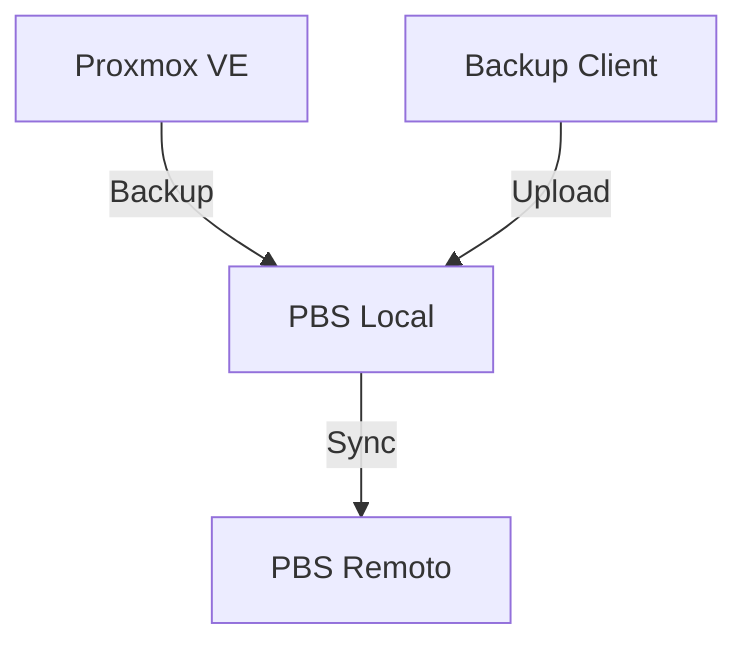

# Proxmox Backup Server (PBS)

El compañero ideal de Proxmox VE. Permite backups incrementales deduplicados de ultra alta velocidad.

## El problema

El `vzdump` clásico de PVE guarda un fichero comprimido por cada copia. Con diez VMs y retención de un mes acabas con cientos de gigas casi idénticos, y cada backup lee y escribe el disco entero aunque haya cambiado un 1 %. En un homelab eso significa ventanas de backup largas, discos llenos y retenciones recortadas «por espacio».

PBS resuelve las tres cosas: trocea los datos en chunks, los **deduplica** entre todas las copias, hace backups **incrementales** de VMs (solo se envían los bloques cambiados) y añade lo que `vzdump` no tiene: verificación de integridad, replicación a otro servidor y restauración de ficheros sueltos. Esta página cubre cómo montarlo; la política general (cuántas copias, dónde) está en [Estrategia de Backup 3-2-1](strategy_321.md).

## 📋 Tabla de Contenidos

- [Instalación](#instalacion)
- [Conceptos Clave](#conceptos-clave)
- [Datastore](#datastore)
- [Usuarios y tokens](#usuarios-y-tokens)
- [Integración con PVE](#integracion-con-pve)
- [Prune y garbage collection](#prune-y-garbage-collection)
- [Verificación](#verificacion)
- [Replicación a un segundo PBS](#replicacion-a-un-segundo-pbs)
- [Cliente en servidores Linux](#cliente-en-servidores-linux)
- [Restaurar](#restaurar)
- [Topología de Ejemplo](#topologia-de-ejemplo)
- [Troubleshooting](#troubleshooting)
- [Buenas prácticas](#buenas-practicas)
- [Referencias](#referencias)

## Instalación

Se puede instalar como ISO independiente o sobre Debian. La ISO es lo más simple: instala el sistema, el repositorio y la interfaz web en el puerto 8007.

```bash
apt update
apt install proxmox-backup-server
```

Sobre Debian necesitas antes añadir el repositorio de Proxmox para tu versión de Debian (sin suscripción hay un repositorio `no-subscription`). Los nombres exactos de suite y la clave dependen de la versión; cópialos de la documentación oficial, no de memoria.

**No lo instales en el mismo nodo que protege.** Si el host PVE muere y el PBS vivía en una VM de ese host, pierdes servidor y copias a la vez. Lo razonable en un homelab es un mini PC o un equipo viejo con discos propios, o como mínimo una máquina física distinta del clúster.

## Conceptos Clave

- **Datastore:** Donde se guardan los datos (disco dedicado recomendado, ZFS es ideal).
- **Remote:** Otro servidor PBS para replicación (Off-site backup).
- **Prune:** Políticas de retención (ej. mantener últimas 7 diarias, 4 semanales).
- **Namespace:** subdivisión lógica dentro de un datastore, útil para separar entornos o clientes con permisos distintos.
- **Snapshot:** una copia concreta de un grupo (por ejemplo `vm/100`), identificada por su fecha.
- **Garbage collection (GC):** borra los chunks que ya no referencia ningún snapshot. Prune solo quita snapshots; el espacio se libera con el GC.
- **Verify:** relee los chunks y comprueba que su contenido coincide con su hash.

## Datastore

Un datastore es un directorio en un sistema de ficheros. El rendimiento del PBS depende casi por completo de ese disco: PBS escribe y lee millones de chunks pequeños, así que los discos rotativos van lentos en verificación y GC y lo ideal es un pool ZFS con SSD (aunque sea para metadatos) o discos SSD directamente. Evita montajes NFS/SMB como datastore: la documentación oficial lo desaconseja por rendimiento y consistencia.

Ejemplo con un dataset ZFS dedicado, creado en el host PBS:

```bash
zfs create tank/pbs
proxmox-backup-manager datastore create main /tank/pbs
proxmox-backup-manager datastore list
```

También se puede crear desde la interfaz web, en `Administration -> Storage / Disks` y `Datastore -> Add Datastore`. Los calendarios de GC y de verificación se configuran sobre el datastore; las opciones concretas varían entre versiones, así que consulta `proxmox-backup-manager datastore update --help` en tu instalación.

## Usuarios y tokens

No uses `root@pam` desde PVE. Crea un usuario de backup y dale solo el rol que necesita sobre ese datastore.

```bash
proxmox-backup-manager user create pve-backup@pbs --password 'cambia-esto'
proxmox-backup-manager acl update /datastore/main DatastoreBackup --auth-id pve-backup@pbs
```

`DatastoreBackup` permite crear backups y leer los propios, pero no borrar los de otros: un PVE comprometido no puede destruir el histórico. Para tareas que sí deben borrar (prune desde el cliente) existe `DatastoreBackup` más permisos de prune, o el rol `DatastoreAdmin`; revisa la lista de roles en la interfaz.

Para automatizar mejor un **token de API** que una contraseña, porque se puede revocar sin tocar el usuario:

```bash
proxmox-backup-manager user generate-token pve-backup@pbs pve
```

El secreto se muestra una sola vez al generarlo. Los tokens tienen sus propios permisos: asigna también una ACL al token (`pve-backup@pbs!pve`) o no tendrá acceso.

## Integración con PVE

En Proxmox VE: `Datacenter -> Storage -> Add -> Proxmox Backup Server`.
Introduce la IP y el `Fingerprint` (copiado del Dashboard de PBS).

Los campos que importan: el datastore, el usuario (`pve-backup@pbs`) y su contraseña o secreto de token. El fingerprint se ve también en el servidor PBS:

```bash
proxmox-backup-manager cert info
```

Verifica el fingerprint la primera vez; es lo que protege contra un servidor suplantado cuando el certificado es autofirmado. Después crea un job en `Datacenter -> Backup` con ese almacenamiento como destino. El primer backup de cada VM lo copia todo; los siguientes solo envían los bloques cambiados. En el almacenamiento PVE puedes activar el cifrado del lado cliente: genera una clave, y **guárdala fuera del PBS y del PVE** (gestor de contraseñas o impresa). Sin la clave, esas copias no se pueden restaurar.

Más contexto sobre nodos y almacenamiento en [Proxmox base](../proxmox/proxmox_base.md).

## Prune y garbage collection

El flujo de retención son dos pasos distintos y ninguno borra datos por sí solo:

1. **Prune** decide qué snapshots sobran según la política (`keep-last`, `keep-daily`, `keep-weekly`, `keep-monthly`, `keep-yearly`) y los marca como eliminados.
2. **Garbage collection** recorre el datastore y borra los chunks que ningún snapshot referencia, liberando espacio de verdad.

Una política típica de homelab: 7 diarias, 4 semanales, 6 mensuales. El GC corre una vez al día o a la semana fuera del horario de backup.

!!! warning "Depende de la versión"
    En versiones antiguas el prune se configuraba dentro del datastore o del job de backup en PVE. En versiones recientes existen *prune jobs* propios del PBS (`proxmox-backup-manager prune-job`). Mira cuál ofrece tu interfaz y no configures el prune en dos sitios con políticas distintas.

El GC tiene un margen de seguridad: los chunks recién escritos no se borran hasta pasado un tiempo, así que tras un prune el espacio no baja al instante. Es normal.

## Verificación

Un backup que nunca has leído es una apuesta. Un **verify job** relee los chunks y compara su hash; detecta bit rot y discos que fallan en silencio.

```bash
proxmox-backup-manager verify-job create semanal --store main --schedule 'sat 03:00'
proxmox-backup-manager verify-job list
```

Los snapshots verificados se marcan y, por defecto, no se vuelven a verificar mientras no pasen cierto tiempo, de modo que el job periódico solo trabaja sobre lo nuevo. Un snapshot que falla la verificación queda marcado como fallido en la interfaz: restáuralo de otra copia (el PBS remoto) y borra el dañado.

Verificar no sustituye a un **ensayo de restauración real**: restaura de vez en cuando una VM de prueba en un PVE y arráncala.

## Replicación a un segundo PBS

La copia fuera del sitio de la regla 3-2-1 se hace con un **sync job**: un PBS remoto tira de los snapshots del principal (o al revés). Es mejor que el remoto tire (*pull*): el remoto guarda credenciales de lectura del principal y el principal no puede borrar el remoto.

En el PBS remoto, registra el principal y crea el job:

```bash
proxmox-backup-manager remote create casa --host pbs.casa.example --auth-id sync@pbs --password 'cambia-esto' --fingerprint 'AA:BB:...'
proxmox-backup-manager sync-job create casa-diario --store offsite --remote casa --remote-store main --schedule daily
```

El usuario `sync@pbs` en el principal necesita permiso de lectura sobre el datastore (por ejemplo `DatastoreReader`). El tráfico va por HTTPS en el 8007: un WireGuard entre las dos casas (ver [WireGuard](../linux/wireguard.md)) evita exponer el puerto. Un PBS remoto puede ser un VPS con disco o un servidor en casa de un amigo; si no confías en el sitio, cifra las copias en el cliente. El remoto aplica su propia política de prune, así que puede conservar más historia que el principal.

## Cliente en servidores Linux

No todo es una VM. Para servidores Linux físicos, contenedores o directorios existe `proxmox-backup-client`, que usa el mismo datastore con la misma deduplicación.

```bash
export PBS_REPOSITORY='pve-backup@pbs@pbs.lan:main'
export PBS_PASSWORD='cambia-esto'

proxmox-backup-client backup etc.pxar:/etc home.pxar:/home
proxmox-backup-client snapshot list
```

`PBS_REPOSITORY` tiene el formato `usuario@realm@host:datastore` (con tokens, `usuario@realm!token@host:datastore`) y evita repetir `--repository`. Cada argumento `nombre.pxar:/ruta` crea un archivo dentro del snapshot. Para automatizarlo usa un timer de systemd (ver [systemd](../linux/systemd.md)) y un fichero de entorno con permisos `0600` para la contraseña; no la dejes en el script.

El cliente también aplica retención por grupo de backup:

```bash
proxmox-backup-client prune host/$(hostname) --keep-daily 7 --keep-weekly 4
```

Si prefieres un repositorio de ficheros sin servidor dedicado, compara con [restic y Borg](restic_borg.md): PBS gana en VMs y en deduplicación centralizada, restic/Borg en simplicidad y en destinos de objetos.

## Restaurar

Con el cliente se restaura un archivo concreto de un snapshot a un directorio:

```bash
proxmox-backup-client snapshot list
proxmox-backup-client restore host/servidor/2026-10-10T03:00:00Z etc.pxar /tmp/restore-etc
```

El nombre del snapshot es el que muestra `snapshot list`; cópialo literalmente. Las VMs se restauran desde la interfaz de PVE (`Storage -> Backups -> Restore`), y desde la misma pantalla puedes elegir **File Restore** para sacar un fichero de dentro de una VM sin restaurarla entera. En la interfaz del PBS también se pueden descargar ficheros de un snapshot desde el navegador del datastore.

Una restauración de VM sobre una existente la sobrescribe. Restaura con un ID nuevo cuando solo quieres comprobar o recuperar datos.

## Topología de Ejemplo



En un homelab típico: uno o varios nodos PVE hacen backup nocturno al PBS local; servidores Linux sueltos usan el cliente; un segundo PBS externo tira de los snapshots cada día. Eso cubre las tres copias y el off-site de [3-2-1](strategy_321.md).

## Troubleshooting

| Síntoma | Causa probable | Arreglo |
|---------|----------------|---------|
| PVE no añade el almacenamiento PBS | Fingerprint incorrecto, puerto 8007 bloqueado o datastore mal escrito | Copia el fingerprint con `proxmox-backup-manager cert info`; prueba `https://IP:8007` desde el nodo PVE |
| `permission check failed` al hacer backup | El usuario o token no tiene ACL sobre el datastore | Revisa `Configuration -> Access Control -> Permissions`; el token necesita su propia ACL |
| El datastore sigue lleno tras el prune | Prune solo marca snapshots; falta el GC o el margen de seguridad no ha pasado | Lanza o espera al GC; comprueba que el job de GC está programado |
| Backups cada vez más lentos | Datastore en disco rotativo o casi lleno | Mueve a SSD/ZFS con metadatos rápidos; libera espacio; revisa la red |
| Verify marca snapshots como fallidos | Chunks corruptos por disco o RAM defectuosos | Revisa SMART y `zpool status`; restaura desde el remoto y borra el snapshot dañado |
| No se puede restaurar una copia cifrada | Falta la clave de cifrado del cliente | No hay arreglo sin la clave: guárdala fuera de PVE y PBS desde el primer día |
| El sync job no trae nada | Credenciales o fingerprint del remote erróneos, o falta permiso de lectura | Comprueba el remote con el mismo usuario; revisa la ACL en el principal |
| Fallo de certificado tras renovar | El fingerprint cambió | Actualiza el fingerprint en el almacenamiento PVE o en el remote |

## Buenas prácticas

- Mantén el PBS en hardware y disco distintos de lo que protege.
- Usa un usuario por consumidor con el rol mínimo, y tokens para automatizar.
- Programa prune, GC y verify por separado y fuera de la ventana de backup.
- Replica a un segundo PBS y, mejor, hazlo en modo *pull*.
- Guarda la clave de cifrado fuera de la infraestructura que protege.
- Vigila el espacio del datastore y las alertas de fallos de job (la interfaz permite notificaciones).
- Restaura una VM de prueba de forma periódica; es la única prueba válida.
- No pongas el datastore sobre NFS/SMB.
- Actualiza PVE y PBS en versiones compatibles y lee las notas de versión antes de saltar de mayor.

## Referencias

- [Documentación oficial de Proxmox Backup Server](https://pbs.proxmox.com/docs/)
- [Manual de `proxmox-backup-client`](https://pbs.proxmox.com/docs/backup-client.html)
- [Estrategia de Backup 3-2-1](strategy_321.md)
- [restic y Borg](restic_borg.md)
- [Proxmox base](../proxmox/proxmox_base.md)
