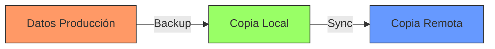

# Estrategia de Backup 3-2-1

## El problema

Casi todo el mundo tiene "backups". Lo que casi nadie tiene es un backup que sobreviva al escenario que de verdad le va a pasar. El disco externo que cuelga del mismo servidor se va con él en la subida de tensión. El `rsync` nocturno hacia el NAS replica fielmente el ransomware en cuanto cifra la primera carpeta. El snapshot de ZFS que da tanta tranquilidad vive en el mismo pool que los datos, y un pool que no importa se lleva los snapshots por delante. Y la copia "en la nube" está en la misma cuenta, con la misma clave API que tiene el servidor comprometido.

La regla 3-2-1 no es una herramienta ni un producto: es un criterio para comprobar que tu plan no tiene un punto único de fallo escondido. Esta página explica qué significa cada número **en una infraestructura propia**, qué cuenta como copia y qué no, cómo decidir cuánto perder y cuánto tardar en volver, y cómo montarlo con las piezas que ya se documentan en este sitio.

!!! note "Qué cubre y qué no"
    Aquí se trata el **diseño del plan**: copias, medios, ubicación, retención y verificación. El uso de las herramientas vive en [Restic y Borg](restic_borg.md) y [Proxmox Backup Server](pbs.md). La capa de seguridad encima del plan (cifrado, inmutabilidad, separación de credenciales) está en [Backup Seguro](../cybersecurity/backup_seguro.md).

## 📋 Tabla de Contenidos

- [La regla](#la-regla)
- [Qué cuenta como copia](#que-cuenta-como-copia)
- [Qué cuenta como medio distinto](#que-cuenta-como-medio-distinto)
- [Qué cuenta como fuera del sitio](#que-cuenta-como-fuera-del-sitio)
- [La variante 3-2-1-1-0](#la-variante-3-2-1-1-0)
- [Decidir RPO, RTO y retención](#decidir-rpo-rto-y-retencion)
- [Aplicación práctica en un homelab](#aplicacion-practica-en-un-homelab)
- [Flujo de datos](#flujo-de-datos)
- [Automatizar y verificar](#automatizar-y-verificar)
- [Troubleshooting](#troubleshooting)
- [Buenas prácticas](#buenas-practicas)
- [Referencias](#referencias)

## La regla

| Número | Significa | Contra qué protege |
|---|---|---|
| **3** copias | Los datos de producción más **dos** backups independientes | Fallo de un disco, borrado accidental, bug que corrompe datos |
| **2** medios | Las copias viven en al menos dos tecnologías o dominios de fallo distintos | Fallo del mismo tipo que se repite (lote de discos, controladora, bug del filesystem) |
| **1** fuera | Al menos una copia en otra ubicación física y administrativa | Incendio, robo, inundación, ransomware que alcanza toda la red local |

Lo que la regla **no** dice, y que suele olvidarse: las copias tienen que ser **restaurables**. Tres copias idénticas de un fichero corrupto cumplen 3-2-1 y no sirven de nada. Por eso la variante moderna añade un cero al final (ver más abajo).

## Qué cuenta como copia

Una copia es un conjunto de datos que puedes restaurar **aunque el origen desaparezca por completo** y que **no cambia cuando cambia el origen**. Con ese criterio, varias cosas que se venden como backup dejan de serlo:

| Esto | ¿Es una copia? | Por qué |
|---|---|---|
| RAID 1/5/6/10, mirror de ZFS | **No** | Protege contra fallo de disco, no contra borrado ni corrupción: un `rm -rf` se replica en todos los discos al instante |
| Snapshot de ZFS/Btrfs/LVM en el mismo pool | **No** (pero es útil) | Permite volver atrás en segundos, pero muere con el pool. Es la primera línea de defensa, no una copia |
| `rsync` o Syncthing hacia el NAS, sin versiones | **A medias** | Protege contra fallo del servidor, pero propaga borrados y cifrados. Solo cuenta si el destino conserva versiones anteriores |
| Snapshot de ZFS enviado con `zfs send` a otro pool | **Sí** | Vive en otro dispositivo y conserva el estado del momento |
| Backup con restic/borg/PBS a otro host | **Sí** | Versionado, deduplicado, independiente del origen |
| Replicación de una base de datos (réplica PostgreSQL) | **No** | Un `DROP TABLE` llega a la réplica en milisegundos. Sirve para alta disponibilidad, no para recuperación |

!!! warning "Sincronizar no es respaldar"
    La diferencia es el **historial**. Un backup conserva cómo estaban los datos ayer, hace una semana y hace un mes; una sincronización solo sabe cómo están ahora. Nextcloud, Dropbox o un `rsync --delete` son sincronización. Si borras algo sin querer y tardas dos días en darte cuenta, la sincronización ya lo ha borrado en todos los sitios.

## Qué cuenta como medio distinto

Cuando la regla se formuló, "dos medios" significaba literalmente disco y cinta. Hoy la lectura útil es **dos dominios de fallo distintos**: que el fallo que se lleva una copia no pueda llevarse la otra por la misma causa.

Combinaciones que cuentan:

- Disco NVMe local del servidor + HDD en un NAS o en un PBS.
- Pool ZFS en el hipervisor + almacenamiento de objetos (S3, B2, MinIO en otro sitio).
- Disco en el servidor + disco externo que se **desconecta** tras el backup.

Combinaciones que **no** cuentan, aunque parezca que sí:

- Dos directorios en el mismo pool ZFS: mismo dominio de fallo.
- Dos discos del mismo lote, comprados juntos, en la misma controladora: fallan juntos con una frecuencia incómoda.
- Dos buckets en la misma cuenta de nube: una clave API comprometida borra ambos.

El medio con la mejor relación coste/seguridad para un homelab sigue siendo un **disco que se desconecta**. Nada por red llega a un disco apagado en un cajón. Su problema es la disciplina: hay que enchufarlo, y si no se automatiza el aviso, se deja de hacer al segundo mes.

## Qué cuenta como fuera del sitio

"Fuera del sitio" protege contra lo que afecta a **toda** la ubicación: incendio, robo, inundación, corte eléctrico prolongado, o el ransomware que ha entrado por una VM y se mueve lateralmente por la LAN.

Opciones habituales, de más barata a más cómoda:

| Opción | Coste | Ancho de banda | Observaciones |
|---|---|---|---|
| Disco rotado en casa de un familiar o en la oficina | Solo el disco | Ninguno (se lleva a mano) | Cifrar obligatoriamente. Rotación manual, fácil de abandonar |
| Segundo PBS o NAS en otra casa, vía [WireGuard](../linux/wireguard.md) | Hardware ×2 | Subida doméstica | Tú controlas los dos extremos. Ideal si alguien de confianza también quiere backups |
| Almacenamiento de objetos (B2, S3, Wasabi, Scaleway, Hetzner Storage Box) | Céntimos por GB/mes | Subida doméstica | Sin hardware. Cuidado con los costes de **descarga** al restaurar |
| Servidor VPS con disco grande | Fijo mensual | Buena | Más caro por GB, pero te sirve además de PBS remoto o destino `rclone` |

El error habitual es tratar "fuera del sitio" como una cuestión geográfica. También tiene que estar **fuera del dominio de credenciales**: si la clave que escribe en el bucket es la misma que puede borrarlo y vive en el servidor de producción, el atacante que entra en producción destruye la copia remota con dos comandos. La tabla de separación de credenciales está en [Backup Seguro: offsite con separación real](../cybersecurity/backup_seguro.md#offsite-con-separacion-real).

## La variante 3-2-1-1-0

La regla original es de los tiempos en que la amenaza era el hardware. Con el ransomware como amenaza principal, se añaden dos condiciones:

- **1** copia **offline o inmutable**: un disco desconectado, una cinta, un bucket con *object lock*, un repositorio borg en modo `--append-only` (`prune` y `delete` siguen aceptándose, pero no liberan espacio hasta `borg compact`) o un datastore de PBS con protección de snapshots. Algo que un atacante con acceso de administrador al servidor **no pueda borrar**.
- **0** errores de verificación: cada backup se comprueba (`restic check`, verificación de datastore en PBS) y se hace al menos una **restauración de prueba** periódica. Un backup que nunca se ha restaurado es una hipótesis.

El "0" es el que más se incumple. No cuesta hardware, cuesta disciplina. La forma de que se cumpla es automatizarlo y que **falle ruidosamente** cuando no se cumple: la verificación programada que envía una alerta si no termina bien, no la que escribe un log que nadie lee.

## Decidir RPO, RTO y retención

Antes de elegir herramienta hay que responder tres preguntas **por tipo de dato**, porque no todos valen lo mismo:

| Concepto | Pregunta | Ejemplo homelab |
|---|---|---|
| **RPO** (Recovery Point Objective) | ¿Cuántos datos puedo permitirme perder? | Fotos familiares: un día. Base de datos de Nextcloud: una hora. ISOs descargables: cualquier cantidad |
| **RTO** (Recovery Time Objective) | ¿Cuánto puedo estar sin el servicio? | DNS interno: minutos. Servidor multimedia: días |
| **Retención** | ¿Cuánto tiempo atrás necesito poder volver? | Configuración: meses (para encontrar cuándo se rompió algo). Datos personales: años |

El RPO fija la **frecuencia**: un RPO de una hora exige backups horarios, y eso descarta herramientas que tarden más de eso o que machaquen el disco de origen. El RTO fija el **tipo de copia**: para restaurar en minutos hace falta una imagen completa de la VM lista para arrancar (PBS, `vzdump`), no un repositorio de ficheros que hay que reinstalar y reconfigurar encima.

Para la retención, el esquema estándar es **GFS** (*Grandfather-Father-Son*): conservar las últimas N diarias, M semanales y K mensuales. Con restic se expresa directamente:

```bash
restic forget --keep-daily 7 --keep-weekly 4 --keep-monthly 6 --keep-yearly 2 --prune
```

Esto conserva una copia por día de la última semana, una por semana del último mes, una por mes del último medio año y una por año de los dos últimos. Gracias a la deduplicación, el coste en espacio de la retención larga es mucho menor de lo que sugiere el recuento de snapshots: solo se guardan los bloques que cambiaron. PBS usa exactamente el mismo modelo en sus *prune jobs*; ver [PBS: retención y prune](pbs.md#prune-y-garbage-collection).

!!! tip "Clasifica antes de respaldar"
    Lo que más abarata un plan es decidir qué **no** se respalda. Imágenes de contenedores, paquetes descargados, caches de compilación y la biblioteca multimedia que puedes volver a bajar no necesitan tres copias; necesitan una lista de cómo volver a obtenerlos. Reserva el 3-2-1 completo para lo que es irreemplazable: datos personales, bases de datos, configuración y secretos.

## Aplicación práctica en un homelab

Una topología típica con hipervisor Proxmox y servicios en contenedores:

- **Copia 1 (Producción):** datos en vivo en el servidor (NVMe, pool ZFS). Snapshots ZFS cada hora como primera línea para el "lo acabo de borrar", **sin contarlos como copia**.
- **Copia 2 (Local, medio distinto):** backup diario de las VMs y contenedores a un [PBS](pbs.md) en otra máquina física con HDDs. Ficheros de los hosts que no son VMs (el propio hipervisor, un Raspberry Pi) con [restic o borg](restic_borg.md) al mismo destino.
- **Copia 3 (Remota, fuera del sitio):** el PBS sincroniza su datastore a un PBS remoto a través de [WireGuard](../linux/wireguard.md) (*sync job* en modo *pull* desde el remoto), o los repositorios restic se suben a almacenamiento de objetos con credenciales de solo escritura.

Y para cumplir el **1** extra: la copia remota tiene inmutabilidad (*object lock*, o un PBS remoto al que el servidor de producción **no** puede conectarse: es el remoto quien tira de los datos). Para el **0**: verificación semanal del datastore y una restauración de prueba mensual de una VM a un ID distinto.

El escalón intermedio, con un solo servidor y sin segunda máquina:

- Disco externo USB para la copia 2, que se monta solo durante el backup y se desmonta después.
- Almacenamiento de objetos para la copia 3.
- Snapshots ZFS para la recuperación rápida del día a día.

No es perfecto (el disco USB cuelga del mismo host y es vulnerable mientras está montado), pero es infinitamente mejor que un solo `rsync` al NAS, y se puede mejorar por partes.

## Flujo de Datos



La dirección de las flechas importa más de lo que parece. Producción **empuja** a la copia local; eso es inevitable, porque alguien tiene que leer los datos. Pero la copia remota debería **tirar** de la local, no al revés: si la local se conecta a la remota con credenciales de escritura y borrado, un atacante que la compromete llega a las tres copias. Con *pull*, la remota tiene credenciales de lectura sobre la local, y la local no tiene ninguna sobre la remota.

## Automatizar y verificar

Un backup que depende de que alguien lo lance no es un plan. Lo mínimo es un temporizador y una alerta cuando algo no termina bien. Con systemd:

```ini
# /etc/systemd/system/backup-restic.service
[Unit]
Description=Backup diario con restic
OnFailure=notify-failure@%n.service

[Service]
Type=oneshot
EnvironmentFile=/etc/restic/env
ExecStart=/usr/bin/restic backup /srv/datos /etc
ExecStart=/usr/bin/restic forget --keep-daily 7 --keep-weekly 4 --keep-monthly 6 --prune
```

```ini
# /etc/systemd/system/backup-restic.timer
[Timer]
OnCalendar=*-*-* 03:00:00
Persistent=true

[Install]
WantedBy=timers.target
```

`Persistent=true` ejecuta el backup al arrancar si la máquina estaba apagada a la hora programada, cosa que un `cron` clásico no hace. `OnFailure=` dispara otra unit cuando el servicio termina con error; esa unit es la que envía el aviso por el canal que uses (correo, ntfy, un webhook). La notación `%n` le pasa el nombre del servicio que falló. Cómo se escriben units y timers está en [Systemd](../linux/systemd.md).

Verificación periódica, con otro timer semanal:

```bash
restic check                          # integridad de la estructura del repositorio
restic check --read-data-subset=10%   # además lee y verifica un 10 % de los datos
```

La verificación completa (`--read-data`) descarga todo el repositorio, lo que en almacenamiento de objetos cuesta dinero y tiempo. `--read-data-subset` reparte esa comprobación: con un 10 % semanal, en diez semanas se ha leído todo.

Y la prueba que realmente cuenta, al menos una vez al mes:

```bash
restic restore latest --target /tmp/restore-test --include /srv/datos/critico
```

Compara lo restaurado con el original y, sobre todo, cronometra. Ese tiempo es tu **RTO real**, y suele ser bastante mayor que el que suponías. Para VMs, restaura en PBS a un ID nuevo y arráncala sin red. El procedimiento completo y qué comprobar está en [Backup Seguro: testing de restauración](../cybersecurity/backup_seguro.md#testing-de-restauracion).

!!! danger "Monitoriza la ausencia, no solo el fallo"
    Un backup que falla manda una alerta. Un backup que **no se ejecuta** (el timer está deshabilitado, el host estaba apagado, la unit no existe tras una reinstalación) no manda nada. Monitoriza el *heartbeat*: que cada backup envíe un ping al terminar y una herramienta como [Uptime Kuma](../monitoring/uptime_kuma.md) avise si el ping no llega en el plazo esperado.

## Troubleshooting

| Síntoma | Causa | Arreglo |
|---|---|---|
| El backup "funciona" pero la restauración trae ficheros vacíos o corruptos | Se respalda en caliente una base de datos o un fichero abierto | Hacer `dump` previo, o respaldar desde un snapshot consistente; para VMs, usar modo *snapshot* con el agente invitado |
| El repositorio crece sin parar aunque los datos no cambian | No se ejecuta `forget --prune`, o la política conserva demasiadas copias | Revisar la política de retención; comprobar que el prune termina (es largo y a veces se mata por timeout) |
| La copia remota tiene los ficheros cifrados por el ransomware | La copia es una sincronización, no un backup con versiones | Cambiar a herramienta con historial; añadir inmutabilidad en el destino |
| El backup diario tarda más de 24 horas | Primera copia sin incremental, red lenta, o deduplicación sobre disco mecánico sin caché | Hacer el primer envío en local y transportar el disco; dividir por conjuntos; revisar E/S del destino |
| El restore desde la nube cuesta más que meses de almacenamiento | Costes de descarga (*egress*) no considerados | Elegir proveedor sin egress o con egress barato para la copia 3; tener la copia 2 local para restauraciones habituales |
| No se detectó que los backups llevaban semanas sin ejecutarse | Solo hay alerta de fallo, no de ausencia | Heartbeat a un monitor externo con plazo máximo entre pings |
| El disco externo "offline" ya no se desconecta nunca | Falta disciplina, proceso manual | Automatizar el aviso, o sustituir por inmutabilidad en destino (object lock, append-only) |
| La restauración necesita una contraseña que estaba en el servidor perdido | Clave del repositorio solo en producción | Guardar la clave en un gestor de contraseñas y en papel, fuera del sitio. Ver [gestión de secretos](../cybersecurity/gestion_secretos.md) |

## Buenas prácticas

- **Clasifica primero.** Decide qué es irreemplazable y qué se puede volver a descargar. El 3-2-1 completo solo para lo primero.
- **Snapshots y RAID no cuentan como copia.** Úsalos, pero no los numeres.
- **Historial siempre.** Cualquier destino sin versiones anteriores es sincronización, no backup.
- **Pull mejor que push para la copia remota.** Que producción no tenga credenciales del destino final.
- **Una copia que nadie pueda borrar** desde producción: disco desconectado, object lock o append-only.
- **Retención GFS**, con el prune automatizado y vigilado: la deduplicación hace barata la retención larga.
- **Cifra todo lo que salga de casa**, y guarda la clave fuera del servidor y fuera del propio backup.
- **Restaura de verdad una vez al mes** y cronométralo: ese es tu RTO, no el de la hoja de cálculo.
- **Alerta por ausencia**, no solo por fallo. Un heartbeat con plazo detecta el timer que alguien deshabilitó.
- **Documenta el procedimiento de restauración** fuera del sistema que respaldas. Si el servidor arde, el wiki que estaba en él también.

## Referencias

- [Proxmox Backup Server](pbs.md) · [Restic y Borg](restic_borg.md)
- [Backup Seguro: cifrado, inmutabilidad y testing](../cybersecurity/backup_seguro.md)
- [WireGuard](../linux/wireguard.md) · [Systemd](../linux/systemd.md) · [Uptime Kuma](../monitoring/uptime_kuma.md)
- [Documentación de restic: eliminar snapshots según política](https://restic.readthedocs.io/en/stable/060_forget.html)
- [Backblaze: la regla 3-2-1 explicada](https://www.backblaze.com/blog/the-3-2-1-backup-strategy/)
