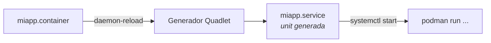

# Podman Quadlet — Contenedores como servicios de systemd

## El problema

Tu contenedor arranca perfecto… hasta que reinicias el servidor. Entonces descubres el patrón de siempre: un `docker-compose.yml`, un `restart: always`, y una unit de systemd escrita a mano que llama a `docker compose up` — dos supervisores discutiendo por el mismo proceso. Cuando el contenedor muere, systemd cree que el servicio sigue vivo porque el comando de arranque retornó 0 hace media hora.

Quadlet elimina la capa intermedia: escribes un fichero declarativo, systemd genera la unit y **el contenedor es el servicio**. Un solo supervisor, dependencias reales, `journalctl` funcionando como con cualquier otro daemon.

!!! note "Qué cubre y qué no"
    Aquí se trata el **ciclo de vida**: declarar, arrancar, ordenar dependencias, comprobar salud y actualizar. El modelo de privilegios rootless (user namespaces, subuid/subgid) vive en [Podman Rootless](podman_rootless.md), que introduce Quadlet de forma breve; esta página es la versión completa.

## 📋 Tabla de Contenidos

- [Cómo funciona](#como-funciona)
- [Tu primer .container](#tu-primer-container)
- [Dónde van los ficheros](#donde-van-los-ficheros)
- [Volúmenes, redes y pods](#volumenes-redes-y-pods)
- [Healthchecks y ciclo de vida](#healthchecks-y-ciclo-de-vida)
- [Dependencias y orden de arranque](#dependencias-y-orden-de-arranque)
- [Actualizaciones automáticas](#actualizaciones-automaticas)
- [Migrar desde Docker Compose](#migrar-desde-docker-compose)
- [Troubleshooting](#troubleshooting)
- [Buenas prácticas](#buenas-practicas)
- [Referencias](#referencias)

## Cómo funciona

Quadlet es un **generador de systemd**. No es un daemon ni un proceso: se ejecuta durante `daemon-reload`, lee tus ficheros `.container` y escribe units `.service` efímeras en memoria.



Tres consecuencias prácticas de que sea un generador:

1. **Todo cambio exige `daemon-reload`.** Editar el fichero no basta.
2. **No puedes `systemctl enable`** una unit generada: no existe como fichero enlazable en disco. El arranque automático se declara con `[Install] WantedBy=` dentro del propio `.container`.
3. **Los errores de sintaxis aparecen en `daemon-reload`**, no al arrancar. Un fichero mal escrito simplemente no genera unit, y `systemctl start` responde "Unit not found".

## Tu primer .container

```ini
# ~/.config/containers/systemd/whoami.container
[Unit]
Description=Servicio whoami
After=network-online.target

[Container]
Image=docker.io/traefik/whoami:latest
PublishPort=8080:80
Environment=WHOAMI_NAME=demo

[Service]
Restart=always

[Install]
WantedBy=default.target
```

```bash
systemctl --user daemon-reload
systemctl --user start whoami.service
systemctl --user status whoami.service
```

El nombre de la unit se deriva del fichero: `whoami.container` → `whoami.service`. Las secciones `[Unit]`, `[Service]` e `[Install]` son systemd estándar y se copian tal cual a la unit generada; solo `[Container]` es específica de Quadlet.

!!! tip "Que sobreviva al cierre de sesión"
    Los servicios de usuario mueren al desconectarte, salvo que actives *lingering*:
    ```bash
    loginctl enable-linger $USER
    ```
    Sin esto, `WantedBy=default.target` arranca el contenedor al hacer login, no al arrancar la máquina. Es el fallo número uno al desplegar rootless en un servidor.

## Dónde van los ficheros

| Modo | Ruta | Control |
|---|---|---|
| **Rootless** (recomendado) | `~/.config/containers/systemd/` | `systemctl --user` |
| Rootful | `/etc/containers/systemd/` | `sudo systemctl` |
| Paquetes de distribución | `/usr/share/containers/systemd/` | `sudo systemctl` |

En rootless usa `WantedBy=default.target`; en rootful, `WantedBy=multi-user.target`. Copiar un ejemplo de uno a otro sin cambiar esto genera un servicio que nunca arranca solo.

## Volúmenes, redes y pods

Cada tipo de recurso tiene su extensión, y los `.container` se refieren a ellos **por nombre de fichero**, no por el nombre real del recurso. Quadlet resuelve las dependencias solo.

```ini
# ~/.config/containers/systemd/appdata.volume
[Volume]
VolumeName=appdata
Label=app=miapp
```

```ini
# ~/.config/containers/systemd/interna.network
[Network]
Subnet=10.89.0.0/24
Gateway=10.89.0.1
```

```ini
# ~/.config/containers/systemd/miapp.container
[Container]
Image=docker.io/library/nginx:alpine
Volume=appdata.volume:/usr/share/nginx/html:Z
Network=interna.network
PublishPort=8080:80
```

Referenciar `appdata.volume` hace dos cosas a la vez: monta el volumen y añade un `Requires=`/`After=` sobre `appdata-volume.service`. El volumen se crea antes de que arranque el contenedor, sin que tengas que ordenarlo tú.

!!! warning "SELinux: `:Z` y `:z`"
    En Fedora, RHEL o cualquier distro con SELinux en *enforcing*, un volumen sin etiqueta produce "Permission denied" dentro del contenedor aunque los permisos POSIX sean correctos. `:Z` etiqueta el contenido en exclusiva para ese contenedor; `:z` lo comparte entre varios. Usa `:Z` salvo que dos contenedores necesiten el mismo directorio.

Para agrupar contenedores que comparten red — el patrón `localhost` entre app y sidecar:

```ini
# ~/.config/containers/systemd/web.pod
[Pod]
PublishPort=8080:80
```

```ini
# En cada .container del grupo
[Container]
Pod=web.pod
```

Los puertos se publican **en el pod**, no en los contenedores. Dentro del pod, los miembros se alcanzan por `localhost`.

## Healthchecks y ciclo de vida

`Restart=always` reinicia el contenedor cuando el proceso **muere**. No hace nada cuando el proceso sigue vivo pero el servicio está colgado: pool de conexiones agotado, deadlock, bucle infinito. Ese es exactamente el fallo que más tiempo tarda en detectarse.

```ini
[Container]
Image=docker.io/library/nginx:alpine
HealthCmd=curl -fsS http://localhost/ || exit 1
HealthInterval=30s
HealthTimeout=5s
HealthRetries=3
HealthStartPeriod=10s
HealthOnFailure=restart
```

| Clave | Para qué |
|---|---|
| `HealthCmd` | Comando ejecutado **dentro** del contenedor; salida 0 = sano |
| `HealthInterval` | Cada cuánto se comprueba |
| `HealthRetries` | Fallos consecutivos antes de marcarlo `unhealthy` |
| `HealthStartPeriod` | Margen de arranque: los fallos aquí no cuentan |
| `HealthOnFailure` | Qué hacer al fallar: `none`, `kill`, `restart`, `stop` |

`HealthOnFailure=restart` es la clave que convierte el healthcheck en algo más que un adorno del `podman ps`. Sin ella, el contenedor se queda marcado como enfermo indefinidamente y nadie se entera.

`HealthStartPeriod` importa más de lo que parece: una base de datos que tarda 40 segundos en aceptar conexiones con un `start-period` de 10 s entra en bucle de reinicio y nunca llega a arrancar. Mide el arranque real y añade margen.

!!! danger "El healthcheck debe existir dentro de la imagen"
    `HealthCmd=curl ...` sobre una imagen `alpine` sin `curl` falla siempre, y el síntoma es un contenedor reiniciándose sin causa aparente en los logs. Comprueba qué tienes disponible:
    ```bash
    podman exec miapp sh -c 'command -v curl wget nc'
    ```
    Si la imagen es *distroless* o mínima, usa el binario de la propia aplicación (`pg_isready`, `redis-cli ping`, `nginx -t`) o expón un endpoint que responda a `wget -qO-`.

Estado actual y por qué falló:



```bash
podman healthcheck run miapp                    # ejecutar la comprobación ahora
podman inspect miapp --format '{{.State.Health.Status}}'
podman inspect miapp --format '{{range .State.Health.Log}}{{.Output}}{{end}}'
```



El mismo razonamiento, aplicado a orquestación, está en [Probes de Kubernetes](../kubernetes/probes.md): `HealthStartPeriod` es el equivalente conceptual de `startupProbe`.

## Dependencias y orden de arranque

Con Compose, `depends_on` solo espera a que el contenedor **arranque**, no a que el servicio esté **listo**. Aquí tienes systemd de verdad:

```ini
# app.container
[Unit]
Requires=db.service
After=db.service

[Container]
Image=registry.example.com/miapp:1.4.2
Network=interna.network
```

`Requires=` propaga el fallo (si `db` no arranca, `app` tampoco) y `After=` fija el orden. Para esperar a que la base de datos esté *lista* y no solo *arrancada*, combínalo con un healthcheck en `db.container` y `Restart=on-failure` en `app`: si arranca antes de tiempo, falla y systemd reintenta hasta que la dependencia responde.

Reinicio controlado, sin martillear el servicio:

```ini
[Service]
Restart=on-failure
RestartSec=10
StartLimitBurst=5
StartLimitIntervalSec=300
```

Tras 5 fallos en 5 minutos systemd para de reintentar y deja la unit en `failed`, donde tu monitorización puede verla. Preferible a un contenedor reiniciándose en bucle durante días sin que salte ninguna alarma.

## Actualizaciones automáticas

```ini
[Container]
Image=docker.io/library/nginx:alpine
Label=io.containers.autoupdate=registry
```

```bash
systemctl --user enable --now podman-auto-update.timer
podman auto-update --dry-run    # qué se actualizaría, sin tocar nada
```

Con `registry`, Podman compara el digest local contra el del registro y, si difiere, tira la imagen nueva y reinicia la unit. Si el contenedor no arranca, **hace rollback automático a la imagen anterior**: es la razón por la que esto es utilizable en producción y un `watchtower` a pelo no.

Alternativa `Label=io.containers.autoupdate=local`: solo actualiza si construyes la imagen tú mismo en local; no consulta ningún registro.

!!! warning "Auto-update quiere tags móviles, tus despliegues quieren tags fijos"
    `autoupdate=registry` sobre `:1.4.2` no hace nada: ese tag no cambia. Sobre `:latest` funciona, pero significa aceptar cualquier versión que publique el mantenedor, incluido un cambio incompatible, a las 3 de la mañana.

    Punto medio razonable: tags de minor (`:1.4`) para servicios de casa, tags fijos y actualización deliberada para lo que no puede caerse. El rollback automático cubre el fallo de arranque, no el cambio de comportamiento que rompe tus datos.

## Migrar desde Docker Compose

`podman-compose` existe y funciona, pero mantiene los dos supervisores. Si el objetivo es que systemd gestione el servicio, la traducción es directa:

| Compose | Quadlet |
|---|---|
| `image:` | `Image=` |
| `ports:` | `PublishPort=` |
| `volumes:` | `Volume=` (+ `:Z` con SELinux) |
| `environment:` | `Environment=` |
| `env_file:` | `EnvironmentFile=` |
| `networks:` | `Network=` |
| `restart: always` | `[Service] Restart=always` |
| `depends_on:` | `[Unit] Requires=` + `After=` |
| `healthcheck:` | `HealthCmd=` y familia |
| `user:` | `User=` |
| `cap_drop:` | `DropCapability=` |
| *(sin equivalente)* | `PodmanArgs=` para flags sin clave propia |

Atajo para servicios ya en marcha: genera el esqueleto desde el contenedor y edítalo.

```bash
podman container create --name tmp -p 8080:80 docker.io/library/nginx:alpine
podman generate systemd --new --files --name tmp   # base a portar a .container
```

`generate systemd` está deprecado en favor de Quadlet — sirve como punto de partida, no como destino.

Regla de decisión: **Compose para desarrollo local** (levantar y tirar el stack entero), **Quadlet para servidores** (arranque, dependencias, healthcheck y logs integrados con el resto del sistema).

## Troubleshooting

| Síntoma | Causa | Comprobación |
|---|---|---|
| `Unit miapp.service not found` | Error de sintaxis, o fichero en ruta equivocada | Ver la salida de `daemon-reload` |
| No arranca al reiniciar el host | Falta *lingering* | `loginctl show-user $USER \| grep Linger` |
| `Permission denied` en un volumen | Etiqueta SELinux ausente | Añadir `:Z` |
| Reinicios en bucle sin error claro | `HealthCmd` inejecutable en la imagen | `podman inspect --format '{{range .State.Health.Log}}{{.Output}}{{end}}'` |
| Cambios que no se aplican | Falta `daemon-reload` | Repetir reload y `restart` |
| Falla en rootless, funciona en root | Puerto <1024, o subuid sin configurar | `sysctl net.ipv4.ip_unprivileged_port_start` |

Ver el `podman run` exacto que Quadlet ha generado — la herramienta que resuelve la mayoría de los casos:

```bash
# Podman 5.x
podman quadlet print miapp.container

# Cualquier versión: ejecutar el generador a mano
/usr/lib/systemd/system-generators/podman-system-generator --user --dryrun
```

Si el `podman run` resultante no es el que esperabas, el problema está en el fichero, no en Podman. Y los logs, como en cualquier servicio del sistema:

```bash
journalctl --user -u miapp.service -f
```

## Buenas prácticas

- **Un fichero por recurso**, versionados en Git y desplegados con [Ansible](../ansible/ansible_base.md). Los `.container` son texto plano: son infraestructura como código sin herramienta adicional.
- **`loginctl enable-linger` en cualquier servidor rootless.** Sin él, nada arranca solo.
- **Healthcheck en todo lo que sirva tráfico**, con `HealthOnFailure=restart` y un `HealthStartPeriod` medido, no adivinado.
- **`StartLimitBurst` siempre.** Un bucle de reinicio silencioso es peor que un servicio caído y visible.
- **Referencia `.volume` y `.network` por fichero**, no por nombre de recurso: las dependencias de arranque salen gratis.
- **Secretos con `Secret=`**, no con `Environment=`: las variables de entorno son legibles en `podman inspect` y en el journal. Ver [gestión de secretos](../cybersecurity/gestion_secretos.md).
- **Auto-update con criterio.** Actívalo donde el rollback automático baste; en lo crítico, actualiza tú.

## Referencias

- [podman-systemd.unit(5) — referencia completa de claves](https://docs.podman.io/en/latest/markdown/podman-systemd.unit.5.html)
- [Uso básico de Quadlet](https://docs.podman.io/en/latest/markdown/podman-quadlet-basic-usage.7.html)
- [podman-auto-update(1)](https://docs.podman.io/en/latest/markdown/podman-auto-update.1.html)
- [Podman Rootless](podman_rootless.md) · [Seguridad en Docker](docker_security.md)
- [Systemd](../linux/systemd.md) · [Probes de Kubernetes](../kubernetes/probes.md)
