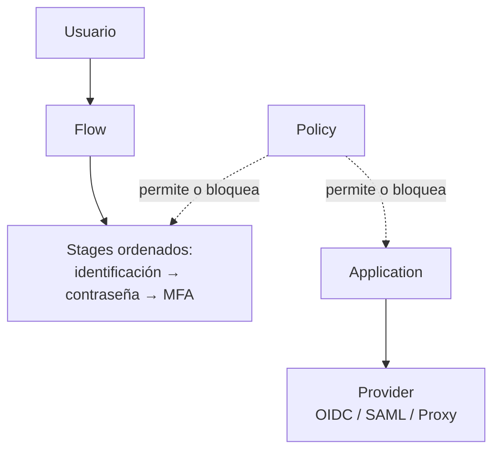
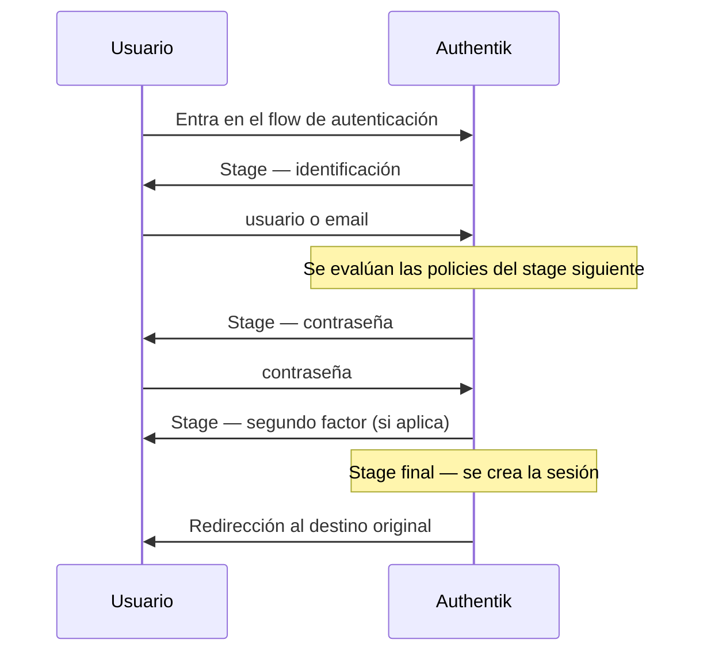
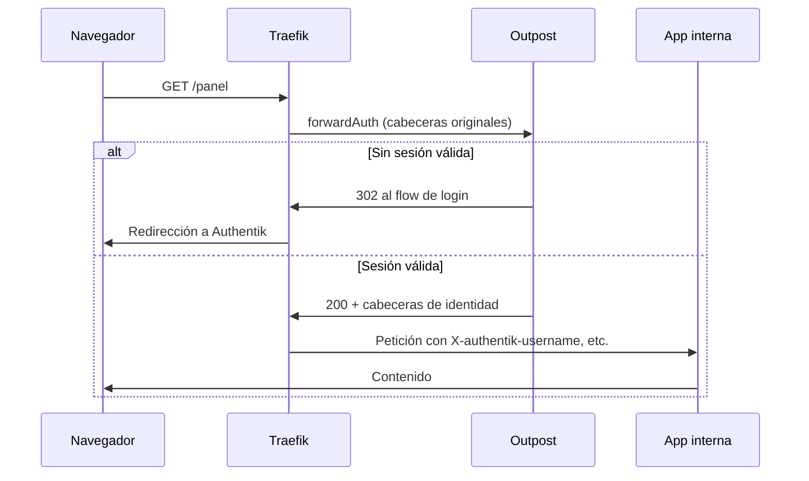

# Authentik — SSO, flows y forward auth

## El problema

Tienes doce servicios y once formas distintas de entrar en ellos. Grafana con su propia tabla de usuarios, Proxmox con PAM, Nextcloud con otra base de datos, y tres aplicaciones que sencillamente **no tienen login**: un panel interno, un exportador de métricas, una interfaz de administración que confía en que nadie la encuentre.

Un IdP resuelve las primeras. El problema real es el tercer grupo: las que no soportan SSO y nunca lo van a soportar. La respuesta clásica es apilar `oauth2-proxy` delante de cada una, con su propio fichero de configuración y su propio ciclo de vida.

Authentik cubre los dos casos con la misma pieza: es un proveedor OIDC/SAML **y** un proxy de autenticación, sobre la misma base de usuarios. El precio es un modelo de datos propio — flows, stages, policies — que no se parece al de ningún otro IdP y que es donde se atasca todo el mundo la primera semana.

!!! warning "Las etiquetas de la interfaz cambian entre versiones"
    Authentik reorganiza y renombra opciones del panel de administración con frecuencia. Esta página describe **conceptos y objetos**, que son estables, y evita citar textualmente rótulos de botones o rutas de menú. Cuando aquí leas "el campo del identificador de cliente", búscalo por lo que hace, no por cómo se llama exactamente en tu versión.

## 📋 Tabla de Contenidos

- [Authentik frente a Keycloak](#authentik-frente-a-keycloak)
- [El modelo de datos](#el-modelo-de-datos)
- [Despliegue](#despliegue)
- [Anatomía de un flow](#anatomia-de-un-flow)
- [Providers OIDC y SAML](#providers-oidc-y-saml)
- [Proxy provider y forward auth](#proxy-provider-y-forward-auth)
- [Fuentes federadas](#fuentes-federadas)
- [MFA y políticas de acceso](#mfa-y-politicas-de-acceso)
- [Backup y recuperación](#backup-y-recuperacion)
- [Troubleshooting](#troubleshooting)
- [Buenas prácticas](#buenas-practicas)
- [Referencias](#referencias)

## Authentik frente a Keycloak

Las dos son IdP open source completos y las dos hacen OIDC y SAML bien. La elección no es de calidad, es de forma.

| | Authentik | [Keycloak](keycloak.md) |
|---|---|---|
| Aislamiento multi-tenant | Por marca y por políticas; sin separación dura equivalente | Realms, con separación fuerte de usuarios y configuración |
| Personalizar el login | Editando el flow: reordenar, añadir o quitar stages desde la interfaz | Sobrescribir plantillas o escribir un SPI en Java |
| Proxy para apps sin SSO | Incluido (proxy provider + outposts) | No incluido; se añade `oauth2-proxy` u otro |
| Lenguaje de extensión | Expresiones Python en políticas y mappings | Java, con despliegue de artefactos |
| Ecosistema y madurez | Menor; documentación viva pero cambiante | Muy amplio, soporte comercial, enorme base instalada |
| Modelo mental | Propio: hay que aprenderlo | Estándar OAuth/SAML, predecible si ya lo conoces |

Criterio práctico: **Authentik** si el caso incluye aplicaciones sin soporte de SSO, si quieres tocar el proceso de login sin escribir Java, o si operas una infraestructura pequeña donde una sola pieza es mejor que tres. **Keycloak** si necesitas realms de verdad separados, si tu organización ya tiene soporte o experiencia en él, o si valoras la previsibilidad de un proyecto grande por encima de la comodidad. **[Dex](dex.md)** si lo único que quieres es traducir un backend existente (LDAP, Keystone, GitHub) a OIDC, sin gestionar usuarios ni sesiones: Dex es una capa de federación, no un IdP con estado.

No es una decisión reversible del todo. Los clientes OIDC se reapuntan cambiando el issuer, pero los flows, las políticas y el catálogo de aplicaciones de Authentik no tienen equivalente exportable a Keycloak.

## El modelo de datos

Esto es lo que hay que entender antes de tocar nada. Cinco tipos de objeto:



**Flow** — un proceso de varios pasos con un propósito: autenticarse, registrarse, recuperar contraseña, cerrar sesión, autorizar una aplicación. Es una lista ordenada de stages, no una pantalla.

**Stage** — un paso dentro de un flow: pedir el identificador, pedir la contraseña, validar un segundo factor, mostrar el consentimiento, escribir el usuario en base de datos. Cada stage recibe el contexto del anterior y lo enriquece.

**Policy** — una condición evaluada en tiempo de ejecución que devuelve verdadero o falso. Se **engancha** a un stage (¿ejecuto este paso?), a una aplicación (¿este usuario puede entrar?) o a la elección de un flow. Es el mecanismo de autorización de todo el sistema.

**Provider** — el protocolo por el que una aplicación habla con Authentik: OIDC, SAML, proxy, LDAP, RADIUS. Contiene los secretos, las URLs de retorno y los mappings de atributos.

**Application** — el objeto de cara al usuario: nombre, icono, entrada en el portal. Enlaza a **un** provider y es donde se cuelgan las políticas de acceso.

Dos ideas que ahorran mucho tiempo. La primera: **application y provider son objetos distintos a propósito** — el provider es la parte técnica (secretos, protocolo), la application es la parte de negocio (quién entra, qué se ve en el portal); crear un provider sin su application deja una integración que funciona por URL directa pero no aparece en ningún sitio. La segunda: **la autorización no vive en el flow**, vive en las políticas enganchadas a la application, y se evalúa después de que el flow haya terminado bien.

Existen además los **property mappings**, expresiones que calculan el valor de un claim OIDC o un atributo SAML a partir del usuario. Es donde se resuelve el "la app necesita el grupo en un claim llamado `roles`".

## Despliegue

Authentik son cuatro piezas, y las cuatro son necesarias:

| Pieza | Función | Si falta |
|---|---|---|
| **server** | Interfaz web y API; atiende el tráfico HTTP | No hay servicio |
| **worker** | Tareas en segundo plano: migraciones, correo, sincronización de fuentes, certificados | Arranca, pero el LDAP no sincroniza y no sale ningún email |
| **PostgreSQL** | Todo el estado: usuarios, flows, providers, tokens, certificados | No arranca |
| **Redis** | Caché, sesiones y cola de tareas | No arranca |

Esqueleto con Compose — los ficheros oficiales incluyen más ajustes; esto sirve para entender qué habla con qué:

```yaml
x-authentik: &authentik
  image: ghcr.io/goauthentik/server
  restart: unless-stopped
  environment:
    AUTHENTIK_SECRET_KEY: ${AUTHENTIK_SECRET_KEY}
    AUTHENTIK_POSTGRESQL__HOST: postgresql
    AUTHENTIK_POSTGRESQL__USER: authentik
    AUTHENTIK_POSTGRESQL__NAME: authentik
    AUTHENTIK_POSTGRESQL__PASSWORD: ${PG_PASS}
    AUTHENTIK_REDIS__HOST: redis
  volumes:
    - ./media:/media
  depends_on: [postgresql, redis]

services:
  postgresql:
    image: docker.io/library/postgres:16-alpine
    restart: unless-stopped
    environment:
      POSTGRES_DB: authentik
      POSTGRES_USER: authentik
      POSTGRES_PASSWORD: ${PG_PASS}
    volumes:
      - database:/var/lib/postgresql/data
    healthcheck:
      test: ["CMD-SHELL", "pg_isready -U authentik"]
      interval: 30s

  redis:
    image: docker.io/library/redis:alpine
    restart: unless-stopped
    volumes:
      - redis:/data

  server:
    <<: *authentik
    command: server
    ports: ["9000:9000"]

  worker:
    <<: *authentik
    command: worker

volumes:
  database:
  redis:
```

El doble guión bajo de `AUTHENTIK_POSTGRESQL__HOST` no es una errata: representa el anidamiento del fichero de configuración. Cualquier opción documentada como `postgresql.host` se puede pasar como variable de entorno con esa convención.

!!! danger "`AUTHENTIK_SECRET_KEY` no es una contraseña más"
    Firma sesiones y protege datos sensibles almacenados. Cambiarla invalida todas las sesiones activas; **perderla junto con el backup deja la base de datos parcialmente inservible**. Guárdala con el mismo cuidado que la contraseña de PostgreSQL — ver [gestión de secretos](../cybersecurity/gestion_secretos.md).

Detrás del proxy inverso, el servidor necesita saber por dónde le llega el tráfico: sin `X-Forwarded-Proto` correcto, Authentik construye URLs de retorno en `http://` y el navegador rechaza las cookies seguras. Con [Traefik](../traefik/traefik_base.md) esas cabeceras van de serie; con Nginx hay que ponerlas a mano. El primer arranque expone una ruta de configuración inicial para crear la cuenta de administrador: es de un solo uso y con caducidad, **úsala en cuanto el servicio esté arriba**.

## Anatomía de un flow

El flow de autenticación por defecto, paso a paso:



Lo que hay que retener:

- **El estado viaja en el contexto del flow.** El stage de identificación deja el usuario resuelto en el contexto y el de contraseña lo consume. Reordenarlos rompe el flow, y el síntoma es un error genérico, no un mensaje útil.
- **Las policies enganchadas a un stage deciden si ese paso se ejecuta.** Así se construye "MFA obligatorio solo para administradores": no son dos flows, es un stage de MFA con una política delante.
- **El último stage es el que crea la sesión.** Un flow sin ese paso final termina sin error visible y devuelve al usuario a la pantalla de login, en bucle. Es el fallo más común al construir un flow desde cero.
- **Duplica antes de tocar.** Los flows por defecto — autenticación, invalidación, recuperación, autorización — son plantilla y son también la única red de seguridad si te dejas fuera del panel. Clona, modifica el clon, y cambia el flow activo solo cuando funcione.

## Providers OIDC y SAML

Ejemplo real: dar SSO a Grafana por OIDC. Creas un provider OAuth2/OIDC y su application; del provider necesitas tres cosas:

- **Client ID** y **Client Secret**, que genera Authentik.
- **Redirect URI**, la URL de retorno de la aplicación. Se compara de forma estricta: `https://grafana.example.com/login/generic_oauth` no es lo mismo que esa URL con barra final.
- El **issuer**, con la forma `https://authentik.example.com/application/o/<slug>/`. La pestaña del provider muestra las URLs exactas de autorización, token y userinfo; cópialas de ahí en vez de escribirlas de memoria, o descúbrelas con `curl -s https://authentik.example.com/application/o/grafana/.well-known/openid-configuration | jq .`

En Grafana:

```ini
[auth.generic_oauth]
enabled = true
name = Authentik
client_id = <client-id>
client_secret = <client-secret>
scopes = openid profile email
auth_url = https://authentik.example.com/application/o/authorize/
token_url = https://authentik.example.com/application/o/token/
api_url = https://authentik.example.com/application/o/userinfo/
role_attribute_path = contains(groups[*], 'grafana-admins') && 'Admin' || 'Viewer'
```

Ese `role_attribute_path` depende de que el token traiga un claim `groups`, y **no siempre viene de serie**: el scope que lo incluye tiene que estar en la lista del provider. Si el login funciona pero todo el mundo entra como `Viewer`, es esto casi seguro. Se comprueba decodificando la carga del ID token con `echo "$ID_TOKEN" | cut -d. -f2 | base64 -d | jq .` y mirando qué claims llegan de verdad.

Para **SAML** la mecánica es la misma con otro vocabulario: en vez de client ID y secret hay un Entity ID, una URL de ACS (donde la aplicación recibe la aserción) y un certificado de firma. Authentik publica los metadatos del provider en una URL descargable y casi todos los service providers aceptan importarla, lo que ahorra transcribir campos. Úsalo solo cuando la aplicación no ofrezca OIDC: es más verboso, más sensible a los relojes desincronizados y bastante peor de depurar.

## Proxy provider y forward auth

El caso estrella: una aplicación sin ningún tipo de autenticación, y quieres que solo entren usuarios de tu IdP. El **proxy provider** funciona de dos formas — como **proxy completo**, donde el outpost recibe la petición y la reenvía a la aplicación sin necesitar nada delante; o como **forward auth**, donde tu proxy inverso existente (Traefik, Nginx, Caddy) consulta al outpost antes de servir cada petición. Lo segundo es lo razonable si ya tienes Traefik gestionando certificados y rutas.

Un **outpost** es el componente que ejecuta ese proxy. Se despliega como contenedor aparte y se registra contra el servidor con un token; el servidor le envía la configuración. El outpost embebido cubre el caso sencillo, pero uno externo permite ponerlo en otra red o cerca de la aplicación.



Con Traefik, un middleware de `forwardAuth` apuntando al endpoint del outpost, y `traefik.http.routers.<app>.middlewares=authentik@file` en el router de la aplicación protegida:

```yaml
http:
  middlewares:
    authentik:
      forwardAuth:
        address: http://authentik-outpost:9000/outpost.goauthentik.io/auth/traefik
        trustForwardHeader: true
        authResponseHeaders:
          - X-authentik-username
          - X-authentik-groups
          - X-authentik-email
          - X-authentik-uid
```

Hay un detalle que causa la mitad de los problemas: además del middleware, **el dominio de la aplicación tiene que enrutar la ruta `/outpost.goauthentik.io/` hacia el outpost**. El retorno del login pasa por ahí; sin esa ruta el usuario se autentica correctamente y vuelve a una URL que no existe, o entra en un bucle de redirecciones.

Con Nginx el patrón equivalente es `auth_request` hacia una location interna del outpost, con un `error_page 401` que redirige al inicio del flow. Consulta la configuración de referencia de Authentik para tu proxy concreto: los detalles de cabeceras y rutas son específicos de cada uno.

!!! warning "Las cabeceras de identidad no son autorización"
    `X-authentik-username` solo es fiable si la aplicación es **inalcanzable** salvo a través del proxy. Si escucha en un puerto expuesto en la LAN, cualquiera puede enviar esa cabecera y hacerse pasar por quien quiera. Publica solo el proxy, deja la aplicación en una red interna, y filtra esas cabeceras en la entrada para que nunca lleguen desde fuera. Ver [Zero Trust](../cybersecurity/zero_trust.md).

## Fuentes federadas

Una **source** es un origen externo de usuarios. Tres familias: **LDAP / Active Directory**, con sincronización periódica que trae usuarios y grupos a la base de datos de Authentik — la ejecuta el *worker*, así que sin worker no ocurre nunca y no hay error visible en la interfaz; **OAuth/OIDC social** (Google, GitHub, GitLab) para el patrón "entra con tu cuenta corporativa"; y **SAML**, cuando el IdP de la organización habla ese protocolo y Authentik actúa de intermediario. Para LDAP, usa siempre una cuenta de servicio de solo lectura.

En toda fuente hay dos cosas que decidir:

1. **Qué pasa con un usuario que no existe todavía.** Se puede crear automáticamente o exigir que exista previamente. Crear automáticamente desde una fuente social **sin política de restricción** significa que cualquier persona con una cuenta de Google entra en tu IdP: combínalo siempre con una política sobre el dominio del correo o la pertenencia a un grupo.
2. **Cómo se enlaza con un usuario existente.** Enlazar por correo electrónico es cómodo y es también un vector de suplantación si el proveedor externo no verifica el correo. Enlazar por identificador único del proveedor es más seguro y más incómodo.

Authentik expone además un **provider LDAP**: el camino inverso, para que aplicaciones que solo saben hablar LDAP se autentiquen contra Authentik. Útil para software antiguo que no va a aprender OIDC nunca.

## MFA y políticas de acceso

Los segundos factores se añaden como stages dentro de un flow, no como una casilla global. Hay soporte para TOTP, WebAuthn/passkeys, códigos de recuperación estáticos y notificaciones por correo, entre otros.

El patrón que se quiere casi siempre — **MFA obligatorio para administradores, opcional para el resto** — es una política delante del stage de validación:

```python
# Expresión de política: exigir MFA a quien tenga acceso administrativo
return request.user.is_superuser
```

Las expresiones son Python evaluado en el servidor, con acceso al usuario, a la petición y al contexto del flow. Sirven también para restringir por horario, por atributos o por red de origen:

```python
from ipaddress import ip_address, ip_network
client_ip = ip_address(request.http_request.META.get("REMOTE_ADDR", "0.0.0.0"))
return client_ip in ip_network("10.0.0.0/8")
```

!!! note "Verifica la forma exacta del objeto de contexto"
    Los atributos disponibles en `request` y en `context` dependen de la versión y de dónde se engancha la política. Authentik incluye un evaluador de pruebas en la propia interfaz de la política: úsalo con un usuario real antes de activarla. Una política que lanza una excepción se comporta como un rechazo y deja fuera a quien no debía.

Para autorizar el acceso a una aplicación lo habitual no requiere código: se enganchan políticas de pertenencia a grupo a la application. Un grupo por aplicación es más trabajo de mantenimiento, pero deja una respuesta clara a "quién puede entrar en esto".

Prohíbete un solo escenario: **quedarte sin acceso administrativo**. Antes de activar MFA obligatorio para superusuarios, ten una segunda cuenta de administrador con su factor ya registrado y probado, o los códigos de recuperación guardados fuera del sistema.

## Backup y recuperación

Todo el estado vive en PostgreSQL; el directorio `media` guarda solo iconos y fondos subidos.

```bash
# Volcado consistente
docker compose exec -T postgresql pg_dump -U authentik -Fc authentik > authentik-$(date +%F).dump

# Restauración sobre una base de datos vacía
docker compose exec -T postgresql pg_restore -U authentik -d authentik --clean < authentik-2026-09-02.dump
```

Un backup útil son **tres cosas** y las tres tienen que viajar juntas: el volcado de PostgreSQL, el valor de `AUTHENTIK_SECRET_KEY` y el directorio `media`.

Qué pierdes si solo tienes el volcado: la base de datos restaura, pero las sesiones y los datos firmados con la clave anterior dejan de validar. Qué pierdes si no tienes nada: los usuarios y grupos (recreables), pero también cada flow modificado, cada política escrita a mano, cada property mapping y cada provider **con su client secret** — y ese último punto es el caro, porque al regenerar los secretos hay que ir aplicación por aplicación reconfigurándolas todas.

La forma de reducir ese daño es tratar la configuración como código. Authentik soporta **blueprints**: ficheros YAML declarativos que describen flows, stages, políticas y providers, y que el servidor aplica al arrancar. Con los blueprints en Git, la base de datos pasa a contener solo usuarios y sesiones, y una reconstrucción deja de ser arqueología.

Encaja con el resto: retención y verificación en [estrategia 3-2-1](../backups/strategy_321.md), cifrado del destino en [backup seguro](../cybersecurity/backup_seguro.md) y ajustes del motor en [PostgreSQL](../databases/postgres.md). Un backup que nunca has restaurado no es un backup: prueba la restauración en una instancia desechable al menos una vez.

## Troubleshooting

| Síntoma | Causa probable | Arreglo |
|---|---|---|
| `Redirect URI Error` al volver del login | La URI del provider no coincide exactamente con la que envía la app | Copiar la URL literal del mensaje de error al provider; vigilar barra final y `http` vs `https` |
| Bucle de redirecciones en forward auth | Falta la ruta `/outpost.goauthentik.io/` en el dominio protegido | Añadir esa ruta al outpost en el mismo router |
| El outpost aparece como no saludable | No alcanza la URL del servidor desde su red, o el token es incorrecto | `curl` al servidor desde dentro del contenedor del outpost; revisar sus logs |
| Login correcto, pero la app dice "sin permisos" | El claim de grupos no llega en el token | Decodificar el ID token; revisar scopes y property mappings del provider |
| CSRF o error de host no válido | El proxy no pasa `X-Forwarded-Proto`/`Host`, o la URL pública está mal configurada | Corregir las cabeceras en el proxy inverso |
| El LDAP no sincroniza y no hay error | El worker no está corriendo o no llega a Redis | `docker compose logs worker`; comprobar conectividad con Redis |
| No sale ningún correo (recuperación, invitaciones) | SMTP sin configurar, o worker parado | Definir las variables `AUTHENTIK_EMAIL__*` y revisar los logs del worker |
| Cambios en un flow que no se notan | Sesión ya establecida | Cerrar sesión o probar en ventana privada |
| Bloqueado fuera del panel tras editar un flow | El flow de autenticación activo está roto | Restaurar el flow por defecto en base de datos, o usar la clave de recuperación generada por CLI |

Diagnóstico base, por orden: `docker compose logs -f server`, luego `docker compose logs -f worker`, luego `docker compose exec postgresql pg_isready -U authentik`. Los eventos del sistema (intentos de login, ejecución de políticas, fallos de flow) quedan registrados dentro de la propia aplicación y suelen decir más que los logs del contenedor cuando el problema es de configuración y no de infraestructura.

## Buenas prácticas

- **Duplica los flows por defecto antes de modificarlos.** Son tu forma de recuperar el acceso si te dejas fuera.
- **Dos cuentas de administración**, con su MFA registrado y probado, y los códigos de recuperación guardados fuera del sistema.
- **Blueprints en Git.** Convierte la configuración en algo revisable y reproducible, y reduce el backup a usuarios y sesiones.
- **Un grupo por aplicación**, con la política de acceso enganchada a la application: más mantenimiento, respuesta clara a quién entra dónde.
- **La aplicación protegida por forward auth no debe ser alcanzable directamente.** Sin esto, las cabeceras de identidad son decorativas.
- **Secretos fuera del Compose**: `AUTHENTIK_SECRET_KEY` y la contraseña de PostgreSQL en un gestor. Ver [gestión de secretos](../cybersecurity/gestion_secretos.md).
- **Backup de PostgreSQL automatizado y restaurado alguna vez**, con la clave secreta guardada junto a él.
- **Actualiza leyendo las notas de versión.** Los cambios de esquema se aplican en el arranque; una actualización a ciegas sin backup previo no tiene marcha atrás.
- **Un solo IdP.** Si ya tienes [Keycloak](keycloak.md) o [Dex](dex.md) en producción, añadir Authentik multiplica las superficies de sesión en vez de simplificar.

## Referencias

- [Documentación oficial de Authentik](https://docs.goauthentik.io/)
- [Instalación con Docker Compose](https://docs.goauthentik.io/docs/install-config/install/docker-compose)
- [Proxy provider y forward auth](https://docs.goauthentik.io/docs/add-secure-apps/providers/proxy/)
- [Blueprints (configuración declarativa)](https://docs.goauthentik.io/docs/customize/blueprints/)
- [Keycloak](keycloak.md) · [Dex IdP](dex.md) · [OpenStack Keystone](keystone.md)
- [Traefik](../traefik/traefik_base.md) · [Quadlet](../docker/quadlets.md) · [Zero Trust](../cybersecurity/zero_trust.md)
