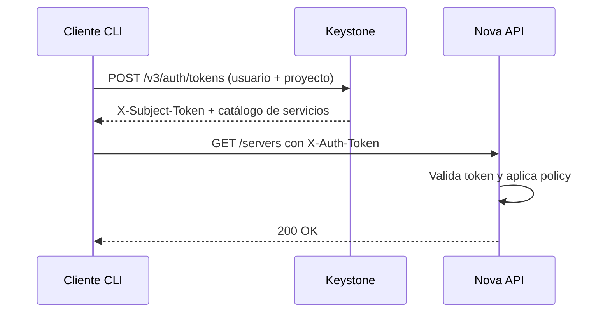

# OpenStack Keystone — Identidad, catálogo y tokens

## El problema

`openstack server list` responde `401`. Cambias la contraseña y sigue fallando. Miras los logs de Nova y no hay ni rastro de la petición — porque nunca llegó a Nova. Repites con `--debug` y descubres que el cliente pedía token contra una URL que ya no existe, resuelta desde un catálogo que alguien pobló mal hace ocho meses.

Ese es el patrón: **casi ningún fallo de "autenticación" en OpenStack es un fallo de contraseña**. Es un dominio equivocado, un rol asignado en el ámbito que no era, un endpoint interno apuntando a una IP muerta o unas claves Fernet desincronizadas entre controladores. Keystone está en el camino crítico de todo, así que cuando se tuerce el cloud entero parece roto a la vez.

!!! note "Qué cubre y qué no"
    Aquí se trata **cómo funciona Keystone y cómo diagnosticarlo**. La visión general de OpenStack está en [conceptos básicos](../openstack/openstack_base.md); el despliegue, en [Kolla Deployment](../openstack/kolla_deployment.md); los errores operativos por servicio, en [Troubleshooting OpenStack](../openstack/troubleshooting_openstack.md). No repetimos esos contenidos: los enlazamos.

## 📋 Tabla de Contenidos

- [Por qué todo pasa por Keystone](#por-que-todo-pasa-por-keystone)
- [El modelo de identidad](#el-modelo-de-identidad)
- [Roles, ámbitos y asignaciones](#roles-ambitos-y-asignaciones)
- [Catálogo de servicios y endpoints](#catalogo-de-servicios-y-endpoints)
- [Tokens Fernet y rotación de claves](#tokens-fernet-y-rotacion-de-claves)
- [Autenticarse desde el CLI](#autenticarse-desde-el-cli)
- [Políticas de autorización](#politicas-de-autorizacion)
- [Federación con un proveedor externo](#federacion-con-un-proveedor-externo)
- [Alta disponibilidad](#alta-disponibilidad)
- [Troubleshooting](#troubleshooting)
- [Buenas prácticas](#buenas-practicas)
- [Referencias](#referencias)

## Por qué todo pasa por Keystone

Keystone hace dos trabajos que se confunden constantemente: **emite tokens** (presentas credenciales, recibes un token con un ámbito concreto) y **publica el catálogo** (te dice en qué URL vive cada servicio). El resto de servicios no validan contraseñas: reciben un token en `X-Auth-Token`, lo verifican y aplican sus políticas sobre los roles que ese token declara.



Dos consecuencias prácticas:

- **El cliente elige la URL a partir del catálogo**, no de tu configuración. Puedes tener `OS_AUTH_URL` perfecto y aun así fallar contra Nova porque el endpoint de Nova está mal registrado.
- **Un token lleva sus permisos dentro.** Cambiar un rol no afecta a los tokens ya emitidos hasta que caducan. Por eso "le he quitado el rol y sigue pudiendo" no es un bug.

La API es **Identity v3**. La v2.0 está retirada desde hace varios ciclos; si un cliente antiguo la pide, la respuesta es actualizar el cliente.

## El modelo de identidad

Aquí es donde se pierde casi todo el mundo, porque hay seis conceptos y solo tres nombres intuitivos.

| Concepto | Qué es | Nota |
|---|---|---|
| **Dominio** | Espacio de nombres para usuarios, grupos y proyectos | Dos usuarios `admin` pueden coexistir en dominios distintos |
| **Proyecto** | Contenedor de recursos y unidad de cuota | El antiguo *tenant*; pueden anidarse |
| **Usuario** | Identidad que se autentica | Vive **dentro** de un dominio |
| **Grupo** | Conjunto de usuarios | Vive en un dominio; sirve para asignar roles en bloque |
| **Rol** | Etiqueta de permisos (`admin`, `member`, `reader`) | Global: no pertenece a ningún dominio |
| **Asignación** | La tupla (actor, rol, ámbito) | Lo que realmente concede permisos |

El error clásico: **el usuario y el proyecto pueden estar en dominios distintos**, y por eso `OS_USER_DOMAIN_NAME` y `OS_PROJECT_DOMAIN_NAME` son dos variables separadas. Ponerlas iguales "porque siempre lo son" funciona hasta el día en que dejan de serlo.

```bash
openstack domain list
openstack project list --domain default
openstack user list --domain default
openstack group contains user devops alice   # ¿está alice en el grupo?
```

Crear una estructura mínima para un equipo:

```bash
openstack domain create --description "Cliente Acme" acme
openstack project create --domain acme --description "Producción Acme" acme-prod
openstack user create --domain acme --password-prompt alice
openstack group create --domain acme acme-ops
openstack group add user --group-domain acme acme-ops alice
openstack role add --project acme-prod --group acme-ops member
```

El rol se asigna **al grupo**, no al usuario. Añadir o quitar personas del equipo pasa a ser un `group add user` en vez de una auditoría de asignaciones dispersas.

!!! tip "Los nombres no son únicos, los IDs sí"
    `openstack project list` puede devolver dos proyectos llamados `dev` en dominios distintos. Cualquier script que resuelva por nombre sin `--domain` es una bomba de relojería. En automatización, guarda IDs.

## Roles, ámbitos y asignaciones

Un token no vale "para todo": vale para un **ámbito**.

| Ámbito | Para qué | Cómo se pide |
|---|---|---|
| **Proyecto** | Operar recursos: instancias, redes, volúmenes | `OS_PROJECT_NAME` |
| **Dominio** | Gestionar usuarios y proyectos de ese dominio | `--os-domain-name` |
| **Sistema** | Operaciones que afectan al cloud entero | `--os-system-scope all` |

El ámbito de sistema existe para separar "administro mi proyecto" de "administro el cloud". Antes, el rol `admin` en *cualquier* proyecto acababa concediendo poderes globales en muchos servicios — un fallo de diseño histórico que este ámbito corrige.

!!! warning "El soporte de ámbito de sistema depende del release y del servicio"
    Keystone lo soporta desde hace tiempo, pero **cada servicio lo adopta a su ritmo**. Un token de sistema puede funcionar contra Keystone y ser rechazado por otro servicio del mismo cloud. Comprueba las *release notes* de tu versión antes de rediseñar los permisos de administración alrededor de él.

Los roles que crea el bootstrap son `admin`, `member` y `reader`, con **implicación** entre ellos: `admin` implica `member`, y `member` implica `reader`. Asignar `admin` concede los tres.

```bash
openstack role list
openstack implied role list

# La consulta que resuelve el 80% de los "no tengo permisos":
openstack role assignment list --names --user alice
openstack role assignment list --names --project acme-prod
```

`--names` es la diferencia entre una tabla legible y una pared de UUIDs. Dos detalles que confunden en esa salida: una asignación **heredada** (`--inherited`) no aplica al ámbito donde se creó sino a sus descendientes — es la forma de dar un rol sobre todos los proyectos de un dominio de una vez; y los roles llegados **por grupo** salen con la columna de grupo rellena y la de usuario vacía, así que buscando solo por usuario no los verás.

## Catálogo de servicios y endpoints

El catálogo es un registro: **servicios** (nombre y tipo) y, para cada uno, **endpoints** por región e interfaz.

```bash
openstack service list
openstack endpoint list
openstack catalog list          # lo que ve tu token AHORA
```

Hay tres interfaces por servicio y región, y confundirlas es una fuente inagotable de incidentes:

| Interfaz | Quién la usa | Error típico |
|---|---|---|
| `public` | Usuarios y clientes desde fuera | Apuntada a una IP privada → nadie usa el cloud desde fuera |
| `internal` | Los propios servicios entre sí | Apuntada al FQDN público → tráfico interno saliendo y volviendo por el firewall |
| `admin` | Operaciones privilegiadas | Históricamente en otro puerto; hoy suele coincidir con las demás |

!!! danger "Un endpoint mal apuntado no da error de red: da `EndpointNotFound` o un timeout raro"
    Cuando Nova necesita hablar con Glance, resuelve la URL desde el catálogo con la interfaz `internal`. Si esa entrada apunta a una IP que ya no existe, el síntoma no es "Glance está caído": es una instancia que se queda en `BUILD` durante minutos y acaba en `ERROR`, y un log de Nova con un timeout contra una dirección que no reconoces. Ese es el momento de mirar `openstack endpoint list`, no los logs de Glance.

Corregir un endpoint es reemplazarlo, no editarlo en la base de datos:

```bash
openstack endpoint list --service glance --interface internal
openstack endpoint set --url https://10.0.20.100:9292 <ENDPOINT_ID>
```

Diferencia clave para diagnosticar: `openstack endpoint list` muestra **lo registrado**; `openstack catalog list` muestra **lo que tu token recibe**, ya filtrado por región y visibilidad. Si difieren, el problema está en el ámbito de tu token o en la región, no en el registro.

En despliegues con Kolla-Ansible los endpoints se generan a partir de las variables de VIP y FQDN de `globals.yml`: corregirlos a mano y luego reconfigurar el servicio te los sobrescribe.

## Tokens Fernet y rotación de claves

Un token Fernet es una cadena cifrada y firmada que **contiene** su ámbito y su caducidad. Keystone no lo guarda en base de datos: lo descifra al validarlo. Esa es toda la ventaja — sin tabla de tokens creciendo sin control y sin estado que replicar entre controladores.

El precio es un **repositorio de claves** que sí debe estar sincronizado. Por defecto vive en `/etc/keystone/fernet-keys/`, con ficheros numerados:

```bash
keystone-manage fernet_setup --keystone-user keystone --keystone-group keystone
keystone-manage fernet_rotate --keystone-user keystone --keystone-group keystone
ls -l /etc/keystone/fernet-keys/
```

| Clave | Papel | Qué hace |
|---|---|---|
| Índice `0` | *Staged* | Todavía no cifra; se promociona en la siguiente rotación |
| Índice más alto | *Primaria* | Cifra los tokens nuevos y los descifra |
| Índices intermedios | *Secundarias* | Solo descifran tokens ya emitidos |

Rotar promociona la *staged* a primaria, degrada la primaria a secundaria y descarta la más antigua cuando se supera `max_active_keys`. Por eso existe la *staged*: en un clúster distribuyes las claves nuevas **antes** de que ningún nodo empiece a cifrar con ellas.

!!! danger "La rotación mal hecha invalida sesiones en todo el cloud"
    Dos formas de conseguirlo, ambas frecuentes.

    **Rotar más rápido de lo que caducan los tokens.** Si descartas una clave secundaria mientras aún hay tokens cifrados con ella, esos tokens dejan de validarse *de golpe* y todo el mundo ve `401` a la vez. La relación documentada entre los parámetros es:

    ```text
    max_active_keys = (caducidad_del_token / frecuencia_de_rotación) + 2
    ```

    Los dos extras son la *staged* y la primaria. Rota más despacio de lo que ese cálculo permite, nunca más rápido.

    **Rotar en un nodo y no en los demás.** Cada controlador cifra con su propia primaria y no puede descifrar las de los otros. El síntoma es peor que una caída: fallos **intermitentes**, según qué nodo atienda cada petición. Si ves `401` en una de cada tres llamadas, compara los repositorios de claves antes de mirar nada más.

```bash
sudo md5sum /etc/keystone/fernet-keys/*      # debe coincidir en todos los nodos
```

!!! warning "Las claves de credenciales son otro repositorio y no se rotan igual"
    Keystone usa un **segundo** juego de claves Fernet para cifrar credenciales almacenadas (`keystone-manage credential_setup`). Ni son las mismas claves ni el mismo directorio. Rotarlas requiere un procedimiento propio que vuelve a cifrar los datos existentes; tratarlas como las de tokens deja credenciales indescifrables que **no se recuperan**. Inclúyelas en las copias de seguridad junto a la base de datos — ver [Day 2 Operations](../openstack/day2.md).

La caducidad se configura en `[token] expiration` de `keystone.conf`. Bajarla reduce la ventana de un token robado; subirla reduce la carga de reautenticación. El valor por defecto ha cambiado entre releases: consúltalo en tu despliegue en lugar de asumirlo.

## Autenticarse desde el CLI

El fichero `openrc` de toda la vida no es más que variables de entorno:

```bash
export OS_AUTH_URL=https://keystone.example.com:5000/v3
export OS_IDENTITY_API_VERSION=3
export OS_PROJECT_NAME=acme-prod
export OS_PROJECT_DOMAIN_NAME=acme
export OS_USERNAME=alice
export OS_USER_DOMAIN_NAME=acme
export OS_REGION_NAME=RegionOne
export OS_INTERFACE=public

read -srp "Password: " OS_PASSWORD && export OS_PASSWORD && echo
```

Pedir la contraseña evita el clásico `admin-openrc.sh` con la contraseña de administrador en claro, versionado por accidente en Git.

La alternativa moderna es **`clouds.yaml`**, que permite varios clouds sin cambiar de variables. El cliente lo busca en el directorio actual, en `~/.config/openstack/` y en `/etc/openstack/`:

```yaml
# ~/.config/openstack/clouds.yaml
clouds:
  acme-prod:
    auth:
      auth_url: https://keystone.example.com:5000/v3
      username: alice
      project_name: acme-prod
      user_domain_name: acme
      project_domain_name: acme
    region_name: RegionOne
    interface: public
    identity_api_version: 3
```

```bash
export OS_CLOUD=acme-prod
openstack server list
```

Las contraseñas pueden ir en `secure.yaml`, en el mismo directorio y con permisos `600`, para que `clouds.yaml` sea compartible.

Para automatización, **no uses tu contraseña**: usa una credencial de aplicación. Se revoca sin tocar tu cuenta, se limita a un subconjunto de roles y caduca.

```bash
openstack application credential create ci-deploy \
  --description "Pipeline de despliegue" \
  --role member \
  --expiration 2027-01-01T00:00:00
```

El secreto se muestra **una sola vez**. En `clouds.yaml` se declara con `auth_type: v3applicationcredential` más `application_credential_id` y `application_credential_secret`.

Verificar la autenticación antes de culpar a ningún otro servicio:

```bash
openstack token issue          # ¿emite token? entonces las credenciales son correctas
openstack catalog list         # ¿el catálogo es el que esperas?
openstack --debug server list  # muestra la URL exacta contra la que falla
```

`--debug` imprime las peticiones HTTP completas. Cuando el error no cuadra con lo que crees que pasa, ese flag enseña la URL real que el cliente ha sacado del catálogo — que suele ser la sorpresa.

## Políticas de autorización

Keystone y el resto de servicios deciden qué puede hacer un token mediante **oslo.policy**. Las reglas por defecto están **en el código**, no en un fichero: `policy.yaml` solo existe para sobrescribir lo que quieras cambiar. Un `policy.yaml` ausente es lo normal y lo correcto.

```bash
oslopolicy-policy-generator --namespace keystone   # volcar los defaults efectivos
```

La dirección del proyecto es la conocida como **secure RBAC**: `admin`/`member`/`reader` como base uniforme en todos los servicios, más ámbitos para separar administración de cloud de administración de proyecto. Dos opciones de `[oslo_policy]` gobiernan la transición:

| Opción | Qué hace |
|---|---|
| `enforce_new_defaults` | Aplica las reglas nuevas ignorando las heredadas |
| `enforce_scope` | Rechaza tokens cuyo ámbito no corresponda a la operación |

!!! warning "Punto que depende por completo de tu release"
    El valor por defecto de esas dos opciones, y qué servicios las respetan de verdad, **ha ido cambiando ciclo a ciclo**. Activarlas en un cloud existente puede romper automatizaciones que funcionaban con `admin` en un proyecto cualquiera. No copies valores de una guía: mira las *release notes* de tu versión y prueba en preproducción.

Una sobrescritura mínima — permitir que un rol de solo lectura liste usuarios:

```yaml
# /etc/keystone/policy.yaml
"identity:list_users": "role:reader"
```

Regla práctica: **antes de escribir una política, comprueba si el problema es una asignación de rol**. Casi siempre lo es. Modificar `policy.yaml` para arreglar lo que era un `openstack role add` deja una divergencia respecto a los defaults que nadie recordará dentro de un año.

## Federación con un proveedor externo

Federar significa que Keystone deja de guardar contraseñas y **confía** en un proveedor externo — Keycloak, Authentik, Dex, un ADFS corporativo — que autentica al usuario y devuelve unas afirmaciones (*assertions*). Hay tres piezas que declarar:

1. **Identity provider** — quién es el emisor en el que confiamos.
2. **Protocol** — `openid` o `saml2`, y con qué *mapping* se procesa.
3. **Mapping** — reglas que traducen atributos del IdP (grupo LDAP, *claim* del token) a **grupos de Keystone**.

```bash
openstack identity provider create --remote-id https://idp.example.com/realms/corp corp-idp
openstack mapping create --rules /etc/keystone/mapping-corp.json corp-mapping
openstack federation protocol create openid --identity-provider corp-idp --mapping corp-mapping
```

Lo que realmente importa es el *mapping*: los usuarios federados **no existen como filas** en Keystone, se materializan al autenticarse. Sus permisos salen exclusivamente de los grupos que el mapping les asigne, y esos grupos deben tener roles asignados **de antemano**. Un mapping correcto sobre grupos sin roles produce un login que funciona y un usuario que no puede hacer absolutamente nada — síntoma desconcertante la primera vez.

!!! note "La capa web no es opcional"
    Keystone no habla OIDC ni SAML por sí mismo: delega en el servidor web que lo aloja (típicamente Apache con `mod_auth_openidc` para OIDC o `mod_shib` para SAML). Esa configuración es específica del módulo y del IdP, y es donde se va la mayor parte del tiempo. Si el IdP es propio, ver [Keycloak](keycloak.md), [Authentik](authentik.md) o [Dex IdP](dex.md).

## Alta disponibilidad

Keystone es una aplicación WSGI **sin estado**: lo persistente está en la base de datos y en el repositorio de claves Fernet. Por eso el patrón habitual es directo — varias instancias tras un balanceador (HAProxy) con una VIP, base de datos en clúster (Galera es lo normal) y **repositorio de claves Fernet idéntico en todos los nodos**.

Ese tercer punto es el único específico de Keystone y el único que la gente olvida. Un nodo nuevo añadido al balanceador con claves generadas por su propio `fernet_setup` emite tokens que los demás no pueden validar.

El procedimiento seguro para rotar en clúster es siempre el mismo: rotar en **un** nodo designado como origen, copiar el repositorio completo a los demás conservando propietario y permisos, y recargar el servicio en cada nodo. Automatízalo con [Ansible](../ansible/ansible_base.md) o con tu herramienta de despliegue; hacerlo a mano garantiza que algún día se olvide un nodo. Con Kolla-Ansible la rotación tiene su propia tarea y no debe hacerse por fuera.

```bash
curl -s -o /dev/null -w '%{http_code}\n' https://keystone.example.com:5000/v3
openstack token issue -f value -c expires
```

Un `GET` a la raíz de la API v3 responde sin autenticación y sirve como *health check* barato para el balanceador. Emitir un token de verdad es una comprobación más honesta: cubre también la base de datos y las claves.

## Troubleshooting

| Síntoma | Causa probable | Comprobación / arreglo |
|---|---|---|
| `401` en todo, credenciales correctas | Dominio equivocado en `OS_USER_DOMAIN_NAME` | `openstack token issue`; revisar dominio de usuario y de proyecto por separado |
| `401` intermitente, una de cada N llamadas | Claves Fernet desincronizadas entre controladores | `md5sum /etc/keystone/fernet-keys/*` en cada nodo |
| Todo el mundo pierde la sesión a la vez | Rotación demasiado frecuente para la caducidad | Revisar `max_active_keys` frente a `[token] expiration` |
| `403 Forbidden` con credenciales válidas | Falta el rol, o el token no tiene el ámbito correcto | `openstack role assignment list --names --user X` |
| `EndpointNotFound` | Servicio o interfaz ausente del catálogo | `openstack catalog list` y `openstack endpoint list --service X` |
| Un servicio no habla con otro, pero la API responde | Endpoint `internal` mal apuntado | `openstack endpoint list --interface internal` |
| `Unable to establish connection` a `:5000` | Keystone caído o VIP sin propietario | Ver [Troubleshooting OpenStack](../openstack/troubleshooting_openstack.md) |
| El usuario federado entra pero no puede nada | Grupos del mapping sin roles asignados | `openstack role assignment list --names --group <grupo>` |
| Quité un rol y el usuario sigue operando | Token previo aún vigente | Esperar a la caducidad: la revocación no es instantánea por diseño |
| Scripts que confunden dos proyectos | Resolución por nombre sin `--domain` | Usar IDs en automatización |

La secuencia de diagnóstico que ordena la mayoría de los casos, en este orden:

```bash
openstack token issue                                  # 1. ¿autentico?
openstack catalog list                                 # 2. ¿el catálogo es correcto?
openstack role assignment list --names --user alice    # 3. ¿tengo los roles?
openstack --debug server list                          # 4. ¿contra qué URL falla?
```

Si el paso 1 funciona y el 4 falla, **el problema no es de identidad**: es de catálogo, de red o del servicio destino. Ese descarte ahorra horas.

## Buenas prácticas

- **Asigna roles a grupos, no a usuarios.** Altas y bajas se convierten en una operación de grupo y las auditorías dejan de ser arqueología.
- **Un dominio por unidad organizativa real.** El dominio `default` para la infraestructura, dominios propios para clientes o equipos. Mezclarlo todo en `default` no se deshace fácilmente después.
- **`--names` en cualquier consulta de asignaciones.** Los UUID no cuentan historias.
- **Credenciales de aplicación para automatización**, nunca la contraseña de una persona, con caducidad y roles mínimos.
- **`clouds.yaml` con `secure.yaml` aparte**, en lugar de `openrc` con contraseñas en claro. Ver [gestión de secretos](../cybersecurity/gestion_secretos.md).
- **Rota las claves Fernet de forma programada y sincronizada**, desde un único origen y a la frecuencia que permita `max_active_keys`.
- **Incluye ambos repositorios de claves en las copias de seguridad**, junto al dump de la base de datos. Una base restaurada sin sus claves de credenciales es una restauración incompleta.
- **Antes de tocar `policy.yaml`, comprueba las asignaciones de rol.** Casi siempre el problema está ahí.

## Referencias

- [Keystone — documentación oficial](https://docs.openstack.org/keystone/latest/)
- [Guía de administración de Keystone](https://docs.openstack.org/keystone/latest/admin/)
- [Tokens Fernet y rotación de claves](https://docs.openstack.org/keystone/latest/admin/fernet-token-faq.html)
- [Federación de identidad](https://docs.openstack.org/keystone/latest/admin/federation/introduction.html)
- [oslo.policy — políticas y valores por defecto](https://docs.openstack.org/oslo.policy/latest/)
- [OpenStack — conceptos básicos](../openstack/openstack_base.md) · [Kolla Deployment](../openstack/kolla_deployment.md)
- [Day 2 Operations](../openstack/day2.md) · [Troubleshooting OpenStack](../openstack/troubleshooting_openstack.md)
- [Keycloak](keycloak.md) · [Authentik](authentik.md) · [Dex IdP](dex.md)
