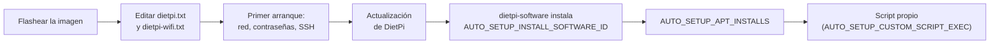

# DietPi — Debian mínimo para Raspberry Pi, otros SBC y x86

## El problema

Tienes una Raspberry Pi que solo debe hacer una cosa: resolver el DNS de casa con Pi-hole o AdGuard Home, ser un nodo pequeño de Docker o recoger métricas. Le pones la imagen estándar, entras con pantalla y teclado, desactivas lo que sobra, instalas lo que falta y la dejas funcionando. Un año después la SD empieza a dar errores de lectura, porque los logs llevan doce meses escribiendo en ella, y al reinstalar descubres que no recuerdas la mitad de los pasos: qué IP fija tenía, qué paquetes instalaste a mano, qué tocaste en la configuración de SSH.

DietPi ataca las tres cosas a la vez. Es un Debian recortado con imágenes para decenas de placas y para x86, los logs van a RAM por defecto, y el primer arranque se puede dejar entero escrito en un fichero de texto (`dietpi.txt`) que se edita antes de meter la tarjeta. Si guardas ese fichero, reinstalar es flashear, copiarlo y enchufar.

!!! note "Probado en el homelab"
    Uso DietPi en el homelab en muchas instalaciones, tanto en Raspberry Pi como en máquinas virtuales x86. Las claves de `dietpi.txt`, los nombres de `dietpi-software` y las opciones están contrastados además con la documentación oficial y con el CHANGELOG de la versión 10.9 (21/11/2026). La instalación en un PC x86 físico sigue la documentación oficial. Si algo no se comporta como aquí se describe, abre una errata.

## 📋 Tabla de Contenidos

- [Qué es DietPi y qué cambia](#que-es-dietpi-y-que-cambia)
- [Instalar en una Raspberry Pi](#instalar-en-una-raspberry-pi)
- [Primer arranque desatendido con dietpi.txt](#primer-arranque-desatendido-con-dietpitxt)
- [Wi-Fi con dietpi-wifi.txt](#wi-fi-con-dietpi-wifitxt)
- [Instalar software con dietpi-software](#instalar-software-con-dietpi-software)
- [Las herramientas de DietPi](#las-herramientas-de-dietpi)
- [Cuidar la SD: RAMlog, swap y root en SSD](#cuidar-la-sd-ramlog-swap-y-root-en-ssd)
- [Copias con dietpi-backup](#copias-con-dietpi-backup)
- [Actualizaciones: dietpi-update y APT](#actualizaciones-dietpi-update-y-apt)
- [SSH: Dropbear u OpenSSH](#ssh-dropbear-u-openssh)
- [DietPi en x86: físico y virtual](#dietpi-en-x86-fisico-y-virtual)
- [Cuándo no usar DietPi](#cuando-no-usar-dietpi)
- [Troubleshooting](#troubleshooting)
- [Buenas prácticas](#buenas-practicas)
- [Referencias](#referencias)

## Qué es DietPi y qué cambia

DietPi no es una distribución con paquetes propios: es Debian con una capa de scripts en `/boot/dietpi/` que configuran el sistema, instalan software ya ajustado y lo mantienen. La versión actual es la **10.9**, publicada el 21 de noviembre de 2026, y las imágenes que enlaza su documentación están construidas sobre **Debian 13 (trixie)**. El código todavía contempla Debian 12 (bookworm) en instalaciones existentes, y tienen una guía para pasar de bookworm a trixie.

Frente a Raspberry Pi OS Lite o un Debian a secas, lo que cambia en la práctica:

| Aspecto | Raspberry Pi OS / Debian | DietPi |
|---|---|---|
| Primer arranque | Opciones de Raspberry Pi Imager o configuración a mano | `dietpi.txt` en la partición de arranque, se aplica una sola vez |
| Logs | journald y, según la imagen, rsyslog en disco | DietPi-RAMlog: `/var/log` en tmpfs, vaciado cada hora |
| Servidor SSH | OpenSSH | Dropbear por defecto; OpenSSH a un clic |
| Software | `apt install` y configurar a mano | `dietpi-software install <id>` con configuración y dependencias |
| Placas | Raspberry Pi (o x86 genérico) | Raspberry Pi, Odroid, Orange Pi, NanoPi, Quartz64…, PC y VM x86_64 |
| Configuración | `raspi-config` o ficheros | `dietpi-config`, `dietpi-drive_manager` y compañía |

Sigue siendo Debian: `apt` funciona igual, los paquetes vienen de los repositorios de Debian y todo lo que sepas de systemd sirve. DietPi solo añade herramientas encima.

## Instalar en una Raspberry Pi

El proceso es el de cualquier imagen:

1. Descarga la imagen de tu placa desde [dietpi.com](https://dietpi.com/#download). Viene comprimida en `.xz`.
2. Flashéala en la SD (o en un USB o eMMC) con balenaEtcher, Rufus o Raspberry Pi Imager; los tres leen el `.xz` directamente. Raspberry Pi Imager también ofrece DietPi en «Other general-purpose OS».
3. **Antes de expulsar la tarjeta**, edita `dietpi.txt` (siguiente apartado).
4. Mete la tarjeta en la placa y arranca. El primer arranque tarda más, porque expande el sistema de ficheros y aplica la configuración.

En la Raspberry Pi, `dietpi.txt` está en la raíz de la partición FAT de arranque, que se ve desde Windows, macOS o Linux en cuanto vuelves a conectar la tarjeta. En algunas placas sin esa partición aparte (la documentación cita NanoPi), el sistema va en una sola partición ext4 y hay que montarla en Linux para llegar a `/boot/dietpi.txt`.

Sin automatizar nada, el primer login es por consola o SSH con usuario `root` y contraseña `dietpi`, y un asistente te pide cambiar las contraseñas y elegir software. Lo interesante es saltárselo.

## Primer arranque desatendido con dietpi.txt

`dietpi.txt` trae comentada cada opción. Las que importan para una placa sin pantalla:

```bash
# /boot/dietpi.txt (fragmento, solo las líneas que cambias)
AUTO_SETUP_LOCALE=es_ES.UTF-8
AUTO_SETUP_KEYBOARD_LAYOUT=es
AUTO_SETUP_TIMEZONE=Europe/Madrid

AUTO_SETUP_NET_ETHERNET_ENABLED=1
AUTO_SETUP_NET_WIFI_ENABLED=0
AUTO_SETUP_NET_USESTATIC=1
AUTO_SETUP_NET_STATIC_IP=192.168.1.53/24
AUTO_SETUP_NET_STATIC_GATEWAY=192.168.1.1
AUTO_SETUP_NET_STATIC_DNS=9.9.9.9 149.112.112.112
AUTO_SETUP_NET_HOSTNAME=dns01

AUTO_SETUP_GLOBAL_PASSWORD=UnaContraseñaLargaDeVerdad
AUTO_SETUP_SSH_SERVER_INDEX=-2
AUTO_SETUP_SSH_PUBKEY=ssh-ed25519 AAAA... antonio@portatil
SOFTWARE_DISABLE_SSH_PASSWORD_LOGINS=1

AUTO_SETUP_LOGGING_INDEX=-1
AUTO_SETUP_RAMLOG_MAXSIZE=50
AUTO_SETUP_SWAPFILE_SIZE=1

AUTO_SETUP_INSTALL_SOFTWARE_ID=adguardhome
AUTO_SETUP_AUTOMATED=1
```

Lo que hace cada bloque, según los comentarios del propio fichero:

- **Idioma y zona.** `AUTO_SETUP_LOCALE` admite una sola entrada y solo UTF-8; por defecto es `C.UTF-8`. La zona horaria va en formato tz (`Europe/Madrid`).
- **Red.** Si activas Ethernet y Wi-Fi a la vez, gana el Wi-Fi y Ethernet se desactiva. La máscara en CIDR es opcional y por defecto vale `/24`. Si prefieres que el router dé la IP y luego fijarla, existe `AUTO_SETUP_DHCP_TO_STATIC=1`, que convierte la concesión DHCP en configuración estática en el primer arranque.
- **Contraseña.** `AUTO_SETUP_GLOBAL_PASSWORD` fija la de `root` y la del usuario `dietpi`, y es la que `dietpi-software` usa por defecto en programas que piden una. Tras aplicarse, DietPi la borra del fichero y la guarda cifrada. Dos avisos del fichero: Dropbear no admite contraseñas de más de 100 bytes, y algunos programas pueden atragantarse con caracteres como `$"|\`. **El nombre de usuario no se configura**: los usuarios son `root` y `dietpi`.
- **SSH.** `AUTO_SETUP_SSH_SERVER_INDEX` vale `-1` para Dropbear, `-2` para OpenSSH y `0` para ninguno. `AUTO_SETUP_SSH_PUBKEY` añade la clave a `root` y a `dietpi`, y se repite la línea para varias claves. Más detalle en [SSH: Dropbear u OpenSSH](#ssh-dropbear-u-openssh).
- **Software.** `AUTO_SETUP_INSTALL_SOFTWARE_ID` admite varios IDs separados por espacios. `AUTO_SETUP_APT_INSTALLS` instala además paquetes de APT normales, después del software de DietPi.
- **Modo desatendido.** Con `AUTO_SETUP_AUTOMATED=1`, el primer arranque actualiza, configura e instala sin preguntar. El fichero insiste en cambiar la contraseña global antes de activarlo. Si algo falla, te ofrece repetirlo en modo interactivo.

El orden del primer arranque, resumido:



Para lo que no cubre ninguna clave hay dos ganchos. Un script en `/boot/Automation_Custom_PreScript.sh` se ejecuta en el primer arranque antes de que haya red. `AUTO_SETUP_CUSTOM_SCRIPT_EXEC=0` ejecuta `/boot/Automation_Custom_Script.sh` al final; en vez de `0` se puede poner una URL y DietPi lo descarga. Los logs quedan en `/var/lib/dietpi/logs/dietpi-firstboot.log` y `/var/lib/dietpi/logs/dietpi-firstrun-setup.log`.

!!! tip "Guarda el dietpi.txt, no la instalación"
    El `dietpi.txt` editado, junto con los scripts de automatización, es la receta de la máquina. Versiónalo en Git **sin la contraseña** (rellénala al copiarlo a la tarjeta). Reinstalar deja de ser un ejercicio de memoria.

## Wi-Fi con dietpi-wifi.txt

Si la placa va por Wi-Fi, pon `AUTO_SETUP_NET_WIFI_ENABLED=1`, el país en `AUTO_SETUP_NET_WIFI_COUNTRY_CODE` (dos letras, `ES`) y las credenciales en `dietpi-wifi.txt`, en la misma partición:

```bash
# /boot/dietpi-wifi.txt (fragmento)
aWIFI_SSID[0]='MiRed'
aWIFI_KEY[0]='MiClaveWifi'
```

El índice `[0]` es la primera red; el fichero admite más. En el primer arranque DietPi lo mueve a `/var/lib/dietpi/dietpi-wifi.db`, así que no esperes encontrarlo después en `/boot`. El país puede quedar sobrescrito si el punto de acceso anuncia otro. Para un servidor, si puedes, usa cable: un DNS de casa que depende del Wi-Fi es un DNS que se cae cuando el Wi-Fi tose.

## Instalar software con dietpi-software

`dietpi-software` instala programas con su configuración, su usuario de sistema y sus dependencias. Desde la **versión 10.8** (octubre de 2026) los IDs son **nombres**, no números: el nombre del programa en minúsculas y sin guiones, puntos ni espacios. Los IDs numéricos antiguos se siguen aceptando por compatibilidad.

| Programa | ID actual | ID numérico antiguo |
|---|---|---|
| Docker | `docker` | 162 |
| Docker Compose | `dockercompose` | 134 |
| Pi-hole | `pihole` | 93 |
| AdGuard Home | `adguardhome` | 126 |
| Unbound | `unbound` | 182 |
| Prometheus Node Exporter | `prometheusexporter` | 99 |

```bash
dietpi-software list                          # todos los IDs disponibles
dietpi-software install docker dockercompose  # varios a la vez
dietpi-software reinstall adguardhome
dietpi-software uninstall pihole
dietpi-software                               # menú interactivo
```

Si encuentras tutoriales con `AUTO_SETUP_INSTALL_SOFTWARE_ID=162`, son anteriores a la 10.8; siguen funcionando, pero en un `dietpi.txt` nuevo usa los nombres. En la 10.9 se añadió autocompletado con tabulador para los IDs.

Pi-hole y AdGuard Home están declarados como **incompatibles** entre sí (los dos quieren el puerto 53): elige uno. Docker guarda sus datos bajo `/mnt/dietpi_userdata`, el directorio de datos de usuario de DietPi, igual que Podman, que llegó al catálogo en la 10.9 con ID `podman`. Si vas a llevar contenedores como servicios, [Podman Quadlet](../docker/quadlets.md) encaja bien aquí. Y para montar el DNS de casa con Unbound detrás, ver [DNS propio](../networking/dns_selfhosted.md).

## Las herramientas de DietPi

Todas son scripts de shell con menús de texto:

| Comando | Para qué |
|---|---|
| `dietpi-launcher` | Menú con acceso a todas las demás |
| `dietpi-config` | Pantalla, audio, rendimiento y overclock, red, idioma, zona, autoarranque; en la 10.9, control de ventilador en la Raspberry Pi |
| `dietpi-software` | Instalar, reinstalar y desinstalar; también cambiar el servidor SSH y el sistema de logs |
| `dietpi-drive_manager` | Montar y formatear discos, mover datos de usuario y swap, llevar el root a otro disco, montar NFS y Samba |
| `dietpi-backup` | Copias con rsync y restauración |
| `dietpi-update` | Actualizar DietPi y avisar de actualizaciones de APT |
| `dietpi-services` | Ver y controlar los servicios que gestiona DietPi |
| `dietpi-cron` | Horas de `cron.daily`, `cron.weekly`, etc. |

Una regla útil: lo que DietPi gestiona, cámbialo con su herramienta. Si editas a mano la red o el SSH, la siguiente vez que abras el menú puede reescribir tu cambio.

## Cuidar la SD: RAMlog, swap y root en SSD

**DietPi-RAMlog** es el sistema de logs por defecto y la principal razón por la que una SD dura más con DietPi. Hay tres modos, que se eligen con `AUTO_SETUP_LOGGING_INDEX` o después desde `dietpi-software` → «Log System»:

| Modo | `AUTO_SETUP_LOGGING_INDEX` | Qué hace |
|---|---|---|
| RAMlog #1 (por defecto) | `-1` | `/var/log` en tmpfs, vaciado cada hora. Nada llega al disco |
| RAMlog #2 | `-2` | Igual, pero cada hora guarda los logs en `/root/log_file_storage` antes de vaciar |
| Full | `-3` | Rsyslog y Logrotate, `/var/log` en disco |

El tamaño del tmpfs lo fija `AUTO_SETUP_RAMLOG_MAXSIZE` (50 MiB por defecto; la documentación sugiere más de 200 para un servidor web con mucho log de acceso). Con RAMlog no se instala rsyslog: si un programa lo necesita, `apt install rsyslog`. El precio es claro: con #1 pierdes los logs en cada vaciado y en cada reinicio, y con #2 puedes perder hasta una hora si se corta la luz. Para un nodo que debe dejar rastro, manda los logs fuera (ver [Stack completo de observabilidad](../monitoring/observability_stack.md)) en vez de escribirlos en la SD.

**Swap.** `AUTO_SETUP_SWAPFILE_SIZE` vale `0` (sin swap), `1` (automático) o un tamaño en MiB. `AUTO_SETUP_SWAPFILE_LOCATION` es una ruta (por defecto `/var/swap`; en automático, 2 GiB menos la RAM) o `zram`, que crea el swap comprimido en RAM en `/dev/zram0` con la mitad de la memoria. En una placa con SD, `zram` evita escribir swap en la tarjeta. Se cambia después desde `dietpi-drive_manager`.

**Root en SSD o USB.** `dietpi-drive_manager` tiene una opción «Transfer RootFS» para copiar el sistema a un disco conectado y arrancar con él. Según la documentación y el propio script, solo está disponible en la **Raspberry Pi y algunas Odroid** (C2, XU4, N2, C4), y solo cuando hay una partición de arranque aparte: la tarjeta sigue haciendo de arranque y el resto va al disco. Copia con rsync y pide reiniciar al terminar. La alternativa, en una Raspberry Pi que arranca de USB o NVMe, es flashear la imagen directamente en el SSD.

Si solo te preocupa el espacio, mueve únicamente los datos de usuario (`/mnt/dietpi_userdata`) o el swap a otro disco desde el mismo menú: selecciona el disco montado y usa «User data» o «Swapfile».

## Copias con dietpi-backup

`dietpi-backup` es una copia **del sistema** con rsync, fichero a fichero, incremental y con rotación (eliges cuántas guardar). Lo que conviene saber antes de fiarse:

- **Destino con sistema de ficheros Linux.** Al ser rsync, los permisos solo se conservan en ext4, NFS o similares. A un recurso Samba la copia no sirve para restaurar.
- **Para los servicios mientras copia.** Todos. Prográmalo a una hora en la que pueda caerse el DNS de casa unos minutos, o asume el corte.
- **Puede dejar fuera tus datos.** Si `/mnt/dietpi_userdata` está en otro disco (es un enlace), su contenido se excluye por defecto. El filtro está en `/boot/dietpi/.dietpi-backup_inc_exc` y se edita desde el menú, opción «Filter».
- **No sale de la máquina** salvo que el destino sea un disco o un recurso de red. Una copia en un USB pegado a la placa cubre un fallo de SD, no un robo ni un incendio.

```bash
dietpi-backup              # menú: destino, filtro, cantidad, copia diaria
dietpi-backup 1            # copia sin preguntas
dietpi-backup -1           # restaura sin preguntas (con cuidado)
dietpi-backup 1 /mnt/nas/backup-dns01
```

La copia diaria va por `cron.daily`; su hora se cambia con `dietpi-cron`. Y hay un truco que encaja con la reinstalación desde cero: `AUTO_SETUP_BACKUP_RESTORE=1` en `dietpi.txt` busca copias en todos los discos conectados durante el primer arranque y te deja elegir una; `2` restaura la primera que encuentre sin preguntar.

`dietpi-backup` es una pieza, no la estrategia: para los datos importantes, una herramienta con copias fuera de casa (ver [Estrategia de Backup 3-2-1](../backups/strategy_321.md)), y de vez en cuando, restaurar de verdad en otra tarjeta para comprobar que vuelve ([Simulacro de restauración](../backups/restore_drill.md)).

## Actualizaciones: dietpi-update y APT

Hay dos cosas que actualizar y conviene no mezclarlas:

1. **DietPi**, sus scripts. Lo hace `dietpi-update`, que comprueba a diario si hay versión nueva (`CONFIG_CHECK_DIETPI_UPDATES=1`) y lo avisa en el banner de login, pero **no se aplica solo**: el proyecto quitó la actualización automática en la 6.29 porque sus versiones suelen traer cambios con avisos o pasos interactivos.
2. **Los paquetes de Debian**, con APT. `CONFIG_CHECK_APT_UPDATES` vale `0` (no mirar), `1` (solo comprobar, el valor por defecto) o `2` (comprobar e instalar automáticamente, con log en `/var/lib/dietpi/logs/dietpi-upgrade_apt.log`).

```bash
dietpi-update      # actualiza DietPi y ofrece instalar las de APT
dietpi-update 1    # aplica la actualización de DietPi sin preguntas
apt update && apt full-upgrade
```

Con `CONFIG_CHECK_APT_UPDATES=2`, DietPi instala **todas** las actualizaciones pendientes, no solo las de seguridad. Si prefieres el control fino de `unattended-upgrades` (solo el origen de seguridad, lista negra, reinicio a una hora), instálalo como en cualquier Debian y deja `CONFIG_CHECK_APT_UPDATES` en `1` para que no haya dos mecanismos actualizando a la vez. Cómo configurarlo, en [Actualizaciones desatendidas en Debian](unattended_upgrades.md). Lo que no conviene es automatizar `dietpi-update`: léete el CHANGELOG antes.

Para el salto de versión de Debian (de bookworm a trixie), DietPi publica una guía propia en su blog; no lo hagas con un `sed` sobre `sources.list` sin leerla.

## SSH: Dropbear u OpenSSH

DietPi instala **Dropbear** por defecto: un servidor SSH ligero, con menos memoria y menos opciones. **OpenSSH** es el de siempre, con SFTP y SCP. Se elige en `AUTO_SETUP_SSH_SERVER_INDEX` o después en `dietpi-software`, que desinstala uno al instalar el otro.

Cuándo cambiar a OpenSSH: si necesitas SFTP (por ejemplo, para copiar ficheros con un cliente gráfico), `Match`, certificados SSH o la configuración que ya usas en el resto de servidores. En una Raspberry Pi 4 o 5 la diferencia de memoria es irrelevante; en una placa de 512 MiB, quizá no.

El endurecimiento mínimo se hace desde `dietpi.txt`, antes de que el servidor arranque:

- `AUTO_SETUP_SSH_PUBKEY` con tu clave ed25519.
- `SOFTWARE_DISABLE_SSH_PASSWORD_LOGINS=1` para desactivar las contraseñas a todos (o `root` solo para root). Con OpenSSH, DietPi lo traduce a `PubkeyAuthentication`, `PasswordAuthentication` y `PermitRootLogin` en `sshd_config`; con Dropbear, a `DROPBEAR_EXTRA_ARGS` en `/etc/default/dropbear`.

Después del primer arranque se cambia con:

```bash
/boot/dietpi/func/dietpi-set_software disable_ssh_password_logins 1
```

Ojo: DietPi entra por defecto como `root`. Con clave y sin contraseñas es aceptable en casa, pero si usas OpenSSH aplica lo de [Seguridad SSH](ssh_security.md): `AllowUsers`, `MaxAuthTries` y, si lo expones, fail2ban o una VPN delante.

## DietPi en x86: físico y virtual

DietPi no es solo para placas. Hay imágenes x86_64 para un mini PC, un thin client o un portátil viejo, y para casi cualquier hipervisor. Según la documentación de instalación:

| Destino | Formato | Cómo se instala |
|---|---|---|
| PC nativo UEFI | Installer o Live (`.xz`) | Installer: USB de arranque con Clonezilla que escribe en el disco interno. Live: se flashea directamente al disco destino |
| PC nativo BIOS/CSM | Installer o Live | Igual que UEFI |
| Proxmox VE (VM) | ISO instalador o disco QCOW2 | ISO con Clonezilla, o importar el QCOW2 con `qm importdisk` |
| Proxmox VE (LXC) | Script de Proxmox VE Helper-Scripts | Convierte un contenedor Debian en DietPi |
| VirtualBox, VMware ESXi | `.ova` | Importar el appliance |
| VMware Player/Fusion, Parallels, UTM | Imagen para cada uno | Importar |
| Hyper-V | `.vhdx` | Crear la VM con ese disco |

Lo que cambia respecto a la Raspberry Pi:

- **El desgaste de la SD deja de importar.** RAMlog sigue ahí y no estorba, pero en un SSD o en un disco virtual puedes elegir el modo Full sin remordimientos si quieres logs persistentes. La opción «Transfer RootFS» no existe en x86.
- **`dietpi.txt` ya no está en una partición FAT a mano.** En las imágenes de VM y en el sistema que deja el instalador vive en `/boot/dietpi.txt` dentro del sistema. Para automatizar el primer arranque hay que editarlo antes de arrancar (montando el disco). En el LXC, la documentación propone editarlo desde el host con `pct exec <ID> -- nano /boot/dietpi.txt` antes del primer login, que es cuando empieza la configuración; allí la red y el hostname los pone Proxmox.
- **QEMU Guest Agent en Proxmox.** Si marcas la casilla «Qemu Agent» en la pestaña System **antes del primer arranque**, DietPi instala el agente durante la configuración inicial: Proxmox ve la IP de la VM y puede congelar el sistema de ficheros para copias consistentes.
- **Recursos.** Para la VM, la guía pide al menos 8 GB de disco si usas la ISO y recomienda 1024 MiB de RAM; con 2048 MiB se configura sin crear swap.

¿Tiene sentido una VM DietPi frente a una VM Debian normal? Si la VM es para un único servicio que `dietpi-software` ya sabe instalar (Pi-hole, AdGuard Home, un Uptime Kuma, un nodo de Docker), DietPi te ahorra el trabajo y deja la misma receta en `dietpi.txt` que en las placas. Si en Proxmox ya clonas VMs desde una plantilla con cloud-init, lo natural es seguir ahí: cloud-init es el estándar, lo entiende OpenTofu y no te ata a los menús de DietPi. Ver [Plantillas cloud-init en Proxmox](../proxmox/cloud_init_templates.md).

## Cuándo no usar DietPi

- **Un servidor que hace muchas cosas.** DietPi brilla con uno o dos servicios. Con diez, acabas mezclando lo que gestiona `dietpi-software` con lo que instalaste a mano, y el valor de la herramienta se diluye.
- **Necesitas un hipervisor.** Para Proxmox VE se instala Proxmox, no DietPi debajo. DietPi va *dentro* de Proxmox, como VM o LXC.
- **Automatización estándar.** Si gestionas todo con [Ansible](../ansible/ansible_base.md) y cloud-init, un Debian o un Raspberry Pi OS Lite limpio encaja mejor que un sistema con sus propios scripts y menús.
- **Logs que deben sobrevivir.** Se puede con el modo Full, pero si es lo que necesitas, estás quitando la principal ventaja de DietPi en una SD.
- **Soporte del fabricante.** Para hardware que depende de herramientas de la Raspberry Pi Foundation o de un fabricante concreto, la imagen oficial suele ir por delante.

## Troubleshooting

| Síntoma | Causa | Arreglo |
|---|---|---|
| El primer arranque ignora la configuración | `dietpi.txt` editado después del primer arranque | Las opciones `AUTO_SETUP_*` solo se leen una vez: reflashea y edita antes de arrancar |
| Se queda en el asistente pese a `AUTO_SETUP_AUTOMATED=1` | Un paso falló y DietPi ofrece repetirlo en modo interactivo | Revisar `/var/lib/dietpi/logs/dietpi-firstrun-setup.log` |
| Sin red tras el primer arranque con Wi-Fi | `dietpi-wifi.txt` vacío, país incorrecto, o Ethernet desactivada porque el Wi-Fi tiene prioridad | Revisar credenciales y `AUTO_SETUP_NET_WIFI_COUNTRY_CODE`; probar por cable |
| `AUTO_SETUP_INSTALL_SOFTWARE_ID` no instala nada | ID mal escrito, o software no disponible en esa placa o arquitectura | `dietpi-software list` y comparar |
| Pi-hole no se instala junto a AdGuard Home | Están declarados como incompatibles | Elegir uno de los dos |
| No encuentro logs de ayer | RAMlog #1 los borra cada hora y en cada reinicio | Cambiar a RAMlog #2 o Full, o mandarlos fuera |
| No aparece «Transfer RootFS» | Placa sin soporte o sin partición de arranque aparte | Flashear la imagen en el SSD si la placa arranca de USB/NVMe |
| La copia no restaura permisos | Destino Samba o sistema de ficheros no Linux | Usar ext4 o NFS como destino |
| No puedo entrar con contraseña por SSH | `SOFTWARE_DISABLE_SSH_PASSWORD_LOGINS=1` sin clave válida | Entrar por consola y corregir con `dietpi-set_software` |

## Buenas prácticas

- **El `dietpi.txt` es la documentación de la máquina.** Uno por equipo, versionado, sin la contraseña.
- **IDs por nombre** en los `dietpi.txt` nuevos; los numéricos son compatibilidad, no futuro.
- **Una función por placa.** El DNS en una, Docker en otra. Si una se rompe, la otra sigue.
- **Clave SSH desde el primer arranque** y contraseñas desactivadas. El `root`/`dietpi` de fábrica no debe llegar nunca a la red.
- **RAMlog en las SD, logs importantes fuera.** Y `zram` para el swap si la placa tiene poca RAM.
- **`dietpi-update` a mano, tras leer el CHANGELOG.** APT, con `unattended-upgrades` o con `CONFIG_CHECK_APT_UPDATES=2`, pero no con los dos.
- **Copia del sistema más copia de datos.** `dietpi-backup` para volver rápido; una herramienta 3-2-1 para no perder nada; y restaura de vez en cuando.
- **Usa las herramientas de DietPi para lo que DietPi gestiona.** Red, SSH y logs, desde sus menús.

## Referencias

- [Documentación de DietPi: instalación](https://dietpi.com/docs/install/) · [Automatización del primer arranque](https://dietpi.com/docs/usage/)
- [`dietpi.txt` en la rama master](https://github.com/MichaIng/DietPi/blob/master/dietpi.txt)
- [CHANGELOG de DietPi](https://github.com/MichaIng/DietPi/blob/master/CHANGELOG.txt) (IDs por nombre en la 10.8, versión 10.9)
- [Herramientas: configuración del sistema](https://dietpi.com/docs/dietpi_tools/system_configuration/) · [Mantenimiento del sistema](https://dietpi.com/docs/dietpi_tools/system_maintenance/)
- [Sistema de logs](https://dietpi.com/docs/software/log_system/) · [Servidores SSH](https://dietpi.com/docs/software/ssh/)
- [Lista de software de DietPi](https://github.com/MichaIng/DietPi/wiki/DietPi-Software-list)
- [Actualizaciones desatendidas](unattended_upgrades.md) · [Seguridad SSH](ssh_security.md) · [Systemd](systemd.md)
- [Estrategia de Backup 3-2-1](../backups/strategy_321.md) · [Simulacro de restauración](../backups/restore_drill.md)
