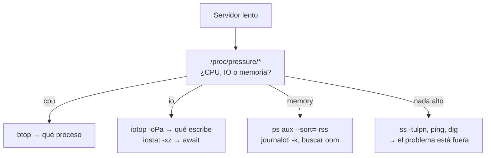

# Monitorización desde la terminal — TUIs para diagnóstico en vivo

## El problema

Son las tres de la mañana, un servicio va lento y tienes una sesión SSH. Grafana te dice que la CPU está al 70%, que es exactamente lo mismo que decía ayer cuando todo iba bien. Lo que necesitas saber es **qué proceso concreto** lo está causando, ahora, en esta máquina.

Ahí es donde el panel se queda corto y la terminal gana: Prometheus responde "cómo ha evolucionado el sistema"; una TUI responde "qué está pasando en este segundo". Son preguntas distintas y hacen falta las dos.

!!! note "Esto no sustituye a tu stack de observabilidad"
    Sin histórico no hay tendencias, ni alertas, ni correlación entre máquinas. Para eso está el [stack de observabilidad](../monitoring/observability_stack.md). Esta página es la caja de herramientas para cuando ya estás dentro del servidor.

## 📋 Tabla de Contenidos

- [Qué instalar y para qué](#que-instalar-y-para-que)
- [Sistema: btop y glances](#sistema-btop-y-glances)
- [Leer la carga sin equivocarse](#leer-la-carga-sin-equivocarse)
- [Disco y red](#disco-y-red)
- [Contenedores: ctop y lazydocker](#contenedores-ctop-y-lazydocker)
- [Kubernetes: k9s](#kubernetes-k9s)
- [Lo que ya tienes instalado](#lo-que-ya-tienes-instalado)
- [Un orden de diagnóstico](#un-orden-de-diagnostico)
- [Buenas prácticas](#buenas-practicas)
- [Referencias](#referencias)

## Qué instalar y para qué

| Herramienta | Responde a | Instalación |
|---|---|---|
| **btop** | ¿Qué proceso consume CPU/RAM ahora? | `apt install btop` |
| **glances** | Todo a la vez, incluido remoto vía API | `pipx install glances` |
| **iotop** | ¿Quién está machacando el disco? | `apt install iotop` |
| **nethogs** | ¿Qué proceso está usando la red? | `apt install nethogs` |
| **ctop** | ¿Qué contenedor se está comiendo el host? | binario de GitHub |
| **lazydocker** | Gestión de contenedores sin recordar flags | binario de GitHub |
| **k9s** | Navegar un clúster sin escribir `kubectl` | binario de GitHub |

No los instales todos de golpe. `btop` y `iotop` cubren el 80% de los incidentes reales en una máquina.

## Sistema: btop y glances

`btop` es el sucesor de `htop`: mismo propósito, mejores gráficas y navegación con ratón.

```bash
btop
```

Lo que de verdad se usa dentro:

| Tecla | Acción |
|---|---|
| `f` | Filtrar procesos por nombre |
| `1`–`4` | Mostrar/ocultar CPU, memoria, red, discos |
| `+` / `-` | Plegar el árbol de procesos |
| `e` | Agrupar hilos por proceso |
| `k` | Enviar señal a un proceso |

`glances` cubre otro caso: verlo todo en una pantalla, incluida temperatura, sensores y contenedores, y sobre todo **exponerlo por red**.

```bash
# En el servidor
glances -w                       # servidor web en :61208

# Desde tu máquina, sin abrir un navegador
glances -c servidor.example.com
```

Es la forma más rápida de mirar una máquina sin agente ni scrape configurado. Para algo permanente, un exporter de Prometheus es mejor idea: `glances -w` no tiene autenticación por defecto.

## Leer la carga sin equivocarse

El error más extendido: interpretar el *load average* como porcentaje de CPU. No lo es.

```bash
uptime
#  03:14:07 up 42 days,  load average: 8.42, 6.11, 4.03
```

El load average cuenta procesos **ejecutables o en espera ininterrumpida de E/S**. Un 8,00 en una máquina de 8 núcleos con todo a tope de CPU es saturación justa. El mismo 8,00 causado por un NFS que no responde significa CPU al 2% y ocho procesos bloqueados. Mismo número, incidentes opuestos.

Divide siempre entre el número de núcleos:

```bash
nproc
```

Lo que de verdad distingue ambos casos es **PSI** (Pressure Stall Information), disponible en cualquier kernel 4.20+:

```bash
cat /proc/pressure/cpu
cat /proc/pressure/io
cat /proc/pressure/memory
# some avg10=23.15 avg60=18.02 avg300=9.44 total=...
```

`some avg10` es el porcentaje de los últimos 10 segundos en que **al menos una** tarea estuvo bloqueada esperando ese recurso. `full` es el porcentaje en que **todas** lo estuvieron.

- `cpu` alto y `io` bajo → falta CPU de verdad.
- `io` alto con CPU baja → el disco o la red son el cuello de botella; el load average te habría engañado.
- `memory` con `full` distinto de cero → estás reclamando memoria activamente, el siguiente paso es el OOM killer.

Es el dato que más rápido descarta hipótesis, y no aparece en casi ningún panel por defecto. Merece un gráfico en Grafana.

## Disco y red

```bash
# Qué proceso escribe, en tiempo real
sudo iotop -oPa
#  -o solo procesos con E/S activa, -P por proceso, -a acumulado

# Latencia y saturación por dispositivo
iostat -xz 2
```

En la salida de `iostat`, la columna que importa no es `%util` (engañosa en NVMe y SSD, donde el paralelismo la satura sin que haya problema) sino `await`: milisegundos medios de espera por petición. Decenas de ms en un SSD es una anomalía; en un disco mecánico saturado es lo normal.

```bash
# Ancho de banda por proceso
sudo nethogs

# Por conexión y host
sudo iftop -i eth0

# Qué está escuchando, y quién
sudo ss -tulpn
```

`ss -tulpn` es el que más veces resuelve el problema: "el puerto está ocupado", "el servicio no escucha donde creías", "escucha solo en localhost y por eso el proxy no llega".

## Contenedores: ctop y lazydocker

`docker stats` da números; `ctop` los da ordenables y con histórico corto.

```bash
ctop            # vista tipo top de todos los contenedores
ctop -a         # solo los que están corriendo
```

`lazydocker` va un paso más allá: logs, `exec`, reinicio y limpieza sin recordar la sintaxis.

```bash
lazydocker
```

| Tecla | Acción |
|---|---|
| `[` / `]` | Cambiar de panel (contenedores, imágenes, volúmenes) |
| `d` | Eliminar el elemento seleccionado |
| `r` | Reiniciar el contenedor |
| `a` | Abrir shell dentro del contenedor |
| `x` | Menú de acciones del panel actual |

!!! tip "Los límites del contenedor no se ven desde fuera"
    `btop` en el host muestra la memoria de la máquina, no el límite del cgroup del contenedor. Un proceso que muere por OOM dentro de su límite no deja rastro visible en el host salvo en el journal:
    ```bash
    journalctl -k | grep -i "killed process"
    cat /sys/fs/cgroup/<ruta>/memory.max
    ```
    Es la causa más común de "el contenedor se reinicia solo y no hay nada en los logs de la aplicación". Ver [ciclo de vida con Quadlet](../docker/quadlets.md).

## Kubernetes: k9s

```bash
k9s
```

Sustituye a la mayoría de los `kubectl get`, `describe` y `logs` que escribes a mano.

| Comando | Acción |
|---|---|
| `:pods`, `:svc`, `:deploy` | Saltar a un tipo de recurso |
| `/texto` | Filtrar |
| `l` | Logs del pod (`Shift+L` para los del contenedor anterior) |
| `d` | Describe |
| `s` | Shell en el contenedor |
| `Ctrl+D` | Eliminar el recurso |
| `:pulses` | Vista general de salud del clúster |

`Shift+L` (logs del contenedor previo) es la tecla que resuelve un `CrashLoopBackOff`: los logs del contenedor muerto son los que dicen por qué murió.

## Lo que ya tienes instalado

Antes de instalar nada, en cualquier servidor:

```bash
# Errores del kernel: OOM, fallos de disco, reinicios de red
journalctl -p err -b --no-pager | tail -40

# Los 10 procesos con más memoria residente
ps aux --sort=-rss | head -11

# Espacio: disco e inodos (los inodos se agotan antes de lo que crees)
df -h; df -i

# Qué directorio se ha comido el disco
du -xh --max-depth=1 / 2>/dev/null | sort -h | tail
```

`df -i` merece un sitio en la lista: un directorio con millones de ficheros pequeños agota los inodos con el disco al 40%, y el error que ves es "No space left on device" con `df -h` diciendo que sobra sitio.

## Un orden de diagnóstico

Ante "el servidor va lento", en este orden:



El último caso es el más frecuente y el que más tiempo se pierde: la máquina está bien y el problema es DNS, un backend remoto o la red. Empezar por PSI descarta el host en diez segundos en vez de en media hora de `top`.

## Buenas prácticas

- **Empieza por PSI, no por `top`.** Descarta o confirma el host de inmediato.
- **Load average dividido entre `nproc`**, y nunca como porcentaje de CPU.
- **`await` antes que `%util`** para juzgar un disco.
- **`df -i` junto a `df -h`.** Siempre.
- **Nada de `glances -w` expuesto sin autenticación.** No la tiene por defecto. Si lo necesitas fuera, ponlo tras [Traefik](../traefik/traefik_base.md) con auth, o mejor, tras la VPN.
- **Lo que diagnostiques dos veces, mételo en Prometheus.** La terminal es para lo puntual; lo repetido merece histórico y alerta ([stack de observabilidad](../monitoring/observability_stack.md)).

## Referencias

- [btop](https://github.com/aristocratos/btop) · [glances](https://nicolargo.github.io/glances/) · [ctop](https://github.com/bcicen/ctop)
- [lazydocker](https://github.com/jesseduffield/lazydocker) · [k9s](https://k9scli.io/)
- [Documentación del kernel sobre PSI](https://docs.kernel.org/accounting/psi.html)
- [Stack de observabilidad](../monitoring/observability_stack.md) · [Recetas rápidas](../recipes.md)
