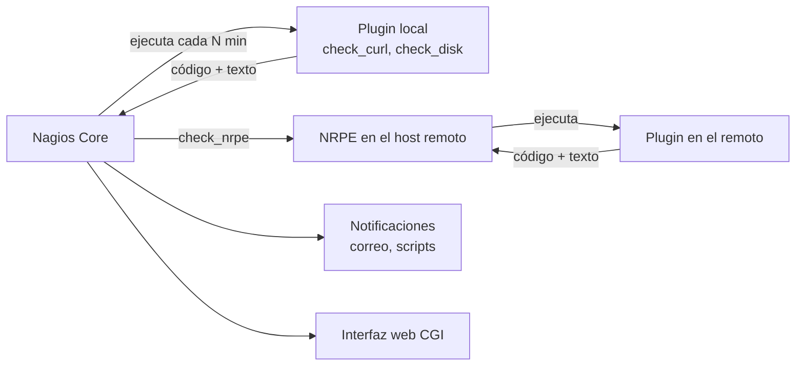

# Nagios Core: monitorización clásica con plugins

## El problema

Quieres algo que compruebe cada pocos minutos que tus servidores y servicios están bien y te avise si no, y quieres poder explicar cada comprobación en una línea de texto. Sin base de datos que crezca, sin agentes con decenas de opciones, sin interfaz desde la que se configura todo.

Nagios Core lleva más de veinte años haciendo exactamente eso, y su idea central ha sobrevivido a casi todos sus competidores: **un plugin es un programa que devuelve un código de salida y una línea de texto**. `0` es OK, `1` aviso, `2` crítico, `3` desconocido. Todo lo demás (planificación, reintentos, notificaciones, dependencias) lo pone Nagios. Ese contrato lo usan hoy Icinga, Naemon, Checkmk y hasta Zabbix o Prometheus con adaptadores, así que entenderlo sirve aunque no acabes usando Nagios.

## 📋 Tabla de Contenidos

- [Cuándo encaja Nagios](#cuando-encaja-nagios)
- [Cómo funciona](#como-funciona)
- [Instalación en Debian 13](#instalacion-en-debian-13)
- [Asegurar la interfaz web](#asegurar-la-interfaz-web)
- [Hosts, servicios y comandos](#hosts-servicios-y-comandos)
- [Los Monitoring Plugins](#los-monitoring-plugins)
- [Máquinas remotas con NRPE](#maquinas-remotas-con-nrpe)
- [Notificaciones](#notificaciones)
- [Escribir un plugin propio](#escribir-un-plugin-propio)
- [Troubleshooting](#troubleshooting)
- [Buenas prácticas](#buenas-practicas)
- [Referencias](#referencias)

## Cuándo encaja Nagios

- **Encaja** si quieres configuración en ficheros de texto versionados en git, comprobaciones de tipo «funciona o no» y un sistema pequeño que se entiende entero.
- **Encaja mal** si necesitas gráficas e histórico de métricas (Nagios guarda estados, no series temporales), descubrimiento automático o gestionar cientos de equipos desde una interfaz. Para eso está [Zabbix](zabbix.md) o el [stack de Prometheus](observability_stack.md).

Si empiezas de cero y te atrae el modelo de Nagios, mira también **Icinga 2**: comparte el contrato de plugins, tiene API y configuración más moderna, y es la evolución que tomó buena parte de la comunidad.

## Cómo funciona



1. Nagios planifica las comprobaciones de **hosts** y **servicios** según sus intervalos.
2. Cada comprobación ejecuta un **comando**, que es una línea que llama a un plugin con argumentos.
3. El plugin devuelve código y texto. Si el estado cambia, Nagios reintenta unas veces (**estado SOFT**) antes de darlo por bueno (**estado HARD**). Solo los cambios HARD notifican.
4. La interfaz web es un conjunto de CGI que leen el estado: sirve para mirar, no para configurar.

## Instalación en Debian 13

Debian empaqueta Nagios como `nagios4`. En Debian 13 es la versión **4.4.6**, con los parches de seguridad que el equipo de Debian ha ido aplicando (entre ellos, la protección CSRF de 4.5.12). La última versión de Nagios Core en el proyecto original es la 4.5.14 (agosto de 2026), y la 4.5 llega a Debian en la siguiente versión estable.

!!! warning "Paquete o compilación"
    Para un uso normal, el paquete de Debian es la opción sensata: recibe parches de seguridad con `apt upgrade`. Compilar la 4.5 desde las fuentes solo compensa si necesitas algo concreto de esa versión, y a cambio las actualizaciones pasan a ser cosa tuya.

```bash
sudo apt install nagios4 monitoring-plugins nagios-nrpe-plugin
```

Esto instala el núcleo (`nagios4-core`), los CGI con su configuración de Apache (`nagios4-cgi`), los plugins en `/usr/lib/nagios/plugins/` y el cliente `check_nrpe`.

Dónde está cada cosa en el paquete de Debian:

| Qué | Dónde |
|---|---|
| Configuración principal | `/etc/nagios4/nagios.cfg` |
| Objetos de ejemplo | `/etc/nagios4/objects/` |
| Tus definiciones | `/etc/nagios4/conf.d/` (cargado por `cfg_dir`) |
| Comandos de los plugins | `/etc/nagios-plugins/config/` (también cargado) |
| Configuración de los CGI | `/etc/nagios4/cgi.cfg` |
| Apache | `/etc/apache2/conf-available/nagios4-cgi.conf` |
| Interfaz web | `http://servidor/nagios4/` |

## Asegurar la interfaz web

!!! danger "La instalación por defecto no pide contraseña"
    El paquete de Debian desactiva la autenticación (`use_authentication=0` en `cgi.cfg`) para que funcione nada más instalarlo, y como compensación la configuración de Apache solo deja entrar desde direcciones privadas (`Require ip` con `10.0.0.0/8`, `192.168.0.0/16`, etc.). Cualquiera de tu red puede mirar y, con algunos CGI, actuar. Arréglalo antes de usarlo en serio.

Los pasos:

1. Crea un usuario con `htdigest` (paquete `apache2-utils`). El paquete ya espera el fichero en `/etc/nagios4/htdigest.users` y el realm `Nagios4`:

   ```bash
   sudo htdigest -c /etc/nagios4/htdigest.users Nagios4 nagiosadmin
   ```

2. En `/etc/apache2/conf-available/nagios4-cgi.conf`, cambia el `Require ip …` del bloque principal por autenticación para todo el sitio, con las mismas directivas `AuthDigest*` que el paquete ya usa para `cmd.cgi` y `Require valid-user`. Activa el módulo con `sudo a2enmod auth_digest`.

3. En `/etc/nagios4/cgi.cfg`, vuelve a activar la autenticación y da permisos al usuario:

   ```ini
   use_authentication=1
   authorized_for_system_information=nagiosadmin
   authorized_for_configuration_information=nagiosadmin
   authorized_for_system_commands=nagiosadmin
   authorized_for_all_services=nagiosadmin
   authorized_for_all_hosts=nagiosadmin
   authorized_for_all_service_commands=nagiosadmin
   authorized_for_all_host_commands=nagiosadmin
   ```

4. `sudo systemctl reload apache2`.

Aun con contraseña, no la publiques en Internet: ponla detrás de la [VPN](../linux/wireguard.md) o de un reverse proxy con [SSO](../identity/authentik.md).

## Hosts, servicios y comandos

La configuración son **objetos** en ficheros de texto. Las plantillas (`use`) heredan valores, de modo que cada objeto solo declara lo que cambia. Las plantillas genéricas (`linux-server`, `generic-service`) están en `/etc/nagios4/objects/templates.cfg`.

Un fichero en `/etc/nagios4/conf.d/web-01.cfg`:

```cfg
define host {
    use                 linux-server
    host_name           web-01
    alias               Servidor web
    address             192.0.2.21
}

define service {
    use                 generic-service
    host_name           web-01
    service_description HTTPS
    check_command       check_https_cert!example.com!14
}

define command {
    command_name        check_https_cert
    command_line        $USER1$/check_curl -H $ARG1$ -S --sni -C $ARG2$
}
```

- `$USER1$` es la ruta de los plugins, definida en `/etc/nagios4/resource.cfg`.
- `$ARG1$`, `$ARG2$`… son los valores separados por `!` en `check_command`.
- El ejemplo comprueba que la web responde por HTTPS y avisa si el certificado caduca en menos de 14 días.

Antes de recargar, **valida siempre**:

```bash
sudo nagios4 -v /etc/nagios4/nagios.cfg
sudo systemctl reload nagios4
```

La validación cuenta objetos, avisos y errores, y con un error Nagios no carga la configuración nueva. Es la costumbre que más disgustos ahorra.

## Los Monitoring Plugins

`monitoring-plugins` es la colección estándar de plugins (en Debian 13, la versión 2.4.0; el proyecto va por la 3.0.3). Se reparte en paquetes: `monitoring-plugins-basic` trae los de uso diario (`check_disk`, `check_load`, `check_procs`, `check_swap`, `check_ping`, `check_tcp`, `check_ssh`, `check_curl`, `check_apt`) y `monitoring-plugins-standard` los que dependen de librerías (`check_dns`, `check_snmp`, `check_pgsql`, `check_mysql`, `check_ldap`…).

Todos se pueden lanzar a mano, que es la mejor manera de probar un umbral antes de escribirlo en la configuración:

```bash
/usr/lib/nagios/plugins/check_disk -w 20% -c 10% -p /
echo $?
```

!!! note "check_http está obsoleto"
    En Debian 13, `check_http` se ha sustituido por `check_curl` (queda como `check_http.deprecated`). Las opciones son casi las mismas. Si copias configuraciones antiguas, cambia el nombre.

Más allá de la colección estándar hay miles de plugins de terceros (para RAID, SAI, APIs, bases de datos…). Antes de instalar uno, léelo: se ejecuta con los permisos del usuario `nagios`.

## Máquinas remotas con NRPE

Comprobaciones como el disco o la carga solo se pueden hacer **en** la máquina. NRPE es un pequeño demonio que corre en el remoto y ejecuta, a petición de Nagios, una lista cerrada de comandos.

En la máquina vigilada:

```bash
sudo apt install nagios-nrpe-server monitoring-plugins-basic
```

En `/etc/nagios/nrpe.cfg` (o mejor en `/etc/nagios/nrpe_local.cfg`, que no pisan las actualizaciones):

```cfg
allowed_hosts=127.0.0.1,::1,192.0.2.10
command[check_root]=/usr/lib/nagios/plugins/check_disk -w 20% -c 10% -p /
command[check_load]=/usr/lib/nagios/plugins/check_load -r -w .15,.10,.05 -c .30,.25,.20
```

En Nagios:

```cfg
define service {
    use                 generic-service
    host_name           web-01
    service_description Disco /
    check_command       check_nrpe!check_root
}
```

!!! warning "No actives dont_blame_nrpe"
    `dont_blame_nrpe=1` permite que Nagios pase argumentos a los comandos de NRPE. Es cómodo y es una puerta para ejecutar comandos en el remoto si alguien suplanta al servidor. Deja `dont_blame_nrpe=0` y define comandos cerrados. Restringe además el puerto 5666 en el cortafuegos a la IP de Nagios.

Si las máquinas ya tienen SSH con claves, `check_by_ssh` es una alternativa a NRPE que no necesita otro demonio, a cambio de abrir una sesión SSH por comprobación.

## Notificaciones

Cuando un host o servicio pasa a un estado HARD problemático, Nagios notifica a sus **contactos** (`/etc/nagios4/objects/contacts.cfg`) usando los comandos `notify-host-by-email` y `notify-service-by-email`, que llaman a `mail`. Para que funcione, la máquina tiene que poder enviar correo; ver [SPF, DKIM y DMARC](../networking/spf_dkim_dmarc.md) si sale hacia Internet.

Cualquier otro canal es un comando más: un script que reciba el mensaje y lo envíe a Telegram o a un webhook. Las opciones que más ruido quitan:

- `notification_interval`: cada cuántos minutos repetir el aviso mientras dure el problema (`0`, solo una vez).
- `notification_period`: en qué horario avisar.
- `parents` en los hosts: si cae el switch, las máquinas detrás salen como **inalcanzables** y no notifican cada una por su cuenta.

## Escribir un plugin propio

Un plugin es cualquier ejecutable que respete el contrato. Por ejemplo, comprobar que la última copia de [Restic](../backups/restic_borg.md) no tiene más de un día, a partir de un fichero que el propio script de copia actualiza al terminar bien:

```bash
#!/bin/sh
# check_backup_age: avisa si el último backup correcto es antiguo.
STAMP=/var/lib/backup/last-ok
WARN=${1:-26}   # horas
CRIT=${2:-50}

[ -f "$STAMP" ] || { echo "UNKNOWN - no existe $STAMP"; exit 3; }
AGE=$(( ($(date +%s) - $(stat -c %Y "$STAMP")) / 3600 ))

if [ "$AGE" -ge "$CRIT" ]; then echo "CRITICAL - último backup hace ${AGE} h"; exit 2
elif [ "$AGE" -ge "$WARN" ]; then echo "WARNING - último backup hace ${AGE} h"; exit 1
else echo "OK - último backup hace ${AGE} h | age=${AGE}h;${WARN};${CRIT}"; exit 0
fi
```

- La primera línea de salida es lo que se ve en la interfaz y en las notificaciones.
- Lo que va tras `|` son **datos de rendimiento**: Nagios no los grafica, pero herramientas como PNP4Nagios o Grafana sí.
- Ante cualquier duda (fichero que falta, comando que falla), devuelve `3` (UNKNOWN), nunca `0`.

## Troubleshooting

| Síntoma | Causa probable | Arreglo |
|---|---|---|
| Nagios no recarga tras un cambio | Error de configuración | `sudo nagios4 -v /etc/nagios4/nagios.cfg` indica fichero y línea |
| La web entra sin pedir contraseña | La autenticación del paquete viene desactivada | Ver [Asegurar la interfaz web](#asegurar-la-interfaz-web) |
| 403 al abrir la web desde fuera de la LAN | `Require ip` de Apache solo admite redes privadas | Es lo esperado; usa la VPN en vez de abrirlo |
| «Error: Invalid or missing CSRF cookie!» al lanzar comandos desde un script | La protección CSRF exige pasar antes por la interfaz | Usa la interfaz, el fichero de comandos externos o, si no hay alternativa, `cgi_cookie_fail_open=1` en `cgi.cfg` |
| `CHECK_NRPE: Error - Could not connect` | Cortafuegos o IP de Nagios ausente en `allowed_hosts` | Abre el 5666 solo a Nagios y añade su IP; reinicia `nagios-nrpe-server` |
| `NRPE: Command 'x' not defined` | El nombre en `check_nrpe!x` no coincide con `command[x]` | Iguala los nombres y reinicia NRPE |
| Un plugin funciona a mano y falla en Nagios | Nagios lo ejecuta como usuario `nagios`, con otro entorno y permisos | Pruébalo con `sudo -u nagios /usr/lib/nagios/plugins/…` |
| Avisos que van y vienen | Umbral demasiado justo o `max_check_attempts` bajo | Sube los reintentos o ajusta el umbral |

## Buenas prácticas

- **Activa la autenticación** antes de nada y no expongas la interfaz fuera de la VPN.
- **Configuración en git**: `/etc/nagios4/conf.d/` es texto; versionarlo te da historial y revisión de cada cambio.
- **Valida antes de recargar**, siempre, y mejor desde un hook o una CI si la configuración vive en un repositorio.
- **Comandos NRPE cerrados**, sin `dont_blame_nrpe`, y el puerto 5666 filtrado.
- **`parents` y dependencias** para que la caída de la red no inunde de avisos.
- **Plugins que fallan con UNKNOWN**, nunca con OK.
- **Mide lo que importa al usuario**: un `check_curl` contra la URL real dice más que diez comprobaciones de procesos.

## Referencias

- [Nagios Core: documentación](https://library.nagios.com/library/products/nagios-core/documentation/)
- [Nagios Core en GitHub (versiones y notas)](https://github.com/NagiosEnterprises/nagioscore/releases)
- [Paquete nagios4 en Debian](https://packages.debian.org/trixie/nagios4)
- [Monitoring Plugins](https://www.monitoring-plugins.org/)
- [Guía de desarrollo de plugins](https://www.monitoring-plugins.org/doc/guidelines.html)
- [NRPE en GitHub](https://github.com/NagiosEnterprises/nrpe)
- Relacionado: [Zabbix 8.0 LTS](zabbix.md), [Uptime Kuma](uptime_kuma.md), [Stack de observabilidad](observability_stack.md)
