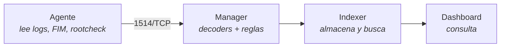

# Observabilidad: Centralización de Logs con Wazuh

## El problema

Instalas Wazuh, despliegas agentes en veinte máquinas y a la semana tienes 40.000 alertas al día. Ninguna se lee. La que importaba —un `sudo` a las 4 de la mañana desde una IP que no toca— está enterrada entre 12.000 avisos de que `/etc/fstab` cambió de mtime porque un `apt upgrade` tocó el fichero.

El problema no es la herramienta: un SIEM sin afinar produce ruido con la misma eficiencia con la que produce señal. El ruleset de fábrica está pensado para cubrir *cualquier* entorno; el tuyo cubre el tuyo. Esta página va de eso: qué ingerir, cómo decidir qué merece una alerta y cómo probar una regla antes de que llegue a producción.

!!! note "Qué cubre y qué no"
    Aquí se trata la **recolección y el análisis de logs**: `localfile`, decoders, reglas, niveles y afinado. La instalación inicial y la comparación con Falco están en [Monitoreo de Seguridad](../cybersecurity/monitoreo_seguridad.md). El uso de las alertas dentro de un incidente vive en [Respuesta a Incidentes](../cybersecurity/respuesta_incidentes.md).

## 📋 Tabla de Contenidos

- [Arquitectura y puntos de fallo](#arquitectura-y-puntos-de-fallo)
- [Recolección de logs con localfile](#recoleccion-de-logs-con-localfile)
- [Decoders y reglas](#decoders-y-reglas)
- [Escribir una regla propia](#escribir-una-regla-propia)
- [Probar antes de aplicar: wazuh-logtest](#probar-antes-de-aplicar-wazuh-logtest)
- [Niveles de alerta y qué notificar](#niveles-de-alerta-y-que-notificar)
- [ossec.conf del agente frente al del manager](#ossecconf-del-agente-frente-al-del-manager)
- [File Integrity Monitoring](#file-integrity-monitoring)
- [Detección de rootkits](#deteccion-de-rootkits)
- [Grupos de agentes y configuración centralizada](#grupos-de-agentes-y-configuracion-centralizada)
- [Integración y retención](#integracion-y-retencion)
- [Troubleshooting](#troubleshooting)
- [Buenas prácticas](#buenas-practicas)
- [Referencias](#referencias)

## Arquitectura y puntos de fallo



| Pieza | Qué hace | Qué pasa si cae |
|---|---|---|
| **Agente** | Lee ficheros y eventos en el endpoint y los envía cifrados al manager | Ese host deja de reportar. El manager lo marca `disconnected`, pero **nadie te avisa salvo que hayas creado la alerta** |
| **Manager** | Decodifica, correla y decide si hay alerta | Se para todo el análisis. Los agentes reintentan y algunos bufferean, pero el hueco temporal es real |
| **Indexer** | Almacena las alertas y sirve las búsquedas | El manager sigue detectando y escribiendo `alerts.json` en disco, pero el dashboard no muestra nada |
| **Dashboard** | Interfaz de consulta | Solo pierdes visualización. Nada deja de detectarse |

La consecuencia es contraintuitiva: **si el indexer se cae pierdes visibilidad, no detección**; si el manager se cae, pierdes ambas. Y un agente caído es el fallo más silencioso de los cuatro, porque la ausencia de alertas se parece mucho a "no ha pasado nada".

!!! warning "Rutas y binarios cambian entre versiones mayores"
    Wazuh viene de OSSEC y arrastra el prefijo `/var/ossec` en Linux, además de haber renombrado binarios (`ossec-*` → `wazuh-*`) y servicios entre ramas mayores. Las rutas de esta página son las de las ramas 4.x sobre Linux, lo más ampliamente documentado. **Antes de copiar una ruta, comprueba la tuya**: `systemctl status wazuh-agent` y `ls /var/ossec/bin/` te dicen la verdad de tu instalación en un segundo. En Windows y macOS el prefijo es distinto.

## Recolección de logs con localfile

Cada fuente que quieras ingerir es un bloque `<localfile>` con dos campos obligatorios: dónde está y cómo se lee.

```xml
<!-- /var/ossec/etc/ossec.conf en el agente -->
<localfile>
  <location>/var/log/auth.log</location>
  <log_format>syslog</log_format>
</localfile>
<localfile>
  <location>/var/log/app/output.json</location>
  <log_format>json</log_format>
  <label key="app_name">frikiteam-service</label>
</localfile>
```

| `log_format` | Para qué |
|---|---|
| `syslog` | Texto plano línea a línea. El caballo de batalla: `auth.log`, `messages`, logs de aplicación no estructurados |
| `json` | Un objeto JSON por línea. Los campos se decodifican solos, sin escribir decoder |
| `journald` | Lee del journal de systemd en vez del fichero, con `<filter field="...">` por unidad o prioridad |
| `audit` | Salida de auditd (`/var/log/audit/audit.log`) |
| `command` / `full_command` | Ejecuta un comando cada `<frequency>` segundos e ingiere su salida; `full_command` trata la salida entera como un evento |
| `multi-line` | Eventos que ocupan N líneas fijas |
| `eventchannel` / `eventlog` | Canales de eventos de Windows. `eventchannel` es el moderno y admite filtro XPath en `<query>` |

`json` es el que más trabajo ahorra: si controlas la aplicación, hacer que escriba JSON por línea elimina la necesidad de escribir un decoder. Merece la pena tocar el logger de la app antes que pelearse con expresiones regulares en el manager. `<location>` admite comodines (`/var/log/nginx/*.log`), y con `journald` se filtra por unidad con `<filter field="_SYSTEMD_UNIT">^sshd.service$</filter>`.

!!! danger "Duplicados: journald y el fichero a la vez"
    Si ingieres `journald` sin filtro **y** `/var/log/auth.log`, el mismo evento entra dos veces, dispara la misma regla dos veces y duplica tu almacenamiento. Elige una vía por fuente. En distros donde rsyslog ya no escribe ficheros, journald es la única opción real.

Los `<label>` se adjuntan a la alerta y sobreviven hasta el indexer. Úsalos para lo que no se deduce del log: entorno, equipo propietario, criticidad. Buscar `app_name:frikiteam-service AND rule.level:>=10` es mucho más rápido que adivinar de qué host venía cada línea.

## Decoders y reglas

Un evento pasa por tres fases antes de convertirse —o no— en alerta: `evento crudo → pre-decoding → decoding → rules`, y solo se emite alerta si el nivel resultante alcanza `log_alert_level`.

- **Pre-decoding** parte la cabecera estándar de syslog: fecha, hostname, programa. No es configurable y no falla casi nunca.
- **Decoding** aplica el decoder que coincida y extrae campos con nombre (`srcip`, `dstuser`, `url`…). **Sin decoder no hay campos**, y sin campos las reglas solo pueden hacer coincidencias de texto plano.
- **Rules** recorre el ruleset y asigna nivel. Las reglas se encadenan: `<if_sid>` hace que una regla solo se evalúe si otra ya casó, y `<if_matched_sid>` correla N ocurrencias en una ventana de tiempo.

Ese encadenamiento es lo que convierte tres fallos de contraseña en un evento distinto de un fallo suelto. La regla hija hereda el contexto de la padre y sube el nivel: no repites la detección, la refinas.

## Escribir una regla propia

Regla de oro: **no toques el ruleset del sistema**. Los ficheros que instala el paquete se sobrescriben en cada actualización. Tus reglas van en el fichero local, con IDs a partir de 100000 —el rango reservado para reglas de usuario— para no chocar con las oficiales.

```xml
<!-- /var/ossec/etc/rules/local_rules.xml -->
<group name="local,sshd,">
  <!-- Sube el nivel de un login SSH correcto desde fuera de la red interna -->
  <rule id="100010" level="10">
    <if_sid>5715</if_sid>
    <srcip>!192.168.0.0/16</srcip>
    <description>SSH: login correcto desde IP externa</description>
    <group>authentication_success,</group>
  </rule>
  <!-- Correlación: 5 fallos del mismo origen en 120 segundos -->
  <rule id="100011" level="12" frequency="5" timeframe="120">
    <if_matched_sid>5710</if_matched_sid>
    <same_source_ip />
    <description>SSH: posible fuerza bruta</description>
    <group>authentication_failures,</group>
  </rule>
</group>
```

| Elemento | Efecto |
|---|---|
| `<if_sid>` | La regla solo se evalúa si la indicada ya casó. Así se **especializa** una regla del sistema sin editarla |
| `<if_matched_sid>` + `frequency` + `timeframe` | Correlación: N coincidencias de esa regla en esa ventana |
| `<same_source_ip />` | Restringe la correlación a un mismo origen. Sin él, cinco fallos de cinco IPs cuentan como fuerza bruta |
| `overwrite="yes"` | Redefine una regla existente conservando su ID, para bajar el nivel de una regla ruidosa sin perder trazabilidad |

Bajar a nivel 0 lo que no te aporta —una regla hija con `<if_sid>` sobre la ruidosa, `level="0"` y una descripción que explique la excepción— es tan legítimo como crear una regla nueva, y bastante más eficaz para reducir ruido. Prefiérelo a comentar la regla original: sobrevive a las actualizaciones y deja escrito *por qué* se ignora.

## Probar antes de aplicar: wazuh-logtest

`/var/ossec/bin/wazuh-logtest` ejecuta las tres fases sobre la línea que le pegues, contra el ruleset cargado en el manager, y te dice qué decoder y qué regla casaron. Es la diferencia entre desplegar una regla y saber que funciona. Devuelve las fases: pre-decoding con timestamp, hostname y programa; decoding con los campos extraídos; y la regla que casó con su ID, nivel y descripción. Si tu regla no aparece, el problema está en la regla; si el decoding sale vacío, el problema está antes, en el decoder.

!!! tip "El ruleset que evalúa es el cargado"
    Tras editar `local_rules.xml` hay que reiniciar el manager (`/var/ossec/bin/wazuh-control restart`) para que la sesión vea tu regla nueva. Un XML mal formado impide que el manager arranque y te deja sin análisis hasta que lo corrijas, así que valida antes de reiniciar en horario delicado.

    La misma comprobación existe como endpoint `PUT /logtest` de la API, útil para validar reglas en un pipeline de CI antes de tocar el manager. Ver [Escaneo en CI](../cybersecurity/ci_security_scanning.md).

## Niveles de alerta y qué notificar

Cada regla lleva un nivel numérico. El rango admitido llega hasta 16; la clasificación oficial documenta el 15 como "ataque severo, sin posibilidad de falso positivo".

| Nivel | Significado práctico | Destino razonable |
|---|---|---|
| 0 | Ignorado, no genera alerta | Nada. Es la herramienta para silenciar |
| 1–3 | Informativo, volumen muy alto | Ni siquiera almacenar, salvo obligación de cumplimiento |
| 4–6 | Error de sistema, mala configuración | Dashboard. Se revisa, no se notifica |
| 7–9 | Relevante para seguridad: fallos de auth, cambios de política | Dashboard y revisión periódica |
| 10–12 | Múltiples fallos, patrones de ataque, correlaciones | **Notificación**: canal de guardia |
| 13–15 | Error grave o ataque confirmado | **Página al on-call.** Debe despertar a alguien |

```xml
<!-- /var/ossec/etc/ossec.conf en el manager -->
<ossec_config>
  <alerts>
    <log_alert_level>3</log_alert_level>     <!-- qué se almacena -->
    <email_alert_level>12</email_alert_level> <!-- qué interrumpe -->
  </alerts>
</ossec_config>
```

`log_alert_level` decide qué se escribe en `alerts.json` —y por tanto qué llega al indexer y cuánto disco gastas—. `email_alert_level` decide qué interrumpe a una persona. Que sean dos números distintos es intencionado: **almacenar es barato, interrumpir no**. Si tu umbral de notificación produce más de un aviso al día que nadie acciona, el umbral está mal o la regla está mal.

## ossec.conf del agente frente al del manager

Los dos ficheros se llaman igual y viven en la misma ruta relativa, pero contienen cosas distintas. Confundirlos es el error de configuración más común.

| Bloque | Agente | Manager |
|---|---|---|
| `<localfile>` | **Sí** — qué logs lee este host | Sí, para los logs del propio manager |
| `<syscheck>` (FIM) y `<rootcheck>` | **Sí** — qué vigila en este host | Sí, para sí mismo |
| `<client>` con `<server><address>` | **Sí** — a quién reporta | No |
| `<rules>` / `<decoders>` | No. **El agente no analiza nada** | **Sí** — la lógica vive aquí |
| `<alerts>` con los umbrales | No | **Sí** |
| `<global>`, `<integration>` | No | **Sí** |

La regla mental que evita el 90 % de las confusiones: **el agente recolecta, el manager decide**. Si estás editando reglas o umbrales en el agente, estás editando un fichero que nadie lee. Y si añades un `<localfile>` en el manager esperando que se aplique a los endpoints, tampoco pasa nada: para eso están los grupos.

## File Integrity Monitoring

FIM (`syscheck`) calcula hashes de los ficheros vigilados y alerta cuando cambian. De fábrica sobre `/etc` completo, genera una avalancha cada vez que actualizas paquetes.

```xml
<syscheck>
  <frequency>43200</frequency>
  <!-- realtime: notifica en el momento (usa inotify) -->
  <directories check_all="yes" realtime="yes">/etc/ssh</directories>
  <directories check_all="yes" realtime="yes">/var/www/html</directories>
  <!-- Periódico: suficiente para lo que cambia poco -->
  <directories check_all="yes">/usr/bin,/usr/sbin</directories>
  <ignore>/etc/mtab</ignore>
  <ignore>/etc/resolv.conf</ignore>
  <ignore type="sregex">.log$|.tmp$</ignore>
</syscheck>
```

Por qué hace ruido si no se afina, en orden de impacto:

1. **`realtime` sobre directorios que cambian solos.** Una caché o un directorio de logs genera eventos continuamente. `realtime` es para lo que no debería cambiar nunca sin que tú lo sepas: `/etc/ssh`, binarios, raíz web.
2. **`check_all="yes"` incluye mtime.** Un fichero cuyo contenido no cambió pero cuya marca de tiempo sí —cosa que hace cualquier gestor de paquetes— genera alerta. Si solo importa el contenido, restringe las comprobaciones a hash y tamaño.
3. **Ventanas de mantenimiento no declaradas.** Un `apt upgrade` sin excepción prevista produce cientos de cambios legítimos indistinguibles de una intrusión.
4. **El límite de inotify no da error visible.** Si lo superas, FIM deja de vigilar en tiempo real **en silencio**; comprueba `sysctl fs.inotify.max_user_watches` si un directorio en `realtime` deja de reportar.

Criterio de selección: vigila lo que un atacante modificaría para persistir —claves SSH, unidades de systemd, cron, binarios, configuración del servidor web— y nada más. Ver [Hardening de Linux](../cybersecurity/hardening_linux.md).

## Detección de rootkits

`rootcheck` busca indicadores clásicos: ficheros conocidos de rootkits, discrepancias entre lo que ve `readdir()` y lo que ve `stat()`, procesos ocultos, puertos escuchando que no aparecen en `netstat`, permisos anómalos.

```xml
<rootcheck>
  <disabled>no</disabled>
  <frequency>43200</frequency>
  <check_trojans>yes</check_trojans>
  <check_pids>yes</check_pids>
  <check_ports>yes</check_ports>
</rootcheck>
```

La parte honesta: **la tasa de falsos positivos es alta en entornos modernos**, por motivos estructurales. Las técnicas asumen un sistema tradicional, y muchas cosas legítimas se parecen a un rootkit desde esa perspectiva: los contenedores y namespaces producen discrepancias de PID por diseño; ficheros ocultos y permisos raros son normales en directorios de herramientas de desarrollo; y las firmas de trojans buscan rootkits con años de antigüedad, que no es donde está un atacante actual. Trátalo como una **red secundaria**, no como tu detección principal: frecuencia baja, hallazgos revisados en batch en vez de notificados, y sin nivel de alerta alto hasta haber visto qué produce durante una semana en tu parque real. Para runtime en contenedores, la herramienta adecuada es Falco, cubierta en [Monitoreo de Seguridad](../cybersecurity/monitoreo_seguridad.md).

## Grupos de agentes y configuración centralizada

Editar `ossec.conf` a mano en cada host no escala más allá de la tercera máquina. Los grupos resuelven eso: el manager distribuye un `agent.conf` compartido a todos los agentes del grupo.

```bash
/var/ossec/bin/agent_groups -a -g webservers -q   # crear grupo
/var/ossec/bin/agent_groups -a -i 003 -g webservers
/var/ossec/bin/agent_groups -l                    # listar grupos
/var/ossec/bin/agent_groups -s -i 003             # grupos de un agente
```

El fichero del grupo vive en el manager, en `/var/ossec/etc/shared/<GRUPO>/agent.conf`:

```xml
<agent_config>
  <localfile>
    <location>/var/log/nginx/access.log</location>
    <log_format>syslog</log_format>
  </localfile>
  <syscheck>
    <directories check_all="yes" realtime="yes">/etc/nginx</directories>
  </syscheck>
</agent_config>
```

- Todo agente nuevo entra en el grupo `default` salvo que lo asignes.
- Un agente puede pertenecer a **varios grupos**; las configuraciones se fusionan y el grupo de mayor prioridad gana en caso de conflicto.
- `agent_config` admite atributos para aplicar bloques solo a parte del grupo, útil cuando mezclas sistemas operativos. Los cambios llegan en la siguiente sincronización, no instantáneamente: si acabas de editar y no ves efecto, espera antes de tocar nada más.

Versiona `agent.conf` en Git y despliégalo con [Ansible](../ansible/ansible_base.md): es la única forma de saber qué configuración tenía un parque de 200 agentes el día del incidente.

## Integración y retención

Wazuh no sustituye a tu stack de observabilidad, se solapa parcialmente con él. La división que funciona: **Loki para logs operativos, Wazuh para eventos de seguridad**. Duplicar todo en ambos multiplica el coste sin añadir detección.

El manager escribe cada alerta en `alerts.json`, una línea de JSON por alerta, así que cualquier otra herramienta puede leerlo — `tail -f /var/ossec/logs/alerts/alerts.json | jq 'select(.rule.level >= 10)'` es el mínimo viable.

- **Al canal de guardia**: el bloque `<integration>` del manager envía alertas a Slack o similar filtrando por nivel, regla o grupo. Filtra siempre; sin filtro, el canal es ruido en 48 horas.
- **A tu pipeline existente**: Promtail o el agente de Loki leyendo `alerts.json` como cualquier otro log estructurado. Ver [Stack de Observabilidad](observability_stack.md).
- **Como métrica**: las alertas de nivel ≥10 por hora son una métrica válida para Prometheus, y detectan "el manager ha dejado de analizar" antes que cualquier revisión manual.
- **Respuesta activa**: Wazuh puede ejecutar un script en el endpoint ante una alerta, típicamente bloquear una IP. Cuidado: un falso positivo con respuesta activa se convierte en una autodenegación de servicio. Para banear IPs por patrones de log, la alternativa madura es fail2ban, en [nftables y fail2ban](../cybersecurity/nftables_fail2ban.md).

El coste de un SIEM es casi todo almacenamiento, y crece con el número de agentes multiplicado por lo hablador que sea cada uno. Tres palancas, en orden de impacto:

1. **Qué se convierte en alerta.** Subir `log_alert_level` de 3 a 5 recorta el volumen drásticamente, porque los niveles bajos son con diferencia los más frecuentes.
2. **Cuánto tiempo se guarda.** El indexer organiza las alertas en índices por fecha, así que una política de ciclo de vida que archive o borre índices antiguos es la herramienta natural: caliente unos días, tibio unas semanas, frío para el resto del periodo obligatorio.
3. **Si guardas también los eventos crudos.** El manager puede archivar *todo* lo recibido, no solo lo que generó alerta. Es oro en una investigación forense y, con diferencia, lo que más disco consume. Actívalo si tienes presupuesto y obligación; si no, no.

!!! warning "Cumplimiento manda sobre optimización"
    PCI DSS, ENS y similares fijan periodos mínimos de retención de registros de auditoría. Antes de recortar, comprueba qué te obliga a guardar y durante cuánto: [Cumplimiento y Auditoría](../cybersecurity/cumplimiento_auditoria.md). Y la copia de la que depende una investigación necesita su propia estrategia: [Backup Seguro](../cybersecurity/backup_seguro.md).

## Troubleshooting

| Síntoma | Causa | Arreglo |
|---|---|---|
| Agente en `Never connected` | Registro incompleto, o 1514/TCP cerrado | Reenrolar el agente y abrir el puerto hacia el manager |
| El log llega pero no genera alerta | Ninguna regla casa, o su nivel < `log_alert_level` | `wazuh-logtest` con esa línea; comprobar el umbral |
| `wazuh-logtest` no ve la regla nueva | El ruleset cargado es el anterior | `wazuh-control restart` tras editar |
| El manager no arranca tras editar reglas | XML mal formado en `local_rules.xml` | Revisar el log del manager, que indica fichero y línea |
| Avalancha de FIM tras actualizar | `check_all` incluye mtime | `<ignore>` para lo volátil, o restringir las comprobaciones |
| FIM en `realtime` deja de reportar | Límite de inotify agotado | Subir `fs.inotify.max_user_watches` |
| Mismo evento duplicado | Ingerido por journald y por fichero a la vez | Quitar uno de los dos `<localfile>` |
| Dashboard vacío, detección viva | Indexer caído | Comprobar que `alerts.json` sí crece |

Los tres sitios donde mirar, en este orden:

```bash
tail -f /var/ossec/logs/ossec.log         # errores del propio Wazuh
tail -f /var/ossec/logs/alerts/alerts.log # lo que sí está alertando
/var/ossec/bin/agent_control -l           # quién está reportando
```

Si `ossec.log` está limpio y `alerts.log` no crece, el problema es de ingesta, no de análisis: revisa `localfile` y los permisos de lectura sobre el fichero vigilado.

## Buenas prácticas

- **Todas tus reglas en `local_rules.xml`, con IDs ≥ 100000.** El ruleset del sistema se sobrescribe en cada actualización.
- **`wazuh-logtest` antes de cada despliegue de regla**, y en CI si el parque es grande. Una regla que no casa es trabajo invisible perdido.
- **Silencia con nivel 0, no borrando.** Deja escrito por qué se ignora algo; tu yo futuro lo agradecerá en una auditoría.
- **Alerta sobre la ausencia de alertas**: un agente que deja de reportar es indistinguible de un día tranquilo. **FIM quirúrgico**, y rootcheck como red secundaria con frecuencia baja.
- **Configuración centralizada por grupos, versionada en Git.** Editar hosts a mano no sobrevive al primer incidente.
- **Dos umbrales distintos**: uno para almacenar, otro para interrumpir. Confundirlos produce ceguera o fatiga de alertas.

## Referencias

- [Documentación de Wazuh](https://documentation.wazuh.com/) · [Recolección de datos de log](https://documentation.wazuh.com/current/user-manual/capabilities/log-data-collection/index.html)
- [Clasificación de reglas](https://documentation.wazuh.com/current/user-manual/ruleset/rules/rules-classification.html) · [Configuración centralizada (agent.conf)](https://documentation.wazuh.com/current/user-manual/reference/centralized-configuration.html)
- [Monitoreo de Seguridad](../cybersecurity/monitoreo_seguridad.md) · [Respuesta a Incidentes](../cybersecurity/respuesta_incidentes.md)
- [Stack de Observabilidad](observability_stack.md) · [nftables y fail2ban](../cybersecurity/nftables_fail2ban.md)
- [Hardening de Linux](../cybersecurity/hardening_linux.md) · [Cumplimiento y Auditoría](../cybersecurity/cumplimiento_auditoria.md)
