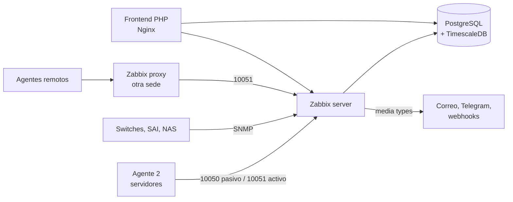

# Zabbix 8.0 LTS: monitorización de servidores y red

## El problema

Tienes una docena de máquinas, un par de switches gestionables, un SAI y un NAS. Quieres saber cuándo se llena un disco, cuándo un servicio deja de escuchar o cuándo una interfaz del switch empieza a dar errores, y quieres que te avise alguien que no seas tú mirando un panel.

[Uptime Kuma](uptime_kuma.md) responde a «¿contesta desde fuera?», y el [stack de Prometheus](observability_stack.md) brilla con aplicaciones que exponen métricas propias. Pero buena parte de la infraestructura real no expone nada: equipos de red que solo hablan SNMP, servidores sin exportadores y aplicaciones heredadas. Zabbix nació para eso. Es un sistema completo, con agente, base de datos, alertas, inventario y descubrimiento, que se configura desde la interfaz web y que trae plantillas para casi cualquier cosa que tenga una dirección IP.

## 📋 Tabla de Contenidos

- [Cuándo encaja Zabbix](#cuando-encaja-zabbix)
- [Arquitectura](#arquitectura)
- [Instalación en Debian 13](#instalacion-en-debian-13)
- [El agente 2](#el-agente-2)
- [Plantillas, ítems y triggers](#plantillas-items-y-triggers)
- [Descubrimiento](#descubrimiento)
- [Alertas](#alertas)
- [Proxies](#proxies)
- [Rendimiento y retención](#rendimiento-y-retencion)
- [Troubleshooting](#troubleshooting)
- [Buenas prácticas](#buenas-practicas)
- [Referencias](#referencias)

## Cuándo encaja Zabbix

| Necesidad | Zabbix | Prometheus + Grafana | Uptime Kuma |
|---|---|---|---|
| ¿El servicio responde desde fuera? | Sí (chequeos web) | Con blackbox_exporter | Es su propósito |
| Equipos de red por SNMP | Plantillas incluidas | snmp_exporter, más trabajo | No |
| Servidores sin exportador | Agente con plantillas | node_exporter por máquina | No |
| Métricas de aplicaciones propias | Posible, menos natural | Es su terreno | No |
| Configuración | Interfaz web y API | Ficheros YAML | Interfaz web |
| Alertas con escalado y horarios | Integradas | Alertmanager | Básicas |

La regla práctica: si lo que vigilas son **máquinas y equipos**, Zabbix ahorra trabajo. Si lo que vigilas son **servicios que ya exponen métricas** (Kubernetes, aplicaciones propias), Prometheus encaja mejor. Conviven sin problema.

## Arquitectura



- **Server**: recoge datos, evalúa triggers y lanza alertas. Todo pasa por él.
- **Base de datos**: guarda configuración e histórico. Es el cuello de botella habitual; ver [Rendimiento y retención](#rendimiento-y-retencion).
- **Frontend**: aplicación PHP desde la que se configura todo. No recoge datos.
- **Agente**: corre en cada máquina vigilada. En modo **pasivo** el server le pregunta (puerto 10050); en modo **activo** el agente pide su lista de comprobaciones y envía los datos (puerto 10051 del server).
- **Proxy**: recoge datos en nombre del server en otra red o sede y se los reenvía.

## Instalación en Debian 13

Zabbix publica su propio repositorio; los paquetes de Debian van varias versiones por detrás. La 8.0 es la LTS actual (soporte largo) y es la que conviene instalar en un servidor que no quieres actualizar cada seis meses.

!!! warning "Versiones"
    Esta guía usa Zabbix 8.0.0, la primera de la rama LTS, con paquetes `8.0.0-1+debian13`. Los nombres de paquete y las rutas son los del repositorio oficial en esa versión; si instalas otra rama, revisa las instrucciones de [la página de descarga](https://www.zabbix.com/download) para tu combinación de sistema, base de datos y servidor web.

### Repositorio y paquetes

```bash
wget https://repo.zabbix.com/zabbix/8.0/release/debian/pool/main/z/zabbix-release/zabbix-release_latest_8.0+debian13_all.deb
sudo dpkg -i zabbix-release_latest_8.0+debian13_all.deb
sudo apt update
sudo apt install zabbix-server-pgsql zabbix-frontend-php php8.4-pgsql \
  zabbix-nginx-conf zabbix-sql-scripts zabbix-agent2 postgresql
```

`zabbix-release` deja las fuentes en `/etc/apt/sources.list.d/` y la clave en `/usr/share/keyrings/zabbix.gpg`. Debian 13 trae PHP 8.4, de ahí `php8.4-pgsql`.

### Base de datos

```bash
sudo -u postgres createuser --pwprompt zabbix
sudo -u postgres createdb -O zabbix zabbix
zcat /usr/share/zabbix/sql-scripts/postgresql/server.sql.gz | sudo -u zabbix psql zabbix
```

El esquema inicial tarda un rato y no debe dar errores. Si los da, lo habitual es haberlo lanzado dos veces: borra la base y empieza de nuevo.

Después, la contraseña en `/etc/zabbix/zabbix_server.conf`:

```ini
DBName=zabbix
DBUser=zabbix
DBPassword=la-que-elegiste
```

### Frontend

El paquete `zabbix-nginx-conf` instala `/etc/zabbix/nginx.conf` con `listen` y `server_name` comentados. Descoméntalos y ajústalos:

```nginx
server {
        listen          8080;
        server_name     zabbix.home.arpa;
        root    /usr/share/zabbix/ui;
        # ...
}
```

```bash
sudo systemctl restart zabbix-server zabbix-agent2 nginx php8.4-fpm
sudo systemctl enable zabbix-server zabbix-agent2 nginx php8.4-fpm
```

Abre `http://zabbix.home.arpa:8080` y el asistente te pide los datos de la base de datos y escribe `/usr/share/zabbix/ui/conf/zabbix.conf.php`. El usuario inicial es `Admin` con contraseña `zabbix`: **cámbiala lo primero**.

Si el frontend va a salir de la LAN, ponlo detrás de un reverse proxy con TLS y, mejor aún, detrás de la [VPN](../linux/wireguard.md) o de un [SSO](../identity/authentik.md). Es una consola con capacidad de ejecutar scripts en tus servidores.

## El agente 2

`zabbix-agent2` es el agente actual, escrito en Go y con plugins (PostgreSQL, MySQL, Docker, Redis…). El clásico `zabbix-agent` sigue existiendo, pero para máquinas nuevas usa el 2.

En cada máquina vigilada, `/etc/zabbix/zabbix_agent2.conf`:

```ini
Server=192.0.2.10          # quién puede preguntar (modo pasivo)
ServerActive=192.0.2.10    # a quién enviar (modo activo)
Hostname=web-01            # debe coincidir con el host en el frontend
```

Los valores por defecto del paquete son `Server=127.0.0.1`, `ServerActive=127.0.0.1` y `Hostname=Zabbix server`, válidos solo para el propio servidor. Las configuraciones adicionales van en `/etc/zabbix/zabbix_agent2.d/`.

**Activo o pasivo.** El modo activo es mejor detrás de NAT o de un cortafuegos: solo hace falta abrir el 10051 del server, y el agente sale. El pasivo necesita que el server llegue al 10050 de cada máquina. Las plantillas oficiales vienen en dos variantes, `by Zabbix agent` (pasivo) y `by Zabbix agent active`: elige una por host.

**Cifrado.** Por defecto el tráfico agente-server va en claro. Con PSK basta:

```bash
openssl rand -hex 32 | sudo tee /etc/zabbix/zabbix_agent2.psk
```

```ini
TLSConnect=psk
TLSAccept=psk
TLSPSKIdentity=web-01
TLSPSKFile=/etc/zabbix/zabbix_agent2.psk
```

Y en el frontend, en el host, pestaña *Encryption*, la misma identidad y la misma clave.

## Plantillas, ítems y triggers

El modelo de Zabbix tiene cuatro piezas:

- **Ítem**: un dato que se recoge (uso de CPU, espacio libre en `/`, estado de una interfaz).
- **Trigger**: una expresión sobre ítems que define un problema, con severidad. Por ejemplo, «espacio libre en `/` por debajo del 10 % durante 5 minutos».
- **Plantilla**: un paquete de ítems, triggers, gráficas y reglas de descubrimiento.
- **Host**: una máquina o equipo con una o varias plantillas enlazadas.

En la práctica casi nunca se crean ítems a mano. Se da de alta el host, se enlaza la plantilla oficial (`Linux by Zabbix agent active`, `Generic by SNMP`, `PostgreSQL by Zabbix agent 2`…) y se ajustan sus **macros**: umbrales como `{$VFS.FS.PUSED.MAX.WARN}` se cambian por host sin tocar la plantilla.

!!! tip "No edites las plantillas oficiales"
    Al actualizar Zabbix las importarás de nuevo y perderás los cambios. Para ajustar umbrales usa macros en el host; para añadir ítems, una plantilla tuya enlazada junto a la oficial.

Un trigger propio se escribe con funciones sobre el histórico:

```text
avg(/web-01/system.cpu.util,10m)>90
```

Es decir, uso medio de CPU por encima del 90 % en los últimos 10 minutos. Las expresiones de recuperación (cuándo se da por resuelto) evitan que una alerta oscile cuando el valor ronda el umbral.

## Descubrimiento

Zabbix tiene dos tipos de descubrimiento, y conviene no confundirlos:

- **Descubrimiento de red**: barre un rango de IP buscando agentes o respuestas SNMP. Con **acciones de autorregistro** o de descubrimiento, los hosts encontrados se crean solos y reciben su plantilla.
- **Descubrimiento de bajo nivel (LLD)**: dentro de un host, encuentra elementos que varían (sistemas de ficheros, interfaces de red, discos, contenedores) y crea un ítem y un trigger por cada uno. Es lo que hace que la plantilla de Linux vigile `/`, `/var` y `/srv` sin que los declares.

Para agentes activos, el **autorregistro** es lo más cómodo: el agente se presenta con su `Hostname` y unos metadatos (`HostMetadata=linux web` en su configuración), y una acción en el server le asigna grupo y plantillas según esos metadatos.

## Alertas

Un trigger que salta genera un **problema**. Que alguien se entere depende de tres cosas:

1. **Media type**: el canal (correo, Telegram, Slack, webhook). Zabbix trae decenas ya definidos en *Alerts → Media types*.
2. **Usuario con media**: a quién y en qué horario, filtrado por severidad.
3. **Acción**: la regla que une problemas con usuarios. Aquí se define el escalado («si sigue abierto a los 30 minutos, avisa también a…») y si se notifica la recuperación.

La causa más común de «Zabbix no avisa» es tener el media type configurado pero ninguna acción que lo use, o una acción con condiciones que no casan con el problema.

Para no aprender a ignorar las alertas: severidades honestas (*Warning* para lo que puede esperar al lunes, *High* para lo que no) y **dependencias entre triggers**, para que la caída de un switch no genere un problema por cada máquina que cuelga de él.

## Proxies

Un **proxy** recoge datos en otra red (otra sede, una DMZ, una VLAN aislada) y los reenvía al server. Guarda los datos en su propia base de datos (SQLite basta) si pierde la conexión, y los entrega al volver.

```bash
sudo apt install zabbix-proxy-sqlite3
```

En `/etc/zabbix/zabbix_proxy.conf`, lo mínimo es `Server` (la IP del server), `Hostname` (el nombre del proxy tal como se da de alta en el frontend) y `DBName` (la ruta del fichero SQLite). Los agentes de esa red apuntan al proxy en lugar de al server. En el frontend, cada host se asigna a su proxy.

También sirve para repartir carga cuando un solo server no da abasto, aunque en un homelab rara vez hace falta.

## Rendimiento y retención

La base de datos crece con cada ítem y cada intervalo. Antes de enlazar plantillas a cien hosts:

- **Intervalos**: no todo necesita un dato por minuto. El espacio en disco cada 5 minutos es más que suficiente.
- **Histórico y tendencias**: el histórico guarda cada valor; las tendencias, medias por hora. Reduce el histórico (7-14 días) y deja las tendencias largas (1-2 años): bastan para planificar capacidad.
- **TimescaleDB**: la extensión de PostgreSQL que Zabbix soporta para histórico. Particiona por tiempo y comprime, y borra datos antiguos sin el *housekeeper*, que en bases grandes es lo que más carga. El paquete `zabbix-sql-scripts` trae su esquema en `/usr/share/zabbix/sql-scripts/postgresql/timescaledb/`. Si vas a pasar de unos cientos de hosts, decídelo al instalar: migrar después es posible pero laborioso.

En *Reports → System information*, el dato que hay que mirar es el **número de valores por segundo requerido**. En *Monitoring → Hosts*, la plantilla `Zabbix server health` muestra qué procesos internos están saturados.

## Troubleshooting

| Síntoma | Causa probable | Arreglo |
|---|---|---|
| El host sale con el icono de disponibilidad en rojo | El server no llega al 10050 del agente, o `Server=` no incluye su IP | Revisa el cortafuegos y `Server=` en el agente; prueba desde el server con `zabbix_get -s IP -k agent.ping` (paquete `zabbix-get`) |
| Las comprobaciones activas no llegan | `Hostname` del agente distinto del nombre del host en el frontend, o el agente no llega al 10051 | Iguala los nombres (distingue mayúsculas); abre el 10051 en el server |
| «Zabbix server is not running» en el frontend | El server está parado o el frontend no llega a él | `systemctl status zabbix-server` y el log `/var/log/zabbix/zabbix_server.log` |
| El server no arranca tras instalar | Contraseña de la base de datos mal o esquema sin importar | El log lo dice en las primeras líneas; revisa `DBPassword` y que el esquema se importara entero |
| Hay problemas, pero no llegan alertas | No hay acción, o sus condiciones no casan | *Reports → Action log* muestra si se intentó enviar algo y el error |
| El frontend va lento y la base de datos crece sin parar | Demasiados ítems con intervalos cortos e histórico largo | Ajusta intervalos y retención; valora TimescaleDB |
| Procesos *poller* al 100 % | Más comprobaciones pasivas de las que el server atiende | Pasa hosts a modo activo, sube `StartPollers` o reparte con un proxy |

## Buenas prácticas

- **Cambia la contraseña de `Admin`** y crea tu propio usuario administrador; deja `Admin` deshabilitado.
- **No expongas el frontend** a Internet sin TLS y sin otra capa delante (VPN o SSO).
- **Agentes en modo activo** siempre que puedas: menos puertos abiertos hacia las máquinas.
- **Cifra con PSK** el tráfico agente-server, sobre todo si cruza redes que no controlas.
- **Plantillas oficiales intactas**, ajustes con macros y añadidos en plantillas propias.
- **Dependencias de triggers** entre la red y lo que cuelga de ella.
- **Copia de seguridad** de la base de datos (`pg_dump`) y de `/etc/zabbix/`. El histórico se puede perder; la configuración de meses, no. Ver [Estrategia 3-2-1](../backups/strategy_321.md).
- **Actualiza dentro de la LTS** (8.0.x) con `apt`; salta de LTS a LTS leyendo antes las notas de actualización.

## Referencias

- [Documentación de Zabbix 8.0](https://www.zabbix.com/documentation/8.0/en/manual)
- [Política de ciclo de vida y versiones](https://www.zabbix.com/life_cycle_and_release_policy)
- [Página de descarga e instrucciones por sistema](https://www.zabbix.com/download)
- [Requisitos de instalación](https://www.zabbix.com/documentation/8.0/en/manual/installation/requirements)
- [Repositorio de paquetes de Zabbix](https://repo.zabbix.com/zabbix/8.0/)
- [Plantillas oficiales e integraciones](https://www.zabbix.com/integrations)
- Relacionado: [Nagios Core](nagios.md), [Uptime Kuma](uptime_kuma.md), [Stack de observabilidad](observability_stack.md)
