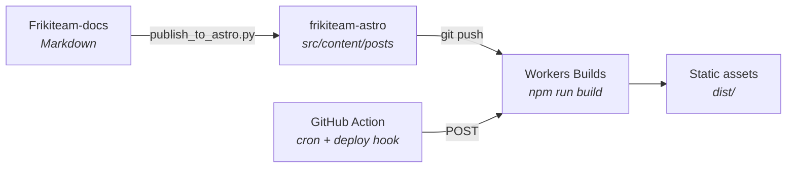

# ¡Hemos migrado! Frikiteam, ahora un blog estático con Astro

!!! tip "¡Hemos migrado!"
    Desde el **22 de noviembre de 2026**, frikiteam.es ya no es WordPress: es el sitio que describe esta página. **Para ti casi nada cambia**: las direcciones de siempre siguen funcionando (las 76 antiguas, con sus redirecciones), el RSS sigue en `/feed/`, y las entradas cargan en unos 170 KB. Lo nuevo: un buscador en la cabecera (pulsa `/` o `Ctrl/⌘+K`), series dibujadas como líneas de metro, y la fe de erratas y las dudas por [GitHub](https://github.com/rasty94/Frikiteam-docs/issues/new/choose). El sitio no usa cookies.

## El problema

WordPress hacía todo en el servidor: PHP, MySQL, Redis, un proxy con TLS y un script que vigilaba que nada de eso se rompiera. Cuatro contenedores para servir lo que, en el fondo, son 150 textos que cambian una vez al día. Cada actualización de núcleo o de plugin había que vigilarla, y cada visita ejecutaba código para generar una página idéntica a la anterior.

Un sitio estático da la vuelta a eso: el trabajo se hace **una vez, al compilar**, y lo que se sirve son ficheros. Pero un blog con series, búsqueda y entradas programadas parece pedir un servidor. Esta página cuenta cómo se resuelve cada una de esas tres cosas con [Astro](https://astro.build) sin ninguno, con los números medidos y los problemas reales que salieron por el camino.

!!! note "Qué cubre y qué no"
    Es la arquitectura **de este blog**, con las versiones de noviembre de 2026 (Astro 7, Pagefind 1.6, Wrangler 4.166, Node 26). No es un tutorial de Astro: para eso están sus [guías](https://docs.astro.build/en/guides/content-collections/). El paso previo, de Markdown en este repositorio a artículo del blog, lo hace `scripts/publish_to_astro.py` y está descrito en el `CLAUDE.md` del repo.

En cifras, a 22 de noviembre de 2026: **147 artículos** en **11 series**, 83 páginas HTML, un `dist/` de 10 MB, un build completo de unos **4 segundos** y **ningún fichero JavaScript propio** en el sitio compilado.

## 📋 Tabla de Contenidos

- [Visión general](#vision-general)
- [Las entradas son una colección con esquema](#las-entradas-son-una-coleccion-con-esquema)
- [Publicación programada en un sitio estático](#publicacion-programada-en-un-sitio-estatico)
- [Series como líneas de metro](#series-como-lineas-de-metro)
- [Markdown con Sätteri y un plugin propio](#markdown-con-satteri-y-un-plugin-propio)
- [Búsqueda con Pagefind](#busqueda-con-pagefind)
- [Redirecciones, caché y cabeceras en Workers](#redirecciones-cache-y-cabeceras-en-workers)
- [SEO sin plugins](#seo-sin-plugins)
- [Lo que pesa de verdad](#lo-que-pesa-de-verdad)
- [El día del cambio](#el-dia-del-cambio)
- [Troubleshooting](#troubleshooting)
- [Buenas prácticas](#buenas-practicas)
- [Referencias](#referencias)

## Visión general

El sitio es un proyecto de Astro que lee Markdown y produce HTML. Un Worker de Cloudflare lo sirve con *static assets*: sin código de servidor, solo el directorio `dist/`.



| Pieza | Para qué | Versión |
|---|---|---|
| Astro | Genera las páginas | 7.4 |
| `@astrojs/markdown-satteri` | Procesador de Markdown | 0.4 |
| Pagefind | Buscador sin servidor | 1.6 |
| `@astrojs/sitemap`, `@astrojs/rss` | Sitemap y RSS | 3.7 y 4.0 |
| Wrangler | Despliega `dist/` en Cloudflare Workers | 4.166 |

El comando de build encadena tres pasos, y que falle cualquiera de ellos detiene el despliegue:

```bash
astro build && pagefind --site dist && node scripts/check-build.mjs
```

Desde el `git push` hasta ver el cambio en línea pasan **unos 90 segundos** (medido el 22/11/2026).

## Las entradas son una colección con esquema

Cada artículo es un `.md` con frontmatter validado por un esquema de Zod. Si algo no encaja, el build falla en vez de publicar una página rota:

```ts
// src/content.config.ts
const posts = defineCollection({
  loader: glob({ pattern: '*.md', base: './src/content/posts' }),
  schema: z.object({
    title: z.string(),
    source: z.string().optional(), // página de Frikiteam-docs de la que sale
    date: z.coerce.date(),
    updated: z.coerce.date(),
    category: z.enum(slugs),       // exactamente una serie por entrada
    description: z.string(),
    tags: z.array(z.string()),
  }),
});
```

Con una serie que no existe, el build termina con un error y código de salida 1:

```text
[InvalidContentEntryDataError] posts → ceph data does not match collection schema.
  category: Invalid option: expected one of "almacenamiento"|"automatizacion"|...
```

El reparto de responsabilidades entre los dos repositorios es lo que evita pisarse:

| Dato | Dónde vive | Quién lo cambia |
|---|---|---|
| Cuerpo, título, extracto, etiquetas, `updated` | Página de este repo | El generador, en cada ejecución |
| Serie (`category`), fecha de salida, imagen | El `.md` del artículo en Astro | Tú; el generador nunca lo pisa |
| URL (`/serie/slug/`) | Sale de los dos anteriores | Congelada al publicar |

!!! warning "Cambiar la serie cambia la URL"
    La URL incluye la serie. Mover un artículo ya publicado a otra serie deja la dirección antigua en 404 si no añades una redirección.

## Publicación programada en un sitio estático

Sin servidor no hay nadie que «publique a las 9:00». La solución son dos ideas: la fecha es un dato del artículo, y **un único filtro** decide qué existe.

```ts
// src/lib/site.ts
const BUILD_TIME = Date.now();
export async function allPosts() {
  return (await getCollection('posts', (p) => p.data.date.getTime() <= BUILD_TIME))
    .sort((a, b) => b.data.date.getTime() - a.data.date.getTime());
}
```

Todas las rutas, el RSS, el mapa de series y el sitemap leen de `allPosts()`, así que una entrada futura no puede colarse por ningún lado. Un artículo sale en la **primera compilación posterior a su fecha**.

Para no fiarlo todo a una convención, el último paso del build lo comprueba por fuera, leyendo los ficheros y no el código de Astro:

```js
// scripts/check-build.mjs (resumen)
if (date > now && built) leaked.push(f);   // programada, pero publicada
if (date <= now && !built) missing.push(f); // debida, pero sin página
if (leaked.length || missing.length) process.exit(1);
```

Falta lo que dispara la compilación cada día. Una Action de GitHub llama al *deploy hook* de Cloudflare, pero antes comprueba si hace falta:


```yaml
on:
  schedule:
    - cron: '5 7 * * *'    # 09:05 Madrid en verano
    - cron: '5 8 * * *'    # 09:05 Madrid en invierno
    - cron: '35 9 * * *'   # de recuperación
    - cron: '5 12 * * *'
jobs:
  deploy:
    steps:
      - uses: actions/checkout@v7
      - id: live
        run: node scripts/check-live.mjs "$LIVE" 0 && echo "done=true" >> "$GITHUB_OUTPUT" || true
      - if: steps.live.outputs.done != 'true'
        env: { HOOK: "${{ secrets.CF_DEPLOY_HOOK }}" }
        run: curl -fsS -X POST "$HOOK" > /dev/null
      - if: steps.live.outputs.done != 'true'
        run: node scripts/check-live.mjs "$LIVE" 15
```


`check-live.mjs` busca la última entrada que ya toca y mira que esté en su URL **y** enlazada desde la portada. Con `0` solo sondea; con `15` espera hasta 15 minutos y, si no aparece, falla en rojo, que es el aviso por correo.

!!! warning "El cron de GitHub no es un reloj"
    La documentación de GitHub lo dice: el evento `schedule` puede retrasarse en picos de carga, **el inicio de cada hora es uno de ellos**, y con carga alta algunos trabajos en cola pueden descartarse. A nosotros nos pasó: el 22/11/2026 no se ejecutó ni el cron de las 07:05 ni el de las 08:05 UTC, y la entrada de las 09:00 dio 404 hasta lanzar la Action a mano. Los primeros disparos por cron llegaron a las 15:13, 16:11 y 19:29 UTC, que no coinciden con ninguna hora programada.

Por eso hay cuatro disparos y por eso cada uno es **idempotente**: si la entrada ya está en línea, no hacen nada. La propia documentación aconseja, además, programar a un minuto distinto del inicio de la hora.

## Series como líneas de metro

Una serie es un recorrido ordenado, y la web lo dibuja como una línea de metro: una parada por entrada, en orden de lectura. El orden es el de la fecha dentro de la serie:

```ts
export async function seriesOf(cat: string) {
  return (await allPosts()).filter((p) => p.data.category === cat).reverse();
}
```

El componente `SeriesLine.astro` pinta una lista ordenada con un punto por entrada. Tres detalles que conviene conocer:

- **El *tooltip* con el título** es un único elemento `position: fixed` que se añade al `<body>`. Dentro de la línea no cabe: el contenedor tiene `overflow-x: auto` para poder desplazarse y recortaría cualquier cosa que sobresalga.
- **El punto mide 14 px.** El área de toque se amplía con un pseudo-elemento hasta 34×28 px, por encima de los 24 px que pide [WCAG 2.5.8](https://www.w3.org/WAI/WCAG22/Understanding/target-size-minimum.html). Solo en horizontal, porque el contenedor recorta en vertical, y sin llegar a las paradas vecinas, que están a 35 px.
- **Cada parada lleva el título como texto** (oculto con una clase `sr-only`). Solo con `aria-label`, los buscadores no ven texto de enlace.

## Markdown con Sätteri y un plugin propio

Astro 7 renderiza el Markdown con **Sätteri**, su procesador nativo, en lugar de remark/rehype. Los plugins de remark ya no valen tal cual: la opción `markdown.rehypePlugins` exige instalar `@astrojs/markdown-remark` y usar el procesador `unified()`. Aquí se portó el plugin a Sätteri.

Las páginas de este repositorio enlazan entre sí con rutas relativas (`../docker/quadlets.md#x`), que en el blog no existen. Un plugin de HAST las resuelve al compilar: a la entrada correspondiente si ya está publicada y, si no, a la página en `docs.frikiteam.es`:

```js
// astro.config.mjs
markdown: { processor: satteri({ hastPlugins: [docLinks] }) },

// src/lib/doc-links.mjs
export default ({ fileURL }) => {
  const from = fileURL && sourceOf(readFileSync(fileURL, 'utf8')); // página de origen
  return from && {
    name: 'doc-links',
    element: {
      filter: ['a'],
      visit(node, ctx) {
        const to = resolveDocLink(from, node.properties.href);
        if (to) ctx.setProperty(node, 'href', to);
      },
    },
  };
};
```

Dos detalles que cuestan un rato:

- **`setAttribute` no sirve para un elemento HTML.** Es para atributos de JSX/MDX; para una propiedad de `<a>` se usa `setProperty`.
- **Los `id` de los encabezados.** El Markdown de MkDocs genera ids sin tildes (`#que-es`), y los índices de las propias páginas enlazan con ellos. El generador de Astro conserva las tildes, así que `scripts/publish_to_astro.py` emite cada encabezado con su `id` explícito, el mismo que daba MkDocs.

## Búsqueda con Pagefind

[Pagefind](https://pagefind.app) indexa el HTML ya compilado. Se ejecuta tras `astro build` y solo mira lo marcado con `data-pagefind-body`, que aquí es el cuerpo de cada artículo: 63 páginas y 13.489 palabras. El índice ocupa 1,4 MB en `dist/pagefind/`, y el navegador solo descarga los fragmentos que necesita.

El buscador no se carga con la página. Un botón en la cabecera abre un `<dialog>` y es entonces cuando se pide Pagefind:

```js
const load = () => (loading ??= new Promise((done, fail) => {
  const css = document.createElement('link');
  css.rel = 'stylesheet'; css.href = '/pagefind/pagefind-ui.css';
  const js = document.createElement('script');
  js.src = '/pagefind/pagefind-ui.js';
  js.onload = () => { ui = new PagefindUI({ element: '#search', showImages: false }); done(); };
  document.head.append(css, js);
}));
```

Atajos `/` y `Ctrl/⌘+K` para abrirlo, y `/?q=palabra` lo abre con la búsqueda hecha, que es la dirección a la que redirige la antigua `/buscar/?q=`. La serie es un filtro (`data-pagefind-filter="serie"`) y el título va como metadato.

!!! tip "Texto oculto que se cuela en los extractos"
    El título y la serie viajaban en elementos ocultos dentro del cuerpo indexado, y aparecían pegados al principio del extracto («ContenedoresContenedores»). La solución es marcarlos con `data-pagefind-ignore`: según la documentación de Pagefind, así salen del índice de texto pero **los filtros y los metadatos que contienen siguen funcionando**.

## Redirecciones, caché y cabeceras en Workers

Un Worker con *static assets* se configura con un `wrangler.jsonc` mínimo:

```jsonc
{
  "name": "frikiteam-astro",
  "compatibility_date": "2026-11-01",
  "assets": { "directory": "./dist", "not_found_handling": "404-page" }
}
```

!!! danger "No borres `wrangler.jsonc`"
    Sin él, `npx wrangler deploy` intenta autoconfigurar el proyecto y le añade el adaptador `@astrojs/cloudflare`, que rompe un sitio puramente estático. Fue el primer fallo del despliegue.

**Redirecciones.** Cloudflare lee un fichero `_redirects`, pero Astro no enruta los ficheros que empiezan por `_`. Se genera como un *endpoint* con otro nombre (`redirects.txt`) y una integración lo renombra al terminar el build. Salen 163 reglas: las URL con fecha de WordPress, el mapa de entradas fusionadas, `/<serie>/` → `/category/<serie>/` y las del feed, el sitemap y la paginación antiguos. El límite es de 2.000 redirecciones estáticas y 100 dinámicas (las que llevan `:slug` o `*`); aquí hay 6 dinámicas.

!!! warning "Cada regla, con y sin barra final"
    `/devsecops/` redirigía, pero `/devsecops` daba **404**: Cloudflare solo aplica la regla a la ruta exacta, y solo añade la barra por su cuenta a los ficheros que existen. La solución es emitir las dos variantes de cada regla.

**Caché y cabeceras.** `public/_headers` admite hasta 100 reglas; aquí hay 8:

```text
/_astro/*
  Cache-Control: public, max-age=31536000, immutable

/diagrams/*
  Cache-Control: public, max-age=2592000, stale-while-revalidate=86400

/*
  Referrer-Policy: strict-origin-when-cross-origin
  X-Frame-Options: SAMEORIGIN
  Permissions-Policy: camera=(), microphone=(), geolocation=()
```

Los ficheros de `/_astro/` llevan un hash en el nombre, así que nunca cambian bajo la misma URL y pueden ser inmutables. Las páginas HTML se quedan con `max-age=0, must-revalidate`. `X-Content-Type-Options: nosniff` no hace falta: Cloudflare ya lo añade.

Redirecciones y cabeceras se prueban en local con `wrangler dev`, que sirve `dist/` con las mismas reglas, antes de subir nada.

## SEO sin plugins

Todo sale de las plantillas, sin plugin:

- **JSON-LD**: `BlogPosting` en cada entrada (con `inLanguage`, `articleSection`, `keywords` y el logo del editor), `WebSite` con `SearchAction` en la portada, `Person` en `/about/` y `CollectionPage` con `ItemList` en cada serie.
- **Sitemap** con `lastmod` por URL y sin las páginas de paginación.
- **`noindex`** mientras el sitio es una copia de evaluación, controlado por una sola bandera (`SITE.indexable`), y siempre en la 404.
- **`/llms.txt`**: una sección por serie con título y extracto de cada entrada, para agentes.
- **Tarjeta social** por defecto de 1200×630, generada con un Chromium sin interfaz a partir de una página HTML con las fuentes del sitio.

!!! note "Un fallo que solo se ve comparando"
    108 de 147 artículos tenían `dateModified` **anterior** a `datePublished`. La fecha de actualización venía de la página de origen (11/10) y la de publicación era la programada (hasta mayo de 2027). Ahora la fecha de modificación es `max(date, updated)`.

## Lo que pesa de verdad

Medido con Chromium y la caché desactivada, sobre el sitio publicado y con una sola pasada por página: un orden de magnitud, no un *benchmark*.

| Página | Peticiones | Transferido | LCP |
|---|---|---|---|
| Portada | 13 | 192 KB | 265 ms |
| Entrada | 10 | 170 KB | 160 ms |
| Entrada, con el buscador abierto | 14 | 221 KB | 150 ms |

Desglose de una entrada: **las fuentes son el 81 %** (cuatro ficheros, 138 KB), el HTML pesa 12 KB, la hoja de estilos 5 KB y el JavaScript propio es 0: los dos scripts del sitio (buscador y *tooltip*) van dentro del HTML, unos 2 KB. Los 10 KB de «Script» son el *beacon* de Cloudflare Web Analytics, no del sitio. Abrir el buscador añade unos 50 KB, pagados solo por quien lo usa.

Las tres fuentes de texto se precargan (`<link rel="preload" as="font">`) para que no lleguen después de la hoja de estilos y desplacen el texto.

## El día del cambio

El 22 de noviembre de 2026 se apagó WordPress. Se hizo en cuatro fases, cada una con su comprobación y su vuelta atrás, y con un script que repite las mismas ~45 comprobaciones antes y después (`scripts/preflight.mjs`: las 63 entradas, las 76 URL antiguas, las 157 redirecciones una a una, 656 imágenes antiguas, la indexación y las cabeceras).

1. **Backup final** de WordPress: 796 filas de `wp_posts` en el dump, las mismas que la base de datos viva, y una copia fuera de la rotación.
2. **Desplegar el sitio como indexable.**
3. **Cambiar el dominio** en Cloudflare.
4. **Apagar WordPress**, sin borrarlo: contenedores parados y con `restart=no`, y los datos guardados 30 días.

Tres cosas que conviene saber si haces algo parecido:

- **WordPress se servía cacheado un año en el borde** (`s-maxage=31536000`, por un plugin de caché de página). Cambiar el origen sin purgar la caché de Cloudflare y sin borrar las reglas que el plugin había creado habría seguido entregando las páginas viejas.
- **Apagar los contenedores no basta**: tenían `restart: always`, y sin `docker update --restart=no` habrían vuelto a arrancar tras el siguiente reinicio.
- **Dos tropiezos reales**, que la comprobación automática encontró: durante unos minutos la web real se sirvió con `noindex`, porque el interruptor estaba en otra rama que aún no se había desplegado; y `www` estuvo unas horas sin registro DNS. Por eso el script mira indexación y redirecciones y no solo que «cargue».

Desde entonces, una Action comprueba cada día que la entrada que toca está en línea, y otra repite la batería completa cada lunes y avisa por Telegram si algo falla.

## Troubleshooting

| Síntoma | Causa | Comprobación |
|---|---|---|
| El despliegue añade `@astrojs/cloudflare` y falla | No hay `wrangler.jsonc` y Wrangler autoconfigura | Crear el fichero con `assets.directory` |
| `markdown.rehypePlugins … run on the unified processor` | Astro 7 usa Sätteri; remark/rehype ya no vienen instalados | Portar a `hastPlugins`, o instalar `@astrojs/markdown-remark` |
| `cannot set property 'href' on a 'element' node` | `setAttribute` es para MDX/JSX | `ctx.setProperty(node, 'href', …)` |
| `/serie` da 404 pero `/serie/` redirige | La regla de `_redirects` solo casa la ruta exacta | Emitir la variante sin barra |
| Una tabla o un diagrama desaparece tras una admonición | El `<div>` HTML se continúa hasta una línea en blanco | Línea en blanco tras `</div>` |
| La entrada de las 9:00 no salió | El `cron` de GitHub se retrasó o se descartó | `gh workflow run`; varios disparos y una sonda idempotente |
| El *beacon* de Web Analytics no aparece con `curl` | Cloudflare solo lo inyecta si pides HTML | `curl -H 'Accept: text/html'` |
| `The language "cisco" doesn't exist, falling back to "plaintext"` | Shiki no incluye ese lenguaje | `langAlias` si hay uno equivalente; si no, texto plano |
| Los enlaces internos de un artículo no llevan a la sección | El `id` del encabezado tiene tildes y el índice no | Emitir el `id` explícito, sin tildes |
| Las líneas de los bloques de código salen muy separadas | Shiki marca cada línea con `class="line"` y tu CSS también usa `.line` | Renombra tu clase y mira en las herramientas del navegador qué CSS recibe una línea de código |

El comando que más ahorra: reproducir el sitio de producción en local, con las mismas reglas.

```bash
npm run build && npx wrangler dev --port 8799
curl -sI http://127.0.0.1:8799/devsecops        # 301, no 404
```

## Buenas prácticas

- **Un único punto de verdad para «qué está publicado»** (`allPosts()`), y un guardia al final del build que lo compruebe leyendo los ficheros, no el código.
- **Todo lo que dependa de la hora debe ser idempotente.** Si el cron falla, repetir el disparo no puede hacer daño.
- **Prueba en un navegador real.** El área de toque, que las fuentes no se descarguen dos veces tras precargarlas y que Pagefind no se pida hasta usarlo se comprobaron ahí, no leyendo el código.
- **Compara antes y después** cuando generes contenido: número de páginas, encabezados, tablas, imágenes y enlaces. Así salió el `dateModified` anterior a la publicación y la tabla tragada por una admonición.
- **No pagues por lo que no usas.** El buscador se pide al abrirlo; las fuentes, solo las del subconjunto latino.
- **Deja el servidor fuera del camino crítico.** Si el repo de contenido está caído, el sitio sigue sirviendo el último `dist/`.

## Referencias

- [Astro — colecciones de contenido](https://docs.astro.build/en/guides/content-collections/) · [Rutas (ficheros con `_`)](https://docs.astro.build/en/guides/routing/) · [Markdown](https://docs.astro.build/en/guides/markdown-content/)
- [Astro 7 — guía de actualización](https://docs.astro.build/en/guides/upgrade-to/v7/) · [Sätteri](https://satteri.bruits.org/)
- [Astro — `@astrojs/sitemap`](https://docs.astro.build/en/guides/integrations-guide/sitemap/) · [Despliegue en Cloudflare](https://docs.astro.build/en/guides/deploy/cloudflare/)
- [Pagefind — indexado](https://pagefind.app/docs/indexing/) · [filtros](https://pagefind.app/docs/filtering/) · [interfaz](https://pagefind.app/docs/ui-usage/)
- [Cloudflare — redirecciones de static assets](https://developers.cloudflare.com/workers/static-assets/redirects/) · [cabeceras](https://developers.cloudflare.com/workers/static-assets/headers/) · [límites](https://developers.cloudflare.com/workers/platform/limits/)
- [Cloudflare — Workers Builds](https://developers.cloudflare.com/workers/ci-cd/builds/) · [Web Analytics](https://developers.cloudflare.com/web-analytics/)
- [GitHub Actions — el evento `schedule`](https://docs.github.com/en/actions/reference/workflows-and-actions/events-that-trigger-workflows)
- [schema.org — BlogPosting](https://schema.org/BlogPosting) · [Google — datos estructurados de artículos](https://developers.google.com/search/docs/appearance/structured-data/article)
- [FastAPI](fastapi.md) · [React](react.md) · [Flutter](flutter.md)
