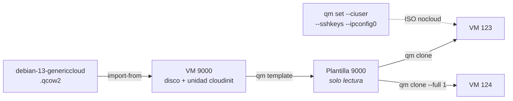

# Plantillas cloud-init en Proxmox — VMs listas en segundos

## El problema

Necesitas una VM nueva para probar algo. Subes la ISO, arrancas el instalador, eliges idioma, teclado, particiones, usuario, esperas a que copie paquetes, reinicias, entras por consola para poner la IP y la clave SSH… y veinte minutos después tienes una máquina idéntica a las cinco anteriores, salvo en los pequeños detalles que se te olvidaron esta vez.

Las imágenes cloud resuelven eso: un disco ya instalado y genérico que, en el primer arranque, lee su configuración (usuario, claves, red) desde una fuente externa mediante **cloud-init**. Proxmox VE sabe generar esa fuente. Preparas la imagen una vez, la conviertes en plantilla y cada VM nueva es un clon más tres parámetros.

!!! warning "Sin probar todavía en el homelab"
    Los pasos de esta página están contrastados con la documentación oficial (wiki de Proxmox VE, `man qm`, cloud.debian.org, documentación de cloud-init y del provider de OpenTofu), pero aún no se han probado de principio a fin en el homelab. Si algo no se comporta como se describe, abre una errata.

!!! note "Qué cubre y qué no"
    Aquí se trata la **plantilla de VM con cloud-init** y su ciclo: crearla, clonarla y personalizarla. La instalación del propio Proxmox está en [Proxmox VE](proxmox_base.md) y en [Proxmox VE 9 sobre Debian 13](../curiosidades/proxmox_en_debian13.md); las redes virtuales, en [SDN](sdn.md).

## 📋 Tabla de Contenidos

- [Cómo funciona](#como-funciona)
- [La imagen de Debian 13](#la-imagen-de-debian-13)
- [Crear la VM base](#crear-la-vm-base)
- [Usuario, claves y red por defecto](#usuario-claves-y-red-por-defecto)
- [Convertir en plantilla](#convertir-en-plantilla)
- [Clonar: enlazado o completo](#clonar-enlazado-o-completo)
- [Ampliar el disco](#ampliar-el-disco)
- [qemu-guest-agent](#qemu-guest-agent)
- [Snippets y cicustom](#snippets-y-cicustom)
- [El siguiente paso: OpenTofu](#el-siguiente-paso-opentofu)
- [Troubleshooting](#troubleshooting)
- [Buenas prácticas](#buenas-practicas)
- [Referencias](#referencias)

## Cómo funciona

Proxmox VE genera una pequeña imagen ISO con los datos de cloud-init y la conecta a la VM como un CD-ROM: es la **unidad cloudinit**. Para Linux usa el formato `nocloud` (para Windows, `configdrive2`). Dentro de la VM, cloud-init lee esa unidad en el primer arranque y aplica usuario, claves SSH, red y lo que le pidas.



Tres ideas que conviene tener claras desde el principio:

1. **La plantilla nunca arranca.** Una plantilla es de solo lectura y Proxmox no permite iniciarla. Lo que configures en ella se hereda en cada clon.
2. **Los valores de cloud-init se pueden fijar en la plantilla y sobrescribir en el clon.** Usuario y clave SSH, en la plantilla; IP y nombre, en cada clon.
3. **La personalización ocurre en el arranque del clon**, no al clonar. Clonar es copiar (o enlazar) disco y configuración; nada más.

## La imagen de Debian 13

Debian publica sus imágenes cloud en [cloud.debian.org](https://cloud.debian.org/images/cloud/). Para Proxmox interesan dos variantes de trixie:

| Variante | Qué es |
|---|---|
| `generic` | Funciona en cualquier entorno con cloud-init, incluido hardware físico |
| `genericcloud` | Igual que `generic`, pero con un juego reducido de drivers en el kernel |

Para una VM con dispositivos virtio, `genericcloud` es la opción natural y pesa menos. Si con ella algo no arranca, la propia Debian recomienda pasar a `generic`.

Descarga y comprueba la suma desde el nodo Proxmox:

```bash
cd /var/tmp
wget https://cloud.debian.org/images/cloud/trixie/latest/debian-13-genericcloud-amd64.qcow2
wget https://cloud.debian.org/images/cloud/trixie/latest/SHA512SUMS
sha512sum --ignore-missing -c SHA512SUMS
```

`latest/` apunta siempre a la última compilación; si quieres una fecha concreta y reproducible, cada compilación tiene su propio directorio con fecha en `images/cloud/trixie/`.

!!! note "Qué trae la imagen"
    El manifiesto de la imagen `genericcloud` (`debian-13-genericcloud-amd64.json`, en el mismo directorio) incluye `cloud-init` y `cloud-initramfs-growroot`, que amplía la partición raíz al arrancar. **No incluye `qemu-guest-agent`**: hay que instalarlo (ver más abajo).

## Crear la VM base

El ID 9000 es una convención habitual para plantillas, no un requisito. Ajusta `local-lvm` y `vmbr0` a tu almacenamiento y tu bridge.

```bash
# VM vacía con controlador VirtIO SCSI
qm create 9000 --name debian13-cloud --ostype l26 \
  --memory 2048 --cores 2 \
  --net0 virtio,bridge=vmbr0 --scsihw virtio-scsi-pci

# Importar la imagen como disco scsi0
qm set 9000 --scsi0 local-lvm:0,import-from=/var/tmp/debian-13-genericcloud-amd64.qcow2

# Unidad cloudinit (el CD-ROM con los datos de cloud-init)
qm set 9000 --ide2 local-lvm:cloudinit

# Arrancar solo desde el disco
qm set 9000 --boot order=scsi0

# Consola serie: muchas imágenes cloud la necesitan
qm set 9000 --serial0 socket --vga serial0

# Habilitar el canal del agente de QEMU
qm set 9000 --agent enabled=1
```

Qué hace cada pieza:

- `--ostype l26` marca la VM como Linux. El formato de la unidad cloudinit (`--citype`) depende de `ostype`: `nocloud` para Linux, `configdrive2` para Windows. El valor por defecto de `ostype` es `other`, así que mejor dejarlo explícito.
- `local-lvm:0,import-from=…` crea un volumen nuevo importando la imagen. Es la sintaxis que usa hoy la wiki; `qm disk import` sigue existiendo, pero deja el disco como `unused` y hay que adjuntarlo en un segundo paso.
- `--boot order=scsi0` evita que la BIOS pierda tiempo buscando en el CD-ROM.
- `--serial0 socket --vga serial0` sigue la recomendación de la wiki para imágenes cloud. Si con tu imagen no ves nada en la consola, vuelve a la pantalla por defecto.

## Usuario, claves y red por defecto

Estos valores se guardan en la configuración de la VM y Proxmox los vuelca a la unidad cloudinit al arrancar:

```bash
qm set 9000 --ciuser admin
qm set 9000 --sshkeys ~/.ssh/id_ed25519.pub
qm set 9000 --ipconfig0 ip=dhcp
```

- `--ciuser` sustituye al usuario por defecto de la imagen (en Debian, `debian`).
- `--sshkeys` recibe **la ruta de un fichero** con una o varias claves públicas, una por línea.
- `--ipconfig0` corresponde a `net0`: `ip=dhcp`, o `ip=192.168.1.50/24,gw=192.168.1.1`. Si no defines ninguna IP, Proxmox usa DHCP en IPv4. Para IPv6 existen `ip6=` y `gw6=`, y `ip6=auto` para autoconfiguración (requiere cloud-init 19.4 o posterior; Debian 13 trae la 25.1).
- `--nameserver` y `--searchdomain` fijan DNS. Si no pones ninguno, se usan los del host.

Hay también `--cipassword`, pero la wiki recomienda claves SSH: Proxmox tiene que guardar una versión cifrada de la contraseña dentro de los datos de cloud-init.

En versiones recientes de Proxmox existe `--ciupgrade` (por defecto `1`): actualiza paquetes en el primer arranque. Es más seguro, pero alarga ese arranque; si prefieres clones rápidos y actualizar con otra herramienta, `--ciupgrade 0`.

Antes de seguir, comprueba qué va a recibir la VM:

```bash
qm cloudinit dump 9000 user
qm cloudinit dump 9000 network
```

## Convertir en plantilla

```bash
qm template 9000
```

La VM 9000 pasa a ser de solo lectura. Hazlo **sin haberla arrancado nunca**: así cloud-init no ha llegado a ejecutarse y cada clon será un primer arranque de verdad. Si la arrancaste para instalar algo, antes de apagarla ejecuta dentro `cloud-init clean --logs --machine-id`, que borra el estado de cloud-init y deja `/etc/machine-id` sin inicializar para que cada clon genere el suyo.

## Clonar: enlazado o completo

```bash
# Clon enlazado (por defecto desde una plantilla)
qm clone 9000 123 --name web01

# Clon completo, en el almacenamiento que elijas
qm clone 9000 124 --name db01 --full 1 --storage local-lvm
```

| | Enlazado | Completo |
|---|---|---|
| Velocidad | Casi instantáneo | Copia todos los datos |
| Espacio inicial | Prácticamente nulo | El del disco entero |
| Depende de la plantilla | Sí: no puedes borrarla mientras existan clones | No |
| Elegir almacenamiento destino | No | Sí (`--storage`) |
| Requisito | Almacenamiento con snapshots o clones (LVM-thin, ZFS, Ceph RBD, qcow2…) | Ninguno |

Un clon enlazado es *copy-on-write*: lee los bloques sin modificar de la plantilla y escribe los cambios en su propio volumen. Para laboratorio y VMs efímeras es ideal; para algo que va a vivir años, o que quieres mover de almacenamiento, el clon completo evita sorpresas. Proxmox asigna MAC nuevas y un UUID nuevo en cada clon.

Ahora, lo propio de cada VM:

```bash
qm set 123 --ipconfig0 ip=192.168.1.123/24,gw=192.168.1.1
qm set 123 --nameserver 192.168.1.1
qm start 123
```

Si cambias valores de cloud-init con la VM ya creada, `qm cloudinit pending 123` muestra lo actual frente a lo pendiente, y `qm cloudinit update 123` regenera la unidad. Ten en cuenta que muchos módulos de cloud-init se ejecutan una sola vez por instancia: cambiar el usuario después del primer arranque no reescribe lo que ya se creó.

## Ampliar el disco

La imagen de Debian tiene un disco virtual de 3 GB. Amplíalo en el clon antes del primer arranque:

```bash
qm disk resize 123 scsi0 +18G
```

Con `+` el valor se suma al tamaño actual; sin él, es el tamaño final. Reducir no está soportado. (`qm resize` es un alias del mismo comando.)

No hace falta tocar particiones: `cloud-initramfs-growroot` y el módulo de cloud-init que amplía la raíz se encargan en el arranque. Si amplías con la VM ya en marcha, el sistema verá el disco más grande, pero la partición crecerá en el siguiente arranque, o a mano con `growpart` (paquete `cloud-guest-utils`, incluido en la imagen).

## qemu-guest-agent

Con el agente, Proxmox puede pedir un apagado limpio, ver las IP de la VM en la interfaz web y congelar el sistema de ficheros durante backups y snapshots para que sean consistentes. En la VM hacen falta dos cosas:

1. El canal habilitado en Proxmox: `--agent enabled=1`, que ya pusimos en la plantilla.
2. El paquete `qemu-guest-agent` instalado y en marcha **dentro** de la VM. La imagen `genericcloud` no lo trae.

La forma limpia de instalarlo en cada clon es un snippet de cloud-init (siguiente sección). Para comprobar que responde:

```bash
qm agent 123 ping
qm guest cmd 123 network-get-interfaces
```

`qm agent` es un alias de `qm guest cmd`. Si el agente funciona, `ping` termina sin error.

## Snippets y cicustom

Lo que Proxmox genera (usuario, claves, red) cubre lo básico. Para instalar paquetes, crear ficheros o ejecutar comandos, `--cicustom` te deja aportar tus propios ficheros de cloud-init. Hay cuatro tipos: `user`, `network`, `meta` y `vendor`. Para los que no aportes, Proxmox sigue generando el suyo.

Los ficheros viven en un almacenamiento con el tipo de contenido **snippets**. En el almacenamiento `local` el directorio es `/var/lib/vz/snippets/`. Mira primero qué tipos tiene ya y añade `snippets` a la lista, porque `--content` la sustituye entera:

```bash
grep -A4 '^dir: local' /etc/pve/storage.cfg
pvesm set local --content iso,vztmpl,backup,snippets   # conserva los tipos que ya tuviera
mkdir -p /var/lib/vz/snippets
```

El punto delicado: **`user=` sustituye por completo al user-data generado**. Si lo usas, `--ciuser` y `--sshkeys` dejan de aplicarse y el usuario y las claves tienen que ir en tu fichero. Para añadir cosas sin perder lo generado, usa **`vendor=`**: cloud-init combina vendor-data y user-data, y si una misma clave aparece en ambos gana la del user-data.

Este vendor-data instala el agente en cada clon:

```yaml
#cloud-config
# /var/lib/vz/snippets/vendor-qga.yaml
packages:
  - qemu-guest-agent
runcmd:
  - systemctl start qemu-guest-agent
```

```bash
qm set 9000 --cicustom "vendor=local:snippets/vendor-qga.yaml"
```

El `systemctl start` está ahí porque, según la wiki de Proxmox, el servicio puede no arrancar solo justo después de instalarse.

Si necesitas un user-data entero propio, no lo escribas desde cero: parte del generado.

```bash
qm cloudinit dump 9000 user > /var/lib/vz/snippets/user-web.yaml
# edítalo y añade lo que necesites
qm set 123 --cicustom "user=local:snippets/user-web.yaml,vendor=local:snippets/vendor-qga.yaml"
```

En un clúster, los snippets tienen que estar en un almacenamiento disponible en todos los nodos a los que pueda migrar la VM. Si no, la VM no podrá arrancar en ese nodo.

## El siguiente paso: OpenTofu

Todo lo anterior es manual y por eso es la base: la plantilla es el artefacto que la automatización necesita. Con una plantilla 9000 en el nodo, crear una VM con [OpenTofu](opentofu.md) es declarar un clon y sus valores de cloud-init. Con el provider `bpg/proxmox`:

```hcl
resource "proxmox_virtual_environment_vm" "web02" {
  name      = "web02"
  node_name = "pve"

  clone {
    vm_id = 9000
    full  = false
  }

  agent {
    enabled = true
  }

  initialization {
    ip_config {
      ipv4 {
        address = "192.168.1.124/24"
        gateway = "192.168.1.1"
      }
    }
    user_account {
      username = "admin"
      keys     = [trimspace(file(pathexpand("~/.ssh/id_ed25519.pub")))]
    }
  }
}
```

Dos detalles de este provider que chocan con lo que hace `qm`: `clone.full` vale `true` por defecto (al revés que `qm clone` desde una plantilla), y `agent.enabled` vale `false` si no lo declaras. La configuración del provider (endpoint, token de API) y el estado remoto se explican en [Proxmox como código con OpenTofu](opentofu.md); ver también [estado de Terraform/OpenTofu](../terraform/terraform_state.md).

## Troubleshooting

| Síntoma | Causa probable | Arreglo |
|---|---|---|
| La consola se queda en negro | La imagen no usa la consola serie, o sí y la VM tiene VGA normal | Probar con y sin `--serial0 socket --vga serial0` |
| No entra por SSH con tu clave | Usas `cicustom user=`, que anula `--sshkeys` | Poner las claves en tu user-data o pasar a `vendor=` |
| El clon no coge la IP fijada | `ipconfig0` cambiado después del primer arranque, unidad sin regenerar | `qm cloudinit pending`, luego `qm cloudinit update` y reiniciar |
| La VM no arranca y menciona el snippet | Fichero inexistente, o almacenamiento sin tipo `snippets`, o no disponible en ese nodo | `ls /var/lib/vz/snippets/` y revisar `content` en `storage.cfg` |
| `qm agent … ping` falla | Paquete no instalado o servicio parado dentro de la VM | Revisar el vendor-data y `systemctl status qemu-guest-agent` en la VM |
| No deja borrar la plantilla | Quedan clones enlazados que dependen de ella | Borrar esos clones o recrearlos como completos |
| Todos los clones tienen el mismo `machine-id` | La plantilla se arrancó antes de convertirla | `cloud-init clean --logs --machine-id` y rehacer la plantilla |
| El disco sigue en 3 GB dentro de la VM | Ampliado con la VM en marcha | Reiniciar, o `growpart` y ampliar el sistema de ficheros |

La primera herramienta, casi siempre, es ver qué datos recibe la VM y qué ha hecho cloud-init con ellos:

```bash
# En el nodo: lo que Proxmox genera
qm cloudinit dump 123 user

# Dentro de la VM: estado y registro de cloud-init
cloud-init status --long
less /var/log/cloud-init.log
```

## Buenas prácticas

- **Una plantilla por imagen y fecha**, con el nombre que lo diga (`debian13-cloud-20261123`). Rehacerla cuesta dos minutos; una plantilla vieja implica actualizar media distribución en cada primer arranque.
- **Claves SSH, nunca contraseñas**, y el usuario por defecto fuera (`--ciuser`). Endurece el resto como en [seguridad SSH](../linux/ssh_security.md).
- **Nunca arranques la plantilla antes de convertirla**, y si lo haces, `cloud-init clean --logs --machine-id`.
- **`vendor=` para añadir, `user=` solo si de verdad necesitas controlar todo el user-data.**
- **Clones enlazados para lo efímero, completos para lo que se queda.**
- **Snippets en almacenamiento compartido** en cualquier clúster, o la migración fallará el día que la necesites.
- **El agente siempre**: apagados limpios y backups consistentes por el precio de un paquete.

## Referencias

- [Cloud-Init Support — wiki de Proxmox VE](https://pve.proxmox.com/wiki/Cloud-Init_Support)
- [qm(1) — página de manual](https://pve.proxmox.com/pve-docs/qm.1.html)
- [pvesm(1) — almacenamiento y tipos de contenido](https://pve.proxmox.com/pve-docs/pvesm.1.html)
- [Qemu-guest-agent — wiki de Proxmox VE](https://pve.proxmox.com/wiki/Qemu-guest-agent)
- [Imágenes cloud de Debian](https://cloud.debian.org/images/cloud/)
- [cloud-init: vendor-data](https://docs.cloud-init.io/en/latest/explanation/vendordata.html) · [CLI de cloud-init](https://docs.cloud-init.io/en/latest/reference/cli.html)
- [Provider bpg/proxmox — recurso proxmox_virtual_environment_vm](https://registry.terraform.io/providers/bpg/proxmox/latest/docs/resources/virtual_environment_vm)
- [Proxmox VE](proxmox_base.md) · [Proxmox VE 9 sobre Debian 13](../curiosidades/proxmox_en_debian13.md) · [Terraform y OpenTofu](../terraform/terraform_base.md)
