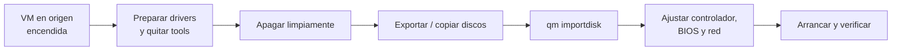

# Proxmox — Migración de VMs y contenedores

## El problema

La migración sale mal casi siempre por el mismo motivo: se planifica como una copia de ficheros y resulta ser un cambio de hardware. La VM que arrancaba en VMware se queda con una pantalla azul `INACCESSIBLE_BOOT_DEVICE` porque el disco pasó de un controlador paravirtualizado a otro. El contenedor que "también se migra en vivo" resulta que no, que se reinicia. Y la migración en caliente entre dos nodos idénticos sobre el papel falla porque uno lleva un Xeon de hace cinco años y el otro no.

Ninguno de esos problemas se descubre migrando. Se descubren después, con el origen ya apagado y la ventana de mantenimiento agotándose. Esta página va de lo que hay que comprobar **antes**.

!!! note "Qué cubre y qué no"
    Aquí se trata el movimiento de cargas: entre nodos del mismo cluster, y desde plataformas externas hacia Proxmox. La creación de VMs, el almacenamiento y el clustering básico están en [Proxmox VE](proxmox_base.md).

## 📋 Tabla de Contenidos

- [Frío o en caliente](#frio-o-en-caliente)
- [Requisitos reales de la migración en vivo](#requisitos-reales-de-la-migracion-en-vivo)
- [Migrar con almacenamiento local](#migrar-con-almacenamiento-local)
- [Replicación como paso previo](#replicacion-como-paso-previo)
- [Contenedores LXC](#contenedores-lxc)
- [Importar desde VMware](#importar-desde-vmware)
- [Hyper-V y máquinas físicas](#hyper-v-y-maquinas-fisicas)
- [Drivers antes de apagar el origen](#drivers-antes-de-apagar-el-origen)
- [Ventana de mantenimiento y vuelta atrás](#ventana-de-mantenimiento-y-vuelta-atras)
- [Verificación posterior](#verificacion-posterior)
- [Troubleshooting](#troubleshooting)
- [Buenas prácticas](#buenas-practicas)
- [Referencias](#referencias)

## Frío o en caliente

Son dos operaciones distintas con requisitos distintos, y conviene no llamarlas igual.

| | En frío (offline) | En caliente (online / live) |
|---|---|---|
| Estado del invitado | Apagado | Encendido |
| Qué se mueve | Configuración y discos | Configuración, discos y **memoria RAM** |
| Corte de servicio | Todo el tiempo que dure | Milisegundos en el cambio final |
| Requisitos | Cluster con quórum | Cluster, CPU compatible y red que aguante |
| Riesgo si falla | Se reintenta, el invitado sigue apagado | La VM sigue viva en el origen |

```bash
# En frío: la VM está apagada
qm migrate 100 pve2

# En caliente: la VM sigue dando servicio
qm migrate 100 pve2 --online
```

La migración en vivo copia la memoria en varias pasadas mientras la VM sigue escribiendo en ella. Cuando lo que queda por copiar es lo bastante pequeño, la pausa un instante, copia el resto y la reanuda en el destino. De ahí la consecuencia práctica: **una VM que escribe en memoria más rápido de lo que la red copia no converge nunca**. Una base de datos con 128 GB de RAM muy activa sobre un enlace de 1 GbE es el ejemplo canónico de migración que se queda dando vueltas.

Si tienes que mover un nodo entero para mantenimiento, ponlo en modo mantenimiento y deja que el cluster reubique las cargas en vez de migrarlas a mano:

```bash
# Vacía el nodo (HA reubica los recursos gestionados)
ha-manager crm-command node-maintenance enable pve1
ha-manager crm-command node-maintenance disable pve1
```

!!! warning "Sin quórum no hay migración"
    `qm migrate` escribe en `/etc/pve`, que es un sistema de ficheros replicado que se monta en solo lectura cuando el cluster pierde el quórum. Con dos nodos y sin dispositivo de desempate, apagar uno deja al otro incapaz de hacer nada. Comprueba `pvecm status` antes de tocar nada.

## Requisitos reales de la migración en vivo

Tres condiciones, y las tres se comprueban en un minuto.

**1. CPU compatible.** El invitado ve un modelo de CPU concreto y unas flags concretas. Si el destino no ofrece esas flags, o el kernel del invitado ya las está usando, la VM revienta al reanudarse. El caso más frecuente es `cpu: host`, que expone la CPU física tal cual: perfecto para rendimiento, incompatible con cualquier destino que no sea idéntico.

```bash
qm config 100 | grep -E '^(cpu|machine|args)'
```

En un cluster heterogéneo, fija un modelo común y aceptado por todos los nodos (los tipos `kvm64` y la familia `x86-64-v2` / `x86-64-v3` existen para esto). El modelo por defecto de las VMs nuevas ha cambiado entre versiones mayores de Proxmox, así que **no asumas cuál es el tuyo: míralo**.

```bash
qm set 100 --cpu x86-64-v2-AES   # requiere apagar y arrancar la VM, no basta un reinicio
```

Un cambio de tipo de CPU no se aplica en caliente. Necesita un ciclo completo de apagado y encendido, lo que significa que preparar el cluster para migraciones en vivo tiene, en sí mismo, un coste de parada.

**2. Almacenamiento accesible en el destino.** Lo ideal es almacenamiento compartido: Ceph, NFS, iSCSI/LVM compartido o ZFS over iSCSI. El disco no se mueve, solo el proceso. Sin él, hay que copiar los discos (siguiente sección).

**3. Red suficiente y bien elegida.** Por defecto el tráfico de migración va cifrado por el túnel SSH y por la red de gestión, que es también la de corosync. Copiar 64 GB de RAM por ahí es una forma excelente de provocar pérdidas de quórum. Sepáralo:

```ini
# /etc/pve/datacenter.cfg
migration: secure,network=10.20.30.0/24
```

`secure` (cifrado, por defecto) frente a `insecure` (sin cifrar, más rápido). `insecure` solo tiene sentido en una red dedicada y físicamente confiable: durante la migración la memoria del invitado viaja en claro.

## Migrar con almacenamiento local

Sin almacenamiento compartido también se puede, incluso en caliente, copiando los discos como parte de la operación:

```bash
qm migrate 100 pve2 --online --with-local-disks
qm migrate 100 pve2 --online --with-local-disks --targetstorage local-zfs
```

El coste es tiempo, y conviene estimarlo antes en vez de descubrirlo en producción. Una cuenta grosera: un disco de 500 GB sobre un enlace de 1 GbE saturado al 100 % son más de 70 minutos **en el mejor caso**, y el mejor caso no existe. Con 10 GbE la cosa baja a minutos, pero entonces el cuello de botella pasa a ser el disco de destino.

Durante todo ese tiempo la VM sigue funcionando y sigue escribiendo, así que el proceso además tiene que ir alcanzando los cambios. Para discos grandes, replicar antes es casi siempre mejor idea.

## Replicación como paso previo

Sobre ZFS local, Proxmox puede replicar los discos de un invitado a otro nodo de forma periódica mediante *snapshots* incrementales. La migración posterior solo tiene que transferir el delta desde la última replicación.

```bash
# Replicar la VM 100 al nodo pve2 cada 15 minutos
pvesr create-local-job 100-0 pve2 --schedule '*/15'

pvesr list
pvesr status
pvesr run --id 100-0        # forzar una pasada antes del cutover
```

Esto convierte una migración de horas en una de minutos. Dos límites que hay que tener claros:

- **Requiere ZFS** (o un almacenamiento con soporte equivalente de envío incremental). Sobre LVM-thin o un directorio no aplica.
- **La replicación no es un backup.** Replica también el borrado y la corrupción. Los backups siguen siendo cosa de vzdump o [Proxmox Backup Server](proxmox_base.md).

## Contenedores LXC

Aquí está la diferencia que más sorpresas causa: **un contenedor LXC en marcha no se migra en vivo**. Un contenedor no es una máquina con su propia memoria aislada, sino un conjunto de procesos del kernel del host. No hay estado de invitado que empaquetar y reanudar al otro lado.

Lo que Proxmox hace es una *restart migration*: apaga el contenedor, mueve los datos, lo vuelve a arrancar en el destino.

```bash
# Contenedor parado: migración directa
pct migrate 200 pve2

# Contenedor en marcha: se apaga, se migra y se arranca
pct migrate 200 pve2 --restart

# Con margen de apagado limpio antes del kill
pct migrate 200 pve2 --restart --timeout 180
```

Consecuencias prácticas:

- El corte no es de milisegundos: es el tiempo de apagar, copiar y arrancar. Con un rootfs pequeño suelen ser segundos; con datos gordos, lo que tarde la copia.
- `--timeout` importa. Si el proceso principal ignora `SIGTERM`, se le mata, y una base de datos dentro de un contenedor apagada a la brava tiene el mismo final que en cualquier otro sitio.
- La replicación con `pvesr` también funciona para contenedores sobre ZFS, y aquí el ahorro se nota todavía más.
- Un contenedor privilegiado con montajes de host (*bind mounts*) rara vez migra limpio: esos directorios no viajan. Revisa `pct config 200` buscando entradas `mp<N>` que apunten fuera del almacenamiento gestionado.

## Importar desde VMware

El flujo, con la fuente todavía encendida y funcionando:



Las versiones recientes de Proxmox VE incorporan un asistente de importación desde ESXi (se añade un almacenamiento de tipo `esxi` y se importan las VMs desde la interfaz). Es la vía cómoda cuando existe; **comprueba si tu versión lo trae** antes de planificar con ella. La vía manual funciona en cualquier versión:

```bash
# 1. Copiar el VMDK al nodo Proxmox (el descriptor, no solo el -flat)
scp usuario@esxi:/vmfs/volumes/datastore1/vm/vm.vmdk /var/lib/vz/import/

# 2. Crear la VM destino sin disco
qm create 120 --name app-migrada --memory 8192 --cores 4 \
  --net0 virtio,bridge=vmbr0 --scsihw virtio-scsi-single --ostype l26

# 3. Importar el disco al almacenamiento elegido
qm importdisk 120 /var/lib/vz/import/vm.vmdk local-lvm

# 4. Engancharlo y fijar el orden de arranque
qm set 120 --scsi0 local-lvm:vm-120-disk-0
qm set 120 --boot order=scsi0
```

`qm importdisk` deja el disco como `unusedN` hasta que lo asocias a un controlador. Para un OVF completo existe `qm importovf`, que además traduce CPU, memoria y discos del manifiesto.

Si prefieres convertir a mano, `qemu-img` hace el trabajo:

```bash
qemu-img convert -p -f vmdk -O qcow2 vm.vmdk vm.qcow2
qemu-img info vm.qcow2
```

!!! warning "VMDK partidos y snapshots"
    Un VMDK con snapshots activos (`-000001.vmdk`) no se importa tal cual: hay que consolidar en el origen primero. Y con discos partidos en trozos de 2 GB, el fichero que hay que dar a `importdisk` es el **descriptor**, el pequeño, no el `-flat` grande.

Antes de apagar el origen: desinstalar VMware Tools. Después, en Proxmox, instalar el `qemu-guest-agent` y activarlo con `qm set 120 --agent 1`.

## Hyper-V y máquinas físicas

**Desde Hyper-V**, el disco es un VHD o VHDX y `qemu-img` lo entiende igual:

```bash
qemu-img convert -p -f vhdx -O raw disco.vhdx /var/lib/vz/import/disco.raw
qm importdisk 130 /var/lib/vz/import/disco.raw local-lvm
```

El detalle que se olvida: una VM de **Generación 2** arranca por UEFI. Si la creas con la BIOS por defecto, no arranca y el síntoma es una pantalla negra sin más pistas.

```bash
qm set 130 --bios ovmf --efidisk0 local-lvm:1,efitype=4m,pre-enrolled-keys=0
```

Si el invitado tenía Secure Boot y las claves no coinciden, el arranque falla en el firmware. Deshabilitarlo en el menú de OVMF es la salida rápida; volver a firmar es la correcta. También conviene desinstalar los Integration Services de Hyper-V antes de apagar.

**Desde una máquina física** (P2V) no hay disco virtual que convertir, así que hay que fabricarlo. Dos enfoques que funcionan:

```bash
# Clonado en bloque por red, desde un live USB en la máquina física
dd if=/dev/sda bs=4M status=progress | ssh root@pve "dd of=/var/lib/vz/import/fisica.raw bs=4M"
```

O una herramienta de imagen (Clonezilla, o el agente de backup que ya uses) y restaurar sobre la VM nueva. La copia en bloque de un sistema **en marcha** produce un sistema de ficheros inconsistente: arranca con un `fsck` de por medio y a veces no arranca. Hazlo desde un live, con los discos desmontados.

Ojo también con el tamaño: `dd` copia el disco entero, incluidos los huecos. Un disco de 2 TB con 200 GB usados son 2 TB por la red y 2 TB en destino salvo que uses una imagen dispersa o un almacenamiento con *thin provisioning*.

## Drivers antes de apagar el origen

Este es el fallo clásico y el más caro, porque se manifiesta cuando ya no hay marcha atrás fácil.

**Windows y virtio.** Windows no trae los drivers virtio. Si importas el disco y lo enganchas directamente a `virtio-scsi`, el arranque termina en `0x0000007B INACCESSIBLE_BOOT_DEVICE`. Hay dos formas de evitarlo, y la buena es la primera:

1. **Antes de apagar el origen**, monta el ISO `virtio-win` en la VM original e instala el paquete completo de drivers (`virtio-win-guest-tools`). Windows registra los controladores aunque no haya hardware virtio presente, y al arrancar en Proxmox los encuentra.
2. Si ya la apagaste: arranca en Proxmox con el disco en `sata0` o `ide0`, añade un segundo disco pequeño en `virtio-scsi` para forzar la instalación del driver, apaga, y mueve el disco de sistema a `scsi0`.

```bash
# Salida de emergencia: arrancar con SATA
qm set 140 --sata0 local-lvm:vm-140-disk-0 --boot order=sata0
# Disco señuelo para que Windows cargue el driver virtio
qm set 140 --scsi1 local-lvm:1
```

**Linux e initramfs.** El kernel necesita los módulos `virtio_blk` / `virtio_scsi` y `virtio_pci` dentro del initramfs, o no encuentra la raíz.

```bash
# Debian/Ubuntu
update-initramfs -u -k all
# RHEL/Rocky/Alma
dracut --regenerate-all --force
```

Otros dos que muerden en Linux:

- **`/etc/fstab` por nombre de dispositivo.** `/dev/sda1` en VMware puede ser otra cosa en Proxmox. Pasa todo a UUID (`blkid`) antes de migrar.
- **Nombres de interfaz de red.** Con nombres predecibles, la interfaz cambia (`ens192` → `ens18`) y la configuración estática se queda huérfana. La máquina arranca sin red, que en un servidor remoto equivale a que no arranca. Ten preparado el acceso por consola en Proxmox.

## Ventana de mantenimiento y vuelta atrás

La migración es fácil de deshacer **si no destruyes el origen**. Ese es todo el plan de vuelta atrás, y todo lo demás son detalles.

Guion de una ventana razonable:

1. **Días antes**: baja el TTL de los registros DNS implicados (de 3600 a 60, por ejemplo). Si el cambio de IP se propaga en un minuto, la vuelta atrás también.
2. **Antes de tocar nada**: backup completo verificado del origen, y snapshot si la plataforma lo permite.
3. **Ensayo**: importa una copia y arráncala en una red aislada. Aquí es donde aparecen los drivers que faltan, con el servicio todavía en producción y sin prisa.
4. **Cutover**: apagado limpio del origen, migración, arranque en destino, verificación.
5. **Punto de no retorno explícito.** Decide de antemano la hora a la que, si no funciona, se vuelve atrás. Sin esa hora escrita, siempre se decide "un ratito más" hasta que se acaba la ventana.
6. **Origen apagado pero intacto** durante días, no minutos. Los fallos de una migración rara vez salen en la primera hora: salen con el batch nocturno, con el backup, o el lunes.
7. **Bajar la VM de origen de cualquier arranque automático.** Dos máquinas con la misma IP y el mismo hostname encendidas a la vez es un incidente peor que la migración fallida.

## Verificación posterior

Lo mínimo, antes de dar por buena la ventana:

```bash
# El invitado responde y el agente está vivo
qm agent 120 ping
qm agent 120 get-osinfo

# Red: MAC nueva, IP correcta, resolución DNS
qm config 120 | grep -E '^net'

# Rendimiento de disco razonable (comparar con la medición del origen)
pveperf /var/lib/vz
```

Y dentro del invitado: servicios arrancados, hora sincronizada (un salto de reloj tras la migración rompe autenticación Kerberos y certificados), montajes de red presentes, logs sin errores de hardware.

Fuera del invitado, lo que se olvida siempre:

- El **job de backup** apuntando al nodo o pool correcto, y una ejecución de prueba.
- Los **recursos HA** redefinidos si la VM estaba gestionada (`ha-manager status`).
- La **monitorización** viendo la máquina nueva y no la vieja.
- Herramientas de invitado instaladas: `qemu-guest-agent` en la VM y `--agent 1` en la configuración. Sin ambas cosas, Proxmox no puede pedir un apagado limpio ni hacer backups consistentes.

## Troubleshooting

| Síntoma | Causa | Arreglo |
|---|---|---|
| `migration aborted` al empezar | Cluster sin quórum, `/etc/pve` en solo lectura | `pvecm status` y recuperar quórum antes de nada |
| Migración en vivo que no termina nunca | La VM escribe memoria más rápido que la red | Red de migración dedicada, o migrar en frío |
| La VM muere al reanudarse en el destino | Flags de CPU distintas (`cpu: host`) | Fijar un tipo de CPU común y apagar/arrancar la VM |
| `storage not available on target node` | El almacenamiento no existe o no está activo en el destino | `pvesm status` en ambos, o usar `--targetstorage` |
| Windows con `0x0000007B` al arrancar | Falta el driver virtio del disco de sistema | Arrancar con `sata0` e instalar `virtio-win` |
| Linux en `initramfs` sin raíz | Módulos virtio ausentes del initramfs | Regenerar initramfs; `/etc/fstab` por UUID |
| Pantalla negra tras importar de Hyper-V | VM de Generación 2, arranque UEFI | `--bios ovmf` más `--efidisk0` |
| El contenedor se reinicia al "migrar en vivo" | Comportamiento esperado en LXC | Planificar el corte; `--restart --timeout` |
| Corosync pierde nodos durante la copia | Migración compartiendo red con el cluster | `migration: network=` en `datacenter.cfg` |
| El invitado arranca sin red | El nombre de la interfaz cambió | Consola de Proxmox y reconfigurar la interfaz |

Dónde mirar cuando el mensaje de la interfaz no dice nada:

```bash
# La tarea completa, con su salida
pvesh get /nodes/pve1/tasks --limit 20
cat /var/log/pve/tasks/<UPID...>

journalctl -u pvedaemon -u pveproxy -f
```

## Buenas prácticas

- **Ensaya con una copia.** Una importación de prueba en una red aislada cuesta una hora y ahorra la ventana entera.
- **Prepara los drivers con el origen encendido.** Es el único momento en que instalar virtio es trivial.
- **Red de migración separada de corosync.** El cluster no tiene por qué enterarse de que estás copiando 64 GB.
- **Tipo de CPU común en clusters heterogéneos.** El poco rendimiento que se pierde se recupera de sobra en no tener que apagar nada para mover cargas.
- **Replica antes de migrar** lo que tenga discos grandes sobre ZFS. Convierte horas de copia en minutos de delta.
- **No borres el origen el mismo día.** Ni al día siguiente.
- **Documenta la configuración de partida**: IPs, rutas, montajes, versiones. Después de migrar, la referencia ya no existe.
- **Backup verificado antes del cutover.** Un backup que no se ha restaurado nunca es una intención, no un backup.

## Referencias

- [Migración de VMs y contenedores — documentación oficial](https://pve.proxmox.com/wiki/Manual:_qm#qm_migration)
- [qm(1) — manual de referencia](https://pve.proxmox.com/pve-docs/qm.1.html) · [pct(1)](https://pve.proxmox.com/pve-docs/pct.1.html)
- [Replicación de almacenamiento (pvesr)](https://pve.proxmox.com/wiki/Storage_Replication)
- [Migrar desde VMware ESXi](https://pve.proxmox.com/wiki/Migrate_to_Proxmox_VE)
- [Drivers virtio para Windows](https://pve.proxmox.com/wiki/Windows_VirtIO_Drivers)
- [Proxmox VE](proxmox_base.md) · [Proxmox SDN](sdn.md)
