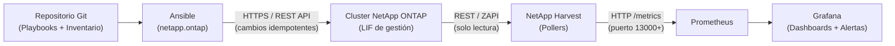

# NetApp ONTAP automatizado: REST API, Ansible y métricas con Harvest

## El problema

Aprovisionar un volumen en System Manager o por SSH se hace en dos minutos; aprovisionar treinta volúmenes con sus *export policies*, cuotas, políticas de snapshot y relaciones SnapMirror entre dos clusters acaba en diferencias sutiles que solo salen a la luz en un incidente. Y cuando además necesitas saber si un agregado se está llenando o si un volumen dispara la latencia a las tres de la mañana, entrar a mano a la consola web no escala.

Aquí unimos las dos caras de la operación moderna en ONTAP 9.x: **automatizar cambios de forma idempotente** con la REST API nativa y la colección oficial **`netapp.ontap`** de Ansible, y **extraer métricas sin sobrecargar la cabina** con **NetApp Harvest** hacia Prometheus y Grafana.

## Arquitectura de automatización y observabilidad



## ONTAP REST API: consultas prácticas

Desde ONTAP 9.6+, la REST API vive en la propia LIF de gestión del cluster (`https://<cluster-mgmt>/api/...`) y cuenta con documentación Swagger interactiva en `https://<cluster-mgmt>/docs/api`.

Para scripting y auditorías rápidas sin instalar nada aparte de `curl` y `jq`:

```bash
# 1. Estado general y versión del cluster
curl -sk -u admin \
  "https://cluster-mgmt.example.local/api/cluster?fields=name,version.full" | jq .

# 2. Agregados con su espacio disponible y porcentaje usado
curl -sk -u admin \
  "https://cluster-mgmt.example.local/api/storage/aggregates?fields=name,space.block_storage.used_percent,space.block_storage.available" \
  | jq '.records[] | {name, used_pct: .space.block_storage.used_percent, avail_bytes: .space.block_storage.available}'

# 3. Volúmenes por encima del 80 % de ocupación
curl -sk -u admin \
  "https://cluster-mgmt.example.local/api/storage/volumes?space.used_percent=>80&fields=name,svm.name,space.used_percent" \
  | jq '.records'

# 4. Relaciones SnapMirror con estado no saludable
curl -sk -u admin \
  "https://cluster-mgmt.example.local/api/snapmirror/relationships?healthy=false&fields=source.path,destination.path,state,lag_time" \
  | jq '.records'
```

!!! tip "Usuario de solo lectura para consultas y métricas"
    No uses `admin` para scripts de lectura ni para Harvest. Crea un usuario dedicado en ONTAP con rol `readonly` (y restringido a la aplicación `http`) para que un fallo de credenciales nunca pueda borrar ni modificar volúmenes.

## Automatización idempotente con Ansible (`netapp.ontap`)

La colección oficial **`netapp.ontap`** usa la REST API de ONTAP por defecto y permite declarar el estado deseado del almacenamiento en Git.

### Instalación de la colección

```bash
ansible-galaxy collection install netapp.ontap
pip install requests
```

### Playbook completo: exportación NFS lista para producción

El siguiente playbook crea (o asegura) la *export policy*, su regla para la subred de hipervisores y el volumen NFS con su política de snapshots y límite de *autosize*:

```yaml
- name: Aprovisionar datastore NFS en NetApp ONTAP
  hosts: localhost
  gather_facts: false
  vars:
    ontap_auth: &ontap_auth
      hostname: "{{ ontap_host }}"
      username: "{{ ontap_user }}"
      password: "{{ ontap_pass }}"
      https: true
      validate_certs: true
      use_rest: always

  tasks:
    - name: Crear export policy para Proxmox
      netapp.ontap.na_ontap_export_policy:
        <<: *ontap_auth
        state: present
        vserver: svm1
        name: pol_proxmox

    - name: Autorizar la subred de hipervisores en la export policy
      netapp.ontap.na_ontap_export_policy_rule:
        <<: *ontap_auth
        state: present
        vserver: svm1
        policy_name: pol_proxmox
        client_match: 10.0.10.0/24
        protocol: ['nfs4']
        ro_rule: ['sys']
        rw_rule: ['sys']
        super_user_security: ['sys']

    - name: Crear o ajustar el volumen NFS
      netapp.ontap.na_ontap_volume:
        <<: *ontap_auth
        state: present
        vserver: svm1
        name: vol_proxmox_01
        aggregate_name: aggr1_nodo1
        size: 500
        size_unit: gb
        junction_path: /vol_proxmox_01
        policy: pol_proxmox
        snapshot_policy: default
        autosize_mode: grow
        max_autosize: 800
        max_autosize_unit: gb
```

Ejecutar el mismo playbook dos veces no duplica recursos ni provoca cortes: si el volumen ya existe con 500 GB y esa política, Ansible devuelve `ok` sin tocar la cabina. Guarda `ontap_pass` siempre cifrada (Ansible Vault o SOPS, ver [Secretos en GitOps](../../cybersecurity/secrets_gitops.md)).

## Monitorización con NetApp Harvest y Prometheus

**NetApp Harvest** es el recolector oficial open-source de NetApp. En lugar de lanzar scripts ad-hoc contra la CLI, Harvest mantiene *pollers* ligeros contra la REST API (o ZAPI) de ONTAP y expone endpoints `/metrics` listos para que **Prometheus** los raspe, incluyendo dashboards oficiales de Grafana.

### Configuración de `harvest.yml`

```yaml
Exporters:
  prometheus1:
    exporter: Prometheus
    local_http_addr: 0.0.0.0
    port_range: 13000-14000

Defaults:
  collectors:
    - Rest
    - RestPerf
    - Ems
  exporters:
    - prometheus1
  use_insecure_tls: false

Pollers:
  ontap-prod-01:
    datacenter: cpd-principal
    addr: cluster-mgmt.example.local
    auth_style: basic_auth
    username: harvest_ro
    password: "CAMBIAR_POR_SECRETO"
```

Harvest asigna un puerto dentro de `port_range` a cada poller y puede generar automáticamente un fichero de *file service discovery* para Prometheus (`prometheus.yml`), o bien apuntarse al puerto fijo si solo monitorizas un cluster.

### Qué vigilar de verdad en Grafana y alertas

En vez de saturar alertas con docenas de gráficas, céntrate en las cinco señales que avisan antes de un incidente real:

1. **Ocupación de agregados (`aggr_space_used_percent`):** alerta de aviso al 80 % y crítica al 90 %. Un agregado lleno bloquea escrituras en todos sus volúmenes a la vez.
2. **Latencia media por volumen (`volume_avg_latency`):** distingue rápido si el problema está en la cabina (>10–15 ms sostenidos en all-flash) o en la red/hipervisor.
3. **Uso de CPU de los nodos (`node_cpu_busy`):** un nodo por encima del 70–80 % sostenido deja poco margen para absorber un *takeover* de su pareja HA.
4. **Salud y lag de SnapMirror (`snapmirror_lag_time`, `snapmirror_healthy`):** detecta réplicas paradas antes de que expire tu RPO.
5. **Eventos EMS críticos (`ems_events`):** fallos de disco, fuentes de alimentación, pérdida de rutas HA o alertas de ARP (antiransomware).

## Troubleshooting

| Síntoma | Causa | Arreglo |
|---|---|---|
| La REST API devuelve `401 Unauthorized` | Credenciales incorrectas o usuario sin aplicación `http` habilitada | Verificar con `security login show` en ONTAP que el usuario tiene acceso `http` |
| Ansible falla con error de certificado TLS | Certificado autofirmado en la LIF de gestión | Instalar la CA interna en el nodo de control (preferido) o usar `validate_certs: false` solo en laboratorio |
| `na_ontap_volume` falla al cambiar tamaño o política | Parámetros incompatibles con la versión de ONTAP o volumen en estado `offline`/DP | Revisar versión de la colección `netapp.ontap` y que el volumen destino sea `RW` |
| Harvest arranca pero Prometheus no ve métricas | Puerto del poller bloqueado por firewall o `local_http_addr` ligado solo a `127.0.0.1` | Comprobar `bin/harvest status` y probar `curl http://<host>:<puerto>/metrics` |
| Faltan métricas de rendimiento en Harvest | El colector `RestPerf` no está habilitado o el usuario `readonly` no tiene permiso sobre endpoints de rendimiento | Confirmar `RestPerf` en `Defaults.collectors` y el rol `readonly` en la cabina |

## Buenas prácticas

- **Autenticación por certificado o cuentas dedicadas:** separa el usuario de aprovisionamiento (Ansible, con permisos acotados) del usuario de solo lectura (Harvest).
- **Versiona el inventario de ONTAP en Git:** trata SVMs, *export policies*, volúmenes y políticas QoS como código para poder auditar quién cambió qué y cuándo.
- **Usa `use_rest: always` en `netapp.ontap`:** evita dependencias heredadas de ZAPI y alinea tus playbooks con las versiones actuales de ONTAP.
- **Revisa el intervalo de raspado de Harvest:** los intervalos por defecto de Harvest ya están pensados para no sobrecargar la controladora; no bajes el *scraping* a pocos segundos sin motivo.

## Referencias

- [ONTAP REST API — Documentación oficial](https://docs.netapp.com/us-en/ontap-automation/)
- [Colección Ansible `netapp.ontap`](https://docs.ansible.com/ansible/latest/collections/netapp/ontap/index.html)
- [NetApp Harvest — Documentación oficial](https://netapp.github.io/harvest/latest/)
- [NetApp ONTAP — Guía base](netapp_base.md) · [SnapMirror, SnapVault y recuperación ante desastres](snapmirror_dr.md)
- [Ansible: automatización de infraestructura](../../ansible/ansible_base.md) · [Stack completo de observabilidad](../../monitoring/observability_stack.md)
