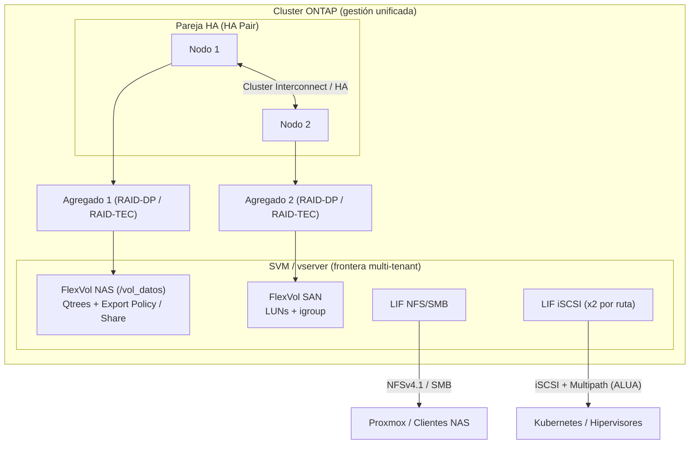

# NetApp ONTAP — Guía base

## El problema

Te entregan una cabina NetApp y descubres que no se parece a un servidor NAS: hay un cluster, parejas HA de nodos, agregados, algo llamado SVM, *broadcast domains* y direcciones IP que pertenecen a «interfaces lógicas» en vez de a una tarjeta de red. Creas un volumen, lo exportas y los clientes no lo ven, porque en ONTAP crear el volumen no lo publica: falta el *junction path*, la *export policy* (o el *igroup* en SAN) y una LIF en la SVM y VLAN correctas. Cada capa tiene su razón de ser, pero hay que conocerlas en orden.

Esta página es el mapa operativo completo de partida: modelo de objetos, red y alta disponibilidad, CLI de inspección, publicación por NFS, SMB e iSCSI, eficiencia de espacio, QoS y protección antiransomware, snapshots y SnapMirror, automatización vía REST API/Ansible e integración con Proxmox y Kubernetes.

!!! note "Qué cubre y qué no"
    Aquí se trata el **modelo de objetos, operación base y acceso por NFS/SMB/iSCSI** desde tu infraestructura. Para comparar protocolos y medir rendimiento está [Protocolos de almacenamiento](../protocols/protocols.md); para otra cabina comercial, [Pure Storage](../pure_storage/pure_storage_base.md); para almacenamiento definido por software, [Ceph](../ceph/ceph_base.md).

## 📋 Tabla de Contenidos

- [Conceptos y arquitectura de ONTAP](#conceptos-y-arquitectura-de-ontap)
- [Red y alta disponibilidad (LIFs, VLANs y failover)](#red-y-alta-disponibilidad-lifs-vlans-y-failover)
- [CLI básica de inspección](#cli-basica-de-inspeccion)
- [Publicar almacenamiento: NFS, SMB e iSCSI](#publicar-almacenamiento-nfs-smb-e-iscsi)
- [Eficiencia de espacio, QoS y antiransomware](#eficiencia-de-espacio-qos-y-antiransomware)
- [Snapshots y SnapMirror](#snapshots-y-snapmirror)
- [Automatización: REST API y Ansible](#automatizacion-rest-api-y-ansible)
- [Integración con Proxmox](#integracion-con-proxmox)
- [Integración con Kubernetes (Trident)](#integracion-con-kubernetes-trident)
- [Troubleshooting](#troubleshooting)
- [Buenas prácticas](#buenas-practicas)
- [Referencias](#referencias)

## Conceptos y arquitectura de ONTAP

ONTAP es el sistema operativo de las cabinas NetApp (FAS, AFF, ASA y ONTAP Select). Los objetos se organizan en dos planos: la **capa física** (nodos, discos y agregados) y la **capa lógica** que ven los clientes (SVMs, volúmenes y LIFs).



Los objetos, de abajo arriba:

| Objeto | Qué es |
|---|---|
| **Nodo** | Un controlador físico. Los nodos se agrupan en parejas de alta disponibilidad (*HA pair*) que asumen los discos del compañero ante un fallo (*takeover/giveback*) |
| **Cluster** | El conjunto de nodos administrado como una unidad, con una sola LIF de gestión |
| **Agregado** | Pool de discos físicos (RAID-DP o RAID-TEC) propiedad de un nodo. Aporta la capacidad sobre la que viven los volúmenes |
| **SVM** (`vserver`) | *Storage Virtual Machine*: servidor de ficheros/bloques virtual con su propio espacio de nombres, DNS, usuarios, protocolos y LIFs. Es la frontera de multi-tenencia |
| **Volumen (FlexVol / FlexGroup)** | La unidad lógica que ven los clientes: contiene ficheros (NAS) o LUNs (SAN). Un FlexVol vive en un agregado; un FlexGroup reparte un único espacio de nombres entre varios agregados |
| **Qtree** | Subdirectorio lógico dentro de un volumen al que se pueden aplicar cuotas y estilos de seguridad propios |
| **LUN** | Disco de bloque presentado por iSCSI, FC o NVMe/TCP, almacenado dentro de un volumen |
| **LIF** | *Logical Interface*: IP (o WWPN) de servicio de una SVM. Se asocia a un puerto físico, `ifgrp` o VLAN y puede migrar entre nodos |

Las ideas que más tropiezos evitan:

- **Los clientes hablan con la SVM, no con el cluster.** Montas `svm1:/vol_datos`, no un nodo. La IP a la que apuntas es una LIF de datos de esa SVM.
- **Los LIFs son móviles (en NAS).** Si un nodo cae o se hace un *takeover*, la LIF NAS migra al compañero y la IP sigue respondiendo. En **SAN (iSCSI/FC)** las LIFs no migran: el cliente mantiene rutas activas hacia ambos nodos mediante *multipath* (ALUA).
- **Un volumen NAS necesita *junction path***: su posición en el árbol de nombres de la SVM (`/vol_datos`). Sin él existe, pero no se puede exportar ni compartir.
- **Acceso = protocolo habilitado + LIF + política.** En NFS es la *export policy*; en SMB, el *share* y sus ACL; en iSCSI, el *igroup* y el *LUN mapping*.

## Red y alta disponibilidad (LIFs, VLANs y failover)

Gran parte de los incidentes al poner en marcha una NetApp vienen de la capa de red de ONTAP, que separa la conectividad física de la lógica mediante cuatro piezas:

- **`ifgrp` (Interface Group):** agregación de puertos físicos (normalmente LACP en modo `multimode_lacp`) en cada nodo.
- **VLAN:** subinterfaz etiquetada sobre un puerto o `ifgrp` (por ejemplo `a0a-100`).
- **Broadcast Domain:** agrupa puertos/VLANs de distintos nodos que comparten el mismo dominio de capa 2. Define a qué puertos puede migrar una LIF NAS si cae su nodo.
- **IPspace:** tabla de enrutamiento aislada (equivalente a una VRF) para separar tráfico de gestión, tráfico de datos o distintos clientes con subredes solapadas.

Antes de cualquier mantenimiento o si notas latencia anómala, comprueba siempre estos tres puntos:

```text
storage failover show                 # salud de la pareja HA y si el takeover está habilitado
network port broadcast-domain show    # puertos agrupados por dominio de capa 2
network interface show -is-home false # LIFs que NO están en su nodo de origen
```

Si una LIF NAS aparece con `is-home false` tras un reinicio o mantenimiento, el tráfico sigue entrando por el nodo vecino y cruza el *cluster interconnect* hacia el nodo dueño del agregado, añadiendo latencia innecesaria. Devolver todas las LIFs a su nodo de origen es seguro y sin corte en NAS:

```text
network interface revert *
```

## CLI básica de inspección

La CLI de ONTAP es jerárquica (`volume show`, `network interface show`) y se conecta por SSH a la LIF de gestión del cluster con un usuario administrador. Los comandos de inspección son de solo lectura:

```text
cluster show                          # nodos del cluster y su estado
storage aggregate show                # agregados, capacidad usada y libre
vserver show                          # SVMs y protocolos permitidos
volume show                           # volúmenes, SVM, agregado, tamaño y uso
volume show -percent-used >80         # volúmenes por encima del 80 % de ocupación
network interface show                # LIFs: IP, nodo y puerto actuales, estado
volume snapshot show                  # snapshots por volumen
lun show                              # LUNs publicadas, tamaño y estado
```

Cada comando admite filtros como `-vserver`, `-volume` o `-fields` y autocompleta con el tabulador.

!!! warning "Dependen de la versión"
    La sintaxis y los campos mostrados cambian entre versiones de ONTAP 9.x. Comprueba la ayuda integrada con `?` en tu propia CLI antes de aplicar comandos copiados de otra instalación.

## Publicar almacenamiento: NFS, SMB e iSCSI

### NFS (NAS Linux, Proxmox y Kubernetes)

Orden lógico: volumen, política de acceso y asignación. Ejemplo para un datastore NFS:

```text
volume create -vserver svm1 -volume vol_datos -aggregate aggr1_nodo1 -size 500GB -junction-path /vol_datos
vserver export-policy create -vserver svm1 -policyname pol_proxmox
vserver export-policy rule create -vserver svm1 -policyname pol_proxmox -clientmatch 10.0.10.0/24 -protocol nfs -rorule sys -rwrule sys -superuser sys
volume modify -vserver svm1 -volume vol_datos -policy pol_proxmox
```

La *export policy* equivale a `/etc/exports`: define qué clientes entran y con qué privilegios. `-superuser sys` equivale a `no_root_squash` y solo debe darse a hosts de confianza, como hipervisores. Una política vacía no deja pasar a nadie, y la regla por defecto de `default` rara vez es la adecuada.

Comprobación desde un cliente Linux autorizado:

```bash
sudo mkdir -p /mnt/netapp
sudo mount -t nfs -o vers=4.1 10.0.10.50:/vol_datos /mnt/netapp
touch /mnt/netapp/prueba && ls -l /mnt/netapp
sudo umount /mnt/netapp
```

!!! warning "Versión de NFS"
    Qué versiones de NFS están habilitadas depende de la configuración de la SVM (`vserver nfs show`). Confírmalo antes de fijar `vers=` en `/etc/fstab`.

### SMB / CIFS (entornos Windows y mixtos)

Para exponer un volumen por SMB se crea un *share* sobre su *junction path*, siempre que la SVM tenga CIFS configurado y unido al dominio:

```text
vserver cifs share create -vserver svm1 -share-name datos -path /vol_datos
vserver cifs share show -vserver svm1
```

El share controla el acceso por usuario y grupo mediante ACL; la *export policy* no interviene en SMB. Si el volumen se comparte por NFS y SMB a la vez, el estilo de seguridad (`unix`, `ntfs` o `mixed`) decide cómo se traducen los permisos: elígelo al crear el volumen y no lo cambies con datos dentro.

### iSCSI (almacenamiento de bloque con multipath)

Para cargas sensibles a la latencia (bases de datos o discos de VM en bloque), iSCSI requiere crear el volumen contenedor, la LUN, el *igroup* con los IQNs de los hosts y el mapeo:

```text
# 1. Volumen contenedor (sin junction-path: no se exporta por NAS)
volume create -vserver svm1 -volume vol_iscsi_db -aggregate aggr1_nodo1 -size 500GB

# 2. Crear la LUN dentro del volumen
lun create -vserver svm1 -path /vol/vol_iscsi_db/lun_pg -size 400GB -ostype linux -space-reserve disabled

# 3. Registrar los iniciadores de los hosts Linux (obtener con: cat /etc/iscsi/initiatorname.iscsi)
lun igroup create -vserver svm1 -igroup ig_proxmox -protocol iscsi -ostype linux -initiator iqn.1993-08.org.debian:01:nodo1,iqn.1993-08.org.debian:01:nodo2

# 4. Mapear la LUN al igroup y verificar
lun mapping create -vserver svm1 -path /vol/vol_iscsi_db/lun_pg -igroup ig_proxmox
lun mapping show -vserver svm1
```

En los nodos Linux se descubren las LIFs iSCSI de **ambos nodos** de la cabina (en dos subredes/VLANs distintas si la red lo permite) y se valida que `multipath` ve rutas activas optimizadas (ALUA) hacia el nodo dueño del volumen y rutas no optimizadas hacia el compañero:

```bash
sudo iscsiadm -m discovery -t sendtargets -p 10.0.20.51
sudo iscsiadm -m discovery -t sendtargets -p 10.0.21.52
sudo iscsiadm -m node --login
sudo multipath -ll
```

## Eficiencia de espacio, QoS y antiransomware

### Eficiencia y control de capacidad

ONTAP aplica deduplicación, compresión y compactación a nivel de volumen (en sistemas AFF/ASA suelen venir activadas por defecto; en FAS conviene comprobarlo con `volume efficiency show`).

- **Thin provisioning:** el volumen declara un tamaño, pero solo consume lo escrito. Vigila siempre el espacio libre del **agregado**, no solo del volumen.
- **`volume autosize`:** permite crecer automáticamente hasta un tope definido (`-mode grow -maximum-size ...`). Fija siempre un máximo para evitar que un volumen llene el agregado.
- **Cuotas en qtrees:** acotan el consumo cuando varios equipos comparten volumen.
- **FabricPool:** mueve bloques fríos a un almacén S3 (on-prem o cloud) según política (`auto`, `snapshot-only`…). Evalúa la latencia de recuperación antes de activarlo en datos calientes.

!!! warning "Eficiencia no es capacidad garantizada"
    Los ratios de dedupe y compresión dependen de los datos: bases de datos comprimidas, vídeo o datos ya cifrados apenas ahorran espacio. Dimensiona con datos reales, no con el ratio comercial.

### Storage QoS (evitar vecinos ruidosos)

Sin QoS, un volcado masivo o una VM descontrolada puede saturar los IOPS de un agregado compartido y degradar el resto de servicios. Una política fija de QoS acota el techo de un volumen:

```text
qos policy-group create -vserver svm1 -policy-group pg_backups -max-throughput 200MB/s
volume modify -vserver svm1 -volume vol_backups -qos-policy-group pg_backups
qos policy-group show
```

En sistemas todo-flash también se pueden definir **mínimos garantizados** (`-min-throughput`) para bases de datos críticas y políticas adaptativas (IOPS/TB).

### Protección antiransomware y snapshots inmutables

En versiones recientes de ONTAP 9.x existen dos capas de defensa clave (requieren licencia/configuración según modelo):

- **Autonomous Ransomware Protection (ARP):** analiza entropía y patrones de escritura anómalos en volúmenes NAS y dispara un snapshot automático al detectar comportamiento compatible con cifrado masivo.
- **Snapshot Locking (Tamperproof Snapshots / SnapLock):** bloquea el borrado de snapshots durante un periodo de retención incluso con credenciales de administrador, protegiendo las copias frente a un atacante que comprometa la gestión.

## Snapshots y SnapMirror

Un **snapshot** de ONTAP es una imagen puntual basada en punteros (WAFL): se crea en segundos y solo consume espacio cuando los bloques originales cambian.

```text
volume snapshot create -vserver svm1 -volume vol_datos -snapshot antes_de_migrar
volume snapshot show -vserver svm1 -volume vol_datos
```

- **Políticas de snapshot:** generan copias periódicas (horarias, diarias, semanales) con retención definida por volumen. Vigila la reserva de snapshots (`percent-snapshot-space`): si los snapshots superan su reserva, empiezan a consumir del espacio activo del volumen (*snapshot spill*).
- **Restaurar:** puedes recuperar ficheros sueltos desde el directorio oculto `.snapshot` o revertir el volumen completo (`volume snapshot restore`, que descarta todo lo posterior).
- **SnapMirror:** replica volúmenes a otro cluster transfiriendo solo bloques cambiados entre snapshots. Soporta replicación asíncrona (RPO igual al intervalo de programación) y síncrona para RPO casi nulo.
- **Etiquetas (`snapmirror-label`) y SnapVault:** permiten mantener una retención corta en origen y una retención larga (archivo) en destino.

```text
snapmirror show                       # estado, salud y lag de todas las relaciones
```

!!! danger "Un snapshot no es un backup"
    Los snapshots viven en el mismo volumen y agregado que los datos: si se pierde la cabina o se borra el volumen, desaparecen con él. SnapMirror a un segundo cluster reduce mucho el riesgo, pero sigue bajo el mismo plano tecnológico. Complementa con la [Estrategia 3-2-1](../../backups/strategy_321.md) y copias independientes fuera de la cabina, por ejemplo con [Restic y Borg](../../backups/restic_borg.md).

## Automatización: REST API y Ansible

Desde ONTAP 9.6+, la **REST API nativa** sustituye progresivamente a los scripts SSH y a ZAPI (ONTAPI). Permite consultar inventario y automatizar tareas con herramientas estándar:

```bash
# Listar volúmenes de una SVM con curl y jq
curl -sk -u admin \
  "https://cluster-mgmt.example.local/api/storage/volumes?svm.name=svm1&fields=name,size,space.used,state" \
  | jq '.records[] | {name, state, size, used: .space.used}'
```

Para infraestructura como código, la colección oficial **`netapp.ontap`** de Ansible (`ansible-galaxy collection install netapp.ontap`) usa la REST API de forma idempotente:


```yaml
- name: Asegurar volumen NFS en ONTAP
  netapp.ontap.na_ontap_volume:
    state: present
    name: vol_datos
    vserver: svm1
    aggregate_name: aggr1_nodo1
    size: 500
    size_unit: gb
    junction_path: /vol_datos
    policy: pol_proxmox
    hostname: "{{ ontap_host }}"
    username: "{{ ontap_user }}"
    password: "{{ ontap_pass }}"
    https: true
    validate_certs: true
```


Esto permite versionar volúmenes, *export policies*, *igroups* y políticas de snapshot en Git con el mismo flujo que el resto de servidores (ver [Ansible: automatización de infraestructura](../../ansible/ansible_base.md)).

## Integración con Proxmox

Dos caminos, según el equilibrio entre simplicidad y latencia:

**NFS** es el más directo: el volumen se monta como almacenamiento compartido para discos virtuales (`qcow2`/`raw`), ISOs y backups, con migración en vivo inmediata entre nodos:

```bash
pvesm add nfs netapp-nfs --server 10.0.10.50 --export /vol_datos --content images,iso,backup
```

Usa una LIF de datos NFS (nunca la de gestión), autoriza a **todos los nodos** del cluster Proxmox en la *export policy* y prefiere NFSv4.1 cuando esté habilitado. Ajusta `rsize`/`wsize` solo tras medir con `fio` ([Protocolos de almacenamiento](../protocols/protocols.md)).

**iSCSI** aporta almacenamiento en bloque y latencia más predecible para bases de datos o VMs críticas. Se mapea la LUN al *igroup* de los nodos Proxmox, se configura `multipath` con dos LIFs iSCSI en rutas separadas y se crea LVM compartido encima.

Regla práctica: NFS para datastores generales, iSCSI donde las mediciones de latencia lo justifiquen. Más detalles de la plataforma en [Proxmox base](../../proxmox/proxmox_base.md).

## Integración con Kubernetes (Trident)

El driver CSI oficial de NetApp es **Trident**. Se despliega en el cluster, se configura un backend (`TridentBackendConfig`) apuntando a la SVM y se exponen `StorageClasses` según protocolo (`ontap-nas` para NFS, `ontap-nas-economy` para muchos volúmenes pequeños en qtrees y `ontap-san` para iSCSI/FC/NVMe):

```yaml
apiVersion: storage.k8s.io/v1
kind: StorageClass
metadata:
  name: ontap-nas
provisioner: csi.trident.netapp.io
parameters:
  backendType: "ontap-nas"
volumeBindingMode: WaitForFirstConsumer
allowVolumeExpansion: true
```

- `WaitForFirstConsumer` retrasa el aprovisionamiento hasta que existe un pod planificado.
- `allowVolumeExpansion: true` permite ampliar PVCs en caliente.
- Separar `StorageClasses` por tier o QoS (por ejemplo `ontap-nas` frente a `ontap-san-db`) permite a los equipos elegir rendimiento sin tocar la cabina.
- Los nodos worker de Kubernetes necesitan los paquetes cliente NFS/iSCSI instalados y acceso en la *export policy* o *igroup*.

!!! warning "Parámetros dependientes de la versión de Trident"
    Los drivers, parámetros de `StorageClass` y CRDs de backend cambian entre versiones de Trident y ONTAP. Contrasta siempre con la documentación de tu versión instalada. El modelo general de CSI está en [Kubernetes y CSI](../kubernetes_csi.md).

## Troubleshooting

| Síntoma | Causa | Arreglo |
|---|---|---|
| El cliente NFS recibe `access denied` al montar | La IP del cliente no coincide con ninguna regla de la export policy, o la política no está asignada al volumen | Revisar `vserver export-policy rule show` y verificar la política del volumen |
| El volumen existe pero no se puede montar | No tiene *junction path*, o la SVM no tiene NFS habilitado | Comprobar `volume show` y `vserver show` |
| Se monta pero los ficheros son de `nobody` | Desajuste de dominio de ID en NFSv4 o de mapeo de usuarios | Alinear el dominio IDmap entre cliente y SVM, o usar NFSv3 si no hay identidad centralizada |
| El cliente no llega a la IP | La LIF migró, está caída o está en una VLAN distinta | `network interface show` y `network port broadcast-domain show` |
| Latencia extra en un volumen NAS tras mantenimiento | La LIF quedó fuera de su nodo de origen y cruza el *cluster interconnect* | `network interface show -is-home false` y devolver con `network interface revert *` |
| El volumen se llena aunque hay espacio en el agregado | `autosize` desactivado, límite bajo o *snapshot spill* | Revisar `volume show`, `volume snapshot show` y ajustar `volume autosize` |
| El agregado se llena de golpe | Thin provisioning sobreasignado o snapshots retenidos en exceso | Revisar `storage aggregate show`, cuotas y políticas de snapshot |
| Un volumen degrada a todo el agregado | Vecino ruidoso sin límite de IOPS/ancho de banda | Revisar `qos policy-group show` y aplicar un techo de QoS al volumen ruidoso |
| El share SMB no autentica | La SVM no está unida al dominio o hay desfase horario con el DC | Revisar configuración CIFS de la SVM y sincronizar NTP |
| Rendimiento irregular por iSCSI | Multipath mal configurado o una sola ruta activa (sin ALUA) | Verificar `multipath -ll` en el host y las dos LIFs iSCSI en ambos nodos |
| SnapMirror aparece con retraso creciente | Enlace saturado o transferencia anterior sin terminar | `snapmirror show` y revisar ancho de banda, *throttle* y programación |

## Buenas prácticas

- **Una SVM por dominio de confianza** (entornos, equipos o clientes): aísla protocolos, redes y administración.
- **LIFs de datos separadas de gestión**, con al menos una LIF por nodo y protocolo; comprueba `is-home false` tras cada mantenimiento.
- **Comprueba `storage failover show` antes de tocar nada** en un nodo: nunca hagas cambios disruptivos si la pareja HA está degradada.
- **Export policies mínimas:** subredes concretas, `-superuser sys` solo para hipervisores, nunca `0.0.0.0/0`.
- **Un volumen por datastore o aplicación**, no un volumen monolítico: snapshots, QoS y restauraciones granulares.
- **Aplica QoS y `autosize` con techo** para proteger el agregado de vecinos ruidosos y crecimientos descontrolados.
- **Políticas de snapshot explícitas y pruebas periódicas de restauración** (desde `.snapshot` y desde el destino de SnapMirror).
- **Automatiza el día a día con REST API o `netapp.ontap`** para evitar configuraciones manuales divergentes entre nodos o entornos.
- **Copia independiente fuera de la cabina:** snapshots y SnapMirror no sustituyen a un backup externo 3-2-1.

## Referencias

- [Documentación oficial de NetApp ONTAP](https://docs.netapp.com/us-en/ontap/)
- [Referencia CLI de ONTAP](https://docs.netapp.com/us-en/ontap-cli/)
- [ONTAP REST API](https://docs.netapp.com/us-en/ontap-automation/)
- [Colección Ansible `netapp.ontap`](https://docs.ansible.com/ansible/latest/collections/netapp/ontap/index.html)
- [Documentación de NetApp Trident](https://docs.netapp.com/us-en/trident/)
- [Protocolos de almacenamiento](../protocols/protocols.md) · [Kubernetes y CSI](../kubernetes_csi.md)
- [Pure Storage](../pure_storage/pure_storage_base.md) · [Ceph](../ceph/ceph_base.md)
- [Estrategia 3-2-1](../../backups/strategy_321.md) · [Restic y Borg](../../backups/restic_borg.md)
- [Proxmox base](../../proxmox/proxmox_base.md)
- [ONTAP: `volume create`](https://docs.netapp.com/us-en/ontap-cli/volume-create.html) · [`lun create`](https://docs.netapp.com/us-en/ontap-cli/lun-create.html) · [`qos policy-group create`](https://docs.netapp.com/us-en/ontap-cli/qos-policy-group-create.html)
- [ONTAP: `vserver export-policy rule create`](https://docs.netapp.com/us-en/ontap-cli/vserver-export-policy-rule-create.html) · [`vserver cifs share create`](https://docs.netapp.com/us-en/ontap-cli/vserver-cifs-share-create.html)
- [Trident: backend `ontap-nas`](https://docs.netapp.com/us-en/trident/trident-use/ontap-nas.html) · [crear un StorageClass](https://docs.netapp.com/us-en/trident/trident-use/create-stor-class.html)
