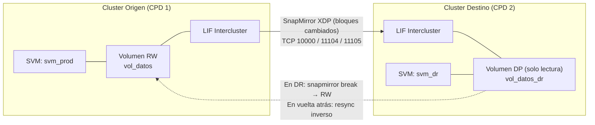

# NetApp ONTAP: SnapMirror, SnapVault y recuperación ante desastres

## El problema

Tener snapshots horarios en tu cabina NetApp te salva de un borrado accidental o de una actualización fallida, pero no sirve de nada si se pierde el CPD, falla el chasis completo o alguien compromete el cluster primario. **SnapMirror** replica volúmenes a un segundo cluster transfiriendo únicamente los bloques cambiados entre snapshots, pero montar la relación es solo la mitad del trabajo: si nunca has ensayado el *failover* (`break`) y la vuelta atrás (*failback* con `resync` inverso), el día del incidente real descubrirás que las *export policies*, los *igroups* o las LIFs de destino no estaban preparados.

Esta página cubre el ciclo completo: requisitos de *peering*, creación e inicialización de una relación `XDP`, diferencias entre `MirrorAllSnapshots` y `MirrorAndVault` (SnapVault), procedimiento ordenado de *failover* y *failback*, y diagnóstico de retrasos (*lag*).

## Arquitectura de replicación y DR

Una relación SnapMirror entre dos clusters ONTAP necesita tres capas previas: **LIFs Intercluster** en cada nodo con conectividad IP entre sedes, **Cluster Peering** (autenticado con frase de paso y cifrado TLS) y **SVM Peering** entre la SVM origen y la SVM destino.



## Políticas: Mirror frente a Vault (`XDP`)

En ONTAP 9.x moderno el tipo de relación estándar es **`XDP`** (*Extended Data Protection*), que unifica replicación rápida (Mirror) y retención larga (Vault) según la política que asignes:

| Política | Qué hace | Cuándo usarla |
|---|---|---|
| `MirrorAllSnapshots` | Replica el volumen completo y **todos** sus snapshots con la misma retención que el origen | Recuperación ante desastres (DR) con RPO bajo |
| `XDPDefault` | Replica solo los snapshots cuya `snapmirror-label` coincide con las reglas de la política (comportamiento SnapVault) | Archivo de larga retención en un destino más barato |
| `MirrorAndVault` | Combina ambos: mantiene una réplica fiel para DR **y** retiene snapshots etiquetados (diarios/semanales) durante meses en destino | El equilibrio más habitual cuando solo tienes un segundo cluster |

La clave para que `MirrorAndVault` o `XDPDefault` funcionen sin sorpresas es alinear las etiquetas **`snapmirror-label`** de la política de snapshots del volumen origen con las reglas de la política SnapMirror en destino. Si las etiquetas no coinciden, la réplica avanza pero el destino no retiene el histórico largo.

## Paso 1: Cluster peering y SVM peering

Antes de crear cualquier relación, ambos clusters deben conocerse y confiar entre sí mediante sus LIFs de tipo `intercluster`:

```text
# Comprobar que existen LIFs intercluster activas en ambos clusters
network interface show -role intercluster

# En el cluster origen (solicita la relación y pide una frase de paso compartida)
cluster peer create -peer-addrs 10.20.0.11,10.20.0.12 -ipspace Default

# En el cluster destino (misma frase de paso, apuntando a las LIFs del origen)
cluster peer create -peer-addrs 10.10.0.11,10.10.0.12 -ipspace Default

# Verificar disponibilidad del peering entre clusters
cluster peer show
```

Con los clusters emparejados, se autoriza el emparejamiento entre la SVM origen y la SVM destino:

```text
# En el cluster destino
vserver peer create -vserver svm_dr -peer-vserver svm_prod -peer-cluster cluster_origen -applications snapmirror

# En el cluster origen (aceptar la solicitud)
vserver peer accept -vserver svm_prod -peer-vserver svm_dr

# Confirmar estado "peered"
vserver peer show
```

## Paso 2: Crear e inicializar la relación SnapMirror

El volumen destino debe crearse con tipo **`DP`** (*Data Protection*, solo lectura) y con un tamaño igual o superior al volumen origen. **Los comandos de gestión de SnapMirror se ejecutan siempre en el cluster destino.**

```text
# 1. Crear volumen destino tipo DP (sin junction-path mientras sea réplica)
volume create -vserver svm_dr -volume vol_datos_dr -aggregate aggr1_dr -size 500GB -type DP

# 2. Crear la relación XDP con política MirrorAndVault y programación horaria
snapmirror create -source-path svm_prod:vol_datos -destination-path svm_dr:vol_datos_dr -type XDP -policy MirrorAndVault -schedule hourly

# 3. Lanzar la transferencia inicial (baseline)
snapmirror initialize -destination-path svm_dr:vol_datos_dr

# 4. Seguir el progreso y comprobar estado "Snapmirrored" y salud "true"
snapmirror show
```

!!! warning "Prepara el acceso en destino antes del desastre"
    Un volumen `DP` no es escribible, pero sí puedes dejar creadas en `svm_dr` las *export policies* (NFS), los *igroups* (iSCSI) y las LIFs de datos de contingencia. El día que ejecutes `break`, solo tendrás que montar el *junction path* (o mapear la LUN) y apuntar los clientes.

## Paso 3: Failover (activar el destino en caso de desastre)

Cuando el origen cae o vas a hacer una prueba real de DR, el objetivo es detener actualizaciones pendientes y convertir el volumen `DP` en lectura/escritura (`RW`):

```text
# 1. Si el origen sigue accesible (simulacro o migración planificada), hacer una última actualización
snapmirror update -destination-path svm_dr:vol_datos_dr

# 2. Detener futuras transferencias programadas
snapmirror quiesce -destination-path svm_dr:vol_datos_dr

# 3. Romper la relación: vol_datos_dr pasa a estado Broken-off y modo RW
snapmirror break -destination-path svm_dr:vol_datos_dr

# 4. Publicar el volumen para clientes NAS (montar junction path y asignar export policy)
volume mount -vserver svm_dr -volume vol_datos_dr -junction-path /vol_datos
volume modify -vserver svm_dr -volume vol_datos_dr -policy pol_proxmox_dr
```

Si publicas bloques por iSCSI, tras el `break` la LUN dentro de `vol_datos_dr` ya es escribible y basta con mapearla al *igroup* de los hipervisores de contingencia (`lun mapping create`).

## Paso 4: Failback (volver al cluster origen sin perder cambios)

El error más caro tras un failover es volver a arrancar los servicios en el origen sin traer primero los datos escritos en destino durante la contingencia. La vuelta atrás segura usa un **resync inverso**:

1. **Detén las escrituras** en el origen (si seguía vivo) y asegúrate de que los clientes están trabajando solo contra `svm_dr:vol_datos_dr`.
2. **En el cluster origen**, crea la relación inversa (`svm_dr:vol_datos_dr` → `svm_prod:vol_datos`) y ejecuta `snapmirror resync`: ONTAP busca el último snapshot común y transfiere únicamente los cambios generados durante el DR hacia el origen (que pasa temporalmente a solo lectura).

```text
# En el cluster ORIGEN (inversión de sentido)
snapmirror create -source-path svm_dr:vol_datos_dr -destination-path svm_prod:vol_datos -type XDP -policy MirrorAndVault
snapmirror resync -destination-path svm_prod:vol_datos
snapmirror show
```

3. **Ventana de corte para volver al origen:** para las aplicaciones en destino, lanza un último `snapmirror update` hacia el origen, ejecuta `snapmirror quiesce` y `snapmirror break` sobre `svm_prod:vol_datos`, y vuelve a dar servicio desde el origen.
4. **Restaura la dirección original** desde el cluster destino ejecutando `snapmirror resync -destination-path svm_dr:vol_datos_dr`, y elimina la relación inversa temporal (`snapmirror delete`) una vez confirmes que la original vuelve a estar en estado `Snapmirrored`.

!!! danger "No borres el snapshot base común"
    `snapmirror resync` evita copiar todo el volumen de nuevo apoyándose en el snapshot común más reciente entre origen y destino. Si alguien purga manualmente ese snapshot en ambos extremos, no quedará más remedio que inicializar la réplica desde cero (*baseline* completo).

## Monitorización y verificación de estado

Tres comandos diarios (o automatizables vía REST API `/api/snapmirror/relationships`):

```text
snapmirror show                                       # estado, salud (Healthy) y Lag Time
snapmirror show -healthy false                        # solo relaciones con problemas
snapmirror show-history -destination-path svm_dr:vol_datos_dr  # historial de transferencias y tiempos
```

Vigila siempre **`Lag Time`**: una relación puede aparecer `Idle` y sin errores aparentes pero arrastrar horas de retraso si el enlace está saturado o una transferencia anterior se solapó con la siguiente ventana.

## Troubleshooting

| Síntoma | Causa | Arreglo |
|---|---|---|
| `cluster peer show` marca `Unavailable` | Firewall bloqueando puertos intercluster (TCP 10000, 11104, 11105) o rutas ausentes en la LIF intercluster | Verificar conectividad con `network ping` desde la LIF intercluster y revisar reglas de firewall |
| `snapmirror initialize` falla por tamaño | El volumen destino `DP` es más pequeño que el origen | Ampliar el volumen destino con `volume size` antes de reintentar |
| `Lag Time` crece en cada ciclo | Ancho de banda insuficiente o volumen con tasa de cambio muy alta | Configurar `-throttle` en horarios laborales y escalonar las programaciones (`-schedule`) |
| `snapmirror resync` falla por falta de snapshot común | Se eliminó el snapshot base de la relación | Re-inicializar la relación desde cero o restaurar con una relación nueva |
| El destino no retiene snapshots semanales/mensuales | Las `snapmirror-label` de la política de snapshots en origen no coinciden con las reglas de la política `MirrorAndVault` | Alinear las etiquetas entre `volume snapshot policy` (origen) y `snapmirror policy` (destino) |
| Tras `break`, los clientes NFS reciben `access denied` | La *export policy* de destino era `default` o faltaba montar el *junction path* | Ejecutar `volume mount` y asignar la política de contingencia preparada en `svm_dr` |

## Buenas prácticas

- **Ensaya un simulacro de `break` y `resync` al menos dos veces al año** con un volumen de prueba o clonado (`FlexClone` sobre el destino DP permite probar el DR sin romper la relación real).
- **Activa cifrado TLS en el peering** si el tráfico entre clusters sale de una red privada controlada.
- **Escala las ventanas de replicación:** no lances 40 volúmenes a `:00` en punto; reparte los horarios para no saturar el enlace ni los discos del destino.
- **Aplica la regla 3-2-1:** SnapMirror protege frente a la caída de una cabina o un CPD, pero un error administrativo o un compromiso de ambos clusters puede afectar a la réplica; mantén además copias inmutables o fuera de ONTAP ([Estrategia de Backup 3-2-1](../../backups/strategy_321.md)).

## Referencias

- [NetApp ONTAP: SnapMirror data protection](https://docs.netapp.com/us-en/ontap/data-protection/snapmirror-disaster-recovery-concept.html)
- [ONTAP CLI: `snapmirror create`](https://docs.netapp.com/us-en/ontap-cli/snapmirror-create.html) · [`snapmirror initialize`](https://docs.netapp.com/us-en/ontap-cli/snapmirror-initialize.html)
- [ONTAP CLI: `snapmirror break`](https://docs.netapp.com/us-en/ontap-cli/snapmirror-break.html) · [`snapmirror resync`](https://docs.netapp.com/us-en/ontap-cli/snapmirror-resync.html)
- [NetApp ONTAP — Guía base](netapp_base.md) · [Automatización y métricas con Harvest](automation_monitoring.md)
- [Estrategia de Backup 3-2-1](../../backups/strategy_321.md) · [Backup seguro: cifrado e inmutabilidad](../../cybersecurity/backup_seguro.md)
