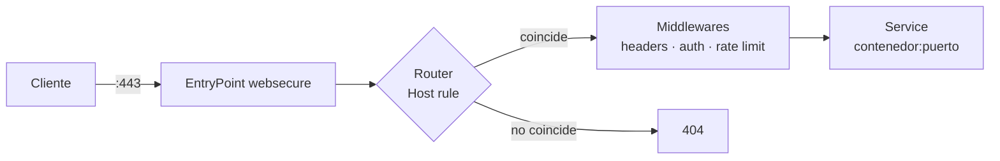

# Traefik

## El problema

Tienes seis servicios en Docker y cada uno escucha en un puerto distinto. Cada vez que añades uno tocas el `nginx.conf`, recargas, y renuevas certificados a mano cuando Let's Encrypt caduca. Multiplica por cada servicio nuevo y el proxy se convierte en el cuello de botella de todos los despliegues.

Traefik invierte el flujo: el contenedor declara cómo quiere ser expuesto mediante *labels*, y el proxy se reconfigura solo. Sin recargas, sin editar ficheros, sin renovaciones manuales.

## 📋 Tabla de Contenidos

- [Modelo mental](#modelo-mental)
- [Configuración estática vs dinámica](#configuracion-estatica-vs-dinamica)
- [Despliegue mínimo con Docker](#despliegue-minimo-con-docker)
- [HTTPS automático con Let's Encrypt](#https-automatico-con-lets-encrypt)
- [Middlewares](#middlewares)
- [Dashboard seguro](#dashboard-seguro)
- [Observabilidad](#observabilidad)
- [Traefik vs HAProxy vs NGINX](#traefik-vs-haproxy-vs-nginx)
- [Troubleshooting](#troubleshooting)
- [Buenas prácticas](#buenas-practicas)
- [Referencias](#referencias)

## Modelo mental

Cuatro conceptos y ya entiendes el 90% de Traefik:

| Concepto | Qué es |
|---|---|
| **EntryPoint** | El puerto donde Traefik escucha (`:80`, `:443`) |
| **Router** | La regla que decide qué petición va a qué servicio (`Host(...)`, `PathPrefix(...)`) |
| **Middleware** | Transformación aplicada antes de llegar al servicio (auth, cabeceras, rate limit) |
| **Service** | El backend real: uno o varios contenedores |



El *provider* (Docker, Kubernetes, fichero) es la fuente desde la que Traefik descubre routers y services. Con el provider Docker, esa fuente son las labels de los contenedores.

## Configuración estática vs dinámica

La distinción que más confusión genera:

- **Estática**: se lee **solo al arrancar**. EntryPoints, providers, resolvers ACME, logs. Cambiarla exige reiniciar el contenedor. Va en flags de `command:`, en `traefik.yml` o en variables de entorno.
- **Dinámica**: se recarga **en caliente**. Routers, services, middlewares, certificados. Va en labels de contenedor o en ficheros vigilados del `providers.file.directory`.

> Si editas algo y no surte efecto sin reiniciar, casi siempre es porque lo pusiste en el sitio equivocado.

## Despliegue mínimo con Docker

Red externa compartida por el proxy y los servicios expuestos:

```bash
docker network create proxy
```

`docker-compose.yml` del proxy:

```yaml
services:
  traefik:
    image: "traefik:v3.4"
    container_name: traefik
    restart: unless-stopped
    security_opt:
      - no-new-privileges:true
    networks:
      - proxy
    ports:
      - "80:80"
      - "443:443"
    command:
      # --- API y dashboard ---
      - "--api.dashboard=true"
      - "--api.insecure=false"          # nunca true fuera de localhost
      # --- Providers ---
      - "--providers.docker=true"
      - "--providers.docker.exposedbydefault=false"  # opt-in explícito
      - "--providers.docker.network=proxy"
      # --- EntryPoints ---
      - "--entryPoints.web.address=:80"
      - "--entryPoints.websecure.address=:443"
      - "--entryPoints.web.http.redirections.entryPoint.to=websecure"
      - "--entryPoints.web.http.redirections.entryPoint.scheme=https"
      - "--entryPoints.websecure.http.tls=true"
    volumes:
      - "/var/run/docker.sock:/var/run/docker.sock:ro"
      - "./letsencrypt:/letsencrypt"

networks:
  proxy:
    external: true
```

Dos decisiones importantes ya tomadas ahí:

- **`exposedbydefault=false`**: ningún contenedor se publica salvo que lleve `traefik.enable=true`. Sin esto, levantar una base de datos en la misma red la expondría a Internet.
- **Redirección 80 → 443 a nivel de entryPoint**: se aplica globalmente, no hay que repetirla router a router.

Un servicio detrás del proxy solo necesita labels:

```yaml
services:
  whoami:
    image: traefik/whoami
    restart: unless-stopped
    networks:
      - proxy
    labels:
      - "traefik.enable=true"
      - "traefik.http.routers.whoami.rule=Host(`whoami.example.com`)"
      - "traefik.http.routers.whoami.entrypoints=websecure"

networks:
  proxy:
    external: true
```

No hay `ports:`. El contenedor no publica nada al host: solo Traefik lo alcanza, por la red `proxy`.

!!! tip "Cuando el contenedor expone varios puertos"
    Traefik no puede adivinar cuál usar y falla. Indícalo:
    `traefik.http.services.whoami.loadbalancer.server.port=8080`

## HTTPS automático con Let's Encrypt

### Desafío HTTP-01

Suficiente si el puerto 80 es accesible desde Internet. Añade a la config estática:

```yaml
command:
  - "--certificatesresolvers.le.acme.email=tu-email@example.com"
  - "--certificatesresolvers.le.acme.storage=/letsencrypt/acme.json"
  - "--certificatesresolvers.le.acme.httpchallenge.entrypoint=web"
  # Resolver por defecto para todo router TLS
  - "--entryPoints.websecure.http.tls.certresolver=le"
```

`acme.json` guarda las claves privadas. Debe persistir en volumen y tener permisos `600`; si no, Traefik se niega a arrancar.

```bash
touch letsencrypt/acme.json && chmod 600 letsencrypt/acme.json
```

### Desafío DNS-01 (wildcards)

Obligatorio para `*.example.com` y para servicios internos sin puerto 80 público. Requiere credenciales del proveedor DNS:

```yaml
command:
  - "--certificatesresolvers.le.acme.dnschallenge=true"
  - "--certificatesresolvers.le.acme.dnschallenge.provider=cloudflare"
environment:
  - "CF_DNS_API_TOKEN=${CF_DNS_API_TOKEN}"
```

Y en el router que pide el wildcard:

```yaml
labels:
  - "traefik.http.routers.app.tls.certresolver=le"
  - "traefik.http.routers.app.tls.domains[0].main=example.com"
  - "traefik.http.routers.app.tls.domains[0].sans=*.example.com"
```

!!! warning "Rate limits de Let's Encrypt"
    50 certificados por dominio registrado y semana, y solo 5 intentos fallidos por hora. Prueba siempre contra el entorno de staging antes de tocar producción:
    `--certificatesresolvers.le.acme.caserver=https://acme-staging-v02.api.letsencrypt.org/directory`
    Los certificados de staging no son válidos: bórralos de `acme.json` al pasar a producción.

## Middlewares

Se declaran una vez y se referencian por nombre. Los más útiles en self-hosted:

```yaml
labels:
  # --- Cabeceras de seguridad ---
  - "traefik.http.middlewares.secure-headers.headers.frameDeny=true"
  - "traefik.http.middlewares.secure-headers.headers.contentTypeNosniff=true"
  - "traefik.http.middlewares.secure-headers.headers.browserXssFilter=true"
  - "traefik.http.middlewares.secure-headers.headers.stsSeconds=31536000"
  - "traefik.http.middlewares.secure-headers.headers.stsIncludeSubdomains=true"
  - "traefik.http.middlewares.secure-headers.headers.stsPreload=true"

  # --- Rate limiting: 100 req/s de media, ráfagas de 200 ---
  - "traefik.http.middlewares.ratelimit.ratelimit.average=100"
  - "traefik.http.middlewares.ratelimit.ratelimit.period=1s"
  - "traefik.http.middlewares.ratelimit.ratelimit.burst=200"

  # --- Restricción por origen (red interna) ---
  - "traefik.http.middlewares.lan-only.ipallowlist.sourcerange=192.168.0.0/16,10.0.0.0/8"

  # --- Autenticación básica ---
  - "traefik.http.middlewares.auth.basicauth.users=admin:$$apr1$$xxxxxxxx$$yyyyyyyyyyyyyyyyyyyyy"
```

Se encadenan en orden, separados por comas:

```yaml
  - "traefik.http.routers.app.middlewares=secure-headers,ratelimit"
```

!!! danger "El detalle del `$` que arruina la tarde"
    En `docker-compose.yml` **cada `$` del hash bcrypt debe duplicarse**, porque Compose interpola variables. Genera el valor ya escapado:
    ```bash
    echo $(htpasswd -nB admin) | sed -e 's/\$/\$\$/g'
    ```
    Si no lo duplicas, Compose se come parte del hash y la autenticación falla con un error que no menciona el `$` por ninguna parte.

    Mejor todavía: mete el hash en un fichero de configuración dinámica (`providers.file`), donde no hay interpolación y no hay que escapar nada. Ver [gestión de secretos](../cybersecurity/gestion_secretos.md).

Para autenticación real (SSO, MFA, usuarios) delega en un IdP mediante `forwardauth`, en vez de mantener listas de `basicauth`:

```yaml
  - "traefik.http.middlewares.sso.forwardauth.address=http://authentik:9000/outpost.goauthentik.io/auth/traefik"
  - "traefik.http.middlewares.sso.forwardauth.trustForwardHeader=true"
```

Ver [Authentik](../identity/authentik.md) y [Keycloak](../identity/keycloak.md).

## Dashboard seguro

El dashboard expone toda tu topología: hosts, routers, backends. `--api.insecure=true` lo publica **sin autenticación** en el puerto 8080. No lo uses fuera de tu portátil.

La versión correcta: un router más, con TLS y middlewares, apuntando al servicio interno `api@internal`.

```yaml
services:
  traefik:
    # ... resto de la configuración ...
    labels:
      - "traefik.enable=true"
      - "traefik.http.routers.dashboard.rule=Host(`traefik.example.com`)"
      - "traefik.http.routers.dashboard.entrypoints=websecure"
      - "traefik.http.routers.dashboard.service=api@internal"
      - "traefik.http.routers.dashboard.tls.certresolver=le"
      - "traefik.http.routers.dashboard.middlewares=auth,lan-only,secure-headers"
```

Tres capas: TLS, autenticación y restricción por IP de origen. Si el dashboard solo se consulta desde la LAN o la VPN, `lan-only` es la defensa más barata y efectiva — combínalo con [WireGuard](../linux/wireguard.md) o [Tailscale](../networking/tailscale.md) y no expongas el dashboard a Internet en absoluto.

!!! warning "El socket de Docker es acceso root"
    Montar `/var/run/docker.sock` en Traefik equivale a dar root del host a ese contenedor: quien lo comprometa puede arrancar un contenedor privilegiado. Mitigaciones, de menor a mayor esfuerzo:

    1. `:ro` y `no-new-privileges:true` (ya incluidos arriba) — ayudan, pero no impiden el escalado.
    2. Un proxy de socket que filtre la API de Docker a solo lectura de contenedores.
    3. Provider por fichero en vez de Docker: sin socket, a cambio de configuración manual.

    Ver [seguridad en Docker](../docker/docker_security.md).

## Observabilidad

Traefik expone métricas Prometheus nativas:

```yaml
command:
  - "--metrics.prometheus=true"
  - "--metrics.prometheus.addEntryPointsLabels=true"
  - "--metrics.prometheus.addServicesLabels=true"
  - "--accesslog=true"
  - "--accesslog.format=json"
```

Métricas que importan en un panel:

| Métrica | Para qué |
|---|---|
| `traefik_service_requests_total` | Tasa de peticiones y ratio de 5xx por servicio |
| `traefik_service_request_duration_seconds` | Latencia p95/p99 del backend |
| `traefik_entrypoint_open_connections` | Saturación del entryPoint |
| `traefik_tls_certs_not_after` | **Días hasta caducidad del certificado** |

La última es la alerta que evita el incidente clásico: renovación ACME fallando en silencio durante semanas. Alerta a 21 días. Ver [stack de observabilidad](../monitoring/observability_stack.md).

## Traefik vs HAProxy vs NGINX

| | Traefik | HAProxy | NGINX |
|---|---|---|---|
| Configuración | Dinámica, por labels | Fichero, recarga | Fichero, recarga |
| Descubrimiento | Automático (Docker/K8s) | Manual o vía plantillas | Manual o vía plantillas |
| TLS automático | Integrado (ACME) | Externo (certbot) | Externo (certbot) |
| Rendimiento bruto | Bueno | **El mejor** | Muy bueno |
| Capa 4 (TCP/UDP) | Sí | **Muy completo** | Sí (stream) |
| Curva de aprendizaje | Suave si usas contenedores | Pronunciada | Media |

Regla práctica: **Traefik** cuando el inventario de servicios cambia a menudo (contenedores, self-hosted, entornos efímeros). **HAProxy** cuando el inventario es estable y necesitas exprimir latencia, balanceo L4 o *health checking* fino — ver [HAProxy avanzado](../haproxy/haproxy_advanced.md). Comparativa completa en [Load Balancing](../networking/load_balancer_comparison.md).

## Troubleshooting

| Síntoma | Causa habitual | Comprobación |
|---|---|---|
| **404 page not found** | El router no existe o no casa la regla | `docker logs traefik` y el dashboard: ¿aparece el router? |
| **Bad Gateway (502)** | Traefik llega al contenedor pero al puerto equivocado | Fija `loadbalancer.server.port` |
| **Gateway Timeout (504)** | Proxy y servicio en redes distintas | `docker network inspect proxy` — ¿están los dos? |
| **Certificado TLS por defecto** | ACME falló; sirve el autofirmado | `--log.level=DEBUG` y busca `acme` en los logs |
| **Cambios que no se aplican** | Editaste configuración estática | Reinicia el contenedor |
| **basicauth siempre rechaza** | `$` sin duplicar en Compose | Compara el hash en el contenedor con el original |

Inspección rápida de lo que Traefik ha entendido de verdad, sin abrir el dashboard:

```bash
# Requiere el dashboard accesible; ajusta host y credenciales
curl -s https://traefik.example.com/api/http/routers | jq '.[] | {name, rule, status, service}'
curl -s https://traefik.example.com/api/http/services | jq '.[] | {name, serverStatus}'
```

`status: "disabled"` en un router indica que Traefik lo cargó pero lo descartó: casi siempre un middleware o un certResolver referenciado que no existe.

## Buenas prácticas

- **`exposedbydefault=false` siempre.** Exponer es opt-in, nunca por omisión.
- **Fija la versión de la imagen** (`traefik:v3.4`, no `:latest`). Los saltos de major cambian la sintaxis de configuración.
- **Un middleware `secure-headers` global** aplicado a todos los routers públicos, no copiado servicio a servicio.
- **`acme.json` en volumen persistente con permisos 600** e incluido en tu [estrategia de backup](../backups/strategy_321.md): perderlo significa re-emitir todos los certificados y arriesgarse a los rate limits.
- **Staging de Let's Encrypt para probar.** Los 5 fallos/hora se agotan mucho antes de lo que parece.
- **Alerta sobre `traefik_tls_certs_not_after`.** La renovación automática también falla.
- **Nada de dashboard público.** VPN o `ipallowlist`, y si no queda otra, TLS + auth + rate limit.

## Referencias

- [Documentación oficial de Traefik](https://doc.traefik.io/traefik/)
- [Referencia de middlewares HTTP](https://doc.traefik.io/traefik/reference/routing-configuration/http/middlewares/overview/)
- [Rate limits de Let's Encrypt](https://letsencrypt.org/docs/rate-limits/)
- [HAProxy](../haproxy/haproxy_base.md) · [Comparativa de balanceadores](../networking/load_balancer_comparison.md)
- [Certificados TLS](../networking/certificados_tls.md) · [Seguridad en Docker](../docker/docker_security.md)
