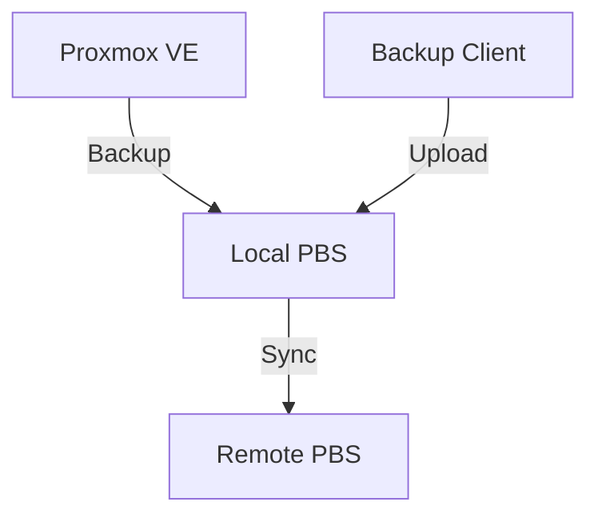

# Proxmox Backup Server (PBS)

The perfect companion for Proxmox VE. Enables ultra-fast deduplicated incremental backups.

## The problem

The classic PVE `vzdump` stores one compressed file per backup. With ten VMs and a month of retention you end up with hundreds of gigabytes of nearly identical data, and every backup reads and writes the whole disk even if only 1% changed. In a homelab that means long backup windows, full disks and retention trimmed "for space".

PBS solves all three: it splits data into chunks, **deduplicates** them across all backups, makes **incremental** VM backups (only changed blocks are sent) and adds what `vzdump` lacks: integrity verification, replication to another server and single-file restore. This page covers how to set it up; the general policy (how many copies, where) is in [3-2-1 Backup Strategy](strategy_321.md).

## 📋 Table of Contents

- [Installation](#installation)
- [Key Concepts](#key-concepts)
- [Datastore](#datastore)
- [Users and tokens](#users-and-tokens)
- [PVE Integration](#pve-integration)
- [Prune and garbage collection](#prune-and-garbage-collection)
- [Verification](#verification)
- [Replication to a second PBS](#replication-to-a-second-pbs)
- [Client on Linux servers](#client-on-linux-servers)
- [Restore](#restore)
- [Example Topology](#example-topology)
- [Troubleshooting](#troubleshooting)
- [Best practices](#best-practices)
- [References](#references)

## Installation

Can be installed as a standalone ISO or on top of Debian. The ISO is simplest: it installs the system, the repository and the web interface on port 8007.

```bash
apt update
apt install proxmox-backup-server
```

On Debian you first need to add the Proxmox repository for your Debian version (without a subscription there is a `no-subscription` repository). Exact suite names and the key depend on the version; copy them from the official documentation, not from memory.

**Do not install it on the node it protects.** If the PVE host dies and the PBS lived in a VM on that host, you lose server and backups at once. A sensible homelab choice is a mini PC or old machine with its own disks, or at least a physical machine separate from the cluster.

## Key Concepts

- **Datastore:** Where data is stored (dedicated disk recommended, ZFS is ideal).
- **Remote:** Another PBS server for replication (Off-site backup).
- **Prune:** Retention policies (e.g., keep last 7 daily, 4 weekly).
- **Namespace:** a logical subdivision inside a datastore, useful to separate environments or clients with different permissions.
- **Snapshot:** a specific backup of a group (for example `vm/100`), identified by its date.
- **Garbage collection (GC):** deletes chunks no snapshot references any more. Prune only removes snapshots; space is freed by the GC.
- **Verify:** rereads the chunks and checks that their content matches their hash.

## Datastore

A datastore is a directory on a filesystem. PBS performance depends almost entirely on that disk: PBS writes and reads millions of small chunks, so spinning disks are slow at verification and GC; ideally use a ZFS pool with SSDs (even just for metadata) or plain SSDs. Avoid NFS/SMB mounts as datastore: the official documentation asks for fast local storage with high IOPS and describes the datastore on a local Unix filesystem (ext4, xfs or zfs).

Example with a dedicated ZFS dataset, created on the PBS host:

```bash
zfs create tank/pbs
proxmox-backup-manager datastore create main /tank/pbs
proxmox-backup-manager datastore list
```

It can also be created from the web interface, under `Administration -> Storage / Disks` and `Datastore -> Add Datastore`. GC and verification schedules are configured on the datastore; the exact options vary between versions, so check `proxmox-backup-manager datastore update --help` on your install.

## Users and tokens

Do not use `root@pam` from PVE. Create a backup user and give it only the role it needs on that datastore.

```bash
proxmox-backup-manager user create pve-backup@pbs --password 'change-this'
proxmox-backup-manager acl update /datastore/main DatastoreBackup --auth-id pve-backup@pbs
```

`DatastoreBackup` allows creating backups and reading your own, but not deleting other people's: a compromised PVE cannot destroy the history. For tasks that must delete (client-side prune) there is the `DatastorePowerUser` role (backup, restore and prune of your own backups) or `DatastoreAdmin`; check the role list in the interface.

For automation, an **API token** beats a password, because it can be revoked without touching the user:

```bash
proxmox-backup-manager user generate-token pve-backup@pbs pve
```

The secret is shown only once, when generated. Tokens have their own permissions: also assign an ACL to the token (`pve-backup@pbs!pve`) or it will have no access.

## PVE Integration

In Proxmox VE: `Datacenter -> Storage -> Add -> Proxmox Backup Server`.
Enter the IP and the `Fingerprint` (copied from the PBS Dashboard).

The fields that matter: the datastore, the user (`pve-backup@pbs`) and its password or token secret. The fingerprint is also visible on the PBS server:

```bash
proxmox-backup-manager cert info
```

Verify the fingerprint the first time; it is what protects you from an impersonated server when the certificate is self-signed. Then create a job under `Datacenter -> Backup` with that storage as target. The first backup of each VM copies everything; later ones only send changed blocks. On the PVE storage you can enable client-side encryption: it generates a key, and **you must store it outside PBS and PVE** (password manager or printed). Without the key, those backups cannot be restored.

More context on nodes and storage in [Proxmox base](../proxmox/proxmox_base.md).

## Prune and garbage collection

Retention is two distinct steps and neither deletes data on its own:

1. **Prune** decides which snapshots are surplus according to the policy (`keep-last`, `keep-daily`, `keep-weekly`, `keep-monthly`, `keep-yearly`) and marks them as removed.
2. **Garbage collection** walks the datastore and deletes chunks no snapshot references, actually freeing space.

A typical homelab policy: 7 daily, 4 weekly, 6 monthly. GC runs once a day or week outside the backup window.

!!! warning "Version dependent"
    In older versions prune was configured inside the datastore or the backup job in PVE. Recent versions have PBS-side *prune jobs* (`proxmox-backup-manager prune-job`). Check which one your interface offers and do not configure prune in two places with different policies.

GC has a safety margin: freshly written chunks are not deleted until some time has passed, so after a prune the space does not drop instantly. This is normal.

## Verification

A backup you have never read is a gamble. A **verify job** rereads the chunks and compares their hash; it detects bit rot and silently failing disks.

```bash
proxmox-backup-manager verify-job create weekly --store main --schedule 'sat 03:00'
proxmox-backup-manager verify-job list
```

Verified snapshots are marked and, by default, are not verified again until some time has passed, so the periodic job only works on new data. A snapshot that fails verification is flagged as failed in the interface: restore it from another copy (the remote PBS) and delete the damaged one.

Verifying does not replace a **real restore test**: now and then restore a test VM on a PVE and boot it.

## Replication to a second PBS

The off-site copy of the 3-2-1 rule is done with a **sync job**: a remote PBS pulls snapshots from the main one (or the other way around). It is better for the remote to pull: the remote holds read credentials for the main server and the main server cannot delete the remote.

On the remote PBS, register the main one and create the job:

```bash
proxmox-backup-manager remote create home --host pbs.home.example --auth-id sync@pbs --password 'change-this' --fingerprint 'AA:BB:...'
proxmox-backup-manager sync-job create home-daily --store offsite --remote home --remote-store main --schedule daily
```

The `sync@pbs` user on the main server needs read permission on the datastore (for example `DatastoreReader`). Traffic goes over HTTPS on 8007: a WireGuard tunnel between the two sites (see [WireGuard](../linux/wireguard.md)) avoids exposing the port. A remote PBS can be a VPS with disk or a server at a friend's house; if you do not trust the site, encrypt the backups on the client. The remote applies its own prune policy, so it can keep more history than the main one.

## Client on Linux servers

Not everything is a VM. For physical Linux servers, containers or directories there is `proxmox-backup-client`, which uses the same datastore with the same deduplication.

```bash
export PBS_REPOSITORY='pve-backup@pbs@pbs.lan:main'
export PBS_PASSWORD='change-this'

proxmox-backup-client backup etc.pxar:/etc home.pxar:/home
proxmox-backup-client snapshot list
```

`PBS_REPOSITORY` has the format `user@realm@host:datastore` (with tokens, `user@realm!token@host:datastore`) and saves repeating `--repository`. Each `name.pxar:/path` argument creates an archive inside the snapshot. To automate it use a systemd timer (see [systemd](../linux/systemd.md)) and an environment file with `0600` permissions for the password; do not leave it in the script.

The client also applies retention per backup group:

```bash
proxmox-backup-client prune host/$(hostname) --keep-daily 7 --keep-weekly 4
```

If you prefer a file repository without a dedicated server, compare with [restic and Borg](restic_borg.md): PBS wins on VMs and centralized deduplication, restic/Borg on simplicity and object storage targets.

## Restore

With the client you restore a specific archive from a snapshot into a directory:

```bash
proxmox-backup-client snapshot list
proxmox-backup-client restore host/server/2026-10-10T03:00:00Z etc.pxar /tmp/restore-etc
```

The snapshot name is the one `snapshot list` shows; copy it literally. VMs are restored from the PVE interface (`Storage -> Backups -> Restore`), and from the same screen you can pick **File Restore** to pull a file from inside a VM without restoring it entirely. In the PBS interface you can also download files from a snapshot through the datastore browser.

Restoring a VM over an existing one overwrites it. Restore with a new ID when you only want to check or recover data.

## Example Topology



In a typical homelab: one or more PVE nodes back up nightly to the local PBS; standalone Linux servers use the client; a second, external PBS pulls the snapshots every day. That covers the three copies and the off-site of [3-2-1](strategy_321.md).

## Troubleshooting

| Symptom | Likely cause | Fix |
|---------|--------------|-----|
| PVE cannot add the PBS storage | Wrong fingerprint, port 8007 blocked or datastore misspelled | Copy the fingerprint with `proxmox-backup-manager cert info`; try `https://IP:8007` from the PVE node |
| `permission check failed` when backing up | The user or token has no ACL on the datastore | Check `Configuration -> Access Control -> Permissions`; the token needs its own ACL |
| Datastore still full after prune | Prune only marks snapshots; the GC is missing or the safety margin has not passed | Run or wait for the GC; check the GC job is scheduled |
| Backups getting slower | Datastore on spinning disk or nearly full | Move to SSD/ZFS with fast metadata; free space; check the network |
| Verify marks snapshots as failed | Corrupt chunks from a faulty disk or RAM | Check SMART and `zpool status`; restore from the remote and delete the damaged snapshot |
| Cannot restore an encrypted backup | The client encryption key is missing | No fix without the key: store it outside PVE and PBS from day one |
| The sync job pulls nothing | Wrong remote credentials or fingerprint, or missing read permission | Test the remote with the same user; check the ACL on the main server |
| Certificate error after renewal | The fingerprint changed | Update the fingerprint in the PVE storage or in the remote |

## Best practices

- Keep the PBS on hardware and disks separate from what it protects.
- Use one user per consumer with the minimum role, and tokens for automation.
- Schedule prune, GC and verify separately and outside the backup window.
- Replicate to a second PBS and, better, do it in *pull* mode.
- Store the encryption key outside the infrastructure it protects.
- Watch datastore space and job failure alerts (the interface supports notifications).
- Restore a test VM periodically; it is the only valid proof.
- Use fast local storage for the datastore, not NFS/SMB.
- Update PVE and PBS to compatible versions and read the release notes before a major jump.

## References

- [Official Proxmox Backup Server documentation](https://pbs.proxmox.com/docs/)
- [`proxmox-backup-client` manual](https://pbs.proxmox.com/docs/backup-client.html)
- [3-2-1 Backup Strategy](strategy_321.md)
- [restic and Borg](restic_borg.md)
- [Proxmox base](../proxmox/proxmox_base.md)
- [Proxmox Backup Server: proxmox-backup-manager](https://pbs.proxmox.com/docs/proxmox-backup-manager/synopsis.html)
- [Proxmox Backup Server: remotes and sync](https://pbs.proxmox.com/docs/managing-remotes.html)
