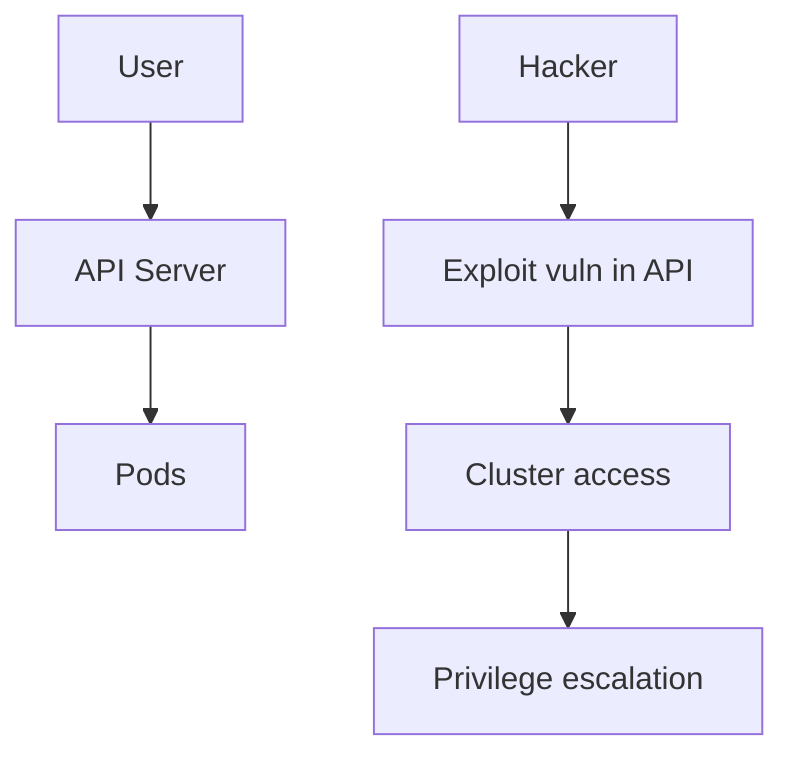

## Summary

This guide explains what a threat model is and how to identify common threats in cloud and DevOps infrastructure environments. It is based on frameworks such as OWASP Top 10 for web/infrastructure applications and MITRE ATT&CK for adversary tactics.

## Prerequisites

- Basic knowledge of cybersecurity (vulnerabilities, common attacks).
- Understanding of cloud environments (AWS, Azure, GCP) or on-premises infrastructure (Kubernetes, Docker).

## What Is a Threat Model?

A threat model is a structured process for identifying, quantifying and prioritizing potential threats to a system. It helps you understand what can go wrong and how to mitigate it before it happens.

### Key Components

- **Assets:** What to protect (data, services, infrastructure).
- **Threats:** What can harm the assets (hackers, malware, human error).
- **Vulnerabilities:** Weaknesses that enable threats.
- **Mitigations:** Controls to reduce risks.

## Common Threats in Infrastructure

### OWASP Top 10 for Infrastructure

1. **Broken Access Control:** Unauthorized access to resources.
2. **Cryptographic Failures:** Weak or misconfigured encryption.
3. **Injection:** Attacks such as SQL injection in APIs or configs.
4. **Insecure Design:** Architectures with inherent security flaws.
5. **Security Misconfiguration:** Default or exposed configurations.
6. **Vulnerable Components:** Dependencies with known CVEs.
7. **Identification and Authentication Failures:** Weak authentication.
8. **Software and Data Integrity Failures:** Manipulation of data or software.
9. **Security Logging and Monitoring Failures:** Missing logs for detection.
10. **Server-Side Request Forgery (SSRF):** Attacks launched from the server.

### MITRE ATT&CK for Infrastructure

Common tactics in cloud/K8s environments:

- **Reconnaissance:** Port scanning, service enumeration.
- **Initial Access:** Exploitation of exposed configs (e.g., public S3 buckets).
- **Execution:** Remote code execution in containers.
- **Persistence:** Backdoors in Docker images or K8s configs.
- **Privilege Escalation:** From user to root in pods.
- **Defense Evasion:** Hiding malware in ephemeral containers.

## How to Create a Threat Model

### Steps

1. **Define scope:** Diagram the architecture (use draw.io or Mermaid).
2. **Identify assets:** Sensitive data, APIs, databases.
3. **Enumerate threats:** Use STRIDE (Spoofing, Tampering, Repudiation, Information Disclosure, Denial of Service, Elevation of Privilege).
4. **Assess risks:** Probability vs impact.
5. **Define mitigations:** Technical controls and processes.

### Tools

- **Microsoft Threat Modeling Tool:** Free, guided.
- **OWASP Threat Dragon:** Open source, web-based.
- **Mermaid for diagrams:** Built into this documentation.

## Examples

### Simple threat diagram in K8s

Mitigations: strict RBAC, Network Policies, admission controllers.

## References

- [OWASP Threat Modeling](https://owasp.org/www-community/Application_Threat_Modeling)
- [MITRE ATT&CK](https://attack.mitre.org/)
- [NIST SP 800-30: Risk Management](https://csrc.nist.gov/publications/detail/sp/800-30/rev-1/final)
