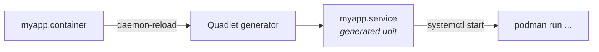

# Podman Quadlet — Containers as systemd services

## The problem

Your container runs perfectly… until you reboot the server. Then you meet the usual pattern: a `docker-compose.yml`, a `restart: always`, and a hand-written systemd unit calling `docker compose up` — two supervisors arguing over the same process. When the container dies, systemd thinks the service is still alive because the start command returned 0 half an hour ago.

Quadlet removes the middle layer: you write a declarative file, systemd generates the unit, and **the container is the service**. One supervisor, real dependencies, `journalctl` working exactly as it does for any other daemon.

!!! note "What this covers and what it doesn't"
    This page is about the **lifecycle**: declaring, starting, ordering dependencies, checking health and updating. The rootless privilege model (user namespaces, subuid/subgid) lives in [Rootless Podman](podman_rootless.md), which introduces Quadlet briefly; this page is the full version.

## 📋 Table of Contents

- [How it works](#how-it-works)
- [Your first .container](#your-first-container)
- [Where the files go](#where-the-files-go)
- [Volumes, networks and pods](#volumes-networks-and-pods)
- [Healthchecks and lifecycle](#healthchecks-and-lifecycle)
- [Dependencies and startup order](#dependencies-and-startup-order)
- [Automatic updates](#automatic-updates)
- [Migrating from Docker Compose](#migrating-from-docker-compose)
- [Troubleshooting](#troubleshooting)
- [Best practices](#best-practices)
- [References](#references)

## How it works

Quadlet is a **systemd generator**. It is not a daemon or a process: it runs during `daemon-reload`, reads your `.container` files and writes ephemeral `.service` units in memory.



Three practical consequences of it being a generator:

1. **Every change requires `daemon-reload`.** Editing the file is not enough.
2. **You cannot `systemctl enable`** a generated unit: it does not exist as a linkable file on disk. Autostart is declared with `[Install] WantedBy=` inside the `.container` itself.
3. **Syntax errors surface at `daemon-reload`**, not at start time. A malformed file simply produces no unit, and `systemctl start` answers "Unit not found".

## Your first .container

```ini
# ~/.config/containers/systemd/whoami.container
[Unit]
Description=whoami service
After=network-online.target

[Container]
Image=docker.io/traefik/whoami:latest
PublishPort=8080:80
Environment=WHOAMI_NAME=demo

[Service]
Restart=always

[Install]
WantedBy=default.target
```

```bash
systemctl --user daemon-reload
systemctl --user start whoami.service
systemctl --user status whoami.service
```

The unit name derives from the filename: `whoami.container` → `whoami.service`. The `[Unit]`, `[Service]` and `[Install]` sections are plain systemd and are copied verbatim into the generated unit; only `[Container]` is Quadlet-specific.

!!! tip "Surviving logout"
    User services die when you disconnect, unless you enable *lingering*:
    ```bash
    loginctl enable-linger $USER
    ```
    Without it, `WantedBy=default.target` starts the container at login, not at boot. This is the number one failure when deploying rootless on a server.

## Where the files go

| Mode | Path | Control |
|---|---|---|
| **Rootless** (recommended) | `~/.config/containers/systemd/` | `systemctl --user` |
| Rootful | `/etc/containers/systemd/` | `sudo systemctl` |
| Distribution packages | `/usr/share/containers/systemd/` | `sudo systemctl` |

Rootless uses `WantedBy=default.target`; rootful uses `WantedBy=multi-user.target`. Copying an example from one to the other without changing this yields a service that never starts on its own.

## Volumes, networks and pods

Each resource type has its own extension, and `.container` files reference them **by filename**, not by the actual resource name. Quadlet resolves the dependencies for you.

```ini
# ~/.config/containers/systemd/appdata.volume
[Volume]
VolumeName=appdata
Label=app=myapp
```

```ini
# ~/.config/containers/systemd/internal.network
[Network]
Subnet=10.89.0.0/24
Gateway=10.89.0.1
```

```ini
# ~/.config/containers/systemd/myapp.container
[Container]
Image=docker.io/library/nginx:alpine
Volume=appdata.volume:/usr/share/nginx/html:Z
Network=internal.network
PublishPort=8080:80
```

Referencing `appdata.volume` does two things at once: it mounts the volume and adds a `Requires=`/`After=` on `appdata-volume.service`. The volume is created before the container starts, without you ordering anything.

!!! warning "SELinux: `:Z` and `:z`"
    On Fedora, RHEL or any distro with SELinux in *enforcing* mode, an unlabeled volume produces "Permission denied" inside the container even when POSIX permissions are correct. `:Z` labels the content exclusively for that container; `:z` shares it across several. Use `:Z` unless two containers genuinely need the same directory.

To group containers sharing a network — the app-plus-sidecar `localhost` pattern:

```ini
# ~/.config/containers/systemd/web.pod
[Pod]
PublishPort=8080:80
```

```ini
# In each .container of the group
[Container]
Pod=web.pod
```

Ports are published **on the pod**, not on the containers. Inside the pod, members reach each other over `localhost`.

## Healthchecks and lifecycle

`Restart=always` restarts the container when the process **dies**. It does nothing when the process is alive but the service is wedged: exhausted connection pool, deadlock, infinite loop. That is precisely the failure that takes longest to notice.

```ini
[Container]
Image=docker.io/library/nginx:alpine
HealthCmd=curl -fsS http://localhost/ || exit 1
HealthInterval=30s
HealthTimeout=5s
HealthRetries=3
HealthStartPeriod=10s
HealthOnFailure=restart
```

| Key | What for |
|---|---|
| `HealthCmd` | Command run **inside** the container; exit 0 = healthy |
| `HealthInterval` | How often to check |
| `HealthRetries` | Consecutive failures before marking it `unhealthy` |
| `HealthStartPeriod` | Startup grace period: failures here don't count |
| `HealthOnFailure` | What to do on failure: `none`, `kill`, `restart`, `stop` |

`HealthOnFailure=restart` is the key that turns the healthcheck into more than decoration in `podman ps`. Without it, the container stays flagged unhealthy indefinitely and nobody finds out.

`HealthStartPeriod` matters more than it looks: a database taking 40 seconds to accept connections with a 10 s start period enters a restart loop and never comes up. Measure the real startup and add margin.

!!! danger "The healthcheck must exist inside the image"
    `HealthCmd=curl ...` against an `alpine` image without `curl` always fails, and the symptom is a container restarting with no visible cause in the logs. Check what you actually have:
    ```bash
    podman exec myapp sh -c 'command -v curl wget nc'
    ```
    If the image is *distroless* or minimal, use the application's own binary (`pg_isready`, `redis-cli ping`, `nginx -t`) or expose an endpoint that answers `wget -qO-`.

Current state and why it failed:



```bash
podman healthcheck run myapp                    # run the check right now
podman inspect myapp --format '{{.State.Health.Status}}'
podman inspect myapp --format '{{range .State.Health.Log}}{{.Output}}{{end}}'
```



The same reasoning applied to orchestration is in [Kubernetes probes](../kubernetes/probes.md): `HealthStartPeriod` is the conceptual equivalent of `startupProbe`.

## Dependencies and startup order

With Compose, `depends_on` only waits for the container to **start**, not for the service to be **ready**. Here you have real systemd:

```ini
# app.container
[Unit]
Requires=db.service
After=db.service

[Container]
Image=registry.example.com/myapp:1.4.2
Network=internal.network
```

`Requires=` propagates failure (if `db` doesn't start, neither does `app`) and `After=` fixes the ordering. To wait until the database is *ready* and not merely *started*, combine it with a healthcheck on `db.container` and `Restart=on-failure` on `app`: if it starts too early it fails, and systemd retries until the dependency answers.

Controlled restarts, without hammering the service:

```ini
[Service]
Restart=on-failure
RestartSec=10
StartLimitBurst=5
StartLimitIntervalSec=300
```

After 5 failures in 5 minutes systemd stops retrying and leaves the unit `failed`, where your monitoring can see it. Far better than a container restart-looping for days without triggering a single alert.

## Automatic updates

```ini
[Container]
Image=docker.io/library/nginx:alpine
Label=io.containers.autoupdate=registry
```

```bash
systemctl --user enable --now podman-auto-update.timer
podman auto-update --dry-run    # what would be updated, touching nothing
```

With `registry`, Podman compares the local digest against the registry's and, if they differ, pulls the new image and restarts the unit. If the container fails to start, **it automatically rolls back to the previous image**: that is why this is usable in production and a bare `watchtower` is not.

Alternative `Label=io.containers.autoupdate=local`: only updates if you build the image locally yourself; it queries no registry.

!!! warning "Auto-update wants moving tags, your deployments want pinned ones"
    `autoupdate=registry` on `:1.4.2` does nothing: that tag never changes. On `:latest` it works, but it means accepting whatever the maintainer publishes, including a breaking change, at 3 a.m.

    A reasonable middle ground: minor tags (`:1.4`) for home services, pinned tags and deliberate updates for anything that must not go down. Automatic rollback covers a startup failure, not the behavior change that corrupts your data.

## Migrating from Docker Compose

`podman-compose` exists and works, but it keeps both supervisors. If the goal is for systemd to own the service, the translation is direct:

| Compose | Quadlet |
|---|---|
| `image:` | `Image=` |
| `ports:` | `PublishPort=` |
| `volumes:` | `Volume=` (plus `:Z` under SELinux) |
| `environment:` | `Environment=` |
| `env_file:` | `EnvironmentFile=` |
| `networks:` | `Network=` |
| `restart: always` | `[Service] Restart=always` |
| `depends_on:` | `[Unit] Requires=` + `After=` |
| `healthcheck:` | `HealthCmd=` and friends |
| `user:` | `User=` |
| `cap_drop:` | `DropCapability=` |
| *(no equivalent)* | `PodmanArgs=` for flags without a dedicated key |

Shortcut for services already running: generate the skeleton from the container and edit it.

```bash
podman container create --name tmp -p 8080:80 docker.io/library/nginx:alpine
podman generate systemd --new --files --name tmp   # starting point to port into .container
```

`generate systemd` is deprecated in favor of Quadlet — treat it as a starting point, not a destination.

Decision rule: **Compose for local development** (bring the whole stack up and tear it down), **Quadlet for servers** (boot, dependencies, healthchecks and logs integrated with the rest of the system).

## Troubleshooting

| Symptom | Cause | Check |
|---|---|---|
| `Unit myapp.service not found` | Syntax error, or file in the wrong path | Read the `daemon-reload` output |
| Doesn't start after a host reboot | Lingering not enabled | `loginctl show-user $USER \| grep Linger` |
| `Permission denied` on a volume | Missing SELinux label | Add `:Z` |
| Restart loop with no clear error | `HealthCmd` not runnable in the image | `podman inspect --format '{{range .State.Health.Log}}{{.Output}}{{end}}'` |
| Changes not taking effect | Missing `daemon-reload` | Reload again and `restart` |
| Fails rootless, works as root | Port <1024, or subuid not configured | `sysctl net.ipv4.ip_unprivileged_port_start` |

See the exact `podman run` Quadlet generated — the tool that solves most cases:

```bash
# Podman 5.x
podman quadlet print myapp.container

# Any version: run the generator by hand
/usr/lib/systemd/system-generators/podman-system-generator --user --dryrun
```

If the resulting `podman run` isn't what you expected, the problem is in the file, not in Podman. And the logs, as for any system service:

```bash
journalctl --user -u myapp.service -f
```

## Best practices

- **One file per resource**, versioned in Git and deployed with [Ansible](../ansible/ansible_base.md). `.container` files are plain text: infrastructure as code with no extra tooling.
- **`loginctl enable-linger` on every rootless server.** Without it, nothing starts by itself.
- **Healthcheck on anything serving traffic**, with `HealthOnFailure=restart` and a `HealthStartPeriod` that was measured, not guessed.
- **Always set `StartLimitBurst`.** A silent restart loop is worse than a service that is down and visible.
- **Reference `.volume` and `.network` by file**, not by resource name: startup dependencies come for free.
- **Secrets via `Secret=`**, not `Environment=`: environment variables are readable in `podman inspect` and in the journal. See [secrets management](../cybersecurity/gestion_secretos.md).
- **Auto-update with judgment.** Enable it where automatic rollback is enough; update critical services yourself.

## References

- [podman-systemd.unit(5) — full key reference](https://docs.podman.io/en/latest/markdown/podman-systemd.unit.5.html)
- [Quadlet basic usage](https://docs.podman.io/en/latest/markdown/podman-quadlet-basic-usage.7.html)
- [podman-auto-update(1)](https://docs.podman.io/en/latest/markdown/podman-auto-update.1.html)
- [Rootless Podman](podman_rootless.md) · [Docker security](docker_security.md)
- [Systemd](../linux/systemd.md) · [Kubernetes probes](../kubernetes/probes.md)
