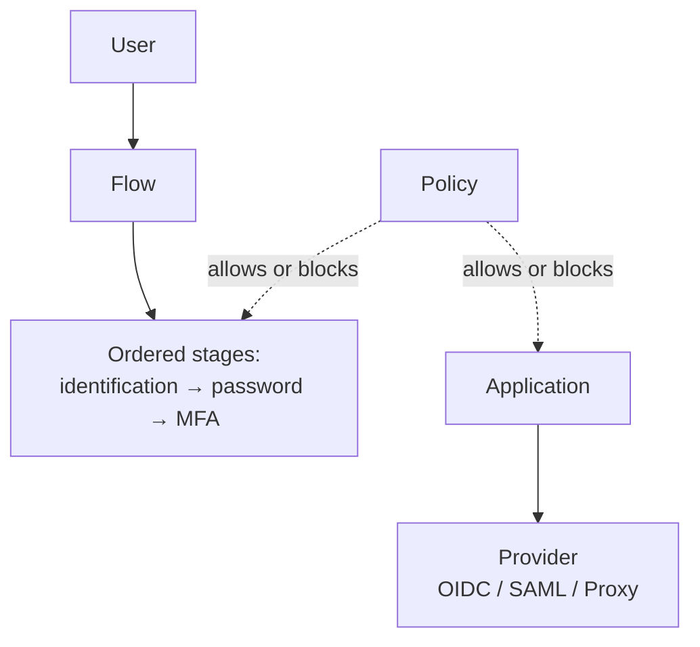
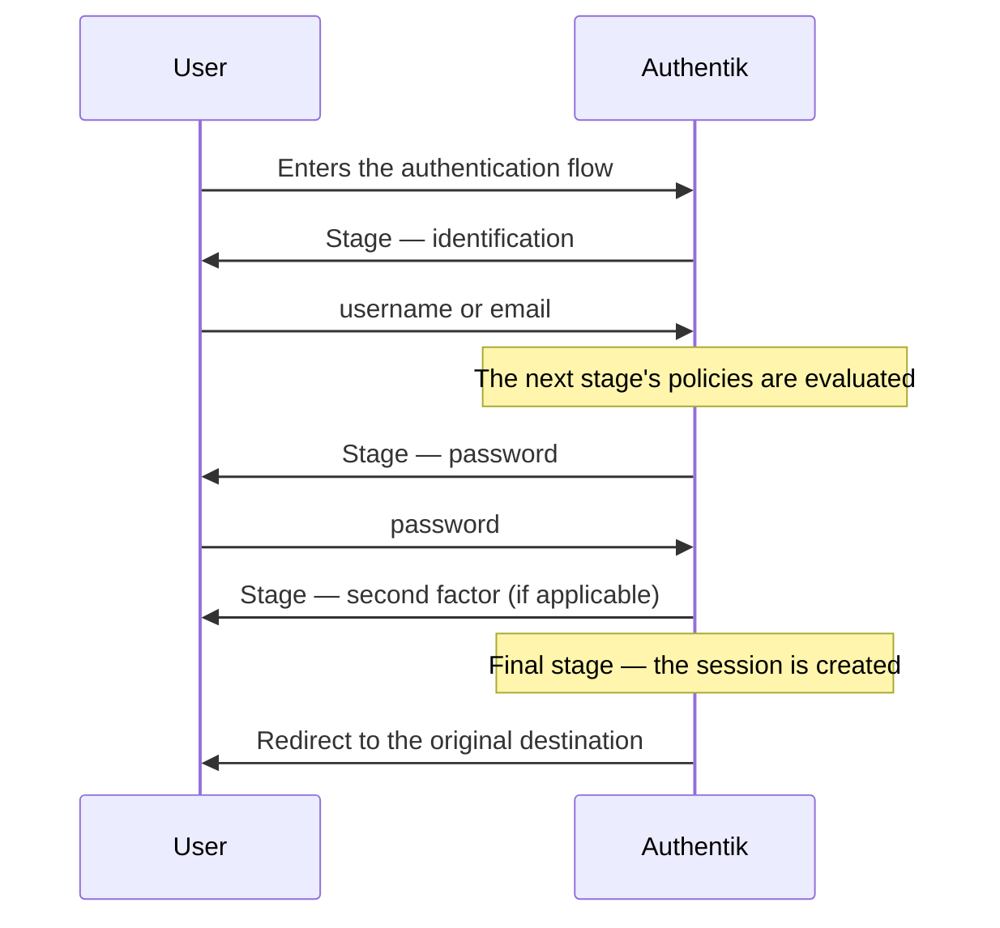
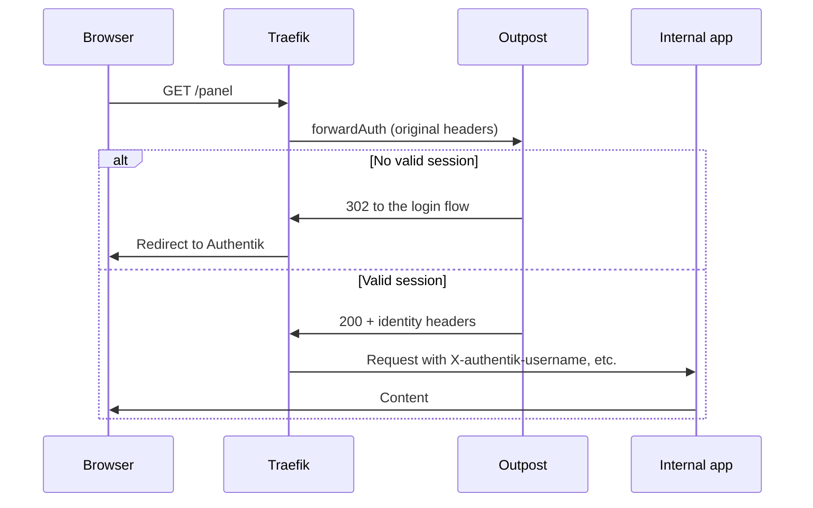

# Authentik — SSO, flows and forward auth

## The problem

You have twelve services and eleven different ways to log into them. Grafana with its own user table, Proxmox with PAM, Nextcloud with yet another database, and three applications that simply **have no login at all**: an internal panel, a metrics exporter, an admin interface that trusts nobody will find it.

An IdP solves the first ones. The real problem is the third group: the ones that don't support SSO and never will. The classic answer is to stack an `oauth2-proxy` in front of each one, with its own config file and its own lifecycle.

Authentik covers both cases with the same piece: it is an OIDC/SAML provider **and** an authentication proxy, on top of the same user base. The price is a data model of its own — flows, stages, policies — that looks like no other IdP's and is where everyone gets stuck during the first week.

!!! warning "Interface labels change between versions"
    Authentik reorganises and renames admin panel options frequently. This page describes **concepts and objects**, which are stable, and avoids quoting button labels or menu paths verbatim. When you read "the client identifier field" here, look for it by what it does, not by exactly what it is called in your version.

## 📋 Table of Contents

- [Authentik vs Keycloak](#authentik-vs-keycloak)
- [The data model](#the-data-model)
- [Deployment](#deployment)
- [Anatomy of a flow](#anatomy-of-a-flow)
- [OIDC and SAML providers](#oidc-and-saml-providers)
- [Proxy provider and forward auth](#proxy-provider-and-forward-auth)
- [Federated sources](#federated-sources)
- [MFA and access policies](#mfa-and-access-policies)
- [Backup and recovery](#backup-and-recovery)
- [Troubleshooting](#troubleshooting)
- [Best practices](#best-practices)
- [References](#references)

## Authentik vs Keycloak

Both are complete open source IdPs and both do OIDC and SAML well. The choice is not about quality, it is about shape.

| | Authentik | [Keycloak](keycloak.md) |
|---|---|---|
| Multi-tenant isolation | By brand and by policies; no equivalent hard separation | Realms, with strong separation of users and configuration |
| Customising the login | By editing the flow: reorder, add or remove stages from the interface | Override templates or write an SPI in Java |
| Proxy for apps without SSO | Included (proxy provider + outposts) | Not included; you add `oauth2-proxy` or another |
| Extension language | Python expressions in policies and mappings | Java, with artifact deployment |
| Ecosystem and maturity | Smaller; living but shifting documentation | Very broad, commercial support, huge installed base |
| Mental model | Its own: you have to learn it | Standard OAuth/SAML, predictable if you already know it |

Practical criterion: **Authentik** if the case includes applications without SSO support, if you want to touch the login process without writing Java, or if you run a small infrastructure where one piece beats three. **Keycloak** if you need genuinely separate realms, if your organisation already has support or experience with it, or if you value the predictability of a large project over convenience. **[Dex](dex.md)** if all you want is to translate an existing backend (LDAP, Keystone, GitHub) into OIDC, without managing users or sessions: Dex is a federation layer, not a stateful IdP.

It is not an entirely reversible decision. OIDC clients are repointed by changing the issuer, but Authentik's flows, policies and application catalogue have no exportable equivalent in Keycloak.

## The data model

This is what you have to understand before touching anything. Five object types:



**Flow** — a multi-step process with a purpose: authenticate, enrol, recover a password, log out, authorise an application. It is an ordered list of stages, not a screen.

**Stage** — a step inside a flow: ask for the identifier, ask for the password, validate a second factor, show the consent screen, write the user into the database. Each stage receives the context from the previous one and enriches it.

**Policy** — a condition evaluated at runtime that returns true or false. It is **bound** to a stage (do I run this step?), to an application (can this user get in?) or to the choice of a flow. It is the authorisation mechanism of the whole system.

**Provider** — the protocol an application uses to talk to Authentik: OIDC, SAML, proxy, LDAP, RADIUS. It holds the secrets, the return URLs and the attribute mappings.

**Application** — the user-facing object: name, icon, entry in the portal. It links to **one** provider and is where access policies are attached.

Two ideas that save a lot of time. First: **application and provider are separate objects on purpose** — the provider is the technical part (secrets, protocol), the application is the business part (who gets in, what shows up in the portal); creating a provider without its application leaves an integration that works via a direct URL but appears nowhere. Second: **authorisation does not live in the flow**, it lives in the policies bound to the application, and it is evaluated after the flow has completed successfully.

There are also **property mappings**, expressions that compute the value of an OIDC claim or a SAML attribute from the user. That is where "the app needs the group in a claim called `roles`" gets solved.

## Deployment

Authentik is four pieces, and all four are required:

| Piece | Role | If missing |
|---|---|---|
| **server** | Web interface and API; serves HTTP traffic | No service at all |
| **worker** | Background tasks: migrations, email, source synchronisation, certificates | It starts, but LDAP never syncs and no email goes out |
| **PostgreSQL** | All state: users, flows, providers, tokens, certificates | It does not start |
| **Redis** | Cache, sessions and task queue | It does not start |

Compose skeleton — the official files include more settings; this is here to show what talks to what:

```yaml
x-authentik: &authentik
  image: ghcr.io/goauthentik/server
  restart: unless-stopped
  environment:
    AUTHENTIK_SECRET_KEY: ${AUTHENTIK_SECRET_KEY}
    AUTHENTIK_POSTGRESQL__HOST: postgresql
    AUTHENTIK_POSTGRESQL__USER: authentik
    AUTHENTIK_POSTGRESQL__NAME: authentik
    AUTHENTIK_POSTGRESQL__PASSWORD: ${PG_PASS}
    AUTHENTIK_REDIS__HOST: redis
  volumes:
    - ./media:/media
  depends_on: [postgresql, redis]

services:
  postgresql:
    image: docker.io/library/postgres:16-alpine
    restart: unless-stopped
    environment:
      POSTGRES_DB: authentik
      POSTGRES_USER: authentik
      POSTGRES_PASSWORD: ${PG_PASS}
    volumes:
      - database:/var/lib/postgresql/data
    healthcheck:
      test: ["CMD-SHELL", "pg_isready -U authentik"]
      interval: 30s

  redis:
    image: docker.io/library/redis:alpine
    restart: unless-stopped
    volumes:
      - redis:/data

  server:
    <<: *authentik
    command: server
    ports: ["9000:9000"]

  worker:
    <<: *authentik
    command: worker

volumes:
  database:
  redis:
```

The double underscore in `AUTHENTIK_POSTGRESQL__HOST` is not a typo: it represents the nesting of the configuration file. Any option documented as `postgresql.host` can be passed as an environment variable with that convention.

!!! danger "`AUTHENTIK_SECRET_KEY` is not just another password"
    It signs sessions and protects sensitive stored data. Changing it invalidates every active session; **losing it along with the backup leaves the database partially unusable**. Keep it with the same care as the PostgreSQL password — see [secrets management](../cybersecurity/gestion_secretos.md).

Behind the reverse proxy, the server needs to know how traffic reaches it: without a correct `X-Forwarded-Proto`, Authentik builds return URLs on `http://` and the browser rejects the secure cookies. With [Traefik](../traefik/traefik_base.md) those headers come by default; with Nginx you have to add them by hand. The first boot exposes an initial setup route to create the administrator account: it is single-use and expires, so **use it as soon as the service is up**.

## Anatomy of a flow

The default authentication flow, step by step:



What to remember:

- **State travels in the flow context.** The identification stage leaves the resolved user in the context and the password stage consumes it. Reordering them breaks the flow, and the symptom is a generic error, not a useful message.
- **Policies bound to a stage decide whether that step runs.** That is how you build "MFA mandatory only for administrators": it is not two flows, it is an MFA stage with a policy in front of it.
- **The last stage is the one that creates the session.** A flow without that final step ends with no visible error and returns the user to the login screen, in a loop. It is the most common failure when building a flow from scratch.
- **Duplicate before you touch.** The default flows — authentication, invalidation, recovery, authorisation — are templates and also the only safety net if you lock yourself out of the panel. Clone, modify the clone, and switch the active flow only once it works.

## OIDC and SAML providers

A real example: giving Grafana SSO over OIDC. You create an OAuth2/OIDC provider and its application; from the provider you need three things:

- **Client ID** and **Client Secret**, generated by Authentik.
- **Redirect URI**, the application's return URL. It is compared strictly: `https://grafana.example.com/login/generic_oauth` is not the same as that URL with a trailing slash.
- The **issuer**, shaped like `https://authentik.example.com/application/o/<slug>/`. The provider tab shows the exact authorisation, token and userinfo URLs; copy them from there instead of typing them from memory, or discover them with `curl -s https://authentik.example.com/application/o/grafana/.well-known/openid-configuration | jq .`

In Grafana:

```ini
[auth.generic_oauth]
enabled = true
name = Authentik
client_id = <client-id>
client_secret = <client-secret>
scopes = openid profile email
auth_url = https://authentik.example.com/application/o/authorize/
token_url = https://authentik.example.com/application/o/token/
api_url = https://authentik.example.com/application/o/userinfo/
role_attribute_path = contains(groups[*], 'grafana-admins') && 'Admin' || 'Viewer'
```

That `role_attribute_path` depends on the token carrying a `groups` claim, and **it does not always come by default**: the scope that includes it has to be in the provider's list. If login works but everyone comes in as `Viewer`, this is almost certainly it. You check it by decoding the ID token payload with `echo "$ID_TOKEN" | cut -d. -f2 | base64 -d | jq .` and looking at which claims actually arrive.

For **SAML** the mechanics are the same with different vocabulary: instead of client ID and secret there is an Entity ID, an ACS URL (where the application receives the assertion) and a signing certificate. Authentik publishes the provider metadata at a downloadable URL and almost every service provider accepts importing it, which saves transcribing fields. Use it only when the application offers no OIDC: it is more verbose, more sensitive to clock skew and considerably worse to debug.

## Proxy provider and forward auth

The headline case: an application with no authentication whatsoever, and you want only your IdP's users to get in. The **proxy provider** works in two ways — as a **full proxy**, where the outpost receives the request and forwards it to the application with nothing needed in front; or as **forward auth**, where your existing reverse proxy (Traefik, Nginx, Caddy) asks the outpost before serving each request. The latter is the sensible one if you already have Traefik managing certificates and routes.

An **outpost** is the component that runs that proxy. It is deployed as a separate container and registers against the server with a token; the server sends it the configuration. The embedded outpost covers the simple case, but an external one lets you place it on another network or close to the application.



With Traefik, a `forwardAuth` middleware pointing at the outpost endpoint, and `traefik.http.routers.<app>.middlewares=authentik@file` on the protected application's router:

```yaml
http:
  middlewares:
    authentik:
      forwardAuth:
        address: http://authentik-outpost:9000/outpost.goauthentik.io/auth/traefik
        trustForwardHeader: true
        authResponseHeaders:
          - X-authentik-username
          - X-authentik-groups
          - X-authentik-email
          - X-authentik-uid
```

There is one detail that causes half the problems: besides the middleware, **the application's domain has to route the `/outpost.goauthentik.io/` path to the outpost**. The login return goes through there; without that route the user authenticates correctly and comes back to a URL that does not exist, or ends up in a redirect loop.

With Nginx the equivalent pattern is `auth_request` to an internal outpost location, with an `error_page 401` that redirects to the start of the flow. Check Authentik's reference configuration for your particular proxy: the header and path details are specific to each one.

!!! warning "Identity headers are not authorisation"
    `X-authentik-username` is only trustworthy if the application is **unreachable** except through the proxy. If it listens on a port exposed on the LAN, anyone can send that header and impersonate whoever they like. Publish only the proxy, keep the application on an internal network, and strip those headers at the edge so they never arrive from outside. See [Zero Trust](../cybersecurity/zero_trust.md).

## Federated sources

A **source** is an external origin of users. Three families: **LDAP / Active Directory**, with periodic synchronisation that pulls users and groups into Authentik's database — it is run by the *worker*, so without a worker it never happens and there is no visible error in the interface; **social OAuth/OIDC** (Google, GitHub, GitLab) for the "sign in with your corporate account" pattern; and **SAML**, when the organisation's IdP speaks that protocol and Authentik acts as an intermediary. For LDAP, always use a read-only service account.

With every source there are two things to decide:

1. **What happens to a user that does not exist yet.** They can be created automatically or be required to exist beforehand. Creating automatically from a social source **without a restriction policy** means anyone with a Google account gets into your IdP: always combine it with a policy on the email domain or on group membership.
2. **How it links to an existing user.** Linking by email address is convenient and is also an impersonation vector if the external provider does not verify the email. Linking by the provider's unique identifier is safer and less convenient.

Authentik also exposes an **LDAP provider**: the reverse path, so that applications which only know how to speak LDAP can authenticate against Authentik. Useful for legacy software that is never going to learn OIDC.

## MFA and access policies

Second factors are added as stages inside a flow, not as a global checkbox. There is support for TOTP, WebAuthn/passkeys, static recovery codes and email notifications, among others.

The pattern you almost always want — **MFA mandatory for administrators, optional for everyone else** — is a policy in front of the validation stage:

```python
# Policy expression: require MFA from anyone with administrative access
return request.user.is_superuser
```

The expressions are Python evaluated on the server, with access to the user, the request and the flow context. They also work for restricting by time of day, by attributes or by source network:

```python
from ipaddress import ip_address, ip_network
client_ip = ip_address(request.http_request.META.get("REMOTE_ADDR", "0.0.0.0"))
return client_ip in ip_network("10.0.0.0/8")
```

!!! note "Verify the exact shape of the context object"
    The attributes available in `request` and in `context` depend on the version and on where the policy is bound. Authentik includes a test evaluator in the policy interface itself: use it with a real user before enabling the policy. A policy that raises an exception behaves like a denial and locks out people it should not.

To authorise access to an application the usual approach requires no code: you bind group membership policies to the application. One group per application is more maintenance work, but it leaves a clear answer to "who can get into this".

Forbid yourself a single scenario: **losing administrative access**. Before enabling mandatory MFA for superusers, have a second administrator account with its factor already enrolled and tested, or the recovery codes stored outside the system.

## Backup and recovery

All state lives in PostgreSQL; the `media` directory only holds uploaded icons and backgrounds.

```bash
# Consistent dump
docker compose exec -T postgresql pg_dump -U authentik -Fc authentik > authentik-$(date +%F).dump

# Restore onto an empty database
docker compose exec -T postgresql pg_restore -U authentik -d authentik --clean < authentik-2026-09-02.dump
```

A useful backup is **three things** and all three have to travel together: the PostgreSQL dump, the value of `AUTHENTIK_SECRET_KEY` and the `media` directory.

What you lose if you only have the dump: the database restores, but sessions and data signed with the previous key stop validating. What you lose if you have nothing: users and groups (recreatable), but also every modified flow, every hand-written policy, every property mapping and every provider **with its client secret** — and that last point is the expensive one, because regenerating the secrets means going application by application reconfiguring all of them.

The way to reduce that damage is to treat the configuration as code. Authentik supports **blueprints**: declarative YAML files that describe flows, stages, policies and providers, applied by the server at startup. With the blueprints in Git, the database ends up holding only users and sessions, and a rebuild stops being archaeology.

It fits with the rest: retention and verification in [3-2-1 strategy](../backups/strategy_321.md), destination encryption in [secure backup](../cybersecurity/backup_seguro.md) and engine tuning in [PostgreSQL](../databases/postgres.md). A backup you have never restored is not a backup: test the restore on a disposable instance at least once.

## Troubleshooting

| Symptom | Likely cause | Fix |
|---|---|---|
| `Redirect URI Error` on returning from login | The provider URI does not match exactly the one the app sends | Copy the literal URL from the error message into the provider; watch the trailing slash and `http` vs `https` |
| Redirect loop in forward auth | The `/outpost.goauthentik.io/` path is missing on the protected domain | Add that route to the outpost on the same router |
| The outpost shows as unhealthy | It cannot reach the server URL from its network, or the token is wrong | `curl` the server from inside the outpost container; check its logs |
| Login succeeds, but the app says "no permissions" | The groups claim does not arrive in the token | Decode the ID token; review the provider's scopes and property mappings |
| CSRF or invalid host error | The proxy does not pass `X-Forwarded-Proto`/`Host`, or the public URL is misconfigured | Fix the headers in the reverse proxy |
| LDAP does not sync and there is no error | The worker is not running or cannot reach Redis | `docker compose logs worker`; check connectivity to Redis |
| No email goes out (recovery, invitations) | SMTP not configured, or worker stopped | Set the `AUTHENTIK_EMAIL__*` variables and check the worker logs |
| Changes to a flow that go unnoticed | Session already established | Log out or test in a private window |
| Locked out of the panel after editing a flow | The active authentication flow is broken | Restore the default flow in the database, or use the recovery key generated via CLI |

Baseline diagnosis, in order: `docker compose logs -f server`, then `docker compose logs -f worker`, then `docker compose exec postgresql pg_isready -U authentik`. System events (login attempts, policy execution, flow failures) are recorded inside the application itself and usually say more than the container logs when the problem is configuration rather than infrastructure.

## Best practices

- **Duplicate the default flows before modifying them.** They are your way back in if you lock yourself out.
- **Two administrator accounts**, with their MFA enrolled and tested, and the recovery codes stored outside the system.
- **Blueprints in Git.** It turns the configuration into something reviewable and reproducible, and reduces the backup to users and sessions.
- **One group per application**, with the access policy bound to the application: more maintenance, a clear answer to who gets in where.
- **The application protected by forward auth must not be reachable directly.** Without this, the identity headers are decorative.
- **Secrets out of the Compose file**: `AUTHENTIK_SECRET_KEY` and the PostgreSQL password in a manager. See [secrets management](../cybersecurity/gestion_secretos.md).
- **Automated PostgreSQL backup that has been restored at least once**, with the secret key stored alongside it.
- **Upgrade after reading the release notes.** Schema changes are applied at startup; a blind upgrade with no prior backup has no way back.
- **One single IdP.** If you already run [Keycloak](keycloak.md) or [Dex](dex.md) in production, adding Authentik multiplies the session surfaces instead of simplifying.

## References

- [Official Authentik documentation](https://docs.goauthentik.io/)
- [Installation with Docker Compose](https://docs.goauthentik.io/docs/install-config/install/docker-compose)
- [Proxy provider and forward auth](https://docs.goauthentik.io/docs/add-secure-apps/providers/proxy/)
- [Blueprints (declarative configuration)](https://docs.goauthentik.io/docs/customize/blueprints/)
- [Keycloak](keycloak.md) · [Dex IdP](dex.md) · [OpenStack Keystone](keystone.md)
- [Traefik](../traefik/traefik_base.md) · [Quadlet](../docker/quadlets.md) · [Zero Trust](../cybersecurity/zero_trust.md)
