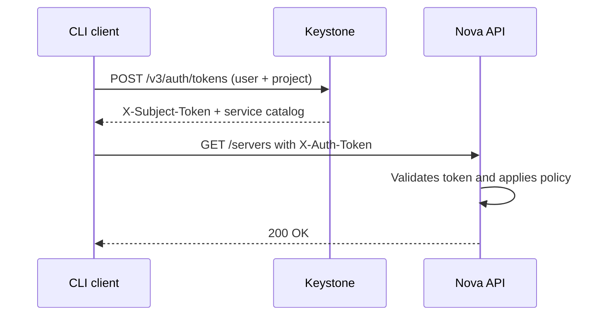

# OpenStack Keystone — Identity, catalog and tokens

## The problem

`openstack server list` returns `401`. You change the password and it still fails. You check the Nova logs and there is no trace of the request — because it never reached Nova. You retry with `--debug` and discover the client was requesting a token against a URL that no longer exists, resolved from a catalog somebody populated wrong eight months ago.

That is the pattern: **almost no "authentication" failure in OpenStack is a password failure**. It is the wrong domain, a role assigned at the wrong scope, an internal endpoint pointing at a dead IP, or Fernet keys out of sync between controllers. Keystone sits on the critical path of everything, so when it goes sideways the whole cloud looks broken at once.

!!! note "What this covers and what it doesn't"
    This page is about **how Keystone works and how to diagnose it**. The OpenStack overview lives in [basic concepts](../openstack/openstack_base.md); deployment, in [Kolla Deployment](../openstack/kolla_deployment.md); per-service operational errors, in [Troubleshooting OpenStack](../openstack/troubleshooting_openstack.md). We don't repeat that content here: we link to it.

## 📋 Table of Contents

- [Why everything goes through Keystone](#why-everything-goes-through-keystone)
- [The identity model](#the-identity-model)
- [Roles, scopes and assignments](#roles-scopes-and-assignments)
- [Service catalog and endpoints](#service-catalog-and-endpoints)
- [Fernet tokens and key rotation](#fernet-tokens-and-key-rotation)
- [Authenticating from the CLI](#authenticating-from-the-cli)
- [Authorization policies](#authorization-policies)
- [Federation with an external provider](#federation-with-an-external-provider)
- [High availability](#high-availability)
- [Troubleshooting](#troubleshooting)
- [Best practices](#best-practices)
- [References](#references)

## Why everything goes through Keystone

Keystone does two jobs that get confused constantly: it **issues tokens** (you present credentials, you get back a token with a specific scope) and it **publishes the catalog** (it tells you at which URL each service lives). The other services don't validate passwords: they receive a token in `X-Auth-Token`, verify it, and apply their policies against the roles that token declares.



Two practical consequences:

- **The client picks the URL from the catalog**, not from your configuration. You can have a perfect `OS_AUTH_URL` and still fail against Nova because Nova's endpoint is registered wrong.
- **A token carries its permissions inside.** Changing a role doesn't affect already-issued tokens until they expire. That's why "I removed the role and they can still do it" is not a bug.

The API is **Identity v3**. v2.0 has been retired for several cycles; if an old client asks for it, the answer is to upgrade the client.

## The identity model

This is where almost everyone gets lost, because there are six concepts and only three intuitive names.

| Concept | What it is | Note |
|---|---|---|
| **Domain** | Namespace for users, groups and projects | Two `admin` users can coexist in different domains |
| **Project** | Resource container and quota unit | The old *tenant*; they can be nested |
| **User** | An identity that authenticates | Lives **inside** a domain |
| **Group** | A set of users | Lives in a domain; used to assign roles in bulk |
| **Role** | Permission label (`admin`, `member`, `reader`) | Global: it belongs to no domain |
| **Assignment** | The (actor, role, scope) tuple | What actually grants permissions |

The classic mistake: **the user and the project can live in different domains**, and that's why `OS_USER_DOMAIN_NAME` and `OS_PROJECT_DOMAIN_NAME` are two separate variables. Setting them to the same value "because they always are" works right up until the day they aren't.

```bash
openstack domain list
openstack project list --domain default
openstack user list --domain default
openstack group contains user devops alice   # is alice in the group?
```

Creating a minimal structure for a team:

```bash
openstack domain create --description "Acme customer" acme
openstack project create --domain acme --description "Acme production" acme-prod
openstack user create --domain acme --password-prompt alice
openstack group create --domain acme acme-ops
openstack group add user --group-domain acme acme-ops alice
openstack role add --project acme-prod --group acme-ops member
```

The role is assigned **to the group**, not to the user. Adding or removing people from the team becomes a `group add user` instead of an audit of scattered assignments.

!!! tip "Names are not unique, IDs are"
    `openstack project list` can return two projects called `dev` in different domains. Any script that resolves by name without `--domain` is a time bomb. In automation, store IDs.

## Roles, scopes and assignments

A token isn't valid "for everything": it is valid for a **scope**.

| Scope | What for | How to request it |
|---|---|---|
| **Project** | Operating resources: instances, networks, volumes | `OS_PROJECT_NAME` |
| **Domain** | Managing users and projects in that domain | `--os-domain-name` |
| **System** | Operations affecting the whole cloud | `--os-system-scope all` |

System scope exists to separate "I administer my project" from "I administer the cloud". Previously, the `admin` role in *any* project ended up granting global powers in many services — a historical design flaw this scope fixes.

!!! warning "System scope support depends on the release and the service"
    Keystone has supported it for a while, but **each service adopts it at its own pace**. A system token may work against Keystone and be rejected by another service in the same cloud. Check the *release notes* for your version before redesigning your admin permissions around it.

The roles created by bootstrap are `admin`, `member` and `reader`, with **implication** between them: `admin` implies `member`, and `member` implies `reader`. Assigning `admin` grants all three.

```bash
openstack role list
openstack implied role list

# The query that solves 80% of "I don't have permissions":
openstack role assignment list --names --user alice
openstack role assignment list --names --project acme-prod
```

`--names` is the difference between a readable table and a wall of UUIDs. Two details in that output cause confusion: an **inherited** assignment (`--inherited`) does not apply to the scope where it was created but to its descendants — it's how you grant a role over every project in a domain at once; and roles arriving **via a group** show up with the group column filled and the user column empty, so searching by user alone won't reveal them.

## Service catalog and endpoints

The catalog is a registry: **services** (name and type) and, for each one, **endpoints** per region and interface.

```bash
openstack service list
openstack endpoint list
openstack catalog list          # what your token sees RIGHT NOW
```

There are three interfaces per service and region, and mixing them up is an endless source of incidents:

| Interface | Who uses it | Typical mistake |
|---|---|---|
| `public` | Users and clients from outside | Pointed at a private IP → nobody can use the cloud from outside |
| `internal` | The services themselves, talking to each other | Pointed at the public FQDN → internal traffic leaving and coming back through the firewall |
| `admin` | Privileged operations | Historically on a different port; today it usually matches the others |

!!! danger "A misdirected endpoint doesn't give a network error: it gives `EndpointNotFound` or a strange timeout"
    When Nova needs to talk to Glance, it resolves the URL from the catalog using the `internal` interface. If that entry points at an IP that no longer exists, the symptom isn't "Glance is down": it's an instance stuck in `BUILD` for minutes that ends up in `ERROR`, and a Nova log with a timeout against an address you don't recognise. That's the moment to look at `openstack endpoint list`, not at Glance's logs.

Fixing an endpoint means replacing it, not editing it in the database:

```bash
openstack endpoint list --service glance --interface internal
openstack endpoint set --url https://10.0.20.100:9292 <ENDPOINT_ID>
```

A key distinction when diagnosing: `openstack endpoint list` shows **what is registered**; `openstack catalog list` shows **what your token receives**, already filtered by region and visibility. If they differ, the problem is in your token's scope or in the region, not in the registry.

In Kolla-Ansible deployments the endpoints are generated from the VIP and FQDN variables in `globals.yml`: fixing them by hand and then reconfiguring the service will overwrite your changes.

## Fernet tokens and key rotation

A Fernet token is an encrypted, signed string that **contains** its scope and its expiry. Keystone doesn't store it in the database: it decrypts it on validation. That's the whole advantage — no token table growing out of control and no state to replicate between controllers.

The price is a **key repository** that does need to stay in sync. By default it lives in `/etc/keystone/fernet-keys/`, with numbered files:

```bash
keystone-manage fernet_setup --keystone-user keystone --keystone-group keystone
keystone-manage fernet_rotate --keystone-user keystone --keystone-group keystone
ls -l /etc/keystone/fernet-keys/
```

| Key | Role | What it does |
|---|---|---|
| Index `0` | *Staged* | Doesn't encrypt yet; promoted at the next rotation |
| Highest index | *Primary* | Encrypts new tokens and decrypts them |
| Intermediate indexes | *Secondary* | Only decrypt already-issued tokens |

Rotating promotes the staged key to primary, demotes the primary to secondary, and discards the oldest one once `max_active_keys` is exceeded. That's why the staged key exists: in a cluster you distribute the new keys **before** any node starts encrypting with them.

!!! danger "A botched rotation invalidates sessions across the whole cloud"
    Two ways to achieve that, both common.

    **Rotating faster than tokens expire.** If you discard a secondary key while tokens encrypted with it are still alive, those tokens stop validating *all at once* and everybody sees `401` simultaneously. The documented relationship between the parameters is:

    ```text
    max_active_keys = (token_expiration / rotation_frequency) + 2
    ```

    The two extras are the staged and the primary key. Rotate more slowly than that formula allows, never faster.

    **Rotating on one node and not the others.** Each controller encrypts with its own primary key and can't decrypt the others'. The symptom is worse than an outage: **intermittent** failures, depending on which node handles each request. If you see `401` on one call out of three, compare the key repositories before looking at anything else.

```bash
sudo md5sum /etc/keystone/fernet-keys/*      # must match on every node
```

!!! warning "Credential keys are a separate repository and don't rotate the same way"
    Keystone uses a **second** set of Fernet keys to encrypt stored credentials (`keystone-manage credential_setup`). They are neither the same keys nor the same directory. Rotating them requires a dedicated procedure that re-encrypts the existing data; treating them like token keys leaves credentials undecryptable and **unrecoverable**. Include them in your backups alongside the database — see [Day 2 Operations](../openstack/day2.md).

Expiry is configured in `[token] expiration` in `keystone.conf`. Lowering it shrinks the window for a stolen token; raising it reduces re-authentication load. The default value has changed between releases: check it in your own deployment instead of assuming it.

## Authenticating from the CLI

The good old `openrc` file is nothing more than environment variables:

```bash
export OS_AUTH_URL=https://keystone.example.com:5000/v3
export OS_IDENTITY_API_VERSION=3
export OS_PROJECT_NAME=acme-prod
export OS_PROJECT_DOMAIN_NAME=acme
export OS_USERNAME=alice
export OS_USER_DOMAIN_NAME=acme
export OS_REGION_NAME=RegionOne
export OS_INTERFACE=public

read -srp "Password: " OS_PASSWORD && export OS_PASSWORD && echo
```

Prompting for the password avoids the classic `admin-openrc.sh` with the admin password in plaintext, accidentally committed to Git.

The modern alternative is **`clouds.yaml`**, which lets you keep several clouds without swapping variables. The client looks for it in the current directory, in `~/.config/openstack/` and in `/etc/openstack/`:

```yaml
# ~/.config/openstack/clouds.yaml
clouds:
  acme-prod:
    auth:
      auth_url: https://keystone.example.com:5000/v3
      username: alice
      project_name: acme-prod
      user_domain_name: acme
      project_domain_name: acme
    region_name: RegionOne
    interface: public
    identity_api_version: 3
```

```bash
export OS_CLOUD=acme-prod
openstack server list
```

Passwords can live in `secure.yaml`, in the same directory and with `600` permissions, so that `clouds.yaml` stays shareable.

For automation, **don't use your password**: use an application credential. It can be revoked without touching your account, it's limited to a subset of roles, and it expires.

```bash
openstack application credential create ci-deploy \
  --description "Deployment pipeline" \
  --role member \
  --expiration 2027-01-01T00:00:00
```

The secret is shown **only once**. In `clouds.yaml` you declare it with `auth_type: v3applicationcredential` plus `application_credential_id` and `application_credential_secret`.

Verify authentication before blaming any other service:

```bash
openstack token issue          # does it issue a token? then the credentials are fine
openstack catalog list         # is the catalog the one you expect?
openstack --debug server list  # shows the exact URL it fails against
```

`--debug` prints the full HTTP requests. When the error doesn't match what you think is happening, that flag shows the real URL the client pulled from the catalog — which is usually the surprise.

## Authorization policies

Keystone and the other services decide what a token may do through **oslo.policy**. The default rules live **in the code**, not in a file: `policy.yaml` exists only to override whatever you want to change. A missing `policy.yaml` is normal and correct.

```bash
oslopolicy-policy-generator --namespace keystone   # dump the effective defaults
```

The project's direction is what's known as **secure RBAC**: `admin`/`member`/`reader` as a uniform baseline across all services, plus scopes to separate cloud administration from project administration. Two `[oslo_policy]` options govern the transition:

| Option | What it does |
|---|---|
| `enforce_new_defaults` | Applies the new rules, ignoring the legacy ones |
| `enforce_scope` | Rejects tokens whose scope doesn't match the operation |

!!! warning "A point that depends entirely on your release"
    The default value of those two options, and which services genuinely honour them, **has kept changing cycle by cycle**. Enabling them on an existing cloud can break automation that used to work with `admin` in some arbitrary project. Don't copy values from a guide: read the *release notes* for your version and test in staging.

A minimal override — letting a read-only role list users:

```yaml
# /etc/keystone/policy.yaml
"identity:list_users": "role:reader"
```

Rule of thumb: **before writing a policy, check whether the problem is a role assignment**. It almost always is. Editing `policy.yaml` to fix what was really an `openstack role add` leaves a divergence from the defaults that nobody will remember a year from now.

## Federation with an external provider

Federating means Keystone stops storing passwords and **trusts** an external provider — Keycloak, Authentik, Dex, a corporate ADFS — that authenticates the user and returns a set of *assertions*. There are three pieces to declare:

1. **Identity provider** — who the issuer we trust is.
2. **Protocol** — `openid` or `saml2`, and which *mapping* processes it.
3. **Mapping** — rules translating IdP attributes (an LDAP group, a token *claim*) into **Keystone groups**.

```bash
openstack identity provider create --remote-id https://idp.example.com/realms/corp corp-idp
openstack mapping create --rules /etc/keystone/mapping-corp.json corp-mapping
openstack federation protocol create openid --identity-provider corp-idp --mapping corp-mapping
```

What really matters is the mapping: federated users **don't exist as rows** in Keystone, they materialise when they authenticate. Their permissions come exclusively from the groups the mapping assigns them, and those groups must have roles assigned **beforehand**. A correct mapping over groups without roles produces a login that works and a user who can do absolutely nothing — a baffling symptom the first time you hit it.

!!! note "The web layer is not optional"
    Keystone doesn't speak OIDC or SAML by itself: it delegates to the web server hosting it (typically Apache with `mod_auth_openidc` for OIDC or `mod_shib` for SAML). That configuration is specific to the module and the IdP, and it's where most of the time goes. If the IdP is your own, see [Keycloak](keycloak.md), [Authentik](authentik.md) or [Dex IdP](dex.md).

## High availability

Keystone is a **stateless** WSGI application: what persists lives in the database and in the Fernet key repository. That's why the usual pattern is straightforward — several instances behind a load balancer (HAProxy) with a VIP, a clustered database (Galera is the norm) and an **identical Fernet key repository on every node**.

That third point is the only Keystone-specific one and the only one people forget. A new node added to the balancer with keys generated by its own `fernet_setup` issues tokens the others cannot validate.

The safe procedure for rotating in a cluster is always the same: rotate on **one** node designated as the source, copy the full repository to the others preserving owner and permissions, and reload the service on each node. Automate it with [Ansible](../ansible/ansible_base.md) or your deployment tool; doing it by hand guarantees that one day a node gets forgotten. With Kolla-Ansible, rotation has its own task and shouldn't be done outside it.

```bash
curl -s -o /dev/null -w '%{http_code}\n' https://keystone.example.com:5000/v3
openstack token issue -f value -c expires
```

A `GET` to the root of the v3 API responds without authentication and works as a cheap *health check* for the balancer. Issuing a real token is a more honest check: it also covers the database and the keys.

## Troubleshooting

| Symptom | Likely cause | Check / fix |
|---|---|---|
| `401` on everything, credentials are correct | Wrong domain in `OS_USER_DOMAIN_NAME` | `openstack token issue`; review user and project domain separately |
| Intermittent `401`, one call in N | Fernet keys out of sync between controllers | `md5sum /etc/keystone/fernet-keys/*` on each node |
| Everybody loses their session at once | Rotation too frequent for the expiry | Review `max_active_keys` against `[token] expiration` |
| `403 Forbidden` with valid credentials | Missing role, or the token lacks the right scope | `openstack role assignment list --names --user X` |
| `EndpointNotFound` | Service or interface missing from the catalog | `openstack catalog list` and `openstack endpoint list --service X` |
| One service can't talk to another, but the API responds | `internal` endpoint pointing at the wrong place | `openstack endpoint list --interface internal` |
| `Unable to establish connection` to `:5000` | Keystone down or VIP with no owner | See [Troubleshooting OpenStack](../openstack/troubleshooting_openstack.md) |
| The federated user logs in but can't do anything | Mapping groups with no roles assigned | `openstack role assignment list --names --group <group>` |
| I removed a role and the user keeps operating | Previous token still valid | Wait for expiry: revocation is not instant by design |
| Scripts mixing up two projects | Name resolution without `--domain` | Use IDs in automation |

The diagnostic sequence that sorts out most cases, in this order:

```bash
openstack token issue                                  # 1. can I authenticate?
openstack catalog list                                 # 2. is the catalog correct?
openstack role assignment list --names --user alice    # 3. do I have the roles?
openstack --debug server list                          # 4. which URL is it failing against?
```

If step 1 works and step 4 fails, **the problem is not identity**: it's the catalog, the network or the target service. That elimination saves hours.

## Best practices

- **Assign roles to groups, not to users.** Onboarding and offboarding become a group operation and audits stop being archaeology.
- **One domain per real organisational unit.** The `default` domain for infrastructure, dedicated domains for customers or teams. Mixing everything into `default` is not easily undone later.
- **`--names` on any assignment query.** UUIDs tell no stories.
- **Application credentials for automation**, never a person's password, with an expiry and minimal roles.
- **`clouds.yaml` with a separate `secure.yaml`**, instead of `openrc` with plaintext passwords. See [secrets management](../cybersecurity/gestion_secretos.md).
- **Rotate Fernet keys on a schedule and in sync**, from a single source and at the frequency `max_active_keys` allows.
- **Include both key repositories in your backups**, alongside the database dump. A database restored without its credential keys is an incomplete restore.
- **Before touching `policy.yaml`, check the role assignments.** The problem is almost always there.

## References

- [Keystone — official documentation](https://docs.openstack.org/keystone/latest/)
- [Keystone administration guide](https://docs.openstack.org/keystone/latest/admin/)
- [Fernet tokens and key rotation](https://docs.openstack.org/keystone/latest/admin/fernet-token-faq.html)
- [Identity federation](https://docs.openstack.org/keystone/latest/admin/federation/introduction.html)
- [oslo.policy — policies and defaults](https://docs.openstack.org/oslo.policy/latest/)
- [OpenStack — basic concepts](../openstack/openstack_base.md) · [Kolla Deployment](../openstack/kolla_deployment.md)
- [Day 2 Operations](../openstack/day2.md) · [Troubleshooting OpenStack](../openstack/troubleshooting_openstack.md)
- [Keycloak](keycloak.md) · [Authentik](authentik.md) · [Dex IdP](dex.md)
