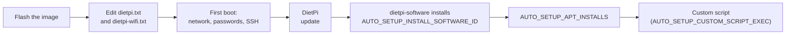

# DietPi — Minimal Debian for Raspberry Pi, other SBCs and x86

## The problem

You have a Raspberry Pi that should do one thing only: resolve DNS for the house with Pi-hole or AdGuard Home, be a small Docker node or collect metrics. You flash the standard image, log in with a screen and keyboard, switch off what you don't need, install what's missing and leave it running. A year later the SD card starts throwing read errors, because the logs have been writing to it for twelve months, and when you reinstall you find you don't remember half the steps: which static IP it had, which packages you installed by hand, what you changed in the SSH configuration.

DietPi tackles all three at once. It is a trimmed-down Debian with images for dozens of boards and for x86, logs go to RAM by default, and the whole first boot can be written down in a text file (`dietpi.txt`) that you edit before inserting the card. Keep that file and reinstalling becomes flash, copy, plug in.

!!! note "Tested in the homelab"
    I run DietPi in the homelab on many installs, both on Raspberry Pi and on x86 virtual machines. The `dietpi.txt` keys, the `dietpi-software` names and the options are also checked against the official documentation and the CHANGELOG of version 10.9 (2026-11-21). Installing on a physical x86 PC follows the official documentation. If something does not behave as described here, please open an erratum.

## 📋 Table of Contents

- [What DietPi is and what changes](#what-dietpi-is-and-what-changes)
- [Installing on a Raspberry Pi](#installing-on-a-raspberry-pi)
- [Unattended first boot with dietpi.txt](#unattended-first-boot-with-dietpitxt)
- [Wi-Fi with dietpi-wifi.txt](#wi-fi-with-dietpi-wifitxt)
- [Installing software with dietpi-software](#installing-software-with-dietpi-software)
- [The DietPi tools](#the-dietpi-tools)
- [Sparing the SD card: RAMlog, swap and root on SSD](#sparing-the-sd-card-ramlog-swap-and-root-on-ssd)
- [Backups with dietpi-backup](#backups-with-dietpi-backup)
- [Updates: dietpi-update and APT](#updates-dietpi-update-and-apt)
- [SSH: Dropbear or OpenSSH](#ssh-dropbear-or-openssh)
- [DietPi on x86: physical and virtual](#dietpi-on-x86-physical-and-virtual)
- [When not to use DietPi](#when-not-to-use-dietpi)
- [Troubleshooting](#troubleshooting)
- [Best practices](#best-practices)
- [References](#references)

## What DietPi is and what changes

DietPi is not a distribution with its own packages: it is Debian with a layer of scripts in `/boot/dietpi/` that configure the system, install pre-tuned software and keep it maintained. The current version is **10.9**, released on 21 November 2026, and the images linked from its documentation are built on **Debian 13 (trixie)**. The code still handles Debian 12 (bookworm) on existing installs, and there is an official guide to move from bookworm to trixie.

Compared with Raspberry Pi OS Lite or plain Debian, this is what changes in practice:

| Aspect | Raspberry Pi OS / Debian | DietPi |
|---|---|---|
| First boot | Raspberry Pi Imager options or manual setup | `dietpi.txt` on the boot partition, applied once |
| Logs | journald and, depending on the image, rsyslog on disk | DietPi-RAMlog: `/var/log` on tmpfs, cleared every hour |
| SSH server | OpenSSH | Dropbear by default; OpenSSH one click away |
| Software | `apt install` and configure by hand | `dietpi-software install <id>` with configuration and dependencies |
| Boards | Raspberry Pi (or generic x86) | Raspberry Pi, Odroid, Orange Pi, NanoPi, Quartz64…, x86_64 PCs and VMs |
| Configuration | `raspi-config` or files | `dietpi-config`, `dietpi-drive_manager` and friends |

It is still Debian: `apt` works the same, packages come from the Debian repositories and everything you know about systemd applies. DietPi only adds tools on top.

## Installing on a Raspberry Pi

The process is the same as for any image:

1. Download your board's image from [dietpi.com](https://dietpi.com/#download). It comes compressed as `.xz`.
2. Flash it to the SD card (or a USB stick or eMMC) with balenaEtcher, Rufus or Raspberry Pi Imager; all three read the `.xz` directly. Raspberry Pi Imager also lists DietPi under "Other general-purpose OS".
3. **Before ejecting the card**, edit `dietpi.txt` (next section).
4. Put the card into the board and power it on. The first boot takes longer, because it expands the filesystem and applies the configuration.

On the Raspberry Pi, `dietpi.txt` sits at the root of the FAT boot partition, which shows up on Windows, macOS or Linux as soon as you reconnect the card. On some boards without that separate partition (the documentation mentions NanoPi), the system lives on a single ext4 partition and you have to mount it on Linux to reach `/boot/dietpi.txt`.

Without any automation, the first login is via console or SSH as user `root` with password `dietpi`, and a wizard asks you to change the passwords and choose software. The interesting part is skipping it.

## Unattended first boot with dietpi.txt

`dietpi.txt` ships with every option commented. The ones that matter for a headless board:

```bash
# /boot/dietpi.txt (excerpt, only the lines you change)
AUTO_SETUP_LOCALE=es_ES.UTF-8
AUTO_SETUP_KEYBOARD_LAYOUT=es
AUTO_SETUP_TIMEZONE=Europe/Madrid

AUTO_SETUP_NET_ETHERNET_ENABLED=1
AUTO_SETUP_NET_WIFI_ENABLED=0
AUTO_SETUP_NET_USESTATIC=1
AUTO_SETUP_NET_STATIC_IP=192.168.1.53/24
AUTO_SETUP_NET_STATIC_GATEWAY=192.168.1.1
AUTO_SETUP_NET_STATIC_DNS=9.9.9.9 149.112.112.112
AUTO_SETUP_NET_HOSTNAME=dns01

AUTO_SETUP_GLOBAL_PASSWORD=UnaContraseñaLargaDeVerdad
AUTO_SETUP_SSH_SERVER_INDEX=-2
AUTO_SETUP_SSH_PUBKEY=ssh-ed25519 AAAA... antonio@portatil
SOFTWARE_DISABLE_SSH_PASSWORD_LOGINS=1

AUTO_SETUP_LOGGING_INDEX=-1
AUTO_SETUP_RAMLOG_MAXSIZE=50
AUTO_SETUP_SWAPFILE_SIZE=1

AUTO_SETUP_INSTALL_SOFTWARE_ID=adguardhome
AUTO_SETUP_AUTOMATED=1
```

What each block does, according to the file's own comments:

- **Language and time zone.** `AUTO_SETUP_LOCALE` takes a single entry and UTF-8 only; the default is `C.UTF-8`. The time zone uses tz format (`Europe/Madrid`).
- **Network.** If you enable Ethernet and Wi-Fi together, Wi-Fi wins and Ethernet is disabled. The CIDR netmask is optional and defaults to `/24`. If you'd rather let the router hand out the IP and pin it afterwards, there is `AUTO_SETUP_DHCP_TO_STATIC=1`, which turns the DHCP lease into static settings on first boot.
- **Password.** `AUTO_SETUP_GLOBAL_PASSWORD` sets the password for `root` and for the `dietpi` user, and `dietpi-software` uses it as the default for programs that need one. Once applied, DietPi removes it from the file and stores it encrypted. Two warnings from the file: Dropbear does not accept passwords longer than 100 bytes, and some programs may choke on characters such as `$"|\`. **The user name is not configurable**: the users are `root` and `dietpi`.
- **SSH.** `AUTO_SETUP_SSH_SERVER_INDEX` is `-1` for Dropbear, `-2` for OpenSSH and `0` for none. `AUTO_SETUP_SSH_PUBKEY` adds the key to `root` and `dietpi`, and you repeat the line for several keys. More detail in [SSH: Dropbear or OpenSSH](#ssh-dropbear-or-openssh).
- **Software.** `AUTO_SETUP_INSTALL_SOFTWARE_ID` accepts several space-separated IDs. `AUTO_SETUP_APT_INSTALLS` also installs regular APT packages, after the DietPi software.
- **Unattended mode.** With `AUTO_SETUP_AUTOMATED=1`, the first boot updates, configures and installs without asking. The file insists you change the global password before enabling it. If something fails, it offers to rerun everything interactively.

The first boot order, summarised:



For anything no key covers there are two hooks. A script at `/boot/Automation_Custom_PreScript.sh` runs on first boot before the network is up. `AUTO_SETUP_CUSTOM_SCRIPT_EXEC=0` runs `/boot/Automation_Custom_Script.sh` at the end; instead of `0` you can put a URL and DietPi downloads it. Logs end up in `/var/lib/dietpi/logs/dietpi-firstboot.log` and `/var/lib/dietpi/logs/dietpi-firstrun-setup.log`.

!!! tip "Keep the dietpi.txt, not the install"
    Your edited `dietpi.txt`, together with the automation scripts, is the machine's recipe. Keep it in Git **without the password** (fill it in when copying it to the card). Reinstalling stops being a memory exercise.

## Wi-Fi with dietpi-wifi.txt

If the board uses Wi-Fi, set `AUTO_SETUP_NET_WIFI_ENABLED=1`, the country in `AUTO_SETUP_NET_WIFI_COUNTRY_CODE` (two letters, `ES`) and the credentials in `dietpi-wifi.txt`, on the same partition:

```bash
# /boot/dietpi-wifi.txt (excerpt)
aWIFI_SSID[0]='MiRed'
aWIFI_KEY[0]='MiClaveWifi'
```

Index `[0]` is the first network; the file takes more. On first boot DietPi moves it to `/var/lib/dietpi/dietpi-wifi.db`, so don't expect to find it in `/boot` afterwards. The country may be overridden if the access point advertises a different one. For a server, use a cable if you can: a home DNS that depends on Wi-Fi is a DNS that goes down whenever the Wi-Fi coughs.

## Installing software with dietpi-software

`dietpi-software` installs programs with their configuration, system user and dependencies. Since **version 10.8** (October 2026) IDs are **names**, not numbers: the program's name in lower case without dashes, dots or spaces. The old numeric IDs are still accepted for compatibility.

| Program | Current ID | Old numeric ID |
|---|---|---|
| Docker | `docker` | 162 |
| Docker Compose | `dockercompose` | 134 |
| Pi-hole | `pihole` | 93 |
| AdGuard Home | `adguardhome` | 126 |
| Unbound | `unbound` | 182 |
| Prometheus Node Exporter | `prometheusexporter` | 99 |

```bash
dietpi-software list                          # all available IDs
dietpi-software install docker dockercompose  # several at once
dietpi-software reinstall adguardhome
dietpi-software uninstall pihole
dietpi-software                               # interactive menu
```

If you find tutorials with `AUTO_SETUP_INSTALL_SOFTWARE_ID=162`, they predate 10.8; they still work, but use names in a new `dietpi.txt`. Version 10.9 added tab completion for the IDs.

Pi-hole and AdGuard Home are declared as **conflicting** (both want port 53): pick one. Docker keeps its data under `/mnt/dietpi_userdata`, DietPi's user data directory, and so does Podman, which joined the catalogue in 10.9 with ID `podman`. If you are going to run containers as services, [Podman Quadlet](../docker/quadlets.md) fits well here. And to build the home DNS with Unbound behind it, see [Self-hosted DNS](../networking/dns_selfhosted.md).

## The DietPi tools

They are all shell scripts with text menus:

| Command | What for |
|---|---|
| `dietpi-launcher` | Menu giving access to all the others |
| `dietpi-config` | Display, audio, performance and overclocking, network, language, time zone, autostart; in 10.9, fan control on the Raspberry Pi |
| `dietpi-software` | Install, reinstall and uninstall; also switch the SSH server and the logging system |
| `dietpi-drive_manager` | Mount and format drives, move user data and swap, move root to another drive, mount NFS and Samba |
| `dietpi-backup` | rsync-based backups and restore |
| `dietpi-update` | Update DietPi and report APT updates |
| `dietpi-services` | View and control the services DietPi manages |
| `dietpi-cron` | Times for `cron.daily`, `cron.weekly`, etc. |

A useful rule: what DietPi manages, change with its tool. If you hand-edit the network or SSH, the next time you open the menu it may overwrite your change.

## Sparing the SD card: RAMlog, swap and root on SSD

**DietPi-RAMlog** is the default logging system and the main reason an SD card lasts longer with DietPi. There are three modes, chosen with `AUTO_SETUP_LOGGING_INDEX` or later from `dietpi-software` → "Log System":

| Mode | `AUTO_SETUP_LOGGING_INDEX` | What it does |
|---|---|---|
| RAMlog #1 (default) | `-1` | `/var/log` on tmpfs, cleared every hour. Nothing reaches the disk |
| RAMlog #2 | `-2` | Same, but every hour it saves the logs to `/root/log_file_storage` before clearing |
| Full | `-3` | Rsyslog and Logrotate, `/var/log` on disk |

The tmpfs size is set by `AUTO_SETUP_RAMLOG_MAXSIZE` (50 MiB by default; the documentation suggests 200+ for a web server with heavy access logs). With RAMlog, rsyslog is not installed: if a program needs it, `apt install rsyslog`. The trade-off is clear: with #1 you lose the logs at every clear and every reboot, and with #2 you can lose up to an hour if the power goes. For a node that must leave a trail, ship the logs elsewhere (see [Complete Observability Stack](../monitoring/observability_stack.md)) instead of writing them to the SD card.

**Swap.** `AUTO_SETUP_SWAPFILE_SIZE` is `0` (no swap), `1` (automatic) or a size in MiB. `AUTO_SETUP_SWAPFILE_LOCATION` is a path (by default `/var/swap`; in automatic mode, 2 GiB minus RAM) or `zram`, which creates compressed swap in RAM on `/dev/zram0` with half the memory. On a board with an SD card, `zram` avoids writing swap to the card. It can be changed later from `dietpi-drive_manager`.

**Root on SSD or USB.** `dietpi-drive_manager` has a "Transfer RootFS" option to copy the system to an attached drive and boot from it. According to the documentation and the script itself, it is only available on the **Raspberry Pi and some Odroids** (C2, XU4, N2, C4), and only when there is a separate boot partition: the card keeps doing the boot and everything else goes to the drive. It copies with rsync and asks for a reboot at the end. The alternative, on a Raspberry Pi that boots from USB or NVMe, is to flash the image straight onto the SSD.

If space is your only concern, move just the user data (`/mnt/dietpi_userdata`) or the swap to another drive from the same menu: select the mounted drive and use "User data" or "Swapfile".

## Backups with dietpi-backup

`dietpi-backup` is a **system** backup with rsync, file by file, incremental and rotated (you choose how many to keep). What you should know before relying on it:

- **Target with a Linux filesystem.** Since it is rsync, permissions are only preserved on ext4, NFS or similar. On a Samba share the backup is no good for restoring.
- **It stops services while it runs.** All of them. Schedule it for a time when the home DNS can go down for a few minutes, or accept the outage.
- **It can leave out your data.** If `/mnt/dietpi_userdata` lives on another drive (it is a symlink), its contents are excluded by default. The filter lives in `/boot/dietpi/.dietpi-backup_inc_exc` and is edited from the menu, "Filter" option.
- **It doesn't leave the machine** unless the target is a drive or a network share. A backup on a USB stick plugged into the board covers an SD failure, not theft or fire.

```bash
dietpi-backup              # menu: target, filter, amount, daily backup
dietpi-backup 1            # backup without prompts
dietpi-backup -1           # restore without prompts (careful)
dietpi-backup 1 /mnt/nas/backup-dns01
```

The daily backup runs from `cron.daily`; its time is changed with `dietpi-cron`. And there's a trick that fits reinstalling from scratch: `AUTO_SETUP_BACKUP_RESTORE=1` in `dietpi.txt` searches all attached drives for backups during first boot and lets you pick one; `2` restores the first one found without asking.

`dietpi-backup` is one piece, not the strategy: for important data, a tool with off-site copies (see [3-2-1 Backup Strategy](../backups/strategy_321.md)), and every now and then, actually restore onto another card to prove it comes back ([Restore drill](../backups/restore_drill.md)).

## Updates: dietpi-update and APT

There are two things to update and it pays not to mix them:

1. **DietPi**, its scripts. `dietpi-update` handles that; it checks daily for a new version (`CONFIG_CHECK_DIETPI_UPDATES=1`) and reports it in the login banner, but it is **not applied automatically**: the project removed automatic updates in 6.29 because its releases often carry changes with notices or interactive steps.
2. **The Debian packages**, with APT. `CONFIG_CHECK_APT_UPDATES` is `0` (don't check), `1` (check only, the default) or `2` (check and install automatically, logging to `/var/lib/dietpi/logs/dietpi-upgrade_apt.log`).

```bash
dietpi-update      # updates DietPi and offers to install APT updates
dietpi-update 1    # applies the DietPi update without prompts
apt update && apt full-upgrade
```

With `CONFIG_CHECK_APT_UPDATES=2`, DietPi installs **all** pending updates, not just security ones. If you prefer the finer control of `unattended-upgrades` (security origin only, blacklist, reboot at a set time), install it as on any Debian and leave `CONFIG_CHECK_APT_UPDATES` at `1` so you don't have two mechanisms upgrading at once. How to set it up is in [Unattended upgrades on Debian](unattended_upgrades.md). What you shouldn't do is automate `dietpi-update`: read the CHANGELOG first.

For the Debian release jump (bookworm to trixie), DietPi publishes its own guide on its blog; don't do it with a `sed` over `sources.list` without reading it.

## SSH: Dropbear or OpenSSH

DietPi installs **Dropbear** by default: a lightweight SSH server, with less memory use and fewer options. **OpenSSH** is the usual one, with SFTP and SCP. You choose in `AUTO_SETUP_SSH_SERVER_INDEX` or later in `dietpi-software`, which uninstalls one when installing the other.

When to switch to OpenSSH: if you need SFTP (for example, to copy files with a graphical client), `Match`, SSH certificates or the configuration you already use on the rest of your servers. On a Raspberry Pi 4 or 5 the memory difference is irrelevant; on a 512 MiB board, maybe not.

Minimum hardening is done from `dietpi.txt`, before the server starts:

- `AUTO_SETUP_SSH_PUBKEY` with your ed25519 key.
- `SOFTWARE_DISABLE_SSH_PASSWORD_LOGINS=1` to disable passwords for everyone (or `root` for root only). With OpenSSH, DietPi translates it into `PubkeyAuthentication`, `PasswordAuthentication` and `PermitRootLogin` in `sshd_config`; with Dropbear, into `DROPBEAR_EXTRA_ARGS` in `/etc/default/dropbear`.

After the first boot it is changed with:

```bash
/boot/dietpi/func/dietpi-set_software disable_ssh_password_logins 1
```

Mind you: DietPi logs in as `root` by default. With a key and no passwords that is acceptable at home, but if you use OpenSSH apply what's in [SSH Security](ssh_security.md): `AllowUsers`, `MaxAuthTries` and, if you expose it, fail2ban or a VPN in front.

## DietPi on x86: physical and virtual

DietPi is not just for boards. There are x86_64 images for a mini PC, a thin client or an old laptop, and for almost any hypervisor. According to the installation documentation:

| Target | Format | How it is installed |
|---|---|---|
| Native PC, UEFI | Installer or Live (`.xz`) | Installer: bootable USB with Clonezilla that writes to the internal disk. Live: flashed straight onto the target disk |
| Native PC, BIOS/CSM | Installer or Live | Same as UEFI |
| Proxmox VE (VM) | Installer ISO or QCOW2 disk | ISO with Clonezilla, or import the QCOW2 with `qm importdisk` |
| Proxmox VE (LXC) | Proxmox VE Helper-Scripts script | Converts a Debian container into DietPi |
| VirtualBox, VMware ESXi | `.ova` | Import the appliance |
| VMware Player/Fusion, Parallels, UTM | An image for each | Import |
| Hyper-V | `.vhdx` | Create the VM with that disk |

What changes compared with the Raspberry Pi:

- **SD card wear stops mattering.** RAMlog is still there and does no harm, but on an SSD or a virtual disk you can pick Full mode with a clear conscience if you want persistent logs. The "Transfer RootFS" option doesn't exist on x86.
- **`dietpi.txt` is no longer on a handy FAT partition.** In the VM images and in the system the installer leaves behind, it lives at `/boot/dietpi.txt` inside the system. To automate the first boot you have to edit it before booting (by mounting the disk). For the LXC, the documentation suggests editing it from the host with `pct exec <ID> -- nano /boot/dietpi.txt` before the first login, which is when setup starts; there, Proxmox sets the network and hostname.
- **QEMU Guest Agent on Proxmox.** If you tick the "Qemu Agent" box on the System tab **before the first boot**, DietPi installs the agent during initial setup: Proxmox sees the VM's IP and can freeze the filesystem for consistent backups.
- **Resources.** For the VM, the guide requires at least 8 GB of disk if you use the ISO and recommends 1024 MiB of RAM; with 2048 MiB it sets itself up without creating swap.

Does a DietPi VM make sense over a normal Debian VM? If the VM is for a single service that `dietpi-software` already knows how to install (Pi-hole, AdGuard Home, an Uptime Kuma, a Docker node), DietPi saves you the work and keeps the same `dietpi.txt` recipe you use on the boards. If on Proxmox you already clone VMs from a cloud-init template, the natural thing is to stay there: cloud-init is the standard, OpenTofu understands it and it doesn't tie you to DietPi's menus. See [Cloud-init templates in Proxmox](../proxmox/cloud_init_templates.md).

## When not to use DietPi

- **A server that does many things.** DietPi shines with one or two services. With ten, you end up mixing what `dietpi-software` manages with what you installed by hand, and the tool's value fades.
- **You need a hypervisor.** For Proxmox VE you install Proxmox, not DietPi underneath. DietPi goes *inside* Proxmox, as a VM or LXC.
- **Standard automation.** If you manage everything with [Ansible](../ansible/ansible_base.md) and cloud-init, a clean Debian or Raspberry Pi OS Lite fits better than a system with its own scripts and menus.
- **Logs that must survive.** Full mode can do it, but if that's what you need, you are dropping DietPi's main advantage on an SD card.
- **Vendor support.** For hardware that depends on Raspberry Pi Foundation tools or on a specific vendor's, the official image is usually ahead.

## Troubleshooting

| Symptom | Cause | Fix |
|---|---|---|
| First boot ignores the configuration | `dietpi.txt` edited after the first boot | `AUTO_SETUP_*` options are read only once: reflash and edit before booting |
| Stuck in the wizard despite `AUTO_SETUP_AUTOMATED=1` | A step failed and DietPi offers to rerun it interactively | Check `/var/lib/dietpi/logs/dietpi-firstrun-setup.log` |
| No network after first boot with Wi-Fi | Empty `dietpi-wifi.txt`, wrong country, or Ethernet disabled because Wi-Fi takes priority | Check credentials and `AUTO_SETUP_NET_WIFI_COUNTRY_CODE`; try a cable |
| `AUTO_SETUP_INSTALL_SOFTWARE_ID` installs nothing | Misspelt ID, or software not available on that board or architecture | `dietpi-software list` and compare |
| Pi-hole won't install alongside AdGuard Home | They are declared as conflicting | Pick one of the two |
| Can't find yesterday's logs | RAMlog #1 clears them every hour and on every reboot | Switch to RAMlog #2 or Full, or ship them elsewhere |
| "Transfer RootFS" doesn't show up | Board not supported or no separate boot partition | Flash the image to the SSD if the board boots from USB/NVMe |
| Backup doesn't restore permissions | Samba target or non-Linux filesystem | Use ext4 or NFS as the target |
| Can't log in over SSH with a password | `SOFTWARE_DISABLE_SSH_PASSWORD_LOGINS=1` without a valid key | Log in on the console and fix it with `dietpi-set_software` |

## Best practices

- **The `dietpi.txt` is the machine's documentation.** One per device, in version control, without the password.
- **Named IDs** in new `dietpi.txt` files; numeric ones are compatibility, not the future.
- **One job per board.** DNS on one, Docker on another. If one breaks, the other keeps going.
- **SSH key from the first boot** and passwords disabled. The factory `root`/`dietpi` must never reach the network.
- **RAMlog on SD cards, important logs elsewhere.** And `zram` for swap if the board is short on RAM.
- **`dietpi-update` by hand, after reading the CHANGELOG.** APT, with `unattended-upgrades` or with `CONFIG_CHECK_APT_UPDATES=2`, but not both.
- **System backup plus data backup.** `dietpi-backup` to get back quickly; a 3-2-1 tool so nothing is lost; and restore now and then.
- **Use DietPi's tools for what DietPi manages.** Network, SSH and logs, from its menus.

## References

- [DietPi documentation: installation](https://dietpi.com/docs/install/) · [First boot automation](https://dietpi.com/docs/usage/)
- [`dietpi.txt` on the master branch](https://github.com/MichaIng/DietPi/blob/master/dietpi.txt)
- [DietPi CHANGELOG](https://github.com/MichaIng/DietPi/blob/master/CHANGELOG.txt) (named IDs in 10.8, version 10.9)
- [Tools: system configuration](https://dietpi.com/docs/dietpi_tools/system_configuration/) · [System maintenance](https://dietpi.com/docs/dietpi_tools/system_maintenance/)
- [Log system](https://dietpi.com/docs/software/log_system/) · [SSH servers](https://dietpi.com/docs/software/ssh/)
- [DietPi software list](https://github.com/MichaIng/DietPi/wiki/DietPi-Software-list)
- [Unattended upgrades](unattended_upgrades.md) · [SSH Security](ssh_security.md) · [Systemd](systemd.md)
- [3-2-1 Backup Strategy](../backups/strategy_321.md) · [Restore drill](../backups/restore_drill.md)
