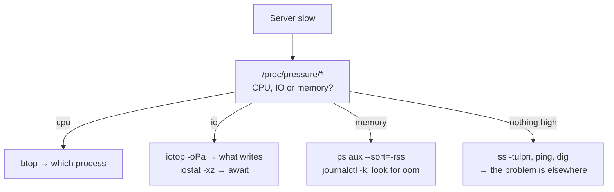

# Terminal monitoring — TUIs for live diagnosis

## The problem

It's three in the morning, a service is slow and you have one SSH session. Grafana says CPU is at 70%, which is exactly what it said yesterday when everything was fine. What you need to know is **which specific process** is causing it, right now, on this machine.

That's where the dashboard falls short and the terminal wins: Prometheus answers "how has the system evolved"; a TUI answers "what is happening this second". Different questions, and you need both.

!!! note "This does not replace your observability stack"
    Without history there are no trends, no alerts, no correlation across machines. That's what the [observability stack](../monitoring/observability_stack.md) is for. This page is the toolbox for when you are already inside the server.

## 📋 Table of Contents

- [What to install and why](#what-to-install-and-why)
- [System: btop and glances](#system-btop-and-glances)
- [Reading load correctly](#reading-load-correctly)
- [Disk and network](#disk-and-network)
- [Containers: ctop and lazydocker](#containers-ctop-and-lazydocker)
- [Kubernetes: k9s](#kubernetes-k9s)
- [What you already have installed](#what-you-already-have-installed)
- [A diagnostic order](#a-diagnostic-order)
- [Best practices](#best-practices)
- [References](#references)

## What to install and why

| Tool | Answers | Installation |
|---|---|---|
| **btop** | Which process is eating CPU/RAM right now? | `apt install btop` |
| **glances** | Everything at once, including remote over an API | `pipx install glances` |
| **iotop** | Who is hammering the disk? | `apt install iotop` |
| **nethogs** | Which process is using the network? | `apt install nethogs` |
| **ctop** | Which container is eating the host? | binary from GitHub |
| **lazydocker** | Container management without memorizing flags | binary from GitHub |
| **k9s** | Navigating a cluster without typing `kubectl` | binary from GitHub |

Don't install them all at once. `btop` and `iotop` cover 80% of real single-machine incidents.

## System: btop and glances

`btop` is `htop`'s successor: same purpose, better graphs, mouse navigation.

```bash
btop
```

What you actually use inside it:

| Key | Action |
|---|---|
| `f` | Filter processes by name |
| `1`–`4` | Show/hide CPU, memory, network, disks |
| `+` / `-` | Collapse the process tree |
| `e` | Group threads by process |
| `k` | Send a signal to a process |

`glances` covers a different case: everything on one screen, including temperature, sensors and containers, and above all **exposing it over the network**.

```bash
# On the server
glances -w                       # web server on :61208

# From your machine, without opening a browser
glances -c server.example.com
```

It is the fastest way to look at a machine with no agent and no scrape configured. For anything permanent a Prometheus exporter is the better idea: `glances -w` has no authentication by default.

## Reading load correctly

The most widespread mistake: reading *load average* as a CPU percentage. It isn't one.

```bash
uptime
#  03:14:07 up 42 days,  load average: 8.42, 6.11, 4.03
```

Load average counts processes that are **runnable or in uninterruptible I/O wait**. An 8.00 on an 8-core machine with everything CPU-bound is exactly saturation. The same 8.00 caused by an unresponsive NFS mount means CPU at 2% and eight blocked processes. Same number, opposite incidents.

Always divide by the core count:

```bash
nproc
```

What actually separates the two cases is **PSI** (Pressure Stall Information), available on any kernel 4.20+:

```bash
cat /proc/pressure/cpu
cat /proc/pressure/io
cat /proc/pressure/memory
# some avg10=23.15 avg60=18.02 avg300=9.44 total=...
```

`some avg10` is the percentage of the last 10 seconds during which **at least one** task was blocked waiting for that resource. `full` is the percentage during which **all** of them were.

- High `cpu`, low `io` → genuinely CPU-starved.
- High `io` with low CPU → disk or network is the bottleneck; load average would have misled you.
- `memory` with non-zero `full` → you are actively reclaiming memory, the OOM killer is next.

It is the datapoint that rules out hypotheses fastest, and it appears on almost no default dashboard. It deserves a Grafana panel.

## Disk and network

```bash
# Which process is writing, in real time
sudo iotop -oPa
#  -o only processes with active I/O, -P per process, -a accumulated

# Per-device latency and saturation
iostat -xz 2
```

In `iostat` output, the column that matters isn't `%util` (misleading on NVMe and SSDs, where parallelism saturates it without any actual problem) but `await`: average milliseconds of wait per request. Tens of ms on an SSD is an anomaly; on a saturated spinning disk it's normal.

```bash
# Bandwidth per process
sudo nethogs

# Per connection and host
sudo iftop -i eth0

# What is listening, and who owns it
sudo ss -tulpn
```

`ss -tulpn` is the one that most often resolves the problem: "the port is taken", "the service isn't listening where you thought", "it listens only on localhost, which is why the proxy can't reach it".

## Containers: ctop and lazydocker

`docker stats` gives you numbers; `ctop` gives them sortable and with short history.

```bash
ctop            # top-style view of all containers
ctop -a         # only running ones
```

`lazydocker` goes one step further: logs, `exec`, restart and cleanup without recalling the syntax.

```bash
lazydocker
```

| Key | Action |
|---|---|
| `[` / `]` | Switch panel (containers, images, volumes) |
| `d` | Remove the selected item |
| `r` | Restart the container |
| `a` | Open a shell inside the container |
| `x` | Action menu for the current panel |

!!! tip "Container limits are invisible from outside"
    `btop` on the host shows the machine's memory, not the container's cgroup limit. A process OOM-killed within its limit leaves no visible trace on the host except in the journal:
    ```bash
    journalctl -k | grep -i "killed process"
    cat /sys/fs/cgroup/<path>/memory.max
    ```
    It is the most common cause of "the container restarts by itself and there is nothing in the application logs". See [lifecycle with Quadlet](../docker/quadlets.md).

## Kubernetes: k9s

```bash
k9s
```

It replaces most of the `kubectl get`, `describe` and `logs` you type by hand.

| Command | Action |
|---|---|
| `:pods`, `:svc`, `:deploy` | Jump to a resource type |
| `/text` | Filter |
| `l` | Pod logs (`Shift+L` for the previous container's) |
| `d` | Describe |
| `s` | Shell into the container |
| `Ctrl+D` | Delete the resource |
| `:pulses` | Cluster health overview |

`Shift+L` (previous container logs) is the key that resolves a `CrashLoopBackOff`: the dead container's logs are the ones that say why it died.

## What you already have installed

Before installing anything, on any server:

```bash
# Kernel errors: OOM, disk failures, network resets
journalctl -p err -b --no-pager | tail -40

# Top 10 processes by resident memory
ps aux --sort=-rss | head -11

# Space: disk and inodes (inodes run out sooner than you'd think)
df -h; df -i

# Which directory ate the disk
du -xh --max-depth=1 / 2>/dev/null | sort -h | tail
```

`df -i` earns its place on the list: a directory with millions of small files exhausts inodes at 40% disk usage, and the error you see is "No space left on device" while `df -h` insists there's room.

## A diagnostic order

For "the server is slow", in this order:



The last case is the most frequent and the biggest time sink: the machine is fine and the problem is DNS, a remote backend or the network. Starting from PSI rules the host out in ten seconds instead of half an hour of `top`.

## Best practices

- **Start with PSI, not `top`.** It rules the host in or out immediately.
- **Load average divided by `nproc`**, and never as a CPU percentage.
- **`await` before `%util`** when judging a disk.
- **`df -i` alongside `df -h`.** Always.
- **Never expose `glances -w` without authentication.** It has none by default. If you need it remotely, put it behind [Traefik](../traefik/traefik_base.md) with auth, or better, behind the VPN.
- **Whatever you diagnose twice, put into Prometheus.** The terminal is for one-offs; anything repeated deserves history and an alert ([observability stack](../monitoring/observability_stack.md)).

## References

- [btop](https://github.com/aristocratos/btop) · [glances](https://nicolargo.github.io/glances/) · [ctop](https://github.com/bcicen/ctop)
- [lazydocker](https://github.com/jesseduffield/lazydocker) · [k9s](https://k9scli.io/)
- [Kernel PSI documentation](https://docs.kernel.org/accounting/psi.html)
- [Observability stack](../monitoring/observability_stack.md) · [Quick recipes](../recipes.md)
