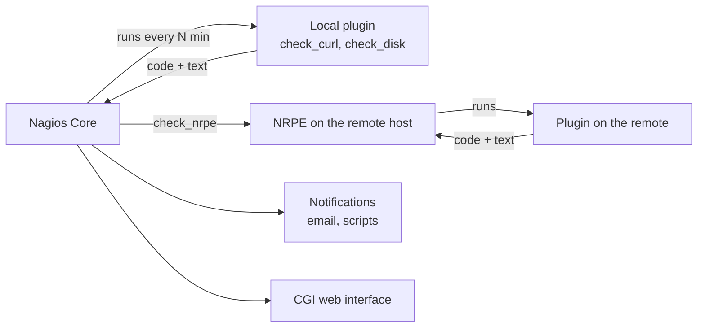

# Nagios Core: classic monitoring with plugins

## The problem

You want something that checks every few minutes that your servers and services are fine and tells you when they aren't, and you want to be able to explain each check in one line of text. No database that keeps growing, no agents with dozens of options, no interface where everything is configured.

Nagios Core has been doing exactly that for more than twenty years, and its central idea has outlived almost all of its competitors: **a plugin is a program that returns an exit code and one line of text**. `0` is OK, `1` warning, `2` critical, `3` unknown. Everything else (scheduling, retries, notifications, dependencies) is Nagios's job. Icinga, Naemon, Checkmk and even Zabbix or Prometheus (with adapters) use that contract today, so understanding it pays off even if you don't end up using Nagios.

## 📋 Table of Contents

- [When Nagios fits](#when-nagios-fits)
- [How it works](#how-it-works)
- [Installing on Debian 13](#installing-on-debian-13)
- [Securing the web interface](#securing-the-web-interface)
- [Hosts, services and commands](#hosts-services-and-commands)
- [The Monitoring Plugins](#the-monitoring-plugins)
- [Remote machines with NRPE](#remote-machines-with-nrpe)
- [Notifications](#notifications)
- [Writing your own plugin](#writing-your-own-plugin)
- [Troubleshooting](#troubleshooting)
- [Best practices](#best-practices)
- [References](#references)

## When Nagios fits

- **It fits** if you want configuration in text files versioned in git, "works or doesn't" checks and a small system you can understand end to end.
- **It fits poorly** if you need graphs and metric history (Nagios stores states, not time series), automatic discovery or managing hundreds of devices from an interface. That is what [Zabbix](zabbix.md) or the [Prometheus stack](observability_stack.md) are for.

If you are starting from scratch and like the Nagios model, also look at **Icinga 2**: it shares the plugin contract, has an API and a more modern configuration, and is where a good part of the community went.

## How it works



1. Nagios schedules checks of **hosts** and **services** according to their intervals.
2. Each check runs a **command**, which is a line that calls a plugin with arguments.
3. The plugin returns code and text. If the state changes, Nagios retries a few times (**SOFT state**) before accepting it (**HARD state**). Only HARD changes notify.
4. The web interface is a set of CGIs that read the state: it is for looking, not for configuring.

## Installing on Debian 13

Debian packages Nagios as `nagios4`. In Debian 13 it is version **4.4.6**, with the security patches the Debian team has applied (among them, the CSRF protection from 4.5.12). The latest upstream Nagios Core release is 4.5.14 (August 2026), and 4.5 reaches Debian in the next stable release.

!!! warning "Package or source build"
    For normal use, the Debian package is the sensible choice: it gets security fixes with `apt upgrade`. Building 4.5 from source only pays off if you need something specific from that version, and in exchange updates become your job.

```bash
sudo apt install nagios4 monitoring-plugins nagios-nrpe-plugin
```

This installs the core (`nagios4-core`), the CGIs with their Apache configuration (`nagios4-cgi`), the plugins in `/usr/lib/nagios/plugins/` and the `check_nrpe` client.

Where things live in the Debian package:

| What | Where |
|---|---|
| Main configuration | `/etc/nagios4/nagios.cfg` |
| Sample objects | `/etc/nagios4/objects/` |
| Your definitions | `/etc/nagios4/conf.d/` (loaded through `cfg_dir`) |
| Plugin commands | `/etc/nagios-plugins/config/` (also loaded) |
| CGI configuration | `/etc/nagios4/cgi.cfg` |
| Apache | `/etc/apache2/conf-available/nagios4-cgi.conf` |
| Web interface | `http://server/nagios4/` |

## Securing the web interface

!!! danger "The default install asks for no password"
    The Debian package turns authentication off (`use_authentication=0` in `cgi.cfg`) so that it works straight after installing, and to compensate the Apache configuration only lets in private addresses (`Require ip` with `10.0.0.0/8`, `192.168.0.0/16`, etc.). Anyone on your network can look and, through some CGIs, act. Fix it before using it for real.

The steps:

1. Create a user with `htdigest` (`apache2-utils` package). The package already expects the file at `/etc/nagios4/htdigest.users` and the realm `Nagios4`:

   ```bash
   sudo htdigest -c /etc/nagios4/htdigest.users Nagios4 nagiosadmin
   ```

2. In `/etc/apache2/conf-available/nagios4-cgi.conf`, replace the `Require ip …` in the main block with authentication for the whole site, using the same `AuthDigest*` directives the package already uses for `cmd.cgi` and `Require valid-user`. Enable the module with `sudo a2enmod auth_digest`.

3. In `/etc/nagios4/cgi.cfg`, turn authentication back on and give the user permissions:

   ```ini
   use_authentication=1
   authorized_for_system_information=nagiosadmin
   authorized_for_configuration_information=nagiosadmin
   authorized_for_system_commands=nagiosadmin
   authorized_for_all_services=nagiosadmin
   authorized_for_all_hosts=nagiosadmin
   authorized_for_all_service_commands=nagiosadmin
   authorized_for_all_host_commands=nagiosadmin
   ```

4. `sudo systemctl reload apache2`.

Even with a password, don't publish it on the Internet: put it behind the [VPN](../linux/wireguard.md) or a reverse proxy with [SSO](../identity/authentik.md).

## Hosts, services and commands

The configuration is **objects** in text files. Templates (`use`) inherit values, so each object only declares what changes. The generic templates (`linux-server`, `generic-service`) are in `/etc/nagios4/objects/templates.cfg`.

A file in `/etc/nagios4/conf.d/web-01.cfg`:

```cfg
define host {
    use                 linux-server
    host_name           web-01
    alias               Web server
    address             192.0.2.21
}

define service {
    use                 generic-service
    host_name           web-01
    service_description HTTPS
    check_command       check_https_cert!example.com!14
}

define command {
    command_name        check_https_cert
    command_line        $USER1$/check_curl -H $ARG1$ -S --sni -C $ARG2$
}
```

- `$USER1$` is the plugin path, defined in `/etc/nagios4/resource.cfg`.
- `$ARG1$`, `$ARG2$`… are the values separated by `!` in `check_command`.
- The example checks that the site answers over HTTPS and warns if the certificate expires in under 14 days.

Before reloading, **always validate**:

```bash
sudo nagios4 -v /etc/nagios4/nagios.cfg
sudo systemctl reload nagios4
```

Validation counts objects, warnings and errors, and with an error Nagios won't load the new configuration. It is the habit that saves the most grief.

## The Monitoring Plugins

`monitoring-plugins` is the standard plugin collection (version 2.4.0 in Debian 13; the project is at 3.0.3). It is split into packages: `monitoring-plugins-basic` has the everyday ones (`check_disk`, `check_load`, `check_procs`, `check_swap`, `check_ping`, `check_tcp`, `check_ssh`, `check_curl`, `check_apt`) and `monitoring-plugins-standard` those that depend on libraries (`check_dns`, `check_snmp`, `check_pgsql`, `check_mysql`, `check_ldap`…).

All of them can be run by hand, which is the best way to try a threshold before writing it into the configuration:

```bash
/usr/lib/nagios/plugins/check_disk -w 20% -c 10% -p /
echo $?
```

!!! note "check_http is deprecated"
    In Debian 13, `check_http` has been replaced by `check_curl` (it remains as `check_http.deprecated`). The options are almost the same. If you copy old configurations, change the name.

Beyond the standard collection there are thousands of third-party plugins (for RAID, UPS, APIs, databases…). Before installing one, read it: it runs with the permissions of the `nagios` user.

## Remote machines with NRPE

Checks such as disk or load can only be done **on** the machine. NRPE is a small daemon that runs on the remote host and executes, when Nagios asks, a closed list of commands.

On the monitored machine:

```bash
sudo apt install nagios-nrpe-server monitoring-plugins-basic
```

In `/etc/nagios/nrpe.cfg` (or better in `/etc/nagios/nrpe_local.cfg`, which upgrades don't overwrite):

```cfg
allowed_hosts=127.0.0.1,::1,192.0.2.10
command[check_root]=/usr/lib/nagios/plugins/check_disk -w 20% -c 10% -p /
command[check_load]=/usr/lib/nagios/plugins/check_load -r -w .15,.10,.05 -c .30,.25,.20
```

In Nagios:

```cfg
define service {
    use                 generic-service
    host_name           web-01
    service_description Disk /
    check_command       check_nrpe!check_root
}
```

!!! warning "Don't enable dont_blame_nrpe"
    `dont_blame_nrpe=1` lets Nagios pass arguments to NRPE commands. It is convenient and it is a door to running commands on the remote host if someone impersonates the server. Leave `dont_blame_nrpe=0` and define closed commands. Also restrict port 5666 in the firewall to the Nagios IP.

If the machines already have SSH with keys, `check_by_ssh` is an alternative to NRPE that needs no extra daemon, at the cost of opening an SSH session per check.

## Notifications

When a host or service enters a problematic HARD state, Nagios notifies its **contacts** (`/etc/nagios4/objects/contacts.cfg`) using the `notify-host-by-email` and `notify-service-by-email` commands, which call `mail`. For that to work, the machine has to be able to send email; see [SPF, DKIM and DMARC](../networking/spf_dkim_dmarc.md) if it goes out to the Internet.

Any other channel is just another command: a script that receives the message and sends it to Telegram or a webhook. The options that cut the most noise:

- `notification_interval`: how many minutes between repeated alerts while the problem lasts (`0`, only once).
- `notification_period`: at what hours to notify.
- `parents` on hosts: if the switch goes down, the machines behind it show up as **unreachable** and don't each notify on their own.

## Writing your own plugin

A plugin is any executable that respects the contract. For example, checking that the latest [Restic](../backups/restic_borg.md) backup is no older than a day, based on a file the backup script itself updates when it finishes successfully:

```bash
#!/bin/sh
# check_backup_age: warns if the last successful backup is old.
STAMP=/var/lib/backup/last-ok
WARN=${1:-26}   # hours
CRIT=${2:-50}

[ -f "$STAMP" ] || { echo "UNKNOWN - $STAMP does not exist"; exit 3; }
AGE=$(( ($(date +%s) - $(stat -c %Y "$STAMP")) / 3600 ))

if [ "$AGE" -ge "$CRIT" ]; then echo "CRITICAL - last backup ${AGE} h ago"; exit 2
elif [ "$AGE" -ge "$WARN" ]; then echo "WARNING - last backup ${AGE} h ago"; exit 1
else echo "OK - last backup ${AGE} h ago | age=${AGE}h;${WARN};${CRIT}"; exit 0
fi
```

- The first output line is what shows in the interface and in notifications.
- What goes after `|` is **performance data**: Nagios doesn't graph it, but tools like PNP4Nagios or Grafana do.
- When in doubt (missing file, failing command), return `3` (UNKNOWN), never `0`.

## Troubleshooting

| Symptom | Likely cause | Fix |
|---|---|---|
| Nagios doesn't reload after a change | Configuration error | `sudo nagios4 -v /etc/nagios4/nagios.cfg` gives file and line |
| The web interface lets you in without a password | Authentication comes disabled in the package | See [Securing the web interface](#securing-the-web-interface) |
| 403 when opening the web interface from outside the LAN | Apache's `Require ip` only allows private networks | That is expected; use the VPN instead of opening it |
| "Error: Invalid or missing CSRF cookie!" when sending commands from a script | CSRF protection requires going through the interface first | Use the interface, the external command file or, if there is no other way, `cgi_cookie_fail_open=1` in `cgi.cfg` |
| `CHECK_NRPE: Error - Could not connect` | Firewall, or the Nagios IP missing from `allowed_hosts` | Open 5666 to Nagios only and add its IP; restart `nagios-nrpe-server` |
| `NRPE: Command 'x' not defined` | The name in `check_nrpe!x` doesn't match `command[x]` | Make the names match and restart NRPE |
| A plugin works by hand and fails in Nagios | Nagios runs it as the `nagios` user, with another environment and permissions | Test it with `sudo -u nagios /usr/lib/nagios/plugins/…` |
| Alerts that come and go | Threshold too tight or `max_check_attempts` too low | Raise the retries or adjust the threshold |

## Best practices

- **Turn authentication on** before anything else and don't expose the interface outside the VPN.
- **Configuration in git**: `/etc/nagios4/conf.d/` is text; versioning it gives you history and review of every change.
- **Validate before reloading**, always, ideally from a hook or CI if the configuration lives in a repository.
- **Closed NRPE commands**, no `dont_blame_nrpe`, and port 5666 filtered.
- **`parents` and dependencies** so a network outage doesn't flood you with alerts.
- **Plugins that fail with UNKNOWN**, never with OK.
- **Measure what matters to the user**: a `check_curl` against the real URL says more than ten process checks.

## References

- [Nagios Core: documentation](https://library.nagios.com/library/products/nagios-core/documentation/)
- [Nagios Core on GitHub (releases and notes)](https://github.com/NagiosEnterprises/nagioscore/releases)
- [nagios4 package in Debian](https://packages.debian.org/trixie/nagios4)
- [Monitoring Plugins](https://www.monitoring-plugins.org/)
- [Plugin development guidelines](https://www.monitoring-plugins.org/doc/guidelines.html)
- [NRPE on GitHub](https://github.com/NagiosEnterprises/nrpe)
- Related: [Zabbix 8.0 LTS](zabbix.md), [Uptime Kuma](uptime_kuma.md), [Observability stack](observability_stack.md)
