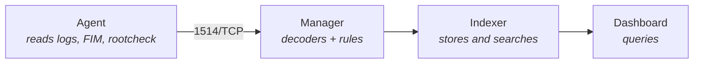

# Observability: Centralized Logging with Wazuh

## The problem

You install Wazuh, deploy agents on twenty machines, and a week later you have 40,000 alerts a day. Nobody reads any of them. The one that mattered — a `sudo` at 4 in the morning from an IP that has no business being there — is buried under 12,000 notices that `/etc/fstab` changed its mtime because an `apt upgrade` touched the file.

The problem is not the tool: an untuned SIEM produces noise as efficiently as it produces signal. The stock ruleset is designed to cover *any* environment; yours covers yours. That is what this page is about: what to ingest, how to decide what deserves an alert, and how to test a rule before it reaches production.

!!! note "What this covers and what it doesn't"
    This page is about **log collection and analysis**: `localfile`, decoders, rules, levels and tuning. Initial installation and the comparison with Falco live in [Security Monitoring](../cybersecurity/monitoreo_seguridad.md). Using the alerts during an incident lives in [Incident Response](../cybersecurity/respuesta_incidentes.md).

## 📋 Table of Contents

- [Architecture and failure points](#architecture-and-failure-points)
- [Log collection with localfile](#log-collection-with-localfile)
- [Decoders and rules](#decoders-and-rules)
- [Writing your own rule](#writing-your-own-rule)
- [Test before you apply: wazuh-logtest](#test-before-you-apply-wazuh-logtest)
- [Alert levels and what to notify](#alert-levels-and-what-to-notify)
- [Agent ossec.conf versus manager ossec.conf](#agent-ossecconf-versus-manager-ossecconf)
- [File Integrity Monitoring](#file-integrity-monitoring)
- [Rootkit detection](#rootkit-detection)
- [Agent groups and centralized configuration](#agent-groups-and-centralized-configuration)
- [Integration and retention](#integration-and-retention)
- [Troubleshooting](#troubleshooting)
- [Best practices](#best-practices)
- [References](#references)

## Architecture and failure points



| Component | What it does | What happens when it goes down |
|---|---|---|
| **Agent** | Reads files and events on the endpoint and ships them encrypted to the manager | That host stops reporting. The manager marks it `disconnected`, but **nobody tells you unless you built that alert** |
| **Manager** | Decodes, correlates and decides whether there is an alert | All analysis stops. Agents retry and some buffer, but the gap in time is real |
| **Indexer** | Stores alerts and serves searches | The manager keeps detecting and writing `alerts.json` to disk, but the dashboard shows nothing |
| **Dashboard** | Query interface | You only lose visualization. Nothing stops being detected |

The consequence is counterintuitive: **if the indexer goes down you lose visibility, not detection**; if the manager goes down you lose both. And a dead agent is the quietest failure of the four, because the absence of alerts looks a lot like "nothing happened".

!!! warning "Paths and binaries change between major versions"
    Wazuh comes from OSSEC and still carries the `/var/ossec` prefix on Linux, and it has renamed binaries (`ossec-*` → `wazuh-*`) and services across major branches. The paths on this page are those of the 4.x branches on Linux, which is the most widely documented. **Before you copy a path, check yours**: `systemctl status wazuh-agent` and `ls /var/ossec/bin/` tell you the truth about your installation in a second. On Windows and macOS the prefix is different.

## Log collection with localfile

Every source you want to ingest is a `<localfile>` block with two mandatory fields: where it is and how it is read.

```xml
<!-- /var/ossec/etc/ossec.conf on the agent -->
<localfile>
  <location>/var/log/auth.log</location>
  <log_format>syslog</log_format>
</localfile>
<localfile>
  <location>/var/log/app/output.json</location>
  <log_format>json</log_format>
  <label key="app_name">frikiteam-service</label>
</localfile>
```

| `log_format` | What for |
|---|---|
| `syslog` | Plain text, line by line. The workhorse: `auth.log`, `messages`, unstructured application logs |
| `json` | One JSON object per line. Fields are decoded on their own, no decoder to write |
| `journald` | Reads from the systemd journal instead of the file, with `<filter field="...">` by unit or priority |
| `audit` | auditd output (`/var/log/audit/audit.log`) |
| `command` / `full_command` | Runs a command every `<frequency>` seconds and ingests its output; `full_command` treats the whole output as one event |
| `multi-line` | Events spanning a fixed number of lines |
| `eventchannel` / `eventlog` | Windows event channels. `eventchannel` is the modern one and accepts an XPath filter in `<query>` |

`json` is the one that saves the most work: if you control the application, making it write one JSON object per line removes the need to write a decoder at all. It is worth touching the app's logger before fighting regular expressions in the manager. `<location>` accepts wildcards (`/var/log/nginx/*.log`), and with `journald` you filter by unit with `<filter field="_SYSTEMD_UNIT">^sshd.service$</filter>`.

!!! danger "Duplicates: journald and the file at the same time"
    If you ingest `journald` without a filter **and** `/var/log/auth.log`, the same event comes in twice, fires the same rule twice and doubles your storage. Pick one path per source. On distributions where rsyslog no longer writes files, journald is the only real option.

`<label>` entries are attached to the alert and survive all the way to the indexer. Use them for what the log does not tell you: environment, owning team, criticality. Searching `app_name:frikiteam-service AND rule.level:>=10` is far faster than guessing which host each line came from.

## Decoders and rules

An event goes through three phases before it becomes — or does not become — an alert: `raw event → pre-decoding → decoding → rules`, and an alert is only emitted if the resulting level reaches `log_alert_level`.

- **Pre-decoding** splits the standard syslog header: date, hostname, program name. It is not configurable and it almost never fails.
- **Decoding** applies the matching decoder and extracts named fields (`srcip`, `dstuser`, `url`…). **No decoder means no fields**, and without fields rules can only do plain-text matching.
- **Rules** walk the ruleset and assign a level. Rules chain: `<if_sid>` makes a rule evaluate only if another one already matched, and `<if_matched_sid>` correlates N occurrences within a time window.

That chaining is what turns three password failures into a different event from a single failure. The child rule inherits the parent's context and raises the level: you are not repeating the detection, you are refining it.

## Writing your own rule

Golden rule: **do not touch the system ruleset**. The files installed by the package are overwritten on every update. Your rules go in the local file, with IDs from 100000 upwards — the range reserved for user rules — so they never clash with the official ones.

```xml
<!-- /var/ossec/etc/rules/local_rules.xml -->
<group name="local,sshd,">
  <!-- Raise the level of a successful SSH login from outside the internal network -->
  <rule id="100010" level="10">
    <if_sid>5715</if_sid>
    <srcip>!192.168.0.0/16</srcip>
    <description>SSH: successful login from an external IP</description>
    <group>authentication_success,</group>
  </rule>
  <!-- Correlation: 5 failures from the same source within 120 seconds -->
  <rule id="100011" level="12" frequency="5" timeframe="120">
    <if_matched_sid>5710</if_matched_sid>
    <same_source_ip />
    <description>SSH: possible brute force</description>
    <group>authentication_failures,</group>
  </rule>
</group>
```

| Element | Effect |
|---|---|
| `<if_sid>` | The rule is evaluated only if the named rule already matched. This is how you **specialize** a system rule without editing it |
| `<if_matched_sid>` + `frequency` + `timeframe` | Correlation: N matches of that rule within that window |
| `<same_source_ip />` | Restricts the correlation to one source. Without it, five failures from five IPs count as brute force |
| `overwrite="yes"` | Redefines an existing rule keeping its ID, to lower the level of a noisy rule without losing traceability |

Dropping to level 0 what does not help you — a child rule with `<if_sid>` on the noisy one, `level="0"` and a description explaining the exception — is as legitimate as writing a new rule, and considerably more effective at reducing noise. Prefer it to commenting out the original rule: it survives updates and leaves *why* it is ignored in writing.

## Test before you apply: wazuh-logtest

`/var/ossec/bin/wazuh-logtest` runs the three phases on the line you paste, against the ruleset loaded in the manager, and tells you which decoder and which rule matched. It is the difference between deploying a rule and knowing it works. It returns the phases: pre-decoding with timestamp, hostname and program; decoding with the extracted fields; and the rule that matched, with its ID, level and description. If your rule does not show up, the problem is in the rule; if decoding comes back empty, the problem is earlier, in the decoder.

!!! tip "The ruleset it evaluates is the loaded one"
    After editing `local_rules.xml` you must restart the manager (`/var/ossec/bin/wazuh-control restart`) for the session to see your new rule. Malformed XML stops the manager from starting and leaves you without analysis until you fix it, so validate before restarting during a delicate window.

    The same check exists as the API's `PUT /logtest` endpoint, useful for validating rules in a CI pipeline before touching the manager. See [CI Security Scanning](../cybersecurity/ci_security_scanning.md).

## Alert levels and what to notify

Every rule carries a numeric level. The accepted range goes up to 16; the official classification documents 15 as "severe attack, no chance of false positives".

| Level | Practical meaning | Reasonable destination |
|---|---|---|
| 0 | Ignored, generates no alert | Nothing. This is the tool for silencing |
| 1–3 | Informational, very high volume | Do not even store, unless compliance requires it |
| 4–6 | System error, misconfiguration | Dashboard. Reviewed, not notified |
| 7–9 | Security relevant: auth failures, policy changes | Dashboard and periodic review |
| 10–12 | Multiple failures, attack patterns, correlations | **Notification**: on-call channel |
| 13–15 | Serious error or confirmed attack | **Page the on-call.** It should wake somebody up |

```xml
<!-- /var/ossec/etc/ossec.conf on the manager -->
<ossec_config>
  <alerts>
    <log_alert_level>3</log_alert_level>     <!-- what gets stored -->
    <email_alert_level>12</email_alert_level> <!-- what interrupts -->
  </alerts>
</ossec_config>
```

`log_alert_level` decides what is written to `alerts.json` — and therefore what reaches the indexer and how much disk you burn. `email_alert_level` decides what interrupts a human. Two different numbers is deliberate: **storing is cheap, interrupting is not**. If your notification threshold produces more than one notice a day that nobody acts on, either the threshold is wrong or the rule is wrong.

## Agent ossec.conf versus manager ossec.conf

Both files have the same name and live at the same relative path, but they contain different things. Confusing them is the most common configuration mistake.

| Block | Agent | Manager |
|---|---|---|
| `<localfile>` | **Yes** — which logs this host reads | Yes, for the manager's own logs |
| `<syscheck>` (FIM) and `<rootcheck>` | **Yes** — what this host watches | Yes, for itself |
| `<client>` with `<server><address>` | **Yes** — who it reports to | No |
| `<rules>` / `<decoders>` | No. **The agent analyzes nothing** | **Yes** — the logic lives here |
| `<alerts>` with the thresholds | No | **Yes** |
| `<global>`, `<integration>` | No | **Yes** |

The mental rule that avoids 90% of the confusion: **the agent collects, the manager decides**. If you are editing rules or thresholds on the agent, you are editing a file nobody reads. And if you add a `<localfile>` on the manager expecting it to apply to the endpoints, nothing happens either: that is what groups are for.

## File Integrity Monitoring

FIM (`syscheck`) hashes the files it watches and alerts when they change. Out of the box across all of `/etc`, it produces an avalanche every time you update packages.

```xml
<syscheck>
  <frequency>43200</frequency>
  <!-- realtime: notifies immediately (uses inotify) -->
  <directories check_all="yes" realtime="yes">/etc/ssh</directories>
  <directories check_all="yes" realtime="yes">/var/www/html</directories>
  <!-- Periodic: enough for things that rarely change -->
  <directories check_all="yes">/usr/bin,/usr/sbin</directories>
  <ignore>/etc/mtab</ignore>
  <ignore>/etc/resolv.conf</ignore>
  <ignore type="sregex">.log$|.tmp$</ignore>
</syscheck>
```

Why it gets noisy when untuned, in order of impact:

1. **`realtime` on directories that change by themselves.** A cache or a log directory generates events continuously. `realtime` is for what should never change without you knowing: `/etc/ssh`, binaries, the web root.
2. **`check_all="yes"` includes mtime.** A file whose content did not change but whose timestamp did — which any package manager does — generates an alert. If only content matters, restrict the checks to hash and size.
3. **Undeclared maintenance windows.** An `apt upgrade` with no planned exception produces hundreds of legitimate changes indistinguishable from an intrusion.
4. **The inotify limit gives no visible error.** If you exceed it, FIM stops watching in real time **silently**; check `sysctl fs.inotify.max_user_watches` if a `realtime` directory stops reporting.

Selection criterion: watch what an attacker would modify to persist — SSH keys, systemd units, cron, binaries, web server configuration — and nothing else. See [Linux Hardening](../cybersecurity/hardening_linux.md).

## Rootkit detection

`rootcheck` looks for classic indicators: known rootkit files, discrepancies between what `readdir()` sees and what `stat()` sees, hidden processes, listening ports that do not show up in `netstat`, anomalous permissions.

```xml
<rootcheck>
  <disabled>no</disabled>
  <frequency>43200</frequency>
  <check_trojans>yes</check_trojans>
  <check_pids>yes</check_pids>
  <check_ports>yes</check_ports>
</rootcheck>
```

The honest part: **the false positive rate is high in modern environments**, for structural reasons. The techniques assume a traditional system, and plenty of legitimate things look like a rootkit from that vantage point: containers and namespaces produce PID discrepancies by design; hidden files and odd permissions are normal in development tooling directories; and trojan signatures look for rootkits that are years old, which is not where a current attacker is. Treat it as a **secondary net**, not your primary detection: low frequency, findings reviewed in batches rather than notified, and no high alert level until you have seen what it produces over a week on your real fleet. For container runtime, the right tool is Falco, covered in [Security Monitoring](../cybersecurity/monitoreo_seguridad.md).

## Agent groups and centralized configuration

Editing `ossec.conf` by hand on each host does not scale past the third machine. Groups solve exactly that: the manager distributes a shared `agent.conf` to every agent in the group.

```bash
/var/ossec/bin/agent_groups -a -g webservers -q   # create group
/var/ossec/bin/agent_groups -a -i 003 -g webservers
/var/ossec/bin/agent_groups -l                    # list groups
/var/ossec/bin/agent_groups -s -i 003             # an agent's groups
```

The group file lives on the manager, at `/var/ossec/etc/shared/<GROUP>/agent.conf`:

```xml
<agent_config>
  <localfile>
    <location>/var/log/nginx/access.log</location>
    <log_format>syslog</log_format>
  </localfile>
  <syscheck>
    <directories check_all="yes" realtime="yes">/etc/nginx</directories>
  </syscheck>
</agent_config>
```

- Every new agent lands in the `default` group unless you assign it.
- An agent can belong to **several groups**; configurations are merged and the highest-priority group wins on conflict.
- `agent_config` accepts attributes to apply blocks to only part of the group, useful when you mix operating systems. Changes arrive on the next synchronization, not instantly: if you just edited and see no effect, wait before touching anything else.

Version `agent.conf` in Git and deploy it with [Ansible](../ansible/ansible_base.md): it is the only way to know what configuration a fleet of 200 agents had on the day of the incident.

## Integration and retention

Wazuh does not replace your observability stack, it partially overlaps with it. The split that works: **Loki for operational logs, Wazuh for security events**. Duplicating everything into both multiplies the cost without adding detection.

The manager writes every alert to `alerts.json`, one JSON line per alert, so any other tool can read it — `tail -f /var/ossec/logs/alerts/alerts.json | jq 'select(.rule.level >= 10)'` is the minimum viable version.

- **To the on-call channel**: the manager's `<integration>` block sends alerts to Slack or similar, filtering by level, rule or group. Always filter; unfiltered, the channel is noise within 48 hours.
- **To your existing pipeline**: Promtail or the Loki agent reading `alerts.json` like any other structured log. See [Observability Stack](observability_stack.md).
- **As a metric**: level ≥10 alerts per hour is a perfectly valid Prometheus metric, and it catches "the manager stopped analyzing" sooner than any manual review.
- **Active response**: Wazuh can run a script on the endpoint when an alert fires, typically blocking an IP. Careful: a false positive with active response turns into a self-inflicted denial of service. For banning IPs by log patterns, the mature alternative is fail2ban, in [nftables and fail2ban](../cybersecurity/nftables_fail2ban.md).

The cost of a SIEM is almost all storage, and it grows with the number of agents multiplied by how talkative each one is. Three levers, in order of impact:

1. **What becomes an alert.** Raising `log_alert_level` from 3 to 5 cuts volume drastically, because the low levels are by far the most frequent.
2. **How long it is kept.** The indexer organizes alerts into date-based indices, so a lifecycle policy that archives or deletes old indices is the natural tool: hot for a few days, warm for a few weeks, cold for the rest of the mandatory period.
3. **Whether you also keep the raw events.** The manager can archive *everything* it receives, not just what generated an alert. It is gold in a forensic investigation and, by a wide margin, what consumes the most disk. Enable it if you have the budget and the obligation; otherwise don't.

!!! warning "Compliance beats optimization"
    PCI DSS, ENS and similar frameworks set minimum retention periods for audit records. Before cutting, check what you are required to keep and for how long: [Compliance and Auditing](../cybersecurity/cumplimiento_auditoria.md). And the copy an investigation depends on needs its own strategy: [Secure Backup](../cybersecurity/backup_seguro.md).

## Troubleshooting

| Symptom | Cause | Fix |
|---|---|---|
| Agent stuck at `Never connected` | Incomplete enrollment, or 1514/TCP closed | Re-enroll the agent and open the port towards the manager |
| Log arrives but generates no alert | No rule matches, or its level < `log_alert_level` | `wazuh-logtest` with that line; check the threshold |
| `wazuh-logtest` does not see the new rule | The loaded ruleset is the previous one | `wazuh-control restart` after editing |
| Manager will not start after editing rules | Malformed XML in `local_rules.xml` | Read the manager log, it names the file and line |
| FIM avalanche after an update | `check_all` includes mtime | `<ignore>` for volatile paths, or restrict the checks |
| `realtime` FIM stops reporting | inotify limit exhausted | Raise `fs.inotify.max_user_watches` |
| Same event duplicated | Ingested by journald and by file at once | Remove one of the two `<localfile>` blocks |
| Empty dashboard, detection alive | Indexer down | Verify that `alerts.json` is still growing |

The three places to look, in this order:

```bash
tail -f /var/ossec/logs/ossec.log         # errors from Wazuh itself
tail -f /var/ossec/logs/alerts/alerts.log # what is actually alerting
/var/ossec/bin/agent_control -l           # who is reporting
```

If `ossec.log` is clean and `alerts.log` is not growing, the problem is ingestion, not analysis: check `localfile` and the read permissions on the watched file.

## Best practices

- **All your rules in `local_rules.xml`, with IDs ≥ 100000.** The system ruleset is overwritten on every update.
- **`wazuh-logtest` before every rule deployment**, and in CI if the fleet is large. A rule that never matches is invisible wasted work.
- **Silence with level 0, do not delete.** Leave in writing why something is ignored; your future self will thank you during an audit.
- **Alert on the absence of alerts**: an agent that stops reporting is indistinguishable from a quiet day. **Surgical FIM**, and rootcheck as a secondary net at low frequency.
- **Centralized configuration by groups, versioned in Git.** Editing hosts by hand does not survive the first incident.
- **Two different thresholds**: one for storing, one for interrupting. Confusing them produces either blindness or alert fatigue.

## References

- [Wazuh documentation](https://documentation.wazuh.com/) · [Log data collection](https://documentation.wazuh.com/current/user-manual/capabilities/log-data-collection/index.html)
- [Rules classification](https://documentation.wazuh.com/current/user-manual/ruleset/rules/rules-classification.html) · [Centralized configuration (agent.conf)](https://documentation.wazuh.com/current/user-manual/reference/centralized-configuration.html)
- [Security Monitoring](../cybersecurity/monitoreo_seguridad.md) · [Incident Response](../cybersecurity/respuesta_incidentes.md)
- [Observability Stack](observability_stack.md) · [nftables and fail2ban](../cybersecurity/nftables_fail2ban.md)
- [Linux Hardening](../cybersecurity/hardening_linux.md) · [Compliance and Auditing](../cybersecurity/cumplimiento_auditoria.md)
