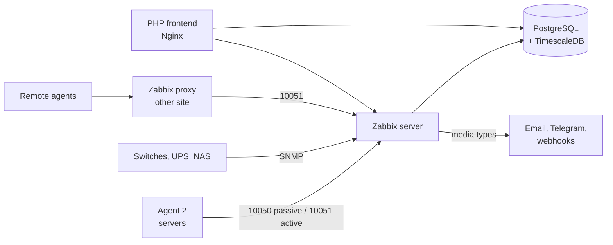

# Zabbix 8.0 LTS: server and network monitoring

## The problem

You have a dozen machines, a couple of managed switches, a UPS and a NAS. You want to know when a disk fills up, when a service stops listening or when a switch port starts throwing errors, and you want to be told by something other than yourself staring at a dashboard.

[Uptime Kuma](uptime_kuma.md) answers "does it respond from outside?", and the [Prometheus stack](observability_stack.md) shines with applications that expose their own metrics. But a good part of real infrastructure exposes nothing: network gear that only speaks SNMP, servers without exporters and legacy applications. Zabbix was born for that. It is a complete system, with an agent, a database, alerts, inventory and discovery, configured from the web interface and shipping templates for almost anything that has an IP address.

## 📋 Table of Contents

- [When Zabbix fits](#when-zabbix-fits)
- [Architecture](#architecture)
- [Installing on Debian 13](#installing-on-debian-13)
- [Agent 2](#agent-2)
- [Templates, items and triggers](#templates-items-and-triggers)
- [Discovery](#discovery)
- [Alerts](#alerts)
- [Proxies](#proxies)
- [Performance and retention](#performance-and-retention)
- [Troubleshooting](#troubleshooting)
- [Best practices](#best-practices)
- [References](#references)

## When Zabbix fits

| Need | Zabbix | Prometheus + Grafana | Uptime Kuma |
|---|---|---|---|
| Does the service respond from outside? | Yes (web checks) | With blackbox_exporter | Its whole purpose |
| Network gear over SNMP | Templates included | snmp_exporter, more work | No |
| Servers without an exporter | Agent with templates | node_exporter per machine | No |
| Metrics from your own applications | Possible, less natural | Its home turf | No |
| Configuration | Web interface and API | YAML files | Web interface |
| Alerts with escalation and schedules | Built in | Alertmanager | Basic |

The rule of thumb: if what you watch is **machines and devices**, Zabbix saves work. If what you watch is **services that already expose metrics** (Kubernetes, your own applications), Prometheus fits better. They live together just fine.

## Architecture



- **Server**: collects data, evaluates triggers and fires alerts. Everything goes through it.
- **Database**: stores configuration and history. It is the usual bottleneck; see [Performance and retention](#performance-and-retention).
- **Frontend**: the PHP application where everything is configured. It does not collect data.
- **Agent**: runs on every monitored machine. In **passive** mode the server asks it (port 10050); in **active** mode the agent asks for its list of checks and sends the data (port 10051 on the server).
- **Proxy**: collects data on behalf of the server in another network or site and forwards it.

## Installing on Debian 13

Zabbix publishes its own repository; Debian's packages lag several versions behind. 8.0 is the current LTS (long-term support) and the one to install on a server you don't want to upgrade every six months.

!!! warning "Versions"
    This guide uses Zabbix 8.0.0, the first release of the LTS branch, with `8.0.0-1+debian13` packages. Package names and paths are those of the official repository at that version; if you install another branch, check the instructions on [the download page](https://www.zabbix.com/download) for your combination of system, database and web server.

### Repository and packages

```bash
wget https://repo.zabbix.com/zabbix/8.0/release/debian/pool/main/z/zabbix-release/zabbix-release_latest_8.0+debian13_all.deb
sudo dpkg -i zabbix-release_latest_8.0+debian13_all.deb
sudo apt update
sudo apt install zabbix-server-pgsql zabbix-frontend-php php8.4-pgsql \
  zabbix-nginx-conf zabbix-sql-scripts zabbix-agent2 postgresql
```

`zabbix-release` puts the sources in `/etc/apt/sources.list.d/` and the key in `/usr/share/keyrings/zabbix.gpg`. Debian 13 ships PHP 8.4, hence `php8.4-pgsql`.

### Database

```bash
sudo -u postgres createuser --pwprompt zabbix
sudo -u postgres createdb -O zabbix zabbix
zcat /usr/share/zabbix/sql-scripts/postgresql/server.sql.gz | sudo -u zabbix psql zabbix
```

The initial schema takes a while and must not throw errors. If it does, the usual cause is running it twice: drop the database and start again.

Then, the password in `/etc/zabbix/zabbix_server.conf`:

```ini
DBName=zabbix
DBUser=zabbix
DBPassword=the-one-you-chose
```

### Frontend

The `zabbix-nginx-conf` package installs `/etc/zabbix/nginx.conf` with `listen` and `server_name` commented out. Uncomment and adjust them:

```nginx
server {
        listen          8080;
        server_name     zabbix.home.arpa;
        root    /usr/share/zabbix/ui;
        # ...
}
```

```bash
sudo systemctl restart zabbix-server zabbix-agent2 nginx php8.4-fpm
sudo systemctl enable zabbix-server zabbix-agent2 nginx php8.4-fpm
```

Open `http://zabbix.home.arpa:8080` and the wizard asks for the database details and writes `/usr/share/zabbix/ui/conf/zabbix.conf.php`. The initial user is `Admin` with password `zabbix`: **change it first thing**.

If the frontend will leave the LAN, put it behind a reverse proxy with TLS and, better still, behind the [VPN](../linux/wireguard.md) or an [SSO](../identity/authentik.md). It is a console that can run scripts on your servers.

## Agent 2

`zabbix-agent2` is the current agent, written in Go and with plugins (PostgreSQL, MySQL, Docker, Redis…). The classic `zabbix-agent` still exists, but use agent 2 for new machines.

On every monitored machine, `/etc/zabbix/zabbix_agent2.conf`:

```ini
Server=192.0.2.10          # who may ask (passive mode)
ServerActive=192.0.2.10    # where to send (active mode)
Hostname=web-01            # must match the host in the frontend
```

The package defaults are `Server=127.0.0.1`, `ServerActive=127.0.0.1` and `Hostname=Zabbix server`, valid only for the server itself. Extra configuration goes in `/etc/zabbix/zabbix_agent2.d/`.

**Active or passive.** Active mode is better behind NAT or a firewall: only port 10051 on the server needs to be open, and the agent connects out. Passive mode needs the server to reach port 10050 on every machine. Official templates come in two flavours, `by Zabbix agent` (passive) and `by Zabbix agent active`: pick one per host.

**Encryption.** By default agent-server traffic is in clear text. PSK is enough:

```bash
openssl rand -hex 32 | sudo tee /etc/zabbix/zabbix_agent2.psk
```

```ini
TLSConnect=psk
TLSAccept=psk
TLSPSKIdentity=web-01
TLSPSKFile=/etc/zabbix/zabbix_agent2.psk
```

And in the frontend, on the host, *Encryption* tab, the same identity and the same key.

## Templates, items and triggers

Zabbix's model has four pieces:

- **Item**: a piece of data that gets collected (CPU usage, free space on `/`, the state of an interface).
- **Trigger**: an expression over items that defines a problem, with a severity. For example, "free space on `/` below 10 % for 5 minutes".
- **Template**: a bundle of items, triggers, graphs and discovery rules.
- **Host**: a machine or device with one or more linked templates.

In practice you almost never create items by hand. You add the host, link the official template (`Linux by Zabbix agent active`, `Generic by SNMP`, `PostgreSQL by Zabbix agent 2`…) and adjust its **macros**: thresholds such as `{$VFS.FS.PUSED.MAX.WARN}` are changed per host without touching the template.

!!! tip "Don't edit the official templates"
    When you upgrade Zabbix you will import them again and lose your changes. Use host macros to adjust thresholds, and a template of your own linked next to the official one to add items.

A custom trigger is written with functions over history:

```text
avg(/web-01/system.cpu.util,10m)>90
```

That is, average CPU usage above 90 % over the last 10 minutes. Recovery expressions (when it counts as resolved) stop an alert from flapping when the value hovers around the threshold.

## Discovery

Zabbix has two kinds of discovery, and it pays not to mix them up:

- **Network discovery**: sweeps an IP range looking for agents or SNMP responses. With **autoregistration** or discovery **actions**, the hosts found are created automatically and get their template.
- **Low-level discovery (LLD)**: inside a host, finds the elements that vary (file systems, network interfaces, disks, containers) and creates an item and a trigger for each. It is what makes the Linux template watch `/`, `/var` and `/srv` without you declaring them.

For active agents, **autoregistration** is the most convenient: the agent introduces itself with its `Hostname` and some metadata (`HostMetadata=linux web` in its configuration), and an action on the server assigns group and templates based on that metadata.

## Alerts

A trigger that fires creates a **problem**. Whether anyone finds out depends on three things:

1. **Media type**: the channel (email, Telegram, Slack, webhook). Zabbix ships dozens already defined in *Alerts → Media types*.
2. **User with media**: who, and at what hours, filtered by severity.
3. **Action**: the rule linking problems to users. This is where escalation is defined ("if it is still open after 30 minutes, also notify…") and whether recovery is notified.

The most common cause of "Zabbix doesn't alert" is having the media type configured but no action using it, or an action whose conditions don't match the problem.

To avoid learning to ignore alerts: honest severities (*Warning* for what can wait until Monday, *High* for what can't) and **trigger dependencies**, so that a switch going down does not create one problem per machine behind it.

## Proxies

A **proxy** collects data in another network (another site, a DMZ, an isolated VLAN) and forwards it to the server. It keeps the data in its own database (SQLite is enough) if the connection drops, and delivers it when it comes back.

```bash
sudo apt install zabbix-proxy-sqlite3
```

In `/etc/zabbix/zabbix_proxy.conf`, the minimum is `Server` (the server's IP), `Hostname` (the proxy's name as registered in the frontend) and `DBName` (the path of the SQLite file). Agents in that network point to the proxy instead of the server. In the frontend, each host is assigned to its proxy.

It also spreads load when a single server can't keep up, although a homelab rarely needs it.

## Performance and retention

The database grows with every item and every interval. Before linking templates to a hundred hosts:

- **Intervals**: not everything needs a value every minute. Disk space every 5 minutes is more than enough.
- **History and trends**: history keeps every value; trends, hourly averages. Shorten history (7-14 days) and keep trends long (1-2 years): they are enough for capacity planning.
- **TimescaleDB**: the PostgreSQL extension Zabbix supports for history. It partitions by time and compresses, and drops old data without the *housekeeper*, which is the biggest load on large databases. The `zabbix-sql-scripts` package ships its schema in `/usr/share/zabbix/sql-scripts/postgresql/timescaledb/`. If you are going past a few hundred hosts, decide at install time: migrating later is possible but laborious.

In *Reports → System information*, the figure to watch is the **required number of values per second**. In *Monitoring → Hosts*, the `Zabbix server health` template shows which internal processes are saturated.

## Troubleshooting

| Symptom | Likely cause | Fix |
|---|---|---|
| The host shows the availability icon in red | The server can't reach the agent's port 10050, or `Server=` doesn't include its IP | Check the firewall and `Server=` on the agent; test from the server with `zabbix_get -s IP -k agent.ping` (`zabbix-get` package) |
| Active checks don't arrive | The agent's `Hostname` differs from the host name in the frontend, or the agent can't reach 10051 | Make the names match (case sensitive); open 10051 on the server |
| "Zabbix server is not running" in the frontend | The server is stopped or the frontend can't reach it | `systemctl status zabbix-server` and the log `/var/log/zabbix/zabbix_server.log` |
| The server won't start after installing | Wrong database password or schema not imported | The log says so in its first lines; check `DBPassword` and that the schema imported fully |
| There are problems, but no alerts arrive | No action, or its conditions don't match | *Reports → Action log* shows whether anything was sent and the error |
| The frontend is slow and the database keeps growing | Too many items with short intervals and long history | Adjust intervals and retention; consider TimescaleDB |
| *Poller* processes at 100 % | More passive checks than the server can handle | Move hosts to active mode, raise `StartPollers` or spread the load with a proxy |

## Best practices

- **Change the `Admin` password** and create your own administrator user; leave `Admin` disabled.
- **Don't expose the frontend** to the Internet without TLS and another layer in front (VPN or SSO).
- **Agents in active mode** whenever you can: fewer ports open towards the machines.
- **Encrypt agent-server traffic with PSK**, especially if it crosses networks you don't control.
- **Official templates untouched**, adjustments via macros and additions in templates of your own.
- **Trigger dependencies** between the network and what hangs off it.
- **Back up** the database (`pg_dump`) and `/etc/zabbix/`. History can be lost; months of configuration can't. See [3-2-1 strategy](../backups/strategy_321.md).
- **Upgrade within the LTS** (8.0.x) with `apt`; jump from LTS to LTS after reading the upgrade notes.

## References

- [Zabbix 8.0 documentation](https://www.zabbix.com/documentation/8.0/en/manual)
- [Life cycle and release policy](https://www.zabbix.com/life_cycle_and_release_policy)
- [Download page and per-system instructions](https://www.zabbix.com/download)
- [Installation requirements](https://www.zabbix.com/documentation/8.0/en/manual/installation/requirements)
- [Zabbix package repository](https://repo.zabbix.com/zabbix/8.0/)
- [Official templates and integrations](https://www.zabbix.com/integrations)
- Related: [Nagios Core](nagios.md), [Uptime Kuma](uptime_kuma.md), [Observability stack](observability_stack.md)
