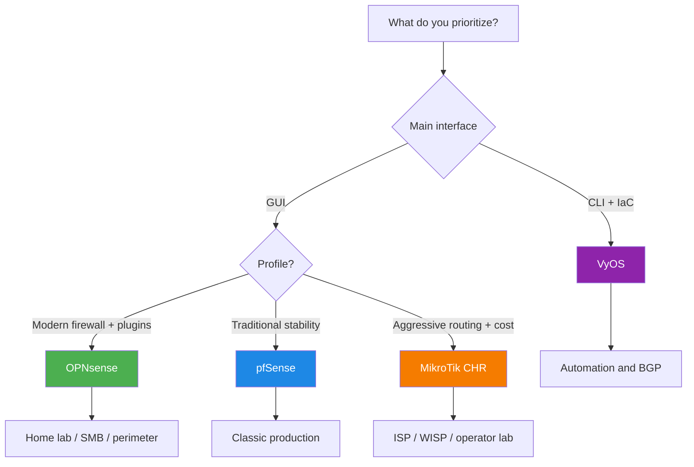

When you need advanced routing, firewalling and network services in virtual form, the most common options are **OPNsense**, **pfSense**, **MikroTik CHR** and **VyOS**.

This document summarizes the key differences and helps you choose according to the scenario.

## Platform guides

- [vRouter performance test template](vrouter_benchmark_template.md)
- [OPNsense: quick guide for home lab and perimeter](vrouter_opnsense.md)
- [pfSense: quick guide for traditional production](vrouter_pfsense.md)
- [MikroTik CHR: quick guide for L3 routing](vrouter_mikrotik_chr.md)
- [VyOS: quick guide for automation and BGP/OSPF](vrouter_vyos.md)

## Typical use cases

- Networking and cybersecurity labs
- Virtual routers in a home lab or at the perimeter
- Perimeter firewall in on-prem infrastructure
- Static and dynamic BGP/OSPF in hybrid environments
- Site-to-site VPN and remote access

## Quick comparison

| Solution | Technology base | Strengths | Limitations | Recommended scenario |
| -------- | --------------- | --------- | ----------- | -------------------- |
| **OPNsense** | FreeBSD + pf | Modern interface, good plugin ecosystem, frequent updates | Less historical documentation than pfSense | Home lab, SMB, security-focused perimeter |
| **pfSense** | FreeBSD + pf | Very stable, large community, high operational maturity | Licensing/ecosystem changes depending on edition | Traditional production and established environments |
| **MikroTik CHR** | RouterOS | High performance per cost, very broad routing features | RouterOS learning curve, performance-based licence | ISP/WISP, intensive L3 routing, operator labs |
| **VyOS** | Linux + FRR + nftables/iptables | Declarative CLI, strong in IaC automation and advanced routing | Less friendly for those who prefer a full graphical interface | Automation, BGP/OSPF, virtual backbone |

## Advanced technical matrix

| Criterion | OPNsense | pfSense | MikroTik CHR | VyOS |
| --------- | -------- | ------- | ------------ | ---- |
| Management plane | Web interface + limited CLI | Web interface + shell | WinBox/WebFig interface + RouterOS CLI | Declarative CLI + API/automation |
| Dynamic routing (BGP/OSPF) | Supported (plugins/FRR) | Supported (FRR package) | Very robust in RouterOS | Very robust with native FRR |
| Main focus | Modern firewall/UTM | Stable, mature firewall | High-performance routing | Routing + automation as code |
| Usual VPN | IPsec, OpenVPN, WireGuard | IPsec, OpenVPN, WireGuard | IPsec, WireGuard, legacy L2TP/PPTP | IPsec, OpenVPN, WireGuard |
| High availability | CARP/failover and configuration sync | CARP/failover and configuration sync | VRRP/failover depending on design | VRRP/high availability depending on architecture |
| Learning curve | Low-medium | Low-medium | Medium-high | Medium-high |
| Automation | Medium (API/plugins) | Medium (API/configuration backup) | High (scripts/Ansible/RouterOS API) | High (GitOps + CLI templates) |
| Recommended profile | SMB, secure perimeter, home lab | Classic, conservative production | ISP/WISP and operator labs | Network and security automation environments |

## Performance targets (initial lab)

| KPI | Baseline target | How to measure it | Acceptance criterion |
| --- | --------------- | ----------------- | -------------------- |
| L3 throughput (unencrypted) | >= 1 Gbps sustained | `iperf3` TCP/UDP between segments | Variation < 15% across 3 runs |
| Site-to-site VPN throughput | >= 300 Mbps sustained | `iperf3` through the tunnel | Average CPU usage < 80% |
| Intra-site latency | <= 5 ms added | Baseline `ping` vs with vRouter | Stable delta without abnormal spikes |
| Packet loss | <= 0.5% | Controlled `mtr`/`ping -f` | No sustained loss > 1 minute |
| Failover convergence | <= 30 s | Controlled link/neighbour cut | Recovery without manual intervention |
| Session stability | 0 unplanned restarts | 24-72 h monitoring | No control-plane outage |

Notes:

- Run tests at off-peak and peak hours to detect degradation under load.
- Keep the same packet size and parallelism when comparing platforms.
- Repeat tests after version, driver or hypervisor type changes.
- If you need targets per context (home lab, SMB, ISP/WISP), use the [vRouter performance test template](vrouter_benchmark_template.md).

## Minimum uniform hardening (all platforms)

- Change default credentials and remove unneeded users.
- Restrict administrative access by IP/dedicated management network.
- Enable MFA for the GUI/admin portal when available.
- Disable unused management services (SSH, API, public GUI).
- Apply a `deny by default` policy on the WAN and explicit rules per service.
- Separate management, user and server networks (VLANs/zones).
- Enable security logs and send them to a central collector.
- Configure reliable NTP for event traceability and auditing.
- Encrypt and validate configuration backups; test restoring them periodically.
- Define a patching process with a maintenance window and a rollback plan.

## What to choose by priority

## Key technical criteria

### 1) Dynamic routing

- **VyOS** and **MikroTik CHR** stand out in BGP/OSPF for complex topologies.
- **OPNsense/pfSense** cover dynamic routing, but tend to shine more as firewalls/UTM.

### 2) Day-to-day operation

- If you prefer a **full GUI**, OPNsense/pfSense reduce friction.
- If you prioritize **GitOps/automation**, VyOS fits better thanks to its declarative CLI model.

### 3) VPN and remote access

- All of them support site-to-site VPN and remote access (IPsec/WireGuard/OpenVPN depending on version and packages).
- Check exact compatibility per version before standardizing in production.

### 4) Licensing and support

- Always review the current edition/commercial model to avoid surprises on upgrades.
- In critical environments, validate enterprise support or a local partner.

## Practical recommendations

- Start with a **proof of concept** using realistic traffic (north-south and east-west).
- Define key indicators (KPIs): latency, throughput, failover, recovery time.
- Document configuration backup/restore and the rollback procedure.
- Version the configuration (where possible) to audit changes.
- Close each evaluation with a short executive report (risks, 7/30-day actions and final decision).

## Decision checklist

- Do you need a GUI or a declarative CLI?
- Is the priority firewalling, advanced routing or both?
- How many VPN tunnels and BGP peers will you maintain?
- What operational capacity does the networking and security team have?
- Are there commercial support and SLA requirements?

If you are torn between two options, compare both in the same lab for a week and decide on metrics, not personal preference.

## References

- [OPNsense: hardware requirements](https://docs.opnsense.org/manual/hardware.html)
- [pfSense: minimum requirements](https://docs.netgate.com/pfsense/en/latest/hardware/minimum-requirements.html)
- [MikroTik: Cloud Hosted Router](https://help.mikrotik.com/docs/spaces/ROS/pages/18350234/Cloud+Hosted+Router+CHR)
- [VyOS: documentation](https://docs.vyos.io/en/latest/)
