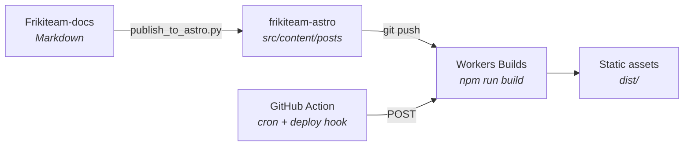

# Astro — A static blog with series, search and scheduled publishing

## The problem

WordPress did everything on the server: PHP, MySQL, Redis, a TLS proxy and a script that checked none of it had broken. Four containers to serve what, at heart, is 150 texts that change once a day. Every core or plugin update had to be watched, and every visit ran code to build a page identical to the previous one.

A static site turns that around: the work is done **once, at build time**, and what gets served is files. But a blog with series, search and scheduled posts seems to need a server. This page explains how each of those three is solved with [Astro](https://astro.build) without one, with measured numbers and the real problems that came up on the way.

!!! note "What this covers and what it does not"
    This is the architecture **of this blog**, with the versions of November 2026 (Astro 7, Pagefind 1.6, Wrangler 4.166, Node 26). It is not an Astro tutorial: for that there are its [guides](https://docs.astro.build/en/guides/content-collections/). The previous step, from Markdown in this repository to a blog post, is done by `scripts/publish_to_astro.py` and is described in the repo's `CLAUDE.md`.

In numbers, as of 22 November 2026: **147 posts** in **11 series**, 83 HTML pages, a 10 MB `dist/`, a full build of about **4 seconds** and **no JavaScript file of its own** in the built site.

## 📋 Table of Contents

- [Overview](#overview)
- [Posts are a collection with a schema](#posts-are-a-collection-with-a-schema)
- [Scheduled publishing on a static site](#scheduled-publishing-on-a-static-site)
- [Series as metro lines](#series-as-metro-lines)
- [Markdown with Sätteri and a custom plugin](#markdown-with-satteri-and-a-custom-plugin)
- [Search with Pagefind](#search-with-pagefind)
- [Redirects, caching and headers on Workers](#redirects-caching-and-headers-on-workers)
- [SEO without plugins](#seo-without-plugins)
- [What it really weighs](#what-it-really-weighs)
- [Troubleshooting](#troubleshooting)
- [Best practices](#best-practices)
- [References](#references)

## Overview

The site is an Astro project that reads Markdown and produces HTML. A Cloudflare Worker serves it with *static assets*: no server code, just the `dist/` directory.



| Piece | What for | Version |
|---|---|---|
| Astro | Generates the pages | 7.4 |
| `@astrojs/markdown-satteri` | Markdown processor | 0.4 |
| Pagefind | Serverless search | 1.6 |
| `@astrojs/sitemap`, `@astrojs/rss` | Sitemap and RSS | 3.7 and 4.0 |
| Wrangler | Deploys `dist/` to Cloudflare Workers | 4.166 |

The build command chains three steps, and a failure in any of them stops the deploy:

```bash
astro build && pagefind --site dist && node scripts/check-build.mjs
```

From `git push` to seeing the change online takes **about 90 seconds** (measured on 22/11/2026).

## Posts are a collection with a schema

Each post is a `.md` with frontmatter validated by a Zod schema. If something does not fit, the build fails instead of publishing a broken page:

```ts
// src/content.config.ts
const posts = defineCollection({
  loader: glob({ pattern: '*.md', base: './src/content/posts' }),
  schema: z.object({
    title: z.string(),
    source: z.string().optional(), // page in Frikiteam-docs it comes from
    date: z.coerce.date(),
    updated: z.coerce.date(),
    category: z.enum(slugs),       // exactly one series per post
    description: z.string(),
    tags: z.array(z.string()),
  }),
});
```

With a series that does not exist, the build ends with an error and exit code 1:

```text
[InvalidContentEntryDataError] posts → ceph data does not match collection schema.
  category: Invalid option: expected one of "almacenamiento"|"automatizacion"|...
```

The split of responsibilities between the two repositories is what keeps them from stepping on each other:

| Data | Where it lives | Who changes it |
|---|---|---|
| Body, title, excerpt, tags, `updated` | The page in this repo | The generator, on every run |
| Series (`category`), release date, image | The post's `.md` in Astro | You; the generator never overwrites it |
| URL (`/series/slug/`) | Derived from the two above | Frozen on publication |

!!! warning "Changing the series changes the URL"
    The URL includes the series. Moving an already published post to another series leaves the old address as a 404 unless you add a redirect.

## Scheduled publishing on a static site

Without a server there is nobody to "publish at 9:00". The solution is two ideas: the date is a field of the post, and **one single filter** decides what exists.

```ts
// src/lib/site.ts
const BUILD_TIME = Date.now();
export async function allPosts() {
  return (await getCollection('posts', (p) => p.data.date.getTime() <= BUILD_TIME))
    .sort((a, b) => b.data.date.getTime() - a.data.date.getTime());
}
```

Every route, the RSS, the series map and the sitemap read from `allPosts()`, so a future post cannot leak in anywhere. A post goes out on the **first build after its date**.

So that it does not rest on a convention alone, the last build step checks it from the outside, reading the files rather than Astro's code:

```js
// scripts/check-build.mjs (summary)
if (date > now && built) leaked.push(f);   // scheduled, but published
if (date <= now && !built) missing.push(f); // due, but without a page
if (leaked.length || missing.length) process.exit(1);
```

What is missing is what triggers the build every day. A GitHub Action calls Cloudflare's *deploy hook*, but first it checks whether it is needed:


```yaml
on:
  schedule:
    - cron: '5 7 * * *'    # 09:05 Madrid in summer
    - cron: '5 8 * * *'    # 09:05 Madrid in winter
    - cron: '35 9 * * *'   # catch-up
    - cron: '5 12 * * *'
jobs:
  deploy:
    steps:
      - uses: actions/checkout@v7
      - id: live
        run: node scripts/check-live.mjs "$LIVE" 0 && echo "done=true" >> "$GITHUB_OUTPUT" || true
      - if: steps.live.outputs.done != 'true'
        env: { HOOK: "${{ secrets.CF_DEPLOY_HOOK }}" }
        run: curl -fsS -X POST "$HOOK" > /dev/null
      - if: steps.live.outputs.done != 'true'
        run: node scripts/check-live.mjs "$LIVE" 15
```


`check-live.mjs` looks for the latest post that is due and checks that it is at its URL **and** linked from the home page. With `0` it only probes; with `15` it waits up to 15 minutes and, if it does not appear, fails red, which is the e-mail alert.

!!! warning "GitHub's cron is not a clock"
    GitHub's documentation says it: the `schedule` event can be delayed during periods of high load, **the start of every hour is one of them**, and under high load some queued jobs may be dropped. It happened to us: on 22/11/2026 neither the 07:05 nor the 08:05 UTC cron ran, and the 09:00 post returned 404 until the Action was launched by hand. The first cron runs arrived at 15:13, 16:11 and 19:29 UTC, which match no scheduled time.

That is why there are four triggers and why each one is **idempotent**: if the post is already online, they do nothing. The documentation also advises scheduling at a minute other than the start of the hour.

## Series as metro lines

A series is an ordered path, and the web draws it as a metro line: one stop per post, in reading order. The order is the date within the series:

```ts
export async function seriesOf(cat: string) {
  return (await allPosts()).filter((p) => p.data.category === cat).reverse();
}
```

The `SeriesLine.astro` component renders an ordered list with one dot per post. Three details worth knowing:

- **The *tooltip* with the title** is a single `position: fixed` element appended to the `<body>`. It does not fit inside the line: the container has `overflow-x: auto` so it can scroll, and it would clip anything that sticks out.
- **The dot is 14 px.** The touch area is extended with a pseudo-element to 34×28 px, above the 24 px that [WCAG 2.5.8](https://www.w3.org/WAI/WCAG22/Understanding/target-size-minimum.html) asks for. Sideways only, because the container clips vertically, and without reaching the neighbouring stops, which are 35 px away.
- **Each stop carries the title as text** (hidden with an `sr-only` class). With only `aria-label`, search engines see no link text.

## Markdown with Sätteri and a custom plugin

Astro 7 renders Markdown with **Sätteri**, its native processor, instead of remark/rehype. remark plugins no longer work as they are: the `markdown.rehypePlugins` option requires installing `@astrojs/markdown-remark` and using the `unified()` processor. Here the plugin was ported to Sätteri.

The pages in this repository link to each other with relative paths (`../docker/quadlets.md#x`), which do not exist on the blog. A HAST plugin resolves them at build time: to the matching post if it is already published and, if not, to the page on `docs.frikiteam.es`:

```js
// astro.config.mjs
markdown: { processor: satteri({ hastPlugins: [docLinks] }) },

// src/lib/doc-links.mjs
export default ({ fileURL }) => {
  const from = fileURL && sourceOf(readFileSync(fileURL, 'utf8')); // source page
  return from && {
    name: 'doc-links',
    element: {
      filter: ['a'],
      visit(node, ctx) {
        const to = resolveDocLink(from, node.properties.href);
        if (to) ctx.setProperty(node, 'href', to);
      },
    },
  };
};
```

Two details that cost a while:

- **`setAttribute` does not work for an HTML element.** It is for JSX/MDX attributes; for a property of `<a>` you use `setProperty`.
- **Heading `id`s.** MkDocs' Markdown generates ids without accents (`#que-es`), and the pages' own indexes link to them. Astro's generator keeps the accents, so `scripts/publish_to_astro.py` emits each heading with an explicit `id`, the same one MkDocs gave it.

## Search with Pagefind

[Pagefind](https://pagefind.app) indexes the already built HTML. It runs after `astro build` and only looks at what is marked with `data-pagefind-body`, which here is each post's body: 63 pages and 13,489 words. The index takes 1.4 MB in `dist/pagefind/`, and the browser only downloads the fragments it needs.

Search is not loaded with the page. A button in the header opens a `<dialog>` and that is when Pagefind is requested:

```js
const load = () => (loading ??= new Promise((done, fail) => {
  const css = document.createElement('link');
  css.rel = 'stylesheet'; css.href = '/pagefind/pagefind-ui.css';
  const js = document.createElement('script');
  js.src = '/pagefind/pagefind-ui.js';
  js.onload = () => { ui = new PagefindUI({ element: '#search', showImages: false }); done(); };
  document.head.append(css, js);
}));
```

The `/` and `Ctrl/⌘+K` shortcuts open it, and `/?q=word` opens it with the search already done, which is the address the old `/buscar/?q=` redirects to. The series is a filter (`data-pagefind-filter="serie"`) and the title goes as metadata.

!!! tip "Hidden text leaking into excerpts"
    The title and the series travelled in hidden elements inside the indexed body, and showed up glued to the start of the excerpt ("ContenedoresContenedores"). The fix is to mark them with `data-pagefind-ignore`: according to Pagefind's documentation, they then leave the text index but **the filters and metadata they contain keep working**.

## Redirects, caching and headers on Workers

A Worker with *static assets* is configured with a minimal `wrangler.jsonc`:

```jsonc
{
  "name": "frikiteam-astro",
  "compatibility_date": "2026-11-01",
  "assets": { "directory": "./dist", "not_found_handling": "404-page" }
}
```

!!! danger "Do not delete `wrangler.jsonc`"
    Without it, `npx wrangler deploy` tries to auto-configure the project and adds the `@astrojs/cloudflare` adapter, which breaks a purely static site. It was the first deploy failure.

**Redirects.** Cloudflare reads a `_redirects` file, but Astro does not route files that start with `_`. It is generated as an *endpoint* under another name (`redirects.txt`) and an integration renames it when the build ends. It comes to 163 rules: the old WordPress dated URLs, the merged-posts map, `/<series>/` → `/category/<series>/` and the old feed, sitemap and pagination ones. The limit is 2,000 static redirects and 100 dynamic ones (those with `:slug` or `*`); there are 6 dynamic ones here.

!!! warning "Every rule, with and without the trailing slash"
    `/devsecops/` redirected, but `/devsecops` returned **404**: Cloudflare only applies the rule to the exact path, and only adds the slash by itself to files that exist. The fix is to emit both variants of every rule.

**Caching and headers.** `public/_headers` accepts up to 100 rules; there are 8 here:

```text
/_astro/*
  Cache-Control: public, max-age=31536000, immutable

/diagrams/*
  Cache-Control: public, max-age=2592000, stale-while-revalidate=86400

/*
  Referrer-Policy: strict-origin-when-cross-origin
  X-Frame-Options: SAMEORIGIN
  Permissions-Policy: camera=(), microphone=(), geolocation=()
```

Files in `/_astro/` carry a hash in the name, so they never change under the same URL and can be immutable. HTML pages keep `max-age=0, must-revalidate`. `X-Content-Type-Options: nosniff` is not needed: Cloudflare already adds it.

Redirects and headers are tested locally with `wrangler dev`, which serves `dist/` with the same rules, before pushing anything.

## SEO without plugins

Everything comes from the templates, with no plugin:

- **JSON-LD**: `BlogPosting` on every post (with `inLanguage`, `articleSection`, `keywords` and the publisher logo), `WebSite` with `SearchAction` on the home page, `Person` on `/about/` and `CollectionPage` with `ItemList` on every series.
- **Sitemap** with a `lastmod` per URL and without the pagination pages.
- **`noindex`** while the site is an evaluation copy, controlled by a single flag (`SITE.indexable`), and always on the 404.
- **`/llms.txt`**: one section per series with each post's title and excerpt, for agents.
- **Default social card** of 1200×630, generated with a headless Chromium from an HTML page that uses the site's fonts.

!!! note "A bug you only see by comparing"
    108 of 147 posts had a `dateModified` **earlier** than `datePublished`. The update date came from the source page (11/10) and the publication date was the scheduled one (up to May 2027). Now the modification date is `max(date, updated)`.

## What it really weighs

Measured with Chromium and the cache disabled, on the published site and with a single pass per page: an order of magnitude, not a *benchmark*.

| Page | Requests | Transferred | LCP |
|---|---|---|---|
| Home | 13 | 192 KB | 265 ms |
| Post | 10 | 170 KB | 160 ms |
| Post, with search open | 14 | 221 KB | 150 ms |

Breakdown of a post: **fonts are 81 %** (four files, 138 KB), the HTML weighs 12 KB, the stylesheet 5 KB and the JavaScript of its own is 0: the site's two scripts (search and *tooltip*) go inside the HTML, about 2 KB. The 10 KB of "Script" is Cloudflare Web Analytics' *beacon*, not the site's. Opening search adds about 50 KB, paid only by whoever uses it.

The three text fonts are preloaded (`<link rel="preload" as="font">`) so they do not arrive after the stylesheet and shift the text.

## Troubleshooting

| Symptom | Cause | Check |
|---|---|---|
| The deploy adds `@astrojs/cloudflare` and fails | There is no `wrangler.jsonc` and Wrangler auto-configures | Create the file with `assets.directory` |
| `markdown.rehypePlugins … run on the unified processor` | Astro 7 uses Sätteri; remark/rehype are no longer installed | Port to `hastPlugins`, or install `@astrojs/markdown-remark` |
| `cannot set property 'href' on a 'element' node` | `setAttribute` is for MDX/JSX | `ctx.setProperty(node, 'href', …)` |
| `/series` gives 404 but `/series/` redirects | The `_redirects` rule only matches the exact path | Emit the variant without the slash |
| A table or a diagram disappears after an admonition | The HTML `<div>` continues until a blank line | A blank line after `</div>` |
| The 9:00 post did not go out | GitHub's `cron` was delayed or dropped | `gh workflow run`; several triggers and an idempotent probe |
| The Web Analytics *beacon* does not show up with `curl` | Cloudflare only injects it if you ask for HTML | `curl -H 'Accept: text/html'` |
| `The language "cisco" doesn't exist, falling back to "plaintext"` | Shiki does not include that language | `langAlias` if there is an equivalent one; otherwise plain text |
| A post's internal links do not reach the section | The heading `id` has accents and the index does not | Emit the explicit `id`, without accents |

The command that saves the most: reproduce the production site locally, with the same rules.

```bash
npm run build && npx wrangler dev --port 8799
curl -sI http://127.0.0.1:8799/devsecops        # 301, not 404
```

## Best practices

- **A single source of truth for "what is published"** (`allPosts()`), and a guard at the end of the build that checks it by reading the files, not the code.
- **Anything that depends on time must be idempotent.** If the cron fails, repeating the trigger cannot do any harm.
- **Test in a real browser.** The touch area, fonts not being downloaded twice after preloading them, and Pagefind not being requested until used were checked there, not by reading the code.
- **Compare before and after** when you generate content: number of pages, headings, tables, images and links. That is how the `dateModified` earlier than publication and the table swallowed by an admonition showed up.
- **Do not pay for what you do not use.** Search is requested when opened; fonts, only the Latin subset.
- **Keep the server out of the critical path.** If the content repo is down, the site keeps serving the last `dist/`.

## References

- [Astro — content collections](https://docs.astro.build/en/guides/content-collections/) · [Routing (files with `_`)](https://docs.astro.build/en/guides/routing/) · [Markdown](https://docs.astro.build/en/guides/markdown-content/)
- [Astro 7 — upgrade guide](https://docs.astro.build/en/guides/upgrade-to/v7/) · [Sätteri](https://satteri.bruits.org/)
- [Astro — `@astrojs/sitemap`](https://docs.astro.build/en/guides/integrations-guide/sitemap/) · [Deploy to Cloudflare](https://docs.astro.build/en/guides/deploy/cloudflare/)
- [Pagefind — indexing](https://pagefind.app/docs/indexing/) · [filtering](https://pagefind.app/docs/filtering/) · [UI](https://pagefind.app/docs/ui-usage/)
- [Cloudflare — static assets redirects](https://developers.cloudflare.com/workers/static-assets/redirects/) · [headers](https://developers.cloudflare.com/workers/static-assets/headers/) · [limits](https://developers.cloudflare.com/workers/platform/limits/)
- [Cloudflare — Workers Builds](https://developers.cloudflare.com/workers/ci-cd/builds/) · [Web Analytics](https://developers.cloudflare.com/web-analytics/)
- [GitHub Actions — the `schedule` event](https://docs.github.com/en/actions/reference/workflows-and-actions/events-that-trigger-workflows)
- [schema.org — BlogPosting](https://schema.org/BlogPosting) · [Google — article structured data](https://developers.google.com/search/docs/appearance/structured-data/article)
- [FastAPI](fastapi.md) · [React](react.md) · [Flutter](flutter.md)
