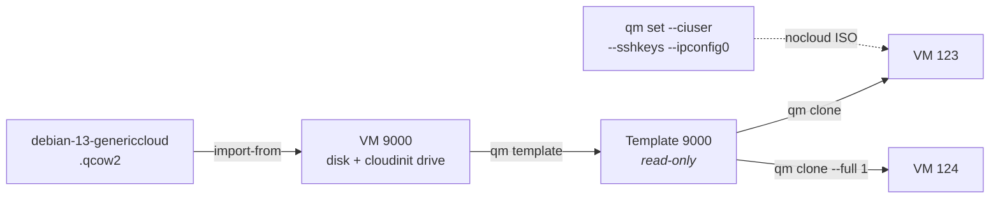

# Cloud-init templates in Proxmox — VMs ready in seconds

## The problem

You need a new VM to try something out. You upload the ISO, start the installer, pick language, keyboard, partitions and user, wait while it copies packages, reboot, log in through the console to set the IP and the SSH key… and twenty minutes later you have a machine identical to the previous five, except for the small details you forgot this time.

Cloud images solve that: an already installed, generic disk that, on first boot, reads its configuration (user, keys, network) from an external source through **cloud-init**. Proxmox VE knows how to generate that source. You prepare the image once, turn it into a template, and every new VM is a clone plus three parameters.

!!! warning "Not yet tested in the homelab"
    The steps on this page have been checked against the official documentation (Proxmox VE wiki, `man qm`, cloud.debian.org, the cloud-init docs and the OpenTofu provider docs), but they have not yet been tested end to end in the homelab. If something does not behave as described, please open an erratum.

!!! note "What this covers and what it doesn't"
    This page is about the **cloud-init VM template** and its lifecycle: building it, cloning it and customising it. Installing Proxmox itself is covered in [Proxmox VE](proxmox_base.md) and [Proxmox VE 9 on Debian 13](../curiosidades/proxmox_en_debian13.md); virtual networks, in [SDN](sdn.md).

## 📋 Table of Contents

- [How it works](#how-it-works)
- [The Debian 13 image](#the-debian-13-image)
- [Creating the base VM](#creating-the-base-vm)
- [Default user, keys and network](#default-user-keys-and-network)
- [Converting to a template](#converting-to-a-template)
- [Cloning: linked or full](#cloning-linked-or-full)
- [Growing the disk](#growing-the-disk)
- [qemu-guest-agent](#qemu-guest-agent)
- [Snippets and cicustom](#snippets-and-cicustom)
- [The next step: OpenTofu](#the-next-step-opentofu)
- [Troubleshooting](#troubleshooting)
- [Best practices](#best-practices)
- [References](#references)

## How it works

Proxmox VE generates a small ISO image with the cloud-init data and attaches it to the VM as a CD-ROM: this is the **cloudinit drive**. For Linux it uses the `nocloud` format (for Windows, `configdrive2`). Inside the VM, cloud-init reads that drive on first boot and applies the user, SSH keys, network and whatever else you ask for.



Three ideas worth having clear from the start:

1. **The template never boots.** A template is read-only and Proxmox will not start it. Whatever you configure on it is inherited by every clone.
2. **Cloud-init values can be set on the template and overridden on the clone.** User and SSH key on the template; IP and name on each clone.
3. **Customisation happens when the clone boots**, not when you clone. Cloning copies (or links) the disk and the configuration; nothing more.

## The Debian 13 image

Debian publishes its cloud images at [cloud.debian.org](https://cloud.debian.org/images/cloud/). For Proxmox, two trixie variants matter:

| Variant | What it is |
|---|---|
| `generic` | Works in any environment with cloud-init, including bare metal |
| `genericcloud` | Same as `generic`, but with a reduced set of hardware drivers in the kernel |

For a VM with virtio devices, `genericcloud` is the natural choice and it is smaller. If something does not boot with it, Debian itself recommends switching to `generic`.

Download it and check the checksum from the Proxmox node:

```bash
cd /var/tmp
wget https://cloud.debian.org/images/cloud/trixie/latest/debian-13-genericcloud-amd64.qcow2
wget https://cloud.debian.org/images/cloud/trixie/latest/SHA512SUMS
sha512sum --ignore-missing -c SHA512SUMS
```

`latest/` always points to the newest build; if you want a specific, reproducible date, every build has its own dated directory under `images/cloud/trixie/`.

!!! note "What the image ships"
    The manifest of the `genericcloud` image (`debian-13-genericcloud-amd64.json`, in the same directory) includes `cloud-init` and `cloud-initramfs-growroot`, which grows the root partition at boot. **It does not include `qemu-guest-agent`**: you have to install it (see below).

## Creating the base VM

ID 9000 is a common convention for templates, not a requirement. Adjust `local-lvm` and `vmbr0` to your storage and bridge.

```bash
# Empty VM with a VirtIO SCSI controller
qm create 9000 --name debian13-cloud --ostype l26 \
  --memory 2048 --cores 2 \
  --net0 virtio,bridge=vmbr0 --scsihw virtio-scsi-pci

# Import the image as disk scsi0
qm set 9000 --scsi0 local-lvm:0,import-from=/var/tmp/debian-13-genericcloud-amd64.qcow2

# Cloudinit drive (the CD-ROM carrying the cloud-init data)
qm set 9000 --ide2 local-lvm:cloudinit

# Boot from the disk only
qm set 9000 --boot order=scsi0

# Serial console: many cloud images need it
qm set 9000 --serial0 socket --vga serial0

# Enable the QEMU agent channel
qm set 9000 --agent enabled=1
```

What each piece does:

- `--ostype l26` marks the VM as Linux. The cloudinit drive format (`--citype`) depends on `ostype`: `nocloud` for Linux, `configdrive2` for Windows. The default `ostype` is `other`, so it is better to set it explicitly.
- `local-lvm:0,import-from=…` creates a new volume by importing the image. This is the syntax the wiki uses today; `qm disk import` still exists, but it leaves the disk as `unused` and you have to attach it in a second step.
- `--boot order=scsi0` stops the BIOS from wasting time looking at the CD-ROM.
- `--serial0 socket --vga serial0` follows the wiki's recommendation for cloud images. If you see nothing on the console with your image, go back to the default display.

## Default user, keys and network

These values are stored in the VM configuration and Proxmox writes them to the cloudinit drive at boot:

```bash
qm set 9000 --ciuser admin
qm set 9000 --sshkeys ~/.ssh/id_ed25519.pub
qm set 9000 --ipconfig0 ip=dhcp
```

- `--ciuser` replaces the image's default user (on Debian, `debian`).
- `--sshkeys` takes **the path to a file** with one or more public keys, one per line.
- `--ipconfig0` maps to `net0`: `ip=dhcp`, or `ip=192.168.1.50/24,gw=192.168.1.1`. If you set no IP at all, Proxmox uses DHCP on IPv4. For IPv6 there are `ip6=` and `gw6=`, and `ip6=auto` for stateless autoconfiguration (requires cloud-init 19.4 or later; Debian 13 ships 25.1).
- `--nameserver` and `--searchdomain` set DNS. If you set neither, the host's values are used.

There is also `--cipassword`, but the wiki recommends SSH keys: Proxmox has to store an encrypted version of the password inside the cloud-init data.

Recent Proxmox versions have `--ciupgrade` (default `1`): it upgrades packages on first boot. Safer, but it makes that boot longer; if you prefer fast clones and upgrade with another tool, use `--ciupgrade 0`.

Before going on, check what the VM is going to receive:

```bash
qm cloudinit dump 9000 user
qm cloudinit dump 9000 network
```

## Converting to a template

```bash
qm template 9000
```

VM 9000 becomes read-only. Do it **without ever having booted it**: that way cloud-init has never run and every clone gets a genuine first boot. If you booted it to install something, run `cloud-init clean --logs --machine-id` inside before shutting it down; it wipes cloud-init's state and leaves `/etc/machine-id` uninitialised so each clone generates its own.

## Cloning: linked or full

```bash
# Linked clone (the default from a template)
qm clone 9000 123 --name web01

# Full clone, on the storage of your choice
qm clone 9000 124 --name db01 --full 1 --storage local-lvm
```

| | Linked | Full |
|---|---|---|
| Speed | Almost instant | Copies all the data |
| Initial space | Practically none | The whole disk |
| Depends on the template | Yes: you cannot delete it while clones exist | No |
| Choose target storage | No | Yes (`--storage`) |
| Requirement | Storage with snapshots or clones (LVM-thin, ZFS, Ceph RBD, qcow2…) | None |

A linked clone is *copy-on-write*: it reads unmodified blocks from the template and writes changes to its own volume. It is ideal for labs and short-lived VMs; for something that will live for years, or that you want to move between storages, a full clone avoids surprises. Proxmox assigns new MACs and a new UUID to every clone.

Now, the per-VM bits:

```bash
qm set 123 --ipconfig0 ip=192.168.1.123/24,gw=192.168.1.1
qm set 123 --nameserver 192.168.1.1
qm start 123
```

If you change cloud-init values once the VM exists, `qm cloudinit pending 123` shows current versus pending values, and `qm cloudinit update 123` regenerates the drive. Keep in mind that many cloud-init modules run only once per instance: changing the user after first boot does not rewrite what was already created.

## Growing the disk

The Debian image has a 3 GB virtual disk. Grow it on the clone before the first boot:

```bash
qm disk resize 123 scsi0 +18G
```

With `+` the value is added to the current size; without it, it is the final size. Shrinking is not supported. (`qm resize` is an alias for the same command.)

There is no need to touch partitions: `cloud-initramfs-growroot` and the cloud-init module that grows the root take care of it at boot. If you grow the disk while the VM is running, the system will see the larger disk, but the partition will grow on the next boot, or by hand with `growpart` (package `cloud-guest-utils`, included in the image).

## qemu-guest-agent

With the agent, Proxmox can request a clean shutdown, show the VM's IPs in the web interface and freeze the filesystem during backups and snapshots so they are consistent. The VM needs two things:

1. The channel enabled in Proxmox: `--agent enabled=1`, which we already set on the template.
2. The `qemu-guest-agent` package installed and running **inside** the VM. The `genericcloud` image does not ship it.

The clean way to install it on every clone is a cloud-init snippet (next section). To check that it answers:

```bash
qm agent 123 ping
qm guest cmd 123 network-get-interfaces
```

`qm agent` is an alias for `qm guest cmd`. If the agent works, `ping` returns without an error.

## Snippets and cicustom

What Proxmox generates (user, keys, network) covers the basics. To install packages, create files or run commands, `--cicustom` lets you supply your own cloud-init files. There are four types: `user`, `network`, `meta` and `vendor`. For any you do not supply, Proxmox keeps generating its own.

The files live on a storage with the **snippets** content type. On the `local` storage the directory is `/var/lib/vz/snippets/`. Check first which types it already has and add `snippets` to the list, because `--content` replaces it entirely:

```bash
grep -A4 '^dir: local' /etc/pve/storage.cfg
pvesm set local --content iso,vztmpl,backup,snippets   # keep whatever types it already had
mkdir -p /var/lib/vz/snippets
```

The tricky part: **`user=` completely replaces the generated user-data**. If you use it, `--ciuser` and `--sshkeys` stop being applied and the user and keys have to go in your file. To add things without losing what is generated, use **`vendor=`**: cloud-init combines vendor-data and user-data, and if the same key appears in both, user-data wins.

This vendor-data installs the agent on every clone:

```yaml
#cloud-config
# /var/lib/vz/snippets/vendor-qga.yaml
packages:
  - qemu-guest-agent
runcmd:
  - systemctl start qemu-guest-agent
```

```bash
qm set 9000 --cicustom "vendor=local:snippets/vendor-qga.yaml"
```

The `systemctl start` is there because, according to the Proxmox wiki, the service may not start on its own right after installation.

If you need a whole user-data of your own, do not write it from scratch: start from the generated one.

```bash
qm cloudinit dump 9000 user > /var/lib/vz/snippets/user-web.yaml
# edit it and add what you need
qm set 123 --cicustom "user=local:snippets/user-web.yaml,vendor=local:snippets/vendor-qga.yaml"
```

In a cluster, snippets must be on a storage available on every node the VM may migrate to. Otherwise the VM will not be able to start on that node.

## The next step: OpenTofu

Everything above is manual, and that is exactly why it is the foundation: the template is the artefact automation needs. With template 9000 on the node, creating a VM with [OpenTofu](opentofu.md) is a matter of declaring a clone and its cloud-init values. With the `bpg/proxmox` provider:

```hcl
resource "proxmox_virtual_environment_vm" "web02" {
  name      = "web02"
  node_name = "pve"

  clone {
    vm_id = 9000
    full  = false
  }

  agent {
    enabled = true
  }

  initialization {
    ip_config {
      ipv4 {
        address = "192.168.1.124/24"
        gateway = "192.168.1.1"
      }
    }
    user_account {
      username = "admin"
      keys     = [trimspace(file(pathexpand("~/.ssh/id_ed25519.pub")))]
    }
  }
}
```

Two details of this provider that clash with what `qm` does: `clone.full` defaults to `true` (the opposite of `qm clone` from a template), and `agent.enabled` defaults to `false` if you do not declare it. Provider configuration (endpoint, API token) and remote state are covered in [Proxmox as code with OpenTofu](opentofu.md); see also [Terraform/OpenTofu state](../terraform/terraform_state.md).

## Troubleshooting

| Symptom | Likely cause | Fix |
|---|---|---|
| The console stays black | The image does not use the serial console, or it does and the VM has normal VGA | Try with and without `--serial0 socket --vga serial0` |
| SSH rejects your key | You use `cicustom user=`, which overrides `--sshkeys` | Put the keys in your user-data or switch to `vendor=` |
| The clone ignores the IP you set | `ipconfig0` changed after first boot, drive not regenerated | `qm cloudinit pending`, then `qm cloudinit update` and reboot |
| The VM does not start and mentions the snippet | Missing file, storage without the `snippets` type, or not available on that node | `ls /var/lib/vz/snippets/` and check `content` in `storage.cfg` |
| `qm agent … ping` fails | Package not installed or service stopped inside the VM | Check the vendor-data and `systemctl status qemu-guest-agent` in the VM |
| You cannot delete the template | Linked clones still depend on it | Delete those clones or recreate them as full clones |
| Every clone has the same `machine-id` | The template was booted before converting it | `cloud-init clean --logs --machine-id` and rebuild the template |
| The disk is still 3 GB inside the VM | Grown while the VM was running | Reboot, or `growpart` and grow the filesystem |

The first tool, almost always, is to look at what data the VM receives and what cloud-init did with it:

```bash
# On the node: what Proxmox generates
qm cloudinit dump 123 user

# Inside the VM: cloud-init status and log
cloud-init status --long
less /var/log/cloud-init.log
```

## Best practices

- **One template per image and date**, named accordingly (`debian13-cloud-20261123`). Rebuilding it takes two minutes; an old template means upgrading half the distribution on every first boot.
- **SSH keys, never passwords**, and drop the default user (`--ciuser`). Harden the rest as in [SSH security](../linux/ssh_security.md).
- **Never boot the template before converting it**, and if you do, `cloud-init clean --logs --machine-id`.
- **`vendor=` to add things, `user=` only if you really need to control the whole user-data.**
- **Linked clones for the ephemeral, full clones for what stays.**
- **Snippets on shared storage** in any cluster, or migration will fail the day you need it.
- **Always the agent**: clean shutdowns and consistent backups for the price of one package.

## References

- [Cloud-Init Support — Proxmox VE wiki](https://pve.proxmox.com/wiki/Cloud-Init_Support)
- [qm(1) — manual page](https://pve.proxmox.com/pve-docs/qm.1.html)
- [pvesm(1) — storage and content types](https://pve.proxmox.com/pve-docs/pvesm.1.html)
- [Qemu-guest-agent — Proxmox VE wiki](https://pve.proxmox.com/wiki/Qemu-guest-agent)
- [Debian cloud images](https://cloud.debian.org/images/cloud/)
- [cloud-init: vendor-data](https://docs.cloud-init.io/en/latest/explanation/vendordata.html) · [cloud-init CLI](https://docs.cloud-init.io/en/latest/reference/cli.html)
- [bpg/proxmox provider — proxmox_virtual_environment_vm resource](https://registry.terraform.io/providers/bpg/proxmox/latest/docs/resources/virtual_environment_vm)
- [Proxmox VE](proxmox_base.md) · [Proxmox VE 9 on Debian 13](../curiosidades/proxmox_en_debian13.md) · [Terraform and OpenTofu](../terraform/terraform_base.md)
