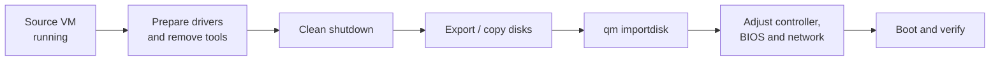

# Proxmox — Migrating VMs and containers

## The problem

Migrations go wrong for almost always the same reason: they are planned as a file copy and turn out to be a hardware change. The VM that booted fine under VMware ends up on an `INACCESSIBLE_BOOT_DEVICE` blue screen because its disk moved from one paravirtualised controller to another. The container that "also migrates live" turns out not to — it restarts. And the hot migration between two nodes that are identical on paper fails because one runs a five-year-old Xeon and the other doesn't.

None of those problems is discovered while migrating. They are discovered afterwards, with the source already powered off and the maintenance window running out. This page is about what to check **first**.

!!! note "What this covers and what it doesn't"
    This page is about moving workloads: between nodes of the same cluster, and from external platforms into Proxmox. Creating VMs, storage and basic clustering live in [Proxmox VE](proxmox_base.md).

## 📋 Table of Contents

- [Cold or hot](#cold-or-hot)
- [The real requirements for live migration](#the-real-requirements-for-live-migration)
- [Migrating with local storage](#migrating-with-local-storage)
- [Replication as a first step](#replication-as-a-first-step)
- [LXC containers](#lxc-containers)
- [Importing from VMware](#importing-from-vmware)
- [Hyper-V and physical machines](#hyper-v-and-physical-machines)
- [Drivers, before you power off the source](#drivers-before-you-power-off-the-source)
- [Maintenance window and rollback](#maintenance-window-and-rollback)
- [Post-migration verification](#post-migration-verification)
- [Troubleshooting](#troubleshooting)
- [Best practices](#best-practices)
- [References](#references)

## Cold or hot

These are two different operations with different requirements, and it helps not to call them the same thing.

| | Cold (offline) | Hot (online / live) |
|---|---|---|
| Guest state | Powered off | Running |
| What moves | Configuration and disks | Configuration, disks and **RAM** |
| Service outage | The whole duration | Milliseconds at the final switch |
| Requirements | Cluster with quorum | Cluster, compatible CPU and a network that copes |
| Risk if it fails | Retry; the guest stays off | The VM keeps running on the source |

```bash
# Cold: the VM is powered off
qm migrate 100 pve2

# Hot: the VM keeps serving traffic
qm migrate 100 pve2 --online
```

Live migration copies memory in several passes while the VM keeps writing to it. Once what is left to copy is small enough, it pauses the VM for an instant, copies the rest and resumes it on the target. Hence the practical consequence: **a VM that dirties memory faster than the network copies it never converges**. A database with 128 GB of very active RAM over a 1 GbE link is the canonical example of a migration that spins forever.

If you need to drain a whole node for maintenance, put it in maintenance mode and let the cluster relocate the workloads instead of migrating them by hand:

```bash
# Drain the node (HA relocates managed resources)
ha-manager crm-command node-maintenance enable pve1
ha-manager crm-command node-maintenance disable pve1
```

!!! warning "No quorum, no migration"
    `qm migrate` writes to `/etc/pve`, a replicated filesystem that is mounted read-only when the cluster loses quorum. With two nodes and no tie-breaker device, powering one off leaves the other unable to do anything. Check `pvecm status` before touching anything.

## The real requirements for live migration

Three conditions, and all three take a minute to check.

**1. Compatible CPU.** The guest sees one specific CPU model with one specific set of flags. If the target does not offer those flags — or if the guest kernel is already using them — the VM dies on resume. The most common case is `cpu: host`, which exposes the physical CPU as-is: great for performance, incompatible with any target that is not identical.

```bash
qm config 100 | grep -E '^(cpu|machine|args)'
```

In a heterogeneous cluster, pin a model every node accepts (the `kvm64` type and the `x86-64-v2` / `x86-64-v3` family exist for exactly this). The default model for new VMs has changed between major Proxmox releases, so **do not assume which one you have: look at it**.

```bash
qm set 100 --cpu x86-64-v2-AES   # needs a full stop/start, a reboot is not enough
```

A CPU type change does not apply hot. It needs a full power cycle, which means that preparing the cluster for live migration has, in itself, a downtime cost.

**2. Storage reachable on the target.** The ideal is shared storage: Ceph, NFS, shared iSCSI/LVM or ZFS over iSCSI. The disk does not move, only the process. Without it, disks have to be copied (next section).

**3. Enough network, on the right wire.** By default migration traffic is encrypted through an SSH tunnel and runs over the management network — the same one corosync uses. Pushing 64 GB of RAM through there is an excellent way to lose quorum. Separate it:

```ini
# /etc/pve/datacenter.cfg
migration: secure,network=10.20.30.0/24
```

`secure` (encrypted, the default) versus `insecure` (unencrypted, faster). `insecure` only makes sense on a dedicated, physically trusted network: during migration the guest's memory travels in the clear.

## Migrating with local storage

Without shared storage it can still be done, even hot, by copying the disks as part of the operation:

```bash
qm migrate 100 pve2 --online --with-local-disks
qm migrate 100 pve2 --online --with-local-disks --targetstorage local-zfs
```

The cost is time, and it is worth estimating it beforehand rather than discovering it in production. A rough figure: a 500 GB disk over a 1 GbE link saturated at 100 % is more than 70 minutes **in the best case**, and the best case does not exist. With 10 GbE that drops to minutes, but then the bottleneck becomes the target disk.

Throughout that time the VM keeps running and keeps writing, so the process also has to catch up with the changes. For large disks, replicating first is almost always the better idea.

## Replication as a first step

On local ZFS, Proxmox can replicate a guest's disks to another node periodically using incremental snapshots. The later migration only has to transfer the delta since the last replication run.

```bash
# Replicate VM 100 to node pve2 every 15 minutes
pvesr create-local-job 100-0 pve2 --schedule '*/15'

pvesr list
pvesr status
pvesr run --id 100-0        # force one pass right before the cutover
```

This turns an hours-long migration into a minutes-long one. Two limits to keep in mind:

- **It requires ZFS** (or storage with equivalent incremental-send support). On LVM-thin or a plain directory it does not apply.
- **Replication is not a backup.** It replicates deletion and corruption too. Backups remain the job of vzdump or [Proxmox Backup Server](proxmox_base.md).

## LXC containers

Here is the difference that surprises the most people: **a running LXC container does not migrate live**. A container is not a machine with its own isolated memory, but a set of processes on the host kernel. There is no guest state to package up and resume on the other side.

What Proxmox does instead is a *restart migration*: stop the container, move the data, start it again on the target.

```bash
# Stopped container: straight migration
pct migrate 200 pve2

# Running container: it is stopped, migrated and started
pct migrate 200 pve2 --restart

# With a grace period for a clean shutdown before the kill
pct migrate 200 pve2 --restart --timeout 180
```

Practical consequences:

- The outage is not milliseconds: it is the time to stop, copy and start. With a small rootfs that is usually seconds; with big data, however long the copy takes.
- `--timeout` matters. If the main process ignores `SIGTERM` it gets killed, and a database inside a container killed abruptly ends the same way it would anywhere else.
- `pvesr` replication also works for containers on ZFS, and the saving is even more noticeable here.
- A privileged container with host bind mounts rarely migrates cleanly: those directories do not travel. Check `pct config 200` for `mp<N>` entries pointing outside managed storage.

## Importing from VMware

The flow, with the source still powered on and working:



Recent Proxmox VE releases ship an ESXi import wizard (you add a storage of type `esxi` and import the VMs from the web UI). It is the comfortable path where it exists; **check whether your version has it** before planning around it. The manual path works on any version:

```bash
# 1. Copy the VMDK to the Proxmox node (the descriptor, not just the -flat file)
scp user@esxi:/vmfs/volumes/datastore1/vm/vm.vmdk /var/lib/vz/import/

# 2. Create the target VM with no disk
qm create 120 --name migrated-app --memory 8192 --cores 4 \
  --net0 virtio,bridge=vmbr0 --scsihw virtio-scsi-single --ostype l26

# 3. Import the disk into the chosen storage
qm importdisk 120 /var/lib/vz/import/vm.vmdk local-lvm

# 4. Attach it and set the boot order
qm set 120 --scsi0 local-lvm:vm-120-disk-0
qm set 120 --boot order=scsi0
```

`qm importdisk` leaves the disk as `unusedN` until you attach it to a controller. For a full OVF there is `qm importovf`, which also translates CPU, memory and disks from the manifest.

If you prefer to convert by hand, `qemu-img` does the job:

```bash
qemu-img convert -p -f vmdk -O qcow2 vm.vmdk vm.qcow2
qemu-img info vm.qcow2
```

!!! warning "Split VMDKs and snapshots"
    A VMDK with live snapshots (`-000001.vmdk`) cannot be imported as-is: consolidate on the source first. And with disks split into 2 GB chunks, the file to hand to `importdisk` is the **descriptor** — the small one, not the big `-flat`.

Before powering off the source: uninstall VMware Tools. Afterwards, on Proxmox, install `qemu-guest-agent` and enable it with `qm set 120 --agent 1`.

## Hyper-V and physical machines

**From Hyper-V**, the disk is a VHD or VHDX and `qemu-img` understands it just the same:

```bash
qemu-img convert -p -f vhdx -O raw disk.vhdx /var/lib/vz/import/disk.raw
qm importdisk 130 /var/lib/vz/import/disk.raw local-lvm
```

The detail everyone forgets: a **Generation 2** VM boots via UEFI. Create it with the default BIOS and it will not boot, and the symptom is a black screen with no further hints.

```bash
qm set 130 --bios ovmf --efidisk0 local-lvm:1,efitype=4m,pre-enrolled-keys=0
```

If the guest had Secure Boot and the keys do not match, boot fails in the firmware. Disabling it from the OVMF menu is the quick way out; re-signing is the correct one. It is also worth uninstalling the Hyper-V Integration Services before shutting down.

**From a physical machine** (P2V) there is no virtual disk to convert, so you have to manufacture one. Two approaches that work:

```bash
# Block-level clone over the network, from a live USB on the physical machine
dd if=/dev/sda bs=4M status=progress | ssh root@pve "dd of=/var/lib/vz/import/physical.raw bs=4M"
```

Or an imaging tool (Clonezilla, or whichever backup agent you already run) restored onto the new VM. A block copy of a **running** system produces an inconsistent filesystem: it boots with an `fsck` on the way, and sometimes it does not boot at all. Do it from a live environment, with the disks unmounted.

Watch the size too: `dd` copies the whole disk, holes included. A 2 TB disk with 200 GB used means 2 TB over the wire and 2 TB on the target unless you use a sparse image or thin-provisioned storage.

## Drivers, before you power off the source

This is the classic failure and the most expensive one, because it shows up when there is no longer an easy way back.

**Windows and virtio.** Windows does not ship virtio drivers. Import the disk, attach it straight to `virtio-scsi`, and the boot ends in `0x0000007B INACCESSIBLE_BOOT_DEVICE`. There are two ways to avoid it, and the good one is the first:

1. **Before powering off the source**, mount the `virtio-win` ISO in the original VM and install the full driver package (`virtio-win-guest-tools`). Windows registers the drivers even with no virtio hardware present, and finds them when it boots on Proxmox.
2. If you already powered it off: boot on Proxmox with the disk on `sata0` or `ide0`, add a small second disk on `virtio-scsi` to force the driver installation, power off, and move the system disk to `scsi0`.

```bash
# Emergency exit: boot from SATA
qm set 140 --sata0 local-lvm:vm-140-disk-0 --boot order=sata0
# Decoy disk so Windows loads the virtio driver
qm set 140 --scsi1 local-lvm:1
```

**Linux and the initramfs.** The kernel needs the `virtio_blk` / `virtio_scsi` and `virtio_pci` modules inside the initramfs, or it will not find the root filesystem.

```bash
# Debian/Ubuntu
update-initramfs -u -k all
# RHEL/Rocky/Alma
dracut --regenerate-all --force
```

Two more that bite on Linux:

- **`/etc/fstab` by device name.** `/dev/sda1` under VMware may be something else under Proxmox. Move everything to UUIDs (`blkid`) before migrating.
- **Network interface names.** With predictable names the interface changes (`ens192` → `ens18`) and the static configuration is orphaned. The machine boots with no network, which on a remote server is the same as not booting. Have Proxmox console access ready.

## Maintenance window and rollback

A migration is easy to undo **as long as you do not destroy the source**. That is the whole rollback plan; everything else is detail.

A reasonable window, step by step:

1. **Days before**: lower the TTL on the DNS records involved (3600 to 60, say). If the IP change propagates in a minute, so does the rollback.
2. **Before touching anything**: a verified full backup of the source, plus a snapshot if the platform allows one.
3. **Rehearsal**: import a copy and boot it on an isolated network. This is where the missing drivers show up, with the service still in production and no time pressure.
4. **Cutover**: clean shutdown of the source, migration, boot on the target, verification.
5. **An explicit point of no return.** Decide in advance the time at which, if it does not work, you roll back. Without that time written down, the decision is always "just a bit longer" until the window is gone.
6. **Source powered off but intact** for days, not minutes. Migration failures rarely surface in the first hour: they surface with the nightly batch, with the backup, or on Monday.
7. **Remove the source VM from any autostart.** Two machines with the same IP and hostname powered on at once is a worse incident than a failed migration.

## Post-migration verification

The minimum, before calling the window a success:

```bash
# The guest answers and the agent is alive
qm agent 120 ping
qm agent 120 get-osinfo

# Network: new MAC, correct IP, working DNS
qm config 120 | grep -E '^net'

# Reasonable disk performance (compare against the source measurement)
pveperf /var/lib/vz
```

And inside the guest: services started, clock in sync (a clock jump after migration breaks Kerberos authentication and certificates), network mounts present, logs free of hardware errors.

Outside the guest, the things always forgotten:

- The **backup job** pointing at the right node or pool, plus a test run.
- **HA resources** redefined if the VM was managed (`ha-manager status`).
- **Monitoring** watching the new machine and not the old one.
- Guest tools installed: `qemu-guest-agent` in the VM and `--agent 1` in the configuration. Without both, Proxmox can neither request a clean shutdown nor take consistent backups.

## Troubleshooting

| Symptom | Cause | Fix |
|---|---|---|
| `migration aborted` at the start | Cluster without quorum, `/etc/pve` read-only | `pvecm status` and restore quorum first |
| Live migration that never finishes | The VM dirties memory faster than the network copies | Dedicated migration network, or migrate cold |
| VM dies on resume at the target | Different CPU flags (`cpu: host`) | Pin a common CPU type and power-cycle the VM |
| `storage not available on target node` | Storage missing or inactive on the target | `pvesm status` on both, or use `--targetstorage` |
| Windows `0x0000007B` at boot | Missing virtio driver for the system disk | Boot from `sata0` and install `virtio-win` |
| Linux drops to `initramfs` with no root | virtio modules absent from the initramfs | Rebuild the initramfs; `/etc/fstab` by UUID |
| Black screen after a Hyper-V import | Generation 2 VM, UEFI boot | `--bios ovmf` plus `--efidisk0` |
| The container restarts on a "live" migration | Expected LXC behaviour | Plan the outage; `--restart --timeout` |
| Corosync loses nodes during the copy | Migration sharing the cluster network | `migration: network=` in `datacenter.cfg` |
| The guest boots with no network | The interface name changed | Use the Proxmox console and reconfigure it |

Where to look when the web UI message says nothing useful:

```bash
# The full task, with its output
pvesh get /nodes/pve1/tasks --limit 20
cat /var/log/pve/tasks/<UPID...>

journalctl -u pvedaemon -u pveproxy -f
```

## Best practices

- **Rehearse with a copy.** A test import on an isolated network costs an hour and saves the whole window.
- **Prepare the drivers while the source is still running.** It is the only moment when installing virtio is trivial.
- **Migration network separate from corosync.** The cluster has no business finding out you are copying 64 GB.
- **A common CPU type on heterogeneous clusters.** The small performance loss is repaid many times over by never having to power anything off to move workloads.
- **Replicate before migrating** anything with large disks on ZFS. It turns hours of copying into minutes of delta.
- **Do not delete the source the same day.** Nor the day after.
- **Document the starting configuration**: IPs, routes, mounts, versions. Once migrated, the reference no longer exists.
- **A verified backup before the cutover.** A backup that has never been restored is an intention, not a backup.

## References

- [Migrating VMs and containers — official documentation](https://pve.proxmox.com/wiki/Manual:_qm#qm_migration)
- [qm(1) — reference manual](https://pve.proxmox.com/pve-docs/qm.1.html) · [pct(1)](https://pve.proxmox.com/pve-docs/pct.1.html)
- [Storage replication (pvesr)](https://pve.proxmox.com/wiki/Storage_Replication)
- [Migrating from VMware ESXi](https://pve.proxmox.com/wiki/Migrate_to_Proxmox_VE)
- [virtio drivers for Windows](https://pve.proxmox.com/wiki/Windows_VirtIO_Drivers)
- [Proxmox VE](proxmox_base.md) · [Proxmox SDN](sdn.md)
