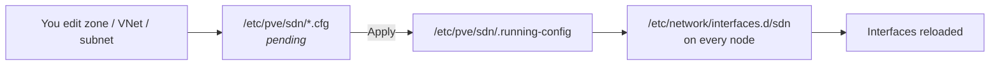

# Proxmox — Software-Defined Networking (SDN)

## The problem

A Linux bridge in Proxmox lives in `/etc/network/interfaces`, which is a file **local to each node**. Adding a new segment to a five-machine cluster means editing five files by hand and getting all five identical. The day one of them says VLAN 130 instead of 30, the VM works perfectly… until it migrates to that node and loses the network, usually on a Friday.

SDN moves that definition into the cluster filesystem: you declare it once, Proxmox replicates it and generates the network configuration on every node. It does not replace your physical switch and it does not make the network faster; what it does is turn a segment into a cluster object instead of a tacit agreement between five text files.

!!! note "Check your version before going further"
    SDN started out as an experimental feature and matured across several major releases: the package providing it, the available zone types and the existence of built-in DHCP all changed. Check what you have with `pveversion -v | grep -E 'pve-manager|libpve-network'` before copying anything from here. If the **Datacenter → SDN** menu is missing or `libpve-network-perl` is not installed, your version predates the integration and upgrading beats forcing it by hand. This page describes the stable, widely documented behaviour; the details of your specific version are in the official documentation linked at the end.

## 📋 Table of Contents

- [What SDN adds over a Linux bridge](#what-sdn-adds-over-a-linux-bridge)
- [Zone types](#zone-types)
- [VNets and subnets](#vnets-and-subnets)
- [The apply cycle](#the-apply-cycle)
- [IPAM](#ipam)
- [Example: VLAN zone](#example-vlan-zone)
- [Example: VXLAN zone across nodes](#example-vxlan-zone-across-nodes)
- [MTU on overlay networks](#mtu-on-overlay-networks)
- [Firewall and SDN](#firewall-and-sdn)
- [EVPN and routing between VNets](#evpn-and-routing-between-vnets)
- [Diagnosing connectivity between nodes](#diagnosing-connectivity-between-nodes)
- [Troubleshooting](#troubleshooting)
- [Best practices](#best-practices)
- [References](#references)

## What SDN adds over a Linux bridge

| | Classic bridge | SDN |
|---|---|---|
| Where the definition lives | `/etc/network/interfaces`, per node | `/etc/pve/sdn/`, replicated cluster-wide |
| Adding a new segment | Edit every node | Declare it once and apply |
| Consistency between nodes | Your responsibility | Guaranteed by the generated configuration |
| Segment spanning nodes | Depends on the switch (VLAN on the trunk) | Possible without touching the switch (VXLAN) |
| Addressing | External to Proxmox | Subnets and IPAM inside the cluster |
| Rollback | Restore the file and restart networking | Return to the previous configuration and apply |

What it does **not** add: performance. A flat bridge over a switch VLAN will always be the shortest path. SDN adds layers — encapsulation with VXLAN, a routing daemon with EVPN — and every layer is one more thing that can break; use it when the problem is management or topology, not to go faster. The hierarchy is short: a **zone** defines the transport, it holds **VNets** (the bridges you attach VMs to), and each VNet can carry **subnets**, whose addressing is managed by **IPAM**. Only EVPN adds one more piece, the **controller**.

## Zone types

The zone defines **how** traffic is carried. It is the decision that matters: changing it later means rebuilding the VNets.

| Zone | What it does | When to use it | What it will cost you |
|---|---|---|---|
| **Simple** | Isolated bridge local to each node, with routing and NAT from the host itself | Labs, single-node internal networks, test environments | No layer 2 between nodes: two VMs on different nodes cannot see each other |
| **VLAN** | 802.1Q tag over a VLAN-aware bridge | You already have VLANs on the switch and want to manage them from Proxmox | The switch trunk must carry each VLAN; without that there is no magic |
| **QinQ** | Double 802.1ad tag: a service one and the customer's | Multi-tenant where each tenant brings its own VLAN plan | Real support in switch and NIC, plus 4 more header bytes |
| **VXLAN** | Layer 2 tunnel over UDP between nodes | A segment that spans nodes without touching the physical network | MTU (see below) and broadcast traffic replicated to every peer |
| **EVPN** | VXLAN with BGP as control plane, plus L3 routing between VNets | Several subnets that must route between each other and reach outside | FRR, an ASN, exit nodes and debugging with `vtysh` |

Quick decision rule: if the switch already does it, **VLAN**. If you need a segment the physical network knows nothing about, **VXLAN**. If on top of that those networks must route between each other behind a gateway that survives migrations, **EVPN**. **Simple** for the laptop and the lab. **QinQ** only if you genuinely have the problem it solves.

## VNets and subnets

A **VNet** is the bridge you attach the VM to. It belongs to a zone and inherits its transport; in simple zones it is nothing more than a bridge:

- In VLAN and QinQ zones, the VNet carries the **tag**.
- In VXLAN and EVPN zones, the VNet carries the **VNI**, the segment identifier inside the tunnel.

A **subnet** is a CIDR attached to a VNet, optionally with a gateway, SNAT and DHCP ranges. It is worth being honest about what that actually does:

!!! warning "A subnet does not conjure up the gateway"
    In **simple** and **EVPN** zones, Proxmox does bring up the gateway declared in the subnet (in EVPN it is *anycast* across all nodes, on top of that). In **VLAN**, **QinQ** and **VXLAN** zones, routing still lives elsewhere: on your router or firewall. There the subnet is for IPAM and documentation, not for providing egress. Declaring `10.100.0.1` as the gateway of a VLAN zone does not make anything answer on that IP.

The whole configuration is plain text under `/etc/pve/sdn/` — `zones.cfg`, `vnets.cfg`, `subnets.cfg`, `controllers.cfg`, `ipams.cfg` and `dns.cfg` — replicated by the cluster. Being `/etc/pve` files, they land in the configuration backup and can be versioned with [Ansible](../ansible/ansible_base.md) like anything else.

## The apply cycle

This is where most time gets lost, so it goes first: **SDN has two states**. What you edit is the *pending* configuration; what is running is the *applied* one. Nothing you touch takes effect until you press **Apply**.



Applying does three things on each node: it writes `/etc/network/interfaces.d/sdn`, reloads networking and leaves a trace in the task log. From the UI that is **Datacenter → SDN → Apply**; from the command line, and checking the result:

```bash
pvesh get /cluster/sdn          # the configuration exactly as it is running
pvesh set /cluster/sdn          # apply it across the cluster

cat /etc/network/interfaces.d/sdn
ip -br link | grep -E 'vnet|vxlan|vrf'
```

!!! danger "If the generated file is empty or missing"
    That means the configuration was never applied on that node, not that the zone is wrong. Usual causes: the cluster had no quorum at that moment (`/etc/pve` read-only), the node was powered off during the *apply*, or `ifupdown2` is missing, which is what allows reloading networking without a reboot. Recover quorum, check `pvecm status` and apply again.

## IPAM

IPAM keeps track of which IP is assigned to what. Proxmox ships one internally and can talk to two external ones:

| Backend | Where it lives | When to pick it |
|---|---|---|
| **PVE** | Inside the cluster, no dependencies | The default, and enough if Proxmox is the only thing handing out addresses |
| **phpIPAM** | External server, over its API | You already use it as the source of truth for the whole network, not just the virtual part |
| **NetBox** | External server, over its API | Same, with integrated inventory and network documentation |

With an external backend, Proxmox **queries and reserves** there instead of deciding on its own: the goal is that no two places hand out the same IPs. It needs an API token with write permissions and connectivity from the nodes; if the API does not answer, operations that need an address fail.

In **simple** zones it can additionally offer DHCP to VMs from the subnet ranges, backed by `dnsmasq`. It is the convenient way to get a self-contained lab. Check your version's documentation for which zone types support it, because this is one of the parts that has changed the most.

## Example: VLAN zone

The most common and most boring scenario, which is a compliment. Prerequisite: the physical bridge must be **VLAN-aware**.

```bash
# /etc/network/interfaces — on every node
auto vmbr0
iface vmbr0 inet static
    address 192.168.1.10/24
    gateway 192.168.1.1
    bridge-ports eno1
    bridge-stp off
    bridge-fd 0
    bridge-vlan-aware yes
    bridge-vids 2-4094
```

Then the zone and the VNet. Both can be created from **Datacenter → SDN**; this is how the resulting configuration looks:

```ini
# /etc/pve/sdn/zones.cfg
vlan: lan
	bridge vmbr0
	ipam pve

# /etc/pve/sdn/vnets.cfg
vnet: srv30
	zone lan
	tag 30
	alias Internal servers
```

Apply, then attach a VM to the VNet, which from there on behaves like any other bridge:

```bash
pvesh set /cluster/sdn
qm set 100 --net0 virtio,bridge=srv30
```

The VM sees no tag at all: it sends untagged frames and the bridge adds the 30 on the way out. If there is no connectivity, suspect number one is the **physical switch trunk**, which has to carry VLAN 30 all the way to that node's port. SDN does not configure your switch.

## Example: VXLAN zone across nodes

Here the segment exists even though the physical network knows nothing about it. Three nodes with IPs `10.10.10.1`, `.2` and `.3` on a network dedicated to VM traffic:

```ini
# /etc/pve/sdn/zones.cfg
vxlan: overlay
	peers 10.10.10.1,10.10.10.2,10.10.10.3
	ipam pve
	mtu 1450

# /etc/pve/sdn/vnets.cfg
vnet: app100
	zone overlay
	tag 100
	alias Internal application network
```

Three details decide whether this works:

1. **Every node goes in `peers`, including itself.** The list is identical across the cluster; Proxmox drops its own address when generating the configuration.
2. **The `peers` IPs choose where the traffic goes.** Put the management ones there and VM traffic will share the link with corosync, which is exactly what you do not want. Use the dedicated network's addresses.
3. **The `tag` is the VNI**, not a VLAN. It is the segment identifier inside the tunnel and must be unique within the zone.

Between nodes you need IP connectivity and **UDP 4789** open in both directions. With no control plane, broadcast and unknown-destination traffic is replicated by unicast to every peer: with many nodes the cost grows fast, and that is where EVPN starts to pay off.

## MTU on overlay networks

If something is going to break in an overlay, this is it. VXLAN encapsulation adds **50 bytes** to every frame over an IPv4 underlay — outer Ethernet header (14), IP (20), UDP (8) and VXLAN (8) — and **70 bytes** if the underlay is IPv6. A 1500-byte guest frame leaves the wire as a 1550-byte packet.

If the physical switch is at 1500, that packet does not fit. And it is not fragmented: the outer packet carries the *don't fragment* bit, so it is **dropped silently**. The symptom is not "no network", which would be easy:

- `ping` and the TCP handshake work: they are small packets.
- `ssh` connects, then hangs the moment anything sizeable is transferred.
- A web page loads halfway; a file copy stalls at zero.
- Path MTU discovery (PMTUD) does not save you, because the ICMP that would warn you is generated in the underlay and many firewalls filter it.

That picture — "it is slow and sometimes it fails" — is almost always MTU. The two ways out:

| Underlay | Maximum VNet MTU | What to do |
|---|---|---|
| 1500 (standard) | 1450 | Set 1450 on the zone **and** in the guests |
| 9000 (jumbo) | 8950 | Jumbo end to end and leave the MTU at its default |

The good option is **jumbo frames on the underlay**: NICs, bonds, bridges and switch ports at 9000, and the VNet stays at 1500 without anyone noticing. The emergency option is lowering the guest MTU to 1450, which works over a 1500 underlay but requires the guests to comply: via DHCP (option 26) or by hand on each VM. A single guest left at 1500 reproduces the whole problem.

Check the real path with a packet that cannot be fragmented, before calling the configuration done:

```bash
ping -M do -s 8972 10.10.10.2   # 9000 - 20 (IP) - 8 (ICMP): if it answers, jumbo is real
ping -M do -s 1472 10.10.10.2   # 1500 - 28: this must always answer
```

!!! warning "MTU belongs to the whole path, not to the interface"
    A single 1500 link — a forgotten switch port, an inter-rack uplink, an intermediate router, one bond member — turns the entire path into 1500. The `ping -M do` test is the only reliable way to know: `ip link` tells you what you configured, not what the cable carries.

## Firewall and SDN

The Proxmox firewall acts on the VM interface, and it does not care whether the bridge came from SDN or from `/etc/network/interfaces`. What changes is what has to be allowed **between the nodes**:

- **UDP 4789** for encapsulated VXLAN traffic.
- **TCP 179** between nodes if you use EVPN, for the BGP sessions.
- The usual cluster ports, which should already be covered.

The firewall sees the outer UDP flow, not the frames inside it. Filtering traffic between two VMs on the same segment is done on the VM interface, never at node level.

!!! danger "The three switches"
    The firewall is enabled at **Datacenter**, at **node** and at **VM** level, and all three have to be on. With the Datacenter one off nothing applies, no matter how many rules you wrote on the VM. It is the most frequent cause of "the rules do nothing", and also of leaving a segment open while believing it is closed.

Isolation between VNets in the same zone is a layer 2 property: it comes from the tag or the VNI, not from rules. But the moment you route between them — with EVPN or an external router — that isolation is gone and explicit policy is required. *IPSets* and security groups at Datacenter level avoid repeating the same rule on twenty machines; see [Proxmox security](proxmox_base.md#security).

## EVPN and routing between VNets

EVPN adds a BGP-based control plane on top of VXLAN: nodes advertise to each other which MACs and IPs sit behind them instead of flooding the network to find out. It needs a **controller** in addition to the zone.

```ini
# /etc/pve/sdn/controllers.cfg
evpn: ctrl1
	asn 65000
	peers 10.10.10.1,10.10.10.2,10.10.10.3

# /etc/pve/sdn/zones.cfg
evpn: tenants
	controller ctrl1
	vrf-vxlan 10000
	exit-nodes pve1,pve2
	ipam pve
	mtu 1450
```

Every VNet in the zone carries its subnet with a gateway, and that gateway is brought up as **anycast**: the same IP and the same MAC on all nodes, so a migrating VM keeps talking to its gateway without noticing anything. That is the real reason to use EVPN, more than saving on flooding. **Exit nodes** are the nodes through which traffic leaves for the outside: declare at least two if egress matters, because with only one, powering it off for maintenance leaves the whole zone without Internet.

Underneath there is FRR (`frr.service`), and debugging does not go through the web interface:

```bash
systemctl status frr
vtysh -c 'show bgp l2vpn evpn summary'   # BGP sessions between nodes
vtysh -c 'show evpn vni'                 # known VNIs and their VRF
vtysh -c 'show evpn mac vni all'         # MACs learned by the control plane
```

!!! note "EVPN is the expensive part"
    It assumes a stable IP underlay between nodes, working BGP sessions and someone who can read a routing table when something breaks. If all you need is a segment that spans nodes, a **VXLAN** zone does that job with a fraction of the moving parts. EVPN starts to pay off when there are several subnets to route between each other, many nodes, or the anycast gateway is a hard requirement.

## Diagnosing connectivity between nodes

In order, bottom up. Most problems are closed in the first two steps:

```bash
# 1. Do the nodes see each other, and does the path MTU hold?
ping -c3 10.10.10.2
ping -M do -s 8972 10.10.10.2

# 2. Is the configuration applied on THIS node?
cat /etc/pve/sdn/.running-config
cat /etc/network/interfaces.d/sdn

# 3. Do the interfaces exist, and with which parameters?
ip -br link | grep -E 'vnet|vxlan'
ip -d link show vxlan_app100     # VNI, UDP port, MTU and actual peers

# 4. What does the tunnel know, what leaves the wire, what did the last apply say?
bridge fdb show dev vxlan_app100
bridge vlan show                 # in VLAN zones, per-port tags
tcpdump -ni eno1 udp port 4789
journalctl -u pvedaemon -u pveproxy --since '30 min ago'
```

If `tcpdump` shows packets leaving but the destination sees nothing, the problem is in the physical network or an intermediate firewall, not in Proxmox. If nothing leaves, the interface is not encapsulating: go back to step 2.

## Troubleshooting

| Symptom | Cause | Fix |
|---|---|---|
| Changes have no effect at all | Pending configuration never applied | **Apply**, or `pvesh set /cluster/sdn` |
| One node ends up without the interfaces | It was off or without quorum during the apply | `pvecm status`, then apply again |
| Ping fine, transfers hanging | Underlay MTU too small | Jumbo frames, or MTU 1450 on zone and guests |
| Two VMs cannot see each other across nodes | **Simple** zone: it does not span nodes | Switch to VLAN or VXLAN |
| VLAN with no connectivity beyond the node | Bridge without `bridge-vlan-aware`, or VLAN missing from the trunk | Fix the bridge and the switch port |
| VXLAN with no traffic between nodes | UDP 4789 blocked or wrong `peers` | Open the port and review the `peers` IPs |
| Nothing answers on the gateway IP | VLAN/VXLAN zone: the gateway lives elsewhere | Configure it on the router, or use EVPN |
| EVPN with no routes between VNets | BGP sessions down | `vtysh -c 'show bgp l2vpn evpn summary'` |
| VNets lose external egress | The single exit node is off | Declare at least two exit nodes |
| Firewall rules are not applied | Datacenter or node switch is off | Enable it at all three levels |

## Best practices

- **Start with the simplest zone that solves the problem.** If VLAN is enough, use VLAN. Every encapsulation layer is one more source of failures and one less layer of visibility for `tcpdump`.
- **Dedicated network for overlay traffic.** Sharing the link with corosync turns a 64 GB copy into a lost quorum; see [migration](migration_guide.md).
- **Decide the MTU before creating anything** and verify it end to end with `ping -M do`. Changing it later forces you to touch every guest.
- **Apply with all nodes powered on.** A node absent during the *apply* ends up with a different configuration from the rest, and the failure shows up weeks later while migrating a VM.
- **VNet names that mean something.** `srv30` or `dmz` survive a 3 a.m. incident; `vnet0` and `vnet1` do not.
- **A single IPAM as source of truth.** Proxmox handing out addresses alongside the corporate DHCP always ends the same way.
- **Test a VM migration before calling the segment done.** It is the scenario that exposes differences between nodes, and the only one that really matters in a cluster.

## References

- [SDN — official Proxmox VE documentation](https://pve.proxmox.com/wiki/Software_Defined_Network)
- [PVE reference manual, SDN chapter](https://pve.proxmox.com/pve-docs/chapter-pvesdn.html)
- [RFC 7348 — VXLAN](https://datatracker.ietf.org/doc/html/rfc7348) · [RFC 8365 — EVPN as control plane](https://datatracker.ietf.org/doc/html/rfc8365)
- [FRRouting — EVPN documentation](https://docs.frrouting.org/en/latest/evpn.html)
- [Proxmox VE](proxmox_base.md) · [VM and container migration](migration_guide.md)
