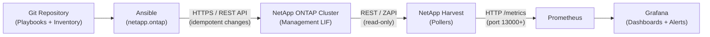

# Automating NetApp ONTAP: REST API, Ansible and Metrics with Harvest

## The problem

Provisioning a single volume in System Manager or over SSH takes two minutes; provisioning thirty volumes with matching export policies, quotas, snapshot policies and SnapMirror relationships across two clusters inevitably introduces subtle drift that only surfaces during an outage. And when you also need to know whether an aggregate is filling up or a volume is spiking latency at 3 a.m., logging into the web UI by hand does not scale.

Here we tie together both halves of modern ONTAP 9.x operations: **idempotent provisioning** with the native REST API and NetApp's official **`netapp.ontap`** Ansible collection, and **low-overhead observability** streaming metrics from **NetApp Harvest** into Prometheus and Grafana.

## Automation and observability architecture



## ONTAP REST API: practical queries

Since ONTAP 9.6+, the REST API runs directly on the cluster management LIF (`https://<cluster-mgmt>/api/...`) with built-in interactive Swagger docs at `https://<cluster-mgmt>/docs/api`.

For quick audits and scripting with nothing more than `curl` and `jq`:

```bash
# 1. Cluster identity and ONTAP version
curl -sk -u admin \
  "https://cluster-mgmt.example.local/api/cluster?fields=name,version.full" | jq .

# 2. Aggregates with available space and used percentage
curl -sk -u admin \
  "https://cluster-mgmt.example.local/api/storage/aggregates?fields=name,space.block_storage.used_percent,space.block_storage.available" \
  | jq '.records[] | {name, used_pct: .space.block_storage.used_percent, avail_bytes: .space.block_storage.available}'

# 3. Volumes above 80% capacity
curl -sk -u admin \
  "https://cluster-mgmt.example.local/api/storage/volumes?space.used_percent=>80&fields=name,svm.name,space.used_percent" \
  | jq '.records'

# 4. Unhealthy SnapMirror relationships
curl -sk -u admin \
  "https://cluster-mgmt.example.local/api/snapmirror/relationships?healthy=false&fields=source.path,destination.path,state,lag_time" \
  | jq '.records'
```

!!! tip "Use a dedicated read-only account for queries and metrics"
    Do not reuse `admin` for read-only scripts or Harvest. Create a dedicated ONTAP user with the `readonly` role (scoped to the `http` application) so leaked credentials can never delete or alter volumes.

## Idempotent automation with Ansible (`netapp.ontap`)

The official **`netapp.ontap`** collection uses the ONTAP REST API by default and lets you declare desired storage state in Git.

### Installing the collection

```bash
ansible-galaxy collection install netapp.ontap
pip install requests
```

### Complete playbook: production-ready NFS export

This playbook creates (or ensures) the export policy, its rule for the hypervisor subnet, and the NFS volume with snapshot policy and bounded autosize:


```yaml
- name: Provision NFS datastore on NetApp ONTAP
  hosts: localhost
  gather_facts: false
  vars:
    ontap_auth: &ontap_auth
      hostname: "{{ ontap_host }}"
      username: "{{ ontap_user }}"
      password: "{{ ontap_pass }}"
      https: true
      validate_certs: true
      use_rest: always

  tasks:
    - name: Create export policy for Proxmox
      netapp.ontap.na_ontap_export_policy:
        <<: *ontap_auth
        state: present
        vserver: svm1
        name: pol_proxmox

    - name: Allow hypervisor subnet in export policy
      netapp.ontap.na_ontap_export_policy_rule:
        <<: *ontap_auth
        state: present
        vserver: svm1
        policy_name: pol_proxmox
        client_match: 10.0.10.0/24
        protocol: ['nfs4']
        ro_rule: ['sys']
        rw_rule: ['sys']
        super_user_security: ['sys']

    - name: Create or update the NFS volume
      netapp.ontap.na_ontap_volume:
        <<: *ontap_auth
        state: present
        vserver: svm1
        name: vol_proxmox_01
        aggregate_name: aggr1_nodo1
        size: 500
        size_unit: gb
        junction_path: /vol_proxmox_01
        policy: pol_proxmox
        snapshot_policy: default
        autosize_mode: grow
        max_autosize: 800
        max_autosize_unit: gb
```


Running the same playbook twice never duplicates objects or disrupts mounts: if the volume already exists at 500 GB with that policy, Ansible reports `ok` without touching the array. Always encrypt `ontap_pass` (Ansible Vault or SOPS — see [Secrets in GitOps](../../cybersecurity/secrets_gitops.md)).

## Monitoring with NetApp Harvest and Prometheus

**NetApp Harvest** is NetApp's official open-source metrics collector. Instead of scraping the CLI with ad-hoc scripts, Harvest runs lightweight pollers against the ONTAP REST API (or ZAPI) and exposes `/metrics` endpoints ready for **Prometheus**, paired with official Grafana dashboards.

### Configuring `harvest.yml`

```yaml
Exporters:
  prometheus1:
    exporter: Prometheus
    local_http_addr: 0.0.0.0
    port_range: 13000-14000

Defaults:
  collectors:
    - Rest
    - RestPerf
    - Ems
  exporters:
    - prometheus1
  use_insecure_tls: false

Pollers:
  ontap-prod-01:
    datacenter: primary-dc
    addr: cluster-mgmt.example.local
    auth_style: basic_auth
    username: harvest_ro
    password: "REPLACE_WITH_SECRET"
```

Harvest allocates a port inside `port_range` for each poller and can generate a Prometheus file service-discovery target file automatically, or you can bind a fixed port when monitoring a single cluster.

### What actually matters in Grafana and alerts

Instead of alert fatigue from dozens of noisy charts, focus on the five signals that catch real incidents early:

1. **Aggregate utilization (`aggr_space_used_percent`):** warn at 80% and alert critically at 90%. A full aggregate stalls writes across every volume on it at once.
2. **Average volume latency (`volume_avg_latency`):** quickly separates array bottlenecks (>10–15 ms sustained on all-flash) from network or hypervisor issues.
3. **Node CPU busy (`node_cpu_busy`):** a controller sustained above 70–80% leaves little headroom to absorb an HA partner takeover.
4. **SnapMirror health and lag (`snapmirror_lag_time`, `snapmirror_healthy`):** catches stalled replicas before your RPO slips.
5. **Critical EMS events (`ems_events`):** disk failures, power supplies, HA path loss or ARP (anti-ransomware) triggers.

## Troubleshooting

| Symptom | Cause | Fix |
|---|---|---|
| REST API returns `401 Unauthorized` | Wrong credentials or user lacks the `http` application | Check `security login show` in ONTAP to confirm `http` access is enabled |
| Ansible fails with TLS certificate error | Self-signed certificate on the management LIF | Install the internal CA on the control node (preferred) or use `validate_certs: false` only in labs |
| `na_ontap_volume` fails on resize or policy update | Parameters incompatible with ONTAP release or volume is `offline`/DP | Verify `netapp.ontap` collection version and confirm target volume is `RW` |
| Harvest starts but Prometheus sees no metrics | Poller port blocked by firewall or `local_http_addr` bound to `127.0.0.1` | Check `bin/harvest status` and test `curl http://<host>:<port>/metrics` |
| Performance metrics missing in Harvest | `RestPerf` collector not enabled or `readonly` user lacks perf access | Confirm `RestPerf` under `Defaults.collectors` and verify the `readonly` role on ONTAP |

## Best practices

- **Certificate auth or dedicated accounts:** separate the provisioning account (Ansible, scoped permissions) from the read-only monitoring account (Harvest).
- **Version ONTAP state in Git:** treat SVMs, export policies, volumes and QoS policies as code so every change is reviewable and auditable.
- **Set `use_rest: always` in `netapp.ontap`:** avoids legacy ZAPI dependencies and stays aligned with current ONTAP releases.
- **Respect Harvest's default polling intervals:** they are tuned to avoid loading storage controllers; avoid aggressive multi-second scraping without a clear reason.

## References

- [ONTAP REST API — Official documentation](https://docs.netapp.com/us-en/ontap-automation/)
- [Ansible `netapp.ontap` collection](https://docs.ansible.com/ansible/latest/collections/netapp/ontap/index.html)
- [NetApp Harvest — Official documentation](https://netapp.github.io/harvest/latest/)
- [NetApp ONTAP — Base Guide](netapp_base.md) · [SnapMirror, SnapVault and Disaster Recovery](snapmirror_dr.md)
- [Ansible: Infrastructure Automation](../../ansible/ansible_base.md) · [Full Observability Stack](../../monitoring/observability_stack.md)
