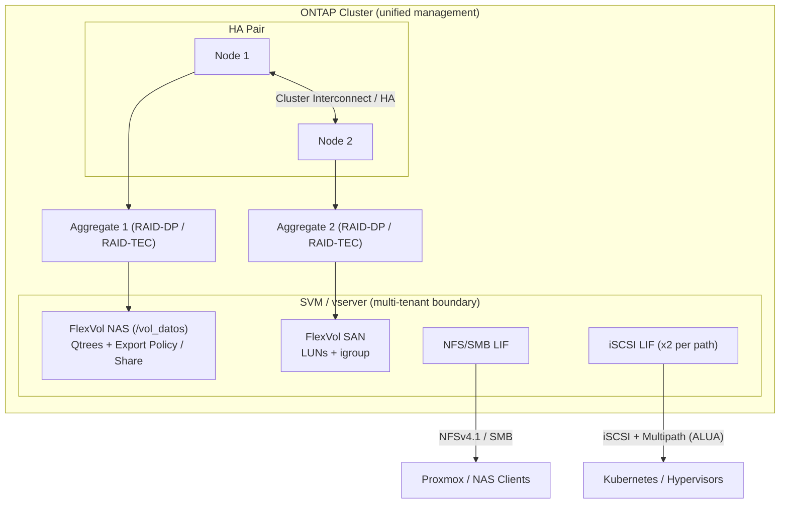

# NetApp ONTAP — Base Guide

## The problem

You are handed a NetApp array and discover it does not look like a regular NAS server: there is a cluster, HA node pairs, aggregates, something called an SVM, broadcast domains, and IP addresses bound to "logical interfaces" instead of a NIC. You create a volume, export it and clients still cannot see it, because in ONTAP creating a volume does not publish it: you also need the *junction path*, the *export policy* (or *igroup* for SAN) and a LIF on the right SVM and VLAN. Every layer has a reason to exist, but you have to learn them in order.

This page is the operational starting map: object model, networking and high availability, inspection CLI, publishing over NFS, SMB and iSCSI, space efficiency, QoS and ransomware protection, snapshots and SnapMirror, automation via REST API/Ansible, and integration with Proxmox and Kubernetes.

!!! note "What this covers and what it does not"
    This page covers the **object model, baseline operations and access over NFS/SMB/iSCSI** from your infrastructure. For comparing protocols and measuring performance see [Storage protocols](../protocols/protocols.md); for another commercial array, [Pure Storage](../pure_storage/pure_storage_base.md); for software-defined storage, [Ceph](../ceph/ceph_base.md).

## 📋 Table of Contents

- [ONTAP concepts and architecture](#ontap-concepts-and-architecture)
- [Networking and high availability (LIFs, VLANs and failover)](#networking-and-high-availability-lifs-vlans-and-failover)
- [Basic inspection CLI](#basic-inspection-cli)
- [Publishing storage: NFS, SMB and iSCSI](#publishing-storage-nfs-smb-and-iscsi)
- [Space efficiency, QoS and anti-ransomware](#space-efficiency-qos-and-anti-ransomware)
- [Snapshots and SnapMirror](#snapshots-and-snapmirror)
- [Automation: REST API and Ansible](#automation-rest-api-and-ansible)
- [Proxmox integration](#proxmox-integration)
- [Kubernetes integration (Trident)](#kubernetes-integration-trident)
- [Troubleshooting](#troubleshooting)
- [Best practices](#best-practices)
- [References](#references)

## ONTAP concepts and architecture

ONTAP is the operating system running on NetApp arrays (FAS, AFF, ASA and ONTAP Select). Objects are organized into two planes: the **physical layer** (nodes, disks and aggregates) and the **logical layer** seen by clients (SVMs, volumes and LIFs).



The objects, from the bottom up:

| Object | What it is |
|---|---|
| **Node** | A physical controller. Nodes are grouped into high-availability pairs (*HA pairs*) that take over each other's disks during a failure (*takeover/giveback*) |
| **Cluster** | The set of nodes managed as a single unit, through one cluster management LIF |
| **Aggregate** | A pool of physical disks (RAID-DP or RAID-TEC) owned by a node. Provides the physical capacity on which volumes live |
| **SVM** (`vserver`) | *Storage Virtual Machine*: a virtual file/block server with its own namespace, DNS, users, protocols and LIFs. It is the multi-tenancy boundary |
| **Volume (FlexVol / FlexGroup)** | The logical unit clients see: holds files (NAS) or LUNs (SAN). A FlexVol lives in one aggregate; a FlexGroup spans a single namespace across multiple aggregates |
| **Qtree** | A logical subdirectory inside a volume that can have its own quotas and security style |
| **LUN** | A block disk presented over iSCSI, FC or NVMe/TCP, stored inside a volume |
| **LIF** | *Logical Interface*: the service IP (or WWPN) of an SVM. Bound to a physical port, `ifgrp` or VLAN, and able to migrate between nodes |

The ideas that prevent the most stumbles:

- **Clients talk to the SVM, not the cluster.** You mount `svm1:/vol_datos`, not a node. The IP you point to is a data LIF of that SVM.
- **LIFs are mobile (for NAS).** If a node goes down or a takeover occurs, the NAS LIF migrates to the partner and the IP keeps answering. For **SAN (iSCSI/FC)** LIFs do not migrate: the client keeps active paths to both nodes via multipath (ALUA).
- **A NAS volume needs a *junction path***: its position in the SVM's namespace tree (`/vol_datos`). Without it, the volume exists but cannot be exported or shared.
- **Access = enabled protocol + LIF + policy.** In NFS it is the *export policy*; in SMB, the *share* and its ACLs; in iSCSI, the *igroup* and *LUN mapping*.

## Networking and high availability (LIFs, VLANs and failover)

Many early NetApp issues come from ONTAP's networking layer, which decouples physical connectivity from logical services using four building blocks:

- **`ifgrp` (Interface Group):** physical port aggregation (typically LACP in `multimode_lacp` mode) on each node.
- **VLAN:** tagged subinterface over a port or `ifgrp` (for example `a0a-100`).
- **Broadcast Domain:** groups ports/VLANs across nodes that share the same Layer-2 domain. It defines which ports a NAS LIF can fail over to if its node goes down.
- **IPspace:** an isolated routing table (equivalent to a VRF) separating management, data or multi-tenant networks with overlapping subnets.

Before any maintenance — or when diagnosing unexpected latency — check these three items:

```text
storage failover show                 # HA pair health and whether takeover is enabled
network port broadcast-domain show    # ports grouped by Layer-2 domain
network interface show -is-home false # LIFs NOT currently on their home node
```

If a NAS LIF shows `is-home false` after a reboot or maintenance window, traffic still enters through the partner node and crosses the *cluster interconnect* to reach the node owning the aggregate, adding extra latency. Reverting all LIFs back to their home nodes is non-disruptive for NAS:

```text
network interface revert *
```

## Basic inspection CLI

The ONTAP CLI is hierarchical (`volume show`, `network interface show`) and accessed over SSH to the cluster management LIF with an admin account. Inspection commands are read-only:

```text
cluster show                          # cluster nodes and their state
storage aggregate show                # aggregates, used and free capacity
vserver show                          # SVMs and allowed protocols
volume show                           # volumes, SVM, aggregate, size and usage
volume show -percent-used >80         # volumes above 80% capacity
network interface show                # LIFs: current IP, node, port and status
volume snapshot show                  # snapshots per volume
lun show                              # published LUNs, size and state
```

Every command supports filters like `-vserver`, `-volume` or `-fields` and tab completion.

!!! warning "Version dependent"
    Exact syntax and output columns vary across ONTAP 9.x releases. Check the built-in help with `?` in your CLI before pasting commands from another installation.

## Publishing storage: NFS, SMB and iSCSI

### NFS (Linux NAS, Proxmox and Kubernetes)

Logical order: volume, access policy and assignment. Example for an NFS datastore:

```text
volume create -vserver svm1 -volume vol_datos -aggregate aggr1_nodo1 -size 500GB -junction-path /vol_datos
vserver export-policy create -vserver svm1 -policyname pol_proxmox
vserver export-policy rule create -vserver svm1 -policyname pol_proxmox -clientmatch 10.0.10.0/24 -protocol nfs -rorule sys -rwrule sys -superuser sys
volume modify -vserver svm1 -volume vol_datos -policy pol_proxmox
```

The *export policy* is the equivalent of `/etc/exports`: it defines which clients can mount and with what privileges. `-superuser sys` equals `no_root_squash` and should only be granted to trusted hosts such as hypervisors. An empty policy denies everyone, and the default rule in `default` is rarely what you want.

Verify from an authorized Linux client:

```bash
sudo mkdir -p /mnt/netapp
sudo mount -t nfs -o vers=4.1 10.0.10.50:/vol_datos /mnt/netapp
touch /mnt/netapp/prueba && ls -l /mnt/netapp
sudo umount /mnt/netapp
```

!!! warning "NFS version"
    Which NFS versions are enabled is an SVM setting (`vserver nfs show`). Confirm it before pinning `vers=` in `/etc/fstab`.

### SMB / CIFS (Windows and mixed environments)

To expose a volume over SMB, create a share on its junction path once the SVM has CIFS configured and domain-joined:

```text
vserver cifs share create -vserver svm1 -share-name datos -path /vol_datos
vserver cifs share show -vserver svm1
```

The share controls access by user and group via ACLs; the export policy does not apply to SMB. If the same volume is shared over both NFS and SMB, its security style (`unix`, `ntfs` or `mixed`) determines how permissions map across protocols: choose it at creation time and avoid changing it with data inside.

### iSCSI (block storage with multipath)

For latency-sensitive workloads (databases or block VM disks), iSCSI requires creating the container volume, the LUN, the *igroup* containing host IQNs, and the mapping:

```text
# 1. Container volume (no junction-path: not exported over NAS)
volume create -vserver svm1 -volume vol_iscsi_db -aggregate aggr1_nodo1 -size 500GB

# 2. Create the LUN inside the volume
lun create -vserver svm1 -path /vol/vol_iscsi_db/lun_pg -size 400GB -ostype linux -space-reserve disabled

# 3. Register Linux host initiators (check with: cat /etc/iscsi/initiatorname.iscsi)
lun igroup create -vserver svm1 -igroup ig_proxmox -protocol iscsi -ostype linux -initiator iqn.1993-08.org.debian:01:nodo1,iqn.1993-08.org.debian:01:nodo2

# 4. Map the LUN to the igroup and verify
lun mapping create -vserver svm1 -path /vol/vol_iscsi_db/lun_pg -igroup ig_proxmox
lun mapping show -vserver svm1
```

On the Linux hosts, discover the iSCSI LIFs on **both array nodes** (ideally across two separate subnets/VLANs) and confirm `multipath` shows active-optimized paths (ALUA) to the node owning the volume and active-non-optimized paths to its partner:

```bash
sudo iscsiadm -m discovery -t sendtargets -p 10.0.20.51
sudo iscsiadm -m discovery -t sendtargets -p 10.0.21.52
sudo iscsiadm -m node --login
sudo multipath -ll
```

## Space efficiency, QoS and anti-ransomware

### Efficiency and capacity control

ONTAP runs deduplication, compression and compaction at the volume level (usually enabled by default on AFF/ASA systems; verify on FAS with `volume efficiency show`).

- **Thin provisioning:** the volume advertises a size but consumes only written blocks. Always monitor free space on the **aggregate**, not just the volume.
- **`volume autosize`:** allows a volume to grow automatically up to a ceiling (`-mode grow -maximum-size ...`). Always set a maximum so one runaway workload cannot fill the aggregate.
- **Quotas on qtrees:** bound consumption when multiple teams share a volume.
- **FabricPool:** tiers cold blocks to an S3 object store (on-prem or cloud) according to policy (`auto`, `snapshot-only`…). Measure recall latency before enabling it on hot datasets.

!!! warning "Efficiency is not guaranteed capacity"
    Dedupe and compression ratios depend on the workload: compressed databases, video or already-encrypted data barely shrink. Size for real data, not brochure ratios.

### Storage QoS (stopping noisy neighbors)

Without QoS, a bulk dump or runaway VM can saturate IOPS on a shared aggregate and slow down everything else. A fixed QoS policy caps a volume's throughput ceiling:

```text
qos policy-group create -vserver svm1 -policy-group pg_backups -max-throughput 200MB/s
volume modify -vserver svm1 -volume vol_backups -qos-policy-group pg_backups
qos policy-group show
```

All-flash systems also support **guaranteed minimums** (`-min-throughput`) for critical databases and adaptive QoS policies (IOPS/TB).

### Anti-ransomware and immutable snapshots

Recent ONTAP 9.x releases add two key defensive layers (subject to licensing and model support):

- **Autonomous Ransomware Protection (ARP):** monitors entropy and abnormal write patterns on NAS volumes and automatically takes a snapshot when activity matches mass encryption.
- **Snapshot Locking (Tamperproof Snapshots / SnapLock):** prevents snapshots from being deleted during their retention period even with administrator credentials, protecting recovery points if management access is compromised.

## Snapshots and SnapMirror

An ONTAP **snapshot** is a pointer-based point-in-time image (WAFL): it is created in seconds and only consumes space as original blocks change.

```text
volume snapshot create -vserver svm1 -volume vol_datos -snapshot antes_de_migrar
volume snapshot show -vserver svm1 -volume vol_datos
```

- **Snapshot policies:** generate scheduled copies (hourly, daily, weekly) with per-volume retention. Watch snapshot reserve (`percent-snapshot-space`): once snapshots exceed their reserve, they spill into active volume space (*snapshot spill*).
- **Restoring:** recover individual files from the hidden `.snapshot` directory, or revert the entire volume (`volume snapshot restore`, which discards everything after that snapshot).
- **SnapMirror:** replicates volumes to another cluster by transferring only changed blocks between snapshots. Supports asynchronous replication (RPO equal to the schedule interval) and synchronous modes for near-zero RPO.
- **Labels (`snapmirror-label`) and SnapVault:** keep short retention on the source and long archival retention on the destination.

```text
snapmirror show                       # state, health and lag of all relationships
```

!!! danger "A snapshot is not a backup"
    Snapshots live in the same volume and aggregate as the data: if the array is lost or the volume is deleted, they go with it. SnapMirror to a second cluster improves resilience dramatically, but still lives on the same storage plane. Follow the [3-2-1 Strategy](../../backups/strategy_321.md) and keep an independent off-array copy, for instance with [Restic and Borg](../../backups/restic_borg.md).

## Automation: REST API and Ansible

Since ONTAP 9.6+, the **native REST API** has progressively replaced SSH scraping and ZAPI (ONTAPI), making inventory and provisioning scriptable with standard tools:

```bash
# List volumes in an SVM using curl and jq
curl -sk -u admin \
  "https://cluster-mgmt.example.local/api/storage/volumes?svm.name=svm1&fields=name,size,space.used,state" \
  | jq '.records[] | {name, state, size, used: .space.used}'
```

For infrastructure as code, NetApp's official **`netapp.ontap`** Ansible collection (`ansible-galaxy collection install netapp.ontap`) drives the REST API idempotently:


```yaml
- name: Ensure NFS volume exists in ONTAP
  netapp.ontap.na_ontap_volume:
    state: present
    name: vol_datos
    vserver: svm1
    aggregate_name: aggr1_nodo1
    size: 500
    size_unit: gb
    junction_path: /vol_datos
    policy: pol_proxmox
    hostname: "{{ ontap_host }}"
    username: "{{ ontap_user }}"
    password: "{{ ontap_pass }}"
    https: true
    validate_certs: true
```


This lets you version volumes, export policies, igroups and snapshot policies in Git using the same workflow as the rest of your servers (see [Ansible: infrastructure automation](../../ansible/ansible_base.md)).

## Proxmox integration

Two paths, depending on your trade-off between simplicity and latency:

**NFS** is the most straightforward: mounted as shared storage for VM disks (`qcow2`/`raw`), ISOs and backups, with instant live migration across nodes:

```bash
pvesm add nfs netapp-nfs --server 10.0.10.50 --export /vol_datos --content images,iso,backup
```

Point to an NFS data LIF (never management), allow **every node** in the Proxmox cluster in the export policy and prefer NFSv4.1 when enabled. Tune `rsize`/`wsize` only after measuring with `fio` ([Storage protocols](../protocols/protocols.md)).

**iSCSI** provides block storage and tighter latency for databases or critical VMs. Map the LUN to the Proxmox nodes' *igroup*, configure `multipath` across two separate iSCSI LIFs, and create shared LVM on top.

Rule of thumb: NFS for general datastores, iSCSI where measured latency justifies the extra operational complexity. Platform details are in [Proxmox base](../../proxmox/proxmox_base.md).

## Kubernetes integration (Trident)

NetApp's official CSI driver is **Trident**. Install it in the cluster, configure a backend (`TridentBackendConfig`) pointing to the SVM and expose `StorageClasses` by protocol (`ontap-nas` for NFS, `ontap-nas-economy` for many small qtree-backed volumes, and `ontap-san` for iSCSI/FC/NVMe):

```yaml
apiVersion: storage.k8s.io/v1
kind: StorageClass
metadata:
  name: ontap-nas
provisioner: csi.trident.netapp.io
parameters:
  backendType: "ontap-nas"
volumeBindingMode: WaitForFirstConsumer
allowVolumeExpansion: true
```

- `WaitForFirstConsumer` delays provisioning until a pod is scheduled.
- `allowVolumeExpansion: true` enables online PVC growth.
- Separating `StorageClasses` by tier or QoS (e.g. `ontap-nas` vs `ontap-san-db`) lets application teams pick performance without touching the array.
- Kubernetes worker nodes need the NFS/iSCSI client packages installed and access granted in the export policy or igroup.

!!! warning "Parameters depend on the Trident version"
    Drivers, `StorageClass` parameters and backend CRDs evolve across Trident and ONTAP versions. Always verify against the docs for your installed release. The general CSI model is covered in [Kubernetes and CSI](../kubernetes_csi.md).

## Troubleshooting

| Symptom | Cause | Fix |
|---|---|---|
| NFS client gets `access denied` on mount | Client IP matches no export policy rule, or the policy is not assigned to the volume | Check `vserver export-policy rule show` and confirm the volume's assigned policy |
| Volume exists but cannot be mounted | Missing *junction path*, or NFS is not enabled on the SVM | Check `volume show` and `vserver show` |
| Mounts, but files are owned by `nobody` | NFSv4 ID domain or user-mapping mismatch | Align IDmap domain between client and SVM, or use NFSv3 if there is no central directory |
| Client cannot reach the IP | LIF migrated, is down, or sits on a different VLAN | Check `network interface show` and `network port broadcast-domain show` |
| Extra latency on a NAS volume after maintenance | LIF stayed off its home node and traverses the *cluster interconnect* | Run `network interface show -is-home false` and revert with `network interface revert *` |
| Volume fills up even though the aggregate has space | `autosize` disabled, low max size or *snapshot spill* | Check `volume show`, `volume snapshot show` and adjust `volume autosize` |
| Aggregate fills up suddenly | Oversubscribed thin provisioning or excessive snapshot retention | Check `storage aggregate show`, quotas and snapshot policies |
| One volume slows down the whole aggregate | Noisy neighbor without an IOPS/throughput cap | Check `qos policy-group show` and assign a QoS ceiling to the noisy volume |
| SMB share fails to authenticate | SVM not joined to the domain or clock skew against the DC | Check SVM CIFS configuration and synchronize NTP |
| Inconsistent iSCSI performance | Broken multipath or single active path (missing ALUA) | Verify `multipath -ll` on the host and both iSCSI LIFs across the HA pair |
| SnapMirror lag keeps growing | Saturated link or previous transfer still running | Run `snapmirror show` and review bandwidth, throttle and schedule |

## Best practices

- **One SVM per trust domain** (environments, teams or tenants): isolates protocols, networks and administration.
- **Keep data LIFs separate from management**, with at least one LIF per node and protocol; check `is-home false` after every maintenance window.
- **Check `storage failover show` before touching a node:** never perform disruptive work while the HA pair is degraded.
- **Minimal export policies:** specific subnets, `-superuser sys` only for hypervisors, never `0.0.0.0/0`.
- **One volume per datastore or application**, not one monolithic volume: enables granular snapshots, QoS and restores.
- **Use QoS and bounded `autosize`** to protect aggregates from noisy neighbors and runaway growth.
- **Explicit snapshot policies and regular restore drills** (both from `.snapshot` and from the SnapMirror destination).
- **Automate day-to-day changes with REST API or `netapp.ontap`** to prevent manual drift across clusters.
- **Keep an independent off-array copy:** snapshots and SnapMirror do not replace a real 3-2-1 backup.

## References

- [Official NetApp ONTAP documentation](https://docs.netapp.com/us-en/ontap/)
- [ONTAP CLI reference](https://docs.netapp.com/us-en/ontap-cli/)
- [ONTAP REST API](https://docs.netapp.com/us-en/ontap-automation/)
- [Ansible `netapp.ontap` collection](https://docs.ansible.com/ansible/latest/collections/netapp/ontap/index.html)
- [NetApp Trident documentation](https://docs.netapp.com/us-en/trident/)
- [SnapMirror, SnapVault and Disaster Recovery](snapmirror_dr.md) · [Automation and metrics with Harvest](automation_monitoring.md)
- [Storage protocols](../protocols/protocols.md) · [Kubernetes and CSI](../kubernetes_csi.md)
- [Pure Storage](../pure_storage/pure_storage_base.md) · [Ceph](../ceph/ceph_base.md)
- [3-2-1 Strategy](../../backups/strategy_321.md) · [Restic and Borg](../../backups/restic_borg.md)
- [Proxmox base](../../proxmox/proxmox_base.md)
- [ONTAP: `volume create`](https://docs.netapp.com/us-en/ontap-cli/volume-create.html) · [`lun create`](https://docs.netapp.com/us-en/ontap-cli/lun-create.html) · [`qos policy-group create`](https://docs.netapp.com/us-en/ontap-cli/qos-policy-group-create.html)
- [ONTAP: `vserver export-policy rule create`](https://docs.netapp.com/us-en/ontap-cli/vserver-export-policy-rule-create.html) · [`vserver cifs share create`](https://docs.netapp.com/us-en/ontap-cli/vserver-cifs-share-create.html)
- [Trident: `ontap-nas` backend](https://docs.netapp.com/us-en/trident/trident-use/ontap-nas.html) · [creating a StorageClass](https://docs.netapp.com/us-en/trident/trident-use/create-stor-class.html)
