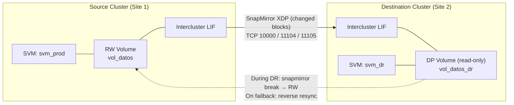

# NetApp ONTAP: SnapMirror, SnapVault and Disaster Recovery

## The problem

Hourly snapshots on your NetApp array save you from an accidental deletion or a bad upgrade, but they do nothing if the site goes dark, the chassis fails or the primary cluster is compromised. **SnapMirror** replicates volumes to a second cluster by transferring only blocks changed between snapshots, yet setting up the relationship is only half the job: if you have never rehearsed *failover* (`break`) and *failback* (reverse `resync`), the day of a real outage is when you discover that export policies, igroups or destination LIFs were never ready.

This page covers the full lifecycle: peering prerequisites, creating and initializing an `XDP` relationship, choosing between `MirrorAllSnapshots` and `MirrorAndVault` (SnapVault), orderly failover and failback procedures, and diagnosing replication lag.

## Replication and DR architecture

A SnapMirror relationship between two ONTAP clusters rests on three prerequisites: **Intercluster LIFs** on each node with IP reachability across sites, **Cluster Peering** (passphrase-authenticated and TLS-encrypted) and **SVM Peering** between the source and destination SVMs.



## Policies: Mirror vs Vault (`XDP`)

In modern ONTAP 9.x, the standard relationship type is **`XDP`** (*Extended Data Protection*), which unifies fast replication (Mirror) and long-term archival (Vault) through the assigned policy:

| Policy | What it does | When to use it |
|---|---|---|
| `MirrorAllSnapshots` | Replicates the full volume and **every** snapshot with the same retention as the source | Disaster recovery (DR) with low RPO |
| `XDPDefault` | Replicates only snapshots whose `snapmirror-label` matches the policy rules (SnapVault behavior) | Long-term archive on a lower-cost destination |
| `MirrorAndVault` | Combines both: keeps an up-to-date DR mirror **and** retains labeled snapshots (daily/weekly) for months on the destination | The most practical default when you have a single secondary cluster |

To avoid surprises with `MirrorAndVault` or `XDPDefault`, align the **`snapmirror-label`** values on the source volume's snapshot policy with the rules in the destination SnapMirror policy. If labels do not match, replication succeeds but the destination never keeps the long-term history.

## Step 1: Cluster peering and SVM peering

Before creating any relationship, both clusters must peer over their `intercluster` LIFs:

```text
# Confirm active intercluster LIFs exist on both clusters
network interface show -role intercluster

# On the source cluster (initiates peering and prompts for a shared passphrase)
cluster peer create -peer-addrs 10.20.0.11,10.20.0.12 -ipspace Default

# On the destination cluster (same passphrase, pointing to source LIFs)
cluster peer create -peer-addrs 10.10.0.11,10.10.0.12 -ipspace Default

# Verify cluster peering availability
cluster peer show
```

Once the clusters are peered, authorize peering between the source and destination SVMs:

```text
# On the destination cluster
vserver peer create -vserver svm_dr -peer-vserver svm_prod -peer-cluster cluster_origen -applications snapmirror

# On the source cluster (accept the request)
vserver peer accept -vserver svm_prod -peer-vserver svm_dr

# Confirm "peered" state
vserver peer show
```

## Step 2: Create and initialize the SnapMirror relationship

The destination volume must be created with type **`DP`** (*Data Protection*, read-only) and a size equal to or larger than the source volume. **SnapMirror management commands are always run on the destination cluster.**

```text
# 1. Create the DP destination volume (no junction-path while it is a replica)
volume create -vserver svm_dr -volume vol_datos_dr -aggregate aggr1_dr -size 500GB -type DP

# 2. Create the XDP relationship with MirrorAndVault policy and hourly schedule
snapmirror create -source-path svm_prod:vol_datos -destination-path svm_dr:vol_datos_dr -type XDP -policy MirrorAndVault -schedule hourly

# 3. Start the initial baseline transfer
snapmirror initialize -destination-path svm_dr:vol_datos_dr

# 4. Monitor progress until State is "Snapmirrored" and Healthy is "true"
snapmirror show
```

!!! warning "Prepare destination access before an outage"
    A `DP` volume is read-only, yet you can pre-stage the NFS export policies, iSCSI igroups and contingency data LIFs on `svm_dr`. When you run `break`, you only need to mount the junction path (or map the LUN) and point clients to it.

## Step 3: Failover (activating the destination in a disaster)

When the source goes down — or during a live DR test — stop pending updates and promote the `DP` volume to read-write (`RW`):

```text
# 1. If the source is still reachable (drill or planned cutover), run a final update
snapmirror update -destination-path svm_dr:vol_datos_dr

# 2. Pause scheduled transfers
snapmirror quiesce -destination-path svm_dr:vol_datos_dr

# 3. Break the relationship: vol_datos_dr enters Broken-off state and becomes RW
snapmirror break -destination-path svm_dr:vol_datos_dr

# 4. Publish the volume for NAS clients (mount junction path and assign export policy)
volume mount -vserver svm_dr -volume vol_datos_dr -junction-path /vol_datos
volume modify -vserver svm_dr -volume vol_datos_dr -policy pol_proxmox_dr
```

For iSCSI block workloads, once `break` completes, the LUN inside `vol_datos_dr` is writable and ready to map to the DR hypervisors' igroup (`lun mapping create`).

## Step 4: Failback (returning to the source without losing data)

The costliest mistake after a failover is bringing services back up on the primary cluster without first replicating back the writes made on the destination during the outage. Safe failback uses a **reverse resync**:

1. **Stop writes** on the source (if it was still up) and ensure clients are writing only to `svm_dr:vol_datos_dr`.
2. **On the source cluster**, create the reverse relationship (`svm_dr:vol_datos_dr` → `svm_prod:vol_datos`) and run `snapmirror resync`: ONTAP finds the latest common snapshot and copies only the changes written during DR back to the source (which temporarily becomes read-only).

```text
# On the SOURCE cluster (reversing replication direction)
snapmirror create -source-path svm_dr:vol_datos_dr -destination-path svm_prod:vol_datos -type XDP -policy MirrorAndVault
snapmirror resync -destination-path svm_prod:vol_datos
snapmirror show
```

3. **Cutover window back to primary:** stop applications on the destination, run one final `snapmirror update` toward the source, run `snapmirror quiesce` and `snapmirror break` on `svm_prod:vol_datos`, and resume service from primary.
4. **Restore the original direction** from the destination cluster by running `snapmirror resync -destination-path svm_dr:vol_datos_dr`, and delete the temporary reverse relationship (`snapmirror delete`) once the original returns to `Snapmirrored`.

!!! danger "Do not delete the common base snapshot"
    `snapmirror resync` avoids a full baseline re-copy by relying on the newest common snapshot shared between source and destination. If someone manually deletes that snapshot on both ends, you have no choice but to re-initialize from scratch.

## Monitoring and health checks

Three daily commands (also scriptable via the REST API at `/api/snapmirror/relationships`):

```text
snapmirror show                                       # state, health (Healthy) and Lag Time
snapmirror show -healthy false                        # only unhealthy relationships
snapmirror show-history -destination-path svm_dr:vol_datos_dr  # transfer history and durations
```

Always watch **`Lag Time`**: a relationship can show `Idle` with no obvious error yet be hours behind if the WAN link is saturated or a previous transfer overran its schedule window.

## Troubleshooting

| Symptom | Cause | Fix |
|---|---|---|
| `cluster peer show` reports `Unavailable` | Firewall blocking intercluster ports (TCP 10000, 11104, 11105) or missing routes on the intercluster LIF | Verify reachability with `network ping` from the intercluster LIF and check firewall rules |
| `snapmirror initialize` fails on size | Destination `DP` volume is smaller than the source | Grow the destination volume with `volume size` before retrying |
| `Lag Time` keeps growing every cycle | Insufficient WAN bandwidth or very high write churn on the volume | Set `-throttle` during business hours and stagger `-schedule` windows |
| `snapmirror resync` fails with no common snapshot | The relationship's base snapshot was deleted | Re-initialize the relationship from scratch or seed a new relationship |
| Destination does not keep weekly/monthly snapshots | Source snapshot policy `snapmirror-label` values do not match the `MirrorAndVault` rules | Align labels between `volume snapshot policy` (source) and `snapmirror policy` (destination) |
| After `break`, NFS clients get `access denied` | Destination export policy was still `default` or the junction path was not mounted | Run `volume mount` and assign the contingency export policy on `svm_dr` |

## Best practices

- **Rehearse a `break` and `resync` drill at least twice a year** using a test volume or a `FlexClone` on the DP destination (which lets you validate DR without breaking the live mirror).
- **Enable TLS encryption on cluster peering** whenever replication traffic crosses untrusted or shared WAN links.
- **Stagger replication schedules:** avoid starting 40 volumes at `:00` sharp so you do not saturate the WAN link or destination disks.
- **Follow the 3-2-1 rule:** SnapMirror protects against an array or site failure, but administrative errors or a dual-cluster compromise can still impact replicas; keep independent immutable copies off-array ([3-2-1 Backup Strategy](../../backups/strategy_321.md)).

## References

- [NetApp ONTAP: SnapMirror data protection](https://docs.netapp.com/us-en/ontap/data-protection/snapmirror-disaster-recovery-concept.html)
- [ONTAP CLI: `snapmirror create`](https://docs.netapp.com/us-en/ontap-cli/snapmirror-create.html) · [`snapmirror initialize`](https://docs.netapp.com/us-en/ontap-cli/snapmirror-initialize.html)
- [ONTAP CLI: `snapmirror break`](https://docs.netapp.com/us-en/ontap-cli/snapmirror-break.html) · [`snapmirror resync`](https://docs.netapp.com/us-en/ontap-cli/snapmirror-resync.html)
- [NetApp ONTAP — Base Guide](netapp_base.md) · [Automation and metrics with Harvest](automation_monitoring.md)
- [3-2-1 Backup Strategy](../../backups/strategy_321.md) · [Secure backup: encryption and immutability](../../cybersecurity/backup_seguro.md)
