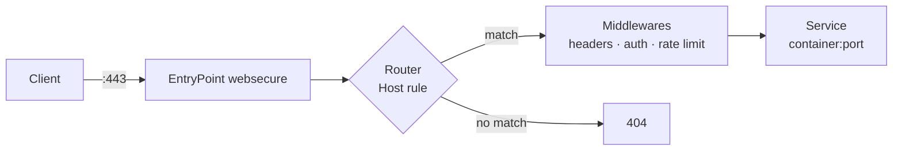

# Traefik

## The problem

You have six services running in Docker, each listening on a different port. Every time you add one you edit `nginx.conf`, reload, and manually renew certificates when Let's Encrypt expires. Multiply that by every new service and the proxy becomes the bottleneck of every deployment.

Traefik inverts the flow: the container declares how it wants to be exposed through *labels*, and the proxy reconfigures itself. No reloads, no file editing, no manual renewals.

## 📋 Table of Contents

- [Mental model](#mental-model)
- [Static vs dynamic configuration](#static-vs-dynamic-configuration)
- [Minimal Docker deployment](#minimal-docker-deployment)
- [Automatic HTTPS with Let's Encrypt](#automatic-https-with-lets-encrypt)
- [Middlewares](#middlewares)
- [Secure dashboard](#secure-dashboard)
- [Observability](#observability)
- [Traefik vs HAProxy vs NGINX](#traefik-vs-haproxy-vs-nginx)
- [Troubleshooting](#troubleshooting)
- [Best practices](#best-practices)
- [References](#references)

## Mental model

Four concepts cover 90% of Traefik:

| Concept | What it is |
|---|---|
| **EntryPoint** | The port Traefik listens on (`:80`, `:443`) |
| **Router** | The rule deciding which request goes to which service (`Host(...)`, `PathPrefix(...)`) |
| **Middleware** | Transformation applied before reaching the service (auth, headers, rate limit) |
| **Service** | The actual backend: one or more containers |



The *provider* (Docker, Kubernetes, file) is the source Traefik discovers routers and services from. With the Docker provider, that source is the container labels.

## Static vs dynamic configuration

The distinction that causes the most confusion:

- **Static**: read **only at startup**. EntryPoints, providers, ACME resolvers, logging. Changing it requires restarting the container. Lives in `command:` flags, `traefik.yml`, or environment variables.
- **Dynamic**: reloaded **hot**. Routers, services, middlewares, certificates. Lives in container labels or in watched files under `providers.file.directory`.

> If you change something and it only takes effect after a restart, you almost certainly put it in the wrong place.

## Minimal Docker deployment

An external network shared by the proxy and the exposed services:

```bash
docker network create proxy
```

Proxy `docker-compose.yml`:

```yaml
services:
  traefik:
    image: "traefik:v3.4"
    container_name: traefik
    restart: unless-stopped
    security_opt:
      - no-new-privileges:true
    networks:
      - proxy
    ports:
      - "80:80"
      - "443:443"
    command:
      # --- API and dashboard ---
      - "--api.dashboard=true"
      - "--api.insecure=false"          # never true outside localhost
      # --- Providers ---
      - "--providers.docker=true"
      - "--providers.docker.exposedbydefault=false"  # explicit opt-in
      - "--providers.docker.network=proxy"
      # --- EntryPoints ---
      - "--entryPoints.web.address=:80"
      - "--entryPoints.websecure.address=:443"
      - "--entryPoints.web.http.redirections.entryPoint.to=websecure"
      - "--entryPoints.web.http.redirections.entryPoint.scheme=https"
      - "--entryPoints.websecure.http.tls=true"
    volumes:
      - "/var/run/docker.sock:/var/run/docker.sock:ro"
      - "./letsencrypt:/letsencrypt"

networks:
  proxy:
    external: true
```

Two important decisions are already made there:

- **`exposedbydefault=false`**: no container is published unless it carries `traefik.enable=true`. Without it, bringing up a database on the same network would expose it to the internet.
- **80 → 443 redirect at the entryPoint level**: applied globally, no need to repeat it router by router.

A service behind the proxy only needs labels:

```yaml
services:
  whoami:
    image: traefik/whoami
    restart: unless-stopped
    networks:
      - proxy
    labels:
      - "traefik.enable=true"
      - "traefik.http.routers.whoami.rule=Host(`whoami.example.com`)"
      - "traefik.http.routers.whoami.entrypoints=websecure"

networks:
  proxy:
    external: true
```

There is no `ports:`. The container publishes nothing to the host: only Traefik can reach it, over the `proxy` network.

!!! tip "When the container exposes several ports"
    Traefik cannot guess which one to use and fails. Spell it out:
    `traefik.http.services.whoami.loadbalancer.server.port=8080`

## Automatic HTTPS with Let's Encrypt

### HTTP-01 challenge

Enough when port 80 is reachable from the internet. Add to the static config:

```yaml
command:
  - "--certificatesresolvers.le.acme.email=your-email@example.com"
  - "--certificatesresolvers.le.acme.storage=/letsencrypt/acme.json"
  - "--certificatesresolvers.le.acme.httpchallenge.entrypoint=web"
  # Default resolver for every TLS router
  - "--entryPoints.websecure.http.tls.certresolver=le"
```

`acme.json` holds the private keys. It must persist in a volume with `600` permissions, or Traefik refuses to start.

```bash
touch letsencrypt/acme.json && chmod 600 letsencrypt/acme.json
```

### DNS-01 challenge (wildcards)

Mandatory for `*.example.com` and for internal services without a public port 80. Requires DNS provider credentials:

```yaml
command:
  - "--certificatesresolvers.le.acme.dnschallenge=true"
  - "--certificatesresolvers.le.acme.dnschallenge.provider=cloudflare"
environment:
  - "CF_DNS_API_TOKEN=${CF_DNS_API_TOKEN}"
```

And on the router requesting the wildcard:

```yaml
labels:
  - "traefik.http.routers.app.tls.certresolver=le"
  - "traefik.http.routers.app.tls.domains[0].main=example.com"
  - "traefik.http.routers.app.tls.domains[0].sans=*.example.com"
```

!!! warning "Let's Encrypt rate limits"
    50 certificates per registered domain per week, and only 5 failed attempts per hour. Always test against staging before touching production:
    `--certificatesresolvers.le.acme.caserver=https://acme-staging-v02.api.letsencrypt.org/directory`
    Staging certificates are not valid: delete them from `acme.json` when moving to production.

## Middlewares

Declared once, referenced by name. The most useful ones for self-hosting:

```yaml
labels:
  # --- Security headers ---
  - "traefik.http.middlewares.secure-headers.headers.frameDeny=true"
  - "traefik.http.middlewares.secure-headers.headers.contentTypeNosniff=true"
  - "traefik.http.middlewares.secure-headers.headers.browserXssFilter=true"
  - "traefik.http.middlewares.secure-headers.headers.stsSeconds=31536000"
  - "traefik.http.middlewares.secure-headers.headers.stsIncludeSubdomains=true"
  - "traefik.http.middlewares.secure-headers.headers.stsPreload=true"

  # --- Rate limiting: 100 req/s average, bursts of 200 ---
  - "traefik.http.middlewares.ratelimit.ratelimit.average=100"
  - "traefik.http.middlewares.ratelimit.ratelimit.period=1s"
  - "traefik.http.middlewares.ratelimit.ratelimit.burst=200"

  # --- Source restriction (internal network) ---
  - "traefik.http.middlewares.lan-only.ipallowlist.sourcerange=192.168.0.0/16,10.0.0.0/8"

  # --- Basic authentication ---
  - "traefik.http.middlewares.auth.basicauth.users=admin:$$apr1$$xxxxxxxx$$yyyyyyyyyyyyyyyyyyyyy"
```

They chain in order, comma-separated:

```yaml
  - "traefik.http.routers.app.middlewares=secure-headers,ratelimit"
```

!!! danger "The `$` detail that ruins your afternoon"
    In `docker-compose.yml` **every `$` in the bcrypt hash must be doubled**, because Compose interpolates variables. Generate the value already escaped:
    ```bash
    echo $(htpasswd -nB admin) | sed -e 's/\$/\$\$/g'
    ```
    If you don't double them, Compose eats part of the hash and authentication fails with an error that never mentions `$` at all.

    Better still: put the hash in a dynamic configuration file (`providers.file`), where there is no interpolation and nothing to escape. See [secrets management](../cybersecurity/gestion_secretos.md).

For real authentication (SSO, MFA, users), delegate to an IdP with `forwardauth` instead of maintaining `basicauth` lists:

```yaml
  - "traefik.http.middlewares.sso.forwardauth.address=http://authentik:9000/outpost.goauthentik.io/auth/traefik"
  - "traefik.http.middlewares.sso.forwardauth.trustForwardHeader=true"
```

See [Authentik](../identity/authentik.md) and [Keycloak](../identity/keycloak.md).

## Secure dashboard

The dashboard exposes your whole topology: hosts, routers, backends. `--api.insecure=true` publishes it **without authentication** on port 8080. Do not use it outside your laptop.

The correct version: one more router, with TLS and middlewares, pointing at the internal `api@internal` service.

```yaml
services:
  traefik:
    # ... rest of the configuration ...
    labels:
      - "traefik.enable=true"
      - "traefik.http.routers.dashboard.rule=Host(`traefik.example.com`)"
      - "traefik.http.routers.dashboard.entrypoints=websecure"
      - "traefik.http.routers.dashboard.service=api@internal"
      - "traefik.http.routers.dashboard.tls.certresolver=le"
      - "traefik.http.routers.dashboard.middlewares=auth,lan-only,secure-headers"
```

Three layers: TLS, authentication and source IP restriction. If the dashboard is only consulted from the LAN or the VPN, `lan-only` is the cheapest effective defense — combine it with [WireGuard](../linux/wireguard.md) or [Tailscale](../networking/tailscale.md) and don't expose the dashboard to the internet at all.

!!! warning "The Docker socket is root access"
    Mounting `/var/run/docker.sock` into Traefik is equivalent to giving that container root on the host: whoever compromises it can start a privileged container. Mitigations, from least to most effort:

    1. `:ro` and `no-new-privileges:true` (already included above) — they help, but do not prevent escalation.
    2. A socket proxy filtering the Docker API down to read-only container access.
    3. File provider instead of Docker: no socket, at the cost of manual configuration.

    See [Docker security](../docker/docker_security.md).

## Observability

Traefik exposes native Prometheus metrics:

```yaml
command:
  - "--metrics.prometheus=true"
  - "--metrics.prometheus.addEntryPointsLabels=true"
  - "--metrics.prometheus.addServicesLabels=true"
  - "--accesslog=true"
  - "--accesslog.format=json"
```

Metrics worth putting on a dashboard:

| Metric | What for |
|---|---|
| `traefik_service_requests_total` | Request rate and 5xx ratio per service |
| `traefik_service_request_duration_seconds` | Backend p95/p99 latency |
| `traefik_entrypoint_open_connections` | EntryPoint saturation |
| `traefik_tls_certs_not_after` | **Days until certificate expiry** |

The last one is the alert that prevents the classic incident: ACME renewal failing silently for weeks. Alert at 21 days. See [observability stack](../monitoring/observability_stack.md).

## Traefik vs HAProxy vs NGINX

| | Traefik | HAProxy | NGINX |
|---|---|---|---|
| Configuration | Dynamic, label-driven | File, reload | File, reload |
| Discovery | Automatic (Docker/K8s) | Manual or templated | Manual or templated |
| Automatic TLS | Built in (ACME) | External (certbot) | External (certbot) |
| Raw performance | Good | **Best** | Very good |
| Layer 4 (TCP/UDP) | Yes | **Very complete** | Yes (stream) |
| Learning curve | Gentle if you use containers | Steep | Medium |

Rule of thumb: **Traefik** when the service inventory changes often (containers, self-hosting, ephemeral environments). **HAProxy** when the inventory is stable and you need to squeeze latency, L4 balancing or fine-grained health checking — see [HAProxy advanced](../haproxy/haproxy_advanced.md). Full comparison in [Load Balancing](../networking/load_balancer_comparison.md).

## Troubleshooting

| Symptom | Usual cause | Check |
|---|---|---|
| **404 page not found** | Router missing or rule doesn't match | `docker logs traefik` and the dashboard: does the router show up? |
| **Bad Gateway (502)** | Traefik reaches the container on the wrong port | Pin `loadbalancer.server.port` |
| **Gateway Timeout (504)** | Proxy and service on different networks | `docker network inspect proxy` — are both there? |
| **Default TLS certificate** | ACME failed; the self-signed one is served | `--log.level=DEBUG` and grep for `acme` in the logs |
| **Changes not applied** | You edited static configuration | Restart the container |
| **basicauth always rejects** | `$` not doubled in Compose | Compare the hash inside the container against the original |

Quick inspection of what Traefik actually understood, without opening the dashboard:

```bash
# Requires the dashboard to be reachable; adjust host and credentials
curl -s https://traefik.example.com/api/http/routers | jq '.[] | {name, rule, status, service}'
curl -s https://traefik.example.com/api/http/services | jq '.[] | {name, serverStatus}'
```

`status: "disabled"` on a router means Traefik loaded it and then discarded it: almost always a referenced middleware or certResolver that doesn't exist.

## Best practices

- **`exposedbydefault=false`, always.** Exposure is opt-in, never the default.
- **Pin the image version** (`traefik:v3.4`, not `:latest`). Major jumps change the configuration syntax.
- **One global `secure-headers` middleware** applied to every public router, not copy-pasted per service.
- **`acme.json` on a persistent volume with 600 permissions**, included in your [backup strategy](../backups/strategy_321.md): losing it means reissuing every certificate and risking the rate limits.
- **Use Let's Encrypt staging for testing.** Those 5 failures/hour run out far sooner than you'd think.
- **Alert on `traefik_tls_certs_not_after`.** Automatic renewal fails too.
- **No public dashboard.** VPN or `ipallowlist`, and if there is no alternative, TLS + auth + rate limit.

## References

- [Official Traefik documentation](https://doc.traefik.io/traefik/)
- [HTTP middlewares reference](https://doc.traefik.io/traefik/reference/routing-configuration/http/middlewares/overview/)
- [Let's Encrypt rate limits](https://letsencrypt.org/docs/rate-limits/)
- [HAProxy](../haproxy/haproxy_base.md) · [Load balancer comparison](../networking/load_balancer_comparison.md)
- [TLS certificates](../networking/certificados_tls.md) · [Docker security](../docker/docker_security.md)
