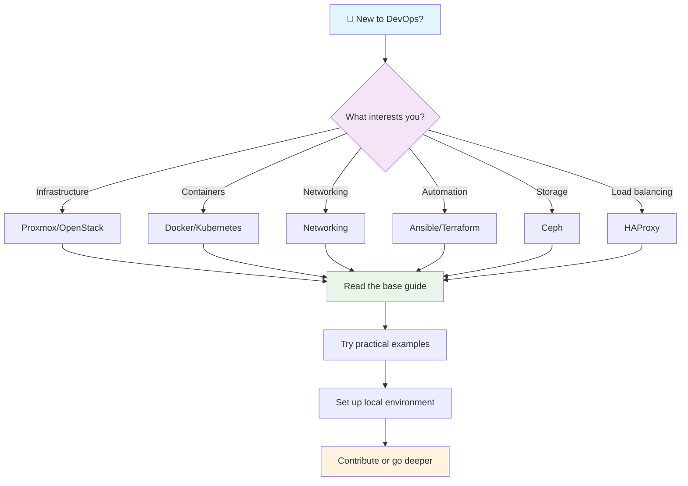

# Getting Started — First Steps in Frikiteam

Welcome to Frikiteam! This guide will help you get oriented and take your first steps in the world of DevOps and infrastructure. Whether you're a complete beginner or coming from another field, here you'll find a visual roadmap and practical examples to get started.

## Visual roadmap: Your path in Frikiteam



### Recommended reading order

1. **Absolute beginners**: Start with Docker → Kubernetes → Networking
2. **From development**: Terraform → Ansible → Docker
3. **From systems**: Proxmox → Ceph → OpenStack
4. **From networking**: Networking → HAProxy → Kubernetes

## Quick guide: Real first steps

### 1. Install Docker (the foundation of everything)

```bash
# Check the installation
docker --version

# If you don't have Docker, install it:
# macOS: brew install docker
# Ubuntu: sudo apt install docker.io
# Windows: Download from docker.com

# Run your first container
docker run hello-world
```

### 2. Create your first containerized application

```bash
# Create a directory for your project
mkdir my-first-app && cd my-first-app

# Create a simple Dockerfile
echo 'FROM nginx:alpine
COPY index.html /usr/share/nginx/html/
EXPOSE 80' > Dockerfile

# Create a basic HTML page
echo '<h1>Hello from Docker!</h1><p>My first containerized app</p>' > index.html

# Build and run
docker build -t my-app .
docker run -p 8080:80 my-app
```

Open <http://localhost:8080> in your browser. Congratulations! You've created your first containerized application.


*Expected view: "Hello World" page served by your Nginx container*

### 3. Explore Kubernetes locally

```bash
# Install minikube or kind to test locally
# macOS: brew install minikube
# Linux: curl -LO https://storage.googleapis.com/minikube/releases/latest/minikube-linux-amd64 && sudo install minikube-linux-amd64 /usr/local/bin/minikube

# Start a local cluster
minikube start

# Deploy a simple app
kubectl create deployment hello-minikube --image=k8s.gcr.io/echoserver:1.4
kubectl expose deployment hello-minikube --type=NodePort --port=8080

# Get the URL
minikube service hello-minikube --url
```

### 4. Automate with Ansible

```bash
# Install Ansible
pip install ansible

# Create a simple inventory
echo '[webservers]
localhost ansible_connection=local' > inventory.ini

# Create a basic playbook
cat > playbook.yml << EOF
---
- hosts: webservers
  tasks:
    - name: Install nginx
      apt:
        name: nginx
        state: present
      become: yes
EOF

# Run the playbook
ansible-playbook -i inventory.ini playbook.yml
```

## Next steps

Once you've completed these first steps:

- **Go deeper** into the technology that interests you most by reading the specific guides
- **Join the community** on our [Discord/GitHub]
- **Contribute** improvements or fixes following `CONTRIBUTING.md`
- **Practice more** with the examples in the documentation sections

## Additional resources

- 📚 [Full documentation](doc/index.md)
- 🛠️ [Quick recipes](doc/recipes.md)
- 🔍 [Glossary](glossary.md)
- 💬 [Community forum](https://github.com/rasty94/Frikiteam-docs/discussions)

---

Need help with a step? Open an issue in our [repository](https://github.com/rasty94/Frikiteam-docs) or join the discussions.
