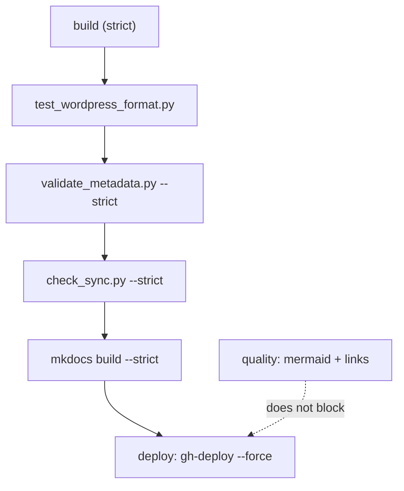

# Repository troubleshooting — when the build breaks

## The problem

It worked locally. You open the PR, the `Build (strict)` job turns red and the output names a file you never touched. Or worse: CI goes green, the site publishes, and the page you just wrote comes out mutilated — a whole code block is missing, while the `.md` in Git is spotless.

Both symptoms share one root cause: between your Markdown and the published HTML there are more machines than it looks. A Jinja2 template engine that reads the file **before** the Markdown parser does, two documentation trees that must move together, three in-house validators under `scripts/` and a strict mode that turns any warning into a failure.

!!! note "What this covers and what it doesn't"
    This page is about failures in **this repository**: MkDocs Material with `i18n`, `macros`, `tags`, `minify`, `social` and `mkdocs-jupyter`. Docker, Kubernetes or Ansible problems live on each technology's own page.

## 📋 Table of Contents

- [What CI runs](#what-ci-runs)
- [Reading strict mode output](#reading-strict-mode-output)
- [Jinja braces in code blocks](#jinja-braces-in-code-blocks)
- [Broken links](#broken-links)
- [The bilingual tree](#the-bilingual-tree)
- [Tags and categories outside the vocabulary](#tags-and-categories-outside-the-vocabulary)
- [The Python environment](#the-python-environment)
- [Mermaid diagrams that do not render](#mermaid-diagrams-that-do-not-render)
- [A page does not show up on the site](#a-page-does-not-show-up-on-the-site)
- [Pages flagged as stale](#pages-flagged-as-stale)
- [Quick diagnosis table](#quick-diagnosis-table)

## What CI runs

The workflow is `.github/workflows/docs-ci.yml` and it has three jobs. Only the first one blocks the deploy.



The order matters when reading a failure: the steps run in sequence and the first one returning a non-zero code cuts the job short. If `validate_metadata.py` fails, `mkdocs build` never even runs — so a PR that went red over a misspelled tag says nothing about the state of the build.

| Job | What it runs | Blocks the deploy? |
|---|---|---|
| `build` | The four steps in the diagram, on Python 3.13 | Yes, `deploy` lists it under `needs` |
| `deploy` | `mkdocs gh-deploy --force` | — (does not run on pull requests) |
| `quality` | `validate_mermaid.sh`, `mkdocs build`, `validate_links.sh site` | No, it just goes red |

Reproducing the whole job locally is four commands:

```bash
python test_wordpress_format.py
python scripts/validate_metadata.py --strict
python scripts/check_sync.py --strict
mkdocs build --strict
```

!!! tip "Git dates are switched off in CI"
    The `git-revision-date-localized` plugin is toggled by the `ENABLE_GIT_DATES` environment variable, and the workflow pins it to `"false"`. With the plugin off, `fallback_to_build_date: true` makes pages fall back to the build date. If you enable it locally (`ENABLE_GIT_DATES=true mkdocs build`) you need the full history: on a shallow clone the plugin finds no commits and warns on every page.

## Reading strict mode output

`mkdocs build` records its problems at three levels: `INFO`, `WARNING` and `ERROR`. Without `--strict` they are all printed and the build still succeeds. With `--strict`, MkDocs counts the `WARNING` lines and aborts at the end:

```text
WARNING -  Doc file 'doc/linux/systemd.md' contains a link 'servicios.md', but the target 'doc/linux/servicios.md' is not found among documentation files.
INFO    -  Doc file 'doc/docker/quadlets.md' contains a link '#healthchecks', but there is no such anchor on this page.
Aborted with 1 warnings in strict mode!
```

Three things people misread in that output:

1. **The abort happens at the end, not on the first warning.** The number in the final message is the total; if it says `3 warnings`, there are three `WARNING` lines scattered across the output, not just the last one you see before the error.
2. **`INFO` lines do not count.** In the example, the broken anchor in `quadlets.md` is a real problem and the build passes anyway. `--strict` never sees it.
3. **The file name is the source of the link**, not the missing target. `doc/linux/systemd.md` is the page you have to edit.

When the warning comes from a plugin, it carries its prefix. The macros one is `[macros]`:

```text
WARNING -  [macros] - ERROR # _Macro Syntax Error_
```

And here is the strict-mode catch: without it that same warning aborts nothing, but the plugin **replaces the page content with the error message** and publishes it. That is exactly what the `quality` job does, running `mkdocs build` without `--strict` so it can validate links afterwards. Which is why `--strict` is not an option for pedants: it is the only thing separating "it published" from "it published correctly".

## Jinja braces in code blocks

This is *the* failure of this repository, and the one that takes longest to find.

The `macros` plugin runs every page through Jinja2 **before** Markdown ever sees it. To Jinja, a code block does not exist: the file is plain text and the three markers it looks for — `{{ }}`, `` and `{# #}` — are interpreted wherever they appear, inside a ```` ```bash ```` fence or outside it.

What it does with each sequence:



| Sequence | What Jinja does | Result |
|---|---|---|
| `${HOME}`, `$1`, `${VAR:-default}` | Nothing: a bare `$` and `{` are not delimiters | Harmless |
| `${#ARRAY[@]}` | `{#` **opens a comment** | Dangerous |
| `{{ variable }}` | Undefined variable; with `on_undefined: keep` (the default) it is left as is | Confusing, does not break |
| `{{ object.field }}` | Attribute of something undefined → `UndefinedError` | Breaks the page |
| `{{ .Values.image.tag }}` (Helm, Go) | Invalid expression → substituted text | Corrupts silently |
| ``, `` (Ansible's Jinja) | Unclosed control block → `TemplateSyntaxError` | Breaks the page |
| `id{{text}}` (Mermaid hexagon node) | Jinja variable | Corrupts the diagram |



### Why it does not always fail

A Jinja comment starts at `{#` and ends at the first `#}`. With `${#SERVICES[@]}` there are two possible outcomes, and the bad one is the one that does **not** raise an error:

- **If no `#}` appears in the rest of the file**, Jinja raises `TemplateSyntaxError: Missing end of comment tag`. Noisy, annoying, easy: you get a warning, and with `--strict` the build dies.
- **If a `#}` shows up further down** — another array, a Python comment, any format string — Jinja treats everything in between as a comment and **deletes it**. No warning, no error, no trace. The build goes green and the published page is cut from the array down to that `#}`, sometimes several sections later.

That second case produces the strange symptom: the source is fine, `git diff` is fine, the PR review is fine, and the page on `docs.frikiteam.es` comes out mutilated. Nobody deleted anything; Jinja ate it.

### How to detect it


```bash
# 1. Building without --strict leaves the error dump inside the published HTML
mkdocs build
grep -rl "Macro Syntax Error" site/
grep -rl "Macro Rendering Error" site/

# 2. Look for unprotected shell array expansions in the source
grep -rn '\${#' docs --include='*.md'

# 3. Compare lengths: if the HTML is far shorter than the Markdown, content is missing
wc -c docs/doc/linux/bash_apis_rest.md site/doc/linux/bash_apis_rest/index.html
```


The second command also finds the occurrences that are already protected (this very page shows up in the list), so the real check is opening each result and seeing whether it sits inside a protected block.

### The fix

Wrap the whole block in `{{ "" }}` and `{{ "" }}`. Jinja leaves everything inside untouched and copies it verbatim to the output:

````markdown
{{ "" }}
```bash
SERVICES=(nginx postgres redis)
echo "Total: ${#SERVICES[@]}"
for i in "${!SERVICES[@]}"; do
  echo "$i -> ${SERVICES[$i]}"
done
```
{{ "" }}
````

Details that matter:

- **The markers go outside the fence, not inside.** Put them between the backticks and they will be printed on the page.
- **Wrap the whole block**, not the offending line. One `raw` per line works, but the next person editing the file will forget.
- **Leave a blank line** between the fence and the markers if the block sits inside a list or an admonition: Markdown needs to see the indentation.
- Outside code blocks the same trick works inline: `{{ ansible_date_time.iso8601 }}` is written with `raw` wrapped around the backticks.

What **not** to do: change the delimiters in `mkdocs.yml`, escape with backslashes (Jinja does not recognise them) or set `render_macros: false` in the frontmatter. The last one works, but it disables macros for the entire page and hides the problem instead of fixing it.

## Broken links

MkDocs validates internal links at build time, at two different levels depending on what is broken:

| What is broken | Level | Breaks `--strict`? |
|---|---|---|
| The target file does not exist | `WARNING` | Yes |
| The `#section` anchor does not exist | `INFO` | No |
| Relative link with no extension or clear target | `INFO` | No |
| Absolute link (`/doc/something.md`) | `INFO` | No |

Which means: a green `mkdocs build --strict` does **not** guarantee the anchors work. The links in the "Table of Contents" block every page carries at the top are anchors, and that is where they break most — an accent or a slash in a heading changes the generated anchor.

```bash
# See the anchor INFO lines too: they show up in the normal output, without --strict
mkdocs build 2>&1 | grep "contains a link"
```

External links are covered by the `quality` job, which runs `linkchecker` over the already built site:

```bash
mkdocs build
./validate_links.sh site
```

The configuration lives in `.linkcheckerrc` and is deliberately permissive: it ignores the `401`, `403` and `404` codes, limits recursion to three levels and does not check anchors. When the job fails it uploads `linkchecker_output.txt` as the `linkchecker-results` artifact. And since the job is not in the deploy's `needs`, a dead external link publishes anyway: you have to watch the red by hand.

## The bilingual tree

Every page under `docs/doc/` has its twin at the same path under `docs/en/doc/`. The `mkdocs-static-i18n` plugin is configured with `docs_structure: folder`, so the `en/` folder is not a page of the site but the complete English tree.

The validator is `scripts/check_sync.py`, and it has exactly one rule: it compares the `updated` frontmatter field of the Spanish twin against the English one.

```bash
python scripts/check_sync.py --strict     # as in CI: exits 1 if anything is out of sync
python scripts/check_sync.py --verbose    # also lists the pages that are up to date
python scripts/check_sync.py --fix        # inserts the "🚧 TRANSLATION PENDING" note in stale EN pages
```

It fails when the ES page's `updated` date is **later** than the EN one, or when the EN page has no `updated` at all. In both cases `--fix` translates nothing: it inserts a visible notice in the English page so the reader knows it is lagging behind.

!!! warning "Its two known limitations"
    **It compares dates, not content.** You can rewrite half a page in Spanish, put the same date on both and pass the validator with the translation untouched. There is an asymmetry warning based on line counts, but it is informational and does not block CI.

    **It only looks one way.** If the English date is more recent than the Spanish one, the script calls it synchronised. And nobody checks `last_reviewed`: keeping it identical on both is a repository convention, not an enforced rule.

It also ignores paths containing `blog` or `index.md`, so section indexes fall outside the check. When you touch a page: edit both, put the same `updated` date on both, and the same `last_reviewed` out of habit.

## Tags and categories outside the vocabulary

`scripts/validate_metadata.py` keeps two closed vocabularies, both defined at the top of the script itself: `TAG_VOCABULARY` (76 tags) and `CATEGORY_VOCABULARY` (15 categories, as Spanish → English pairs).

```bash
python scripts/validate_metadata.py --strict   # the one CI runs
python scripts/validate_metadata.py --report   # stats by category, difficulty and status
```

With `--strict` the output is explicit about which file and which value are the problem:

```text
❌ 1 archivos con tags fuera del vocabulario:
  docs/doc/linux/systemd.md: init-system
   Vocabulario permitido: 76 tags en TAG_VOCABULARY

❌ 1 archivos con problemas de categoría:
  docs/en/doc/linux/systemd.md: categoría 'Linux Systems' debería ser 'Linux' (ES: 'Linux')
```

The category check is cross-tree: it reads the category from the Spanish file, looks up its translation in `CATEGORY_VOCABULARY` and demands that the English twin uses exactly that one. `Contenedores` forces `Containers`; anything else on the English page is a failure even if the value is reasonable.

To add a new value you edit the dictionary in `scripts/validate_metadata.py`. Per `CONTRIBUTING.md`, a new tag is justified by **at least two or three pages using it**; if only one needs it, it is noise. Categories are a separate case: they are added as ES → EN pairs and drive the badge shown in every page header, so treat them as genuinely closed.

!!! note "What is validated and what is not"
    By default the script walks `docs/doc` and `docs/en/doc`. Root-level pages — this one, `quickstart.md`, `glossary.md` — are left out unless you pass the paths by hand with `--docs-path`. A green CI does not mean their tags were ever checked.

## The Python environment

Dependencies live in `requirements.txt` with ranges pinned by major, and CI uses Python 3.13. The local environment, exactly as `CONTRIBUTING.md` describes it:

```bash
python3 -m venv .venv
source .venv/bin/activate
pip install -r requirements.txt
mkdocs serve
```

The most common beginner error is `Config value 'plugins': The 'minify' plugin is not installed`. It almost always means the `mkdocs` being executed is the system one and not the virtual environment's: plugins are installed into `.venv` and the outside binary cannot see them. Check it with `which mkdocs`, which must point at `.venv/bin/mkdocs`. The same applies to `i18n`, `macros` and the rest of the seven plugins declared in `mkdocs.yml`.

The one that fights back at install time is `social`, the plugin generating preview cards: it needs `pillow` and `cairosvg`, which compile against system libraries. CI installs them explicitly before `pip install`:

```bash
# Debian / Ubuntu — the same thing the workflow does
sudo apt-get install -y libjpeg-dev zlib1g-dev libfreetype6-dev

# macOS
brew install cairo freetype libffi
```

If the build complains that it cannot find the Cairo library, the problem is in the system and not in Python: reinstalling the `pip` package will not fix it.

## Mermaid diagrams that do not render

There is no Mermaid plugin installed. Support comes from `pymdownx.superfences`, configured in `mkdocs.yml` with a custom fence turning the blocks marked as `mermaid` into a `<div class="mermaid">`; the JavaScript is loaded by Material once it detects that configuration. Practical consequence: **the HTML is always generated**, even when the diagram is syntactically invalid. A broken diagram is a blank gap on the page, not a build failure.

That is why diagnosis starts in the browser, in the console, where Mermaid leaves the syntax error. And so as not to depend on that, the `quality` job validates the diagrams for real:

```bash
npm install -g @mermaid-js/mermaid-cli
./validate_mermaid.sh
```

The script extracts every `mermaid` block from the files under `docs/` and renders it with `mmdc` into a temporary PNG using `puppeteer-config.json`; if the render fails it prints the error and exits 1. Two important details: **if `mmdc` is not installed, the script validates nothing and exits 0** — a green `./validate_mermaid.sh` may only mean you do not have the tool —, and its extractor is a line-by-line `awk`, not a parser: write the full fence in the middle of a paragraph and it thinks a diagram starts there, ending up validating your prose. Which is why this page never spells it out.

The two syntax failures that show up most here: labels with parentheses, accents or slashes need quotes (`A["Node (1)"]`), and the hexagon node `id{{text}}` uses double braces, which Jinja interprets before Mermaid ever sees them — it has to be protected with `raw` like any other block.

## A page does not show up on the site

If the file exists, the path is right and the page still is not published, check the frontmatter:

```yaml
draft: true
```

`hooks/drafts.py` removes every page with `draft: true` from the site: it is not rendered, it does not enter the search index or the tags index, and its `nav` entry is pruned. This is deliberate. To publish it, drop the field or set it to `false`.

Two consequences worth knowing:

- **It must be declared in both languages or in neither.** `validate_metadata.py --strict` fails when only one carries it, because otherwise half a page gets published and nobody notices.
- **If other pages link to it, the build fails.** `--strict` names every broken link. That is not a hook bug: remove the links too before marking the page as a draft.

## Pages flagged as stale

`scripts/check_freshness.py` lists the pages nobody has touched in too long. It does not run in CI: it is a maintenance tool.

```bash
python scripts/check_freshness.py              # default threshold: 90 days
python scripts/check_freshness.py --days 180
python scripts/check_freshness.py --docs-path docs/en/doc
```

The date it uses is **not** the frontmatter one but the date of the last commit that touched the file, read from `git log`. The reason is written in the script itself: the `updated` field depends on somebody remembering to bump it by hand, and in practice nobody does, so it flagged 100% of the pages as stale. The frontmatter is only used as a fallback for files not committed yet.

And there is a deliberate filter: `git log` runs with `--invert-grep --grep=^chore(meta)`, so that **commits whose message starts with `chore(meta):` do not count**. Renaming tags or normalising categories touches the file without reviewing its content; if they counted, one bulk metadata pass would rejuvenate the whole repository without anyone having read a single line. Hence the rule in `CONTRIBUTING.md`: if the commit only touches frontmatter, use that prefix.

If a page you have just rewritten still shows up as stale, the cause is usually one of two: the change is not committed yet, or you committed it with the `chore(meta):` prefix.

## Quick diagnosis table

| Symptom | Command | What to look at |
|---|---|---|
| `Aborted with N warnings in strict mode!` | `mkdocs build --strict 2>&1 \| grep WARNING` | The N `WARNING` lines, scattered across the output |
| The published page comes out cut short | `grep -rn '\${#' docs --include='*.md'` | An unprotected `{#` that opened a Jinja comment |
| The published page is an error dump | `grep -rl "Macro Syntax Error" site/` | Invalid Jinja; wrap the block in `raw` |
| `Missing end of comment tag` | The line the `[macros]` warning points at | A `${#array[@]}` outside `raw` |
| `The 'minify' plugin is not installed` | `which mkdocs` | Must be `.venv/bin/mkdocs`, not the system one |
| `is not found among documentation files` | The file name in the warning itself | The broken link is on that page, not on the target |
| An anchor that leads nowhere | `mkdocs build 2>&1 \| grep "contains a link"` | `INFO` lines: they do not break `--strict` |
| `ARCHIVOS DESINCRONIZADOS` | `python scripts/check_sync.py --verbose` | ES `updated` later than the EN one |
| `tags fuera del vocabulario` | `python scripts/validate_metadata.py --strict` | `TAG_VOCABULARY` in `scripts/validate_metadata.py` |
| `categoría 'X' debería ser 'Y'` | `python scripts/validate_metadata.py --strict` | The ES → EN pair in `CATEGORY_VOCABULARY` |
| A diagram shows up as a blank gap | Browser console, or `./validate_mermaid.sh` | Unquoted labels, or `{{ }}` without `raw` |
| `validate_mermaid.sh` passes when it should not | `command -v mmdc` | Without `mmdc` the script validates nothing and exits 0 |
| A page you just wrote shows as stale | `git log --format=%cs -1 -- docs/path.md` | Not committed, or committed as `chore(meta):` |
| Git dates missing or wrong | `ENABLE_GIT_DATES=true mkdocs build` | Off in CI; locally it needs the full history |
