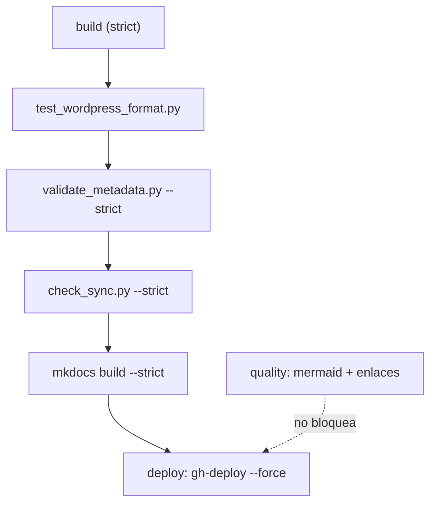

# Troubleshooting del repositorio — cuando el build se rompe

## El problema

En local iba bien. Abres el PR, el job `Build (strict)` se pone en rojo y la salida menciona un fichero que no has tocado. O peor: la CI pasa en verde, el sitio se publica, y la página que acabas de escribir sale mutilada — falta un bloque de código entero, mientras que el `.md` en Git está impecable.

Los dos síntomas tienen la misma raíz: entre tu Markdown y el HTML publicado hay más máquinas de las que parece. Un motor de plantillas Jinja2 que lee el fichero **antes** que el parser de Markdown, dos árboles de documentación que deben ir a la par, tres validadores propios en `scripts/` y un modo estricto que convierte cualquier aviso en un fallo.

!!! note "Qué cubre y qué no"
    Esta página trata los fallos de **este repositorio**: MkDocs Material con `i18n`, `macros`, `tags`, `minify`, `social` y `mkdocs-jupyter`. Los problemas de Docker, Kubernetes o Ansible viven en la página de cada tecnología.

## 📋 Tabla de Contenidos

- [Qué ejecuta la CI](#que-ejecuta-la-ci)
- [Leer la salida del modo estricto](#leer-la-salida-del-modo-estricto)
- [Llaves de Jinja en bloques de código](#llaves-de-jinja-en-bloques-de-codigo)
- [Enlaces rotos](#enlaces-rotos)
- [El árbol bilingüe](#el-arbol-bilingue)
- [Tags y categorías fuera del vocabulario](#tags-y-categorias-fuera-del-vocabulario)
- [El entorno de Python](#el-entorno-de-python)
- [Diagramas Mermaid que no renderizan](#diagramas-mermaid-que-no-renderizan)
- [Páginas que salen como obsoletas](#paginas-que-salen-como-obsoletas)
- [Tabla de diagnóstico rápido](#tabla-de-diagnostico-rapido)

## Qué ejecuta la CI

El workflow es `.github/workflows/docs-ci.yml` y tiene tres jobs. Solo el primero bloquea el despliegue.



El orden importa para leer el fallo: los pasos van en secuencia y el primero que devuelve un código distinto de cero corta el job. Si `validate_metadata.py` falla, `mkdocs build` ni siquiera llega a ejecutarse — así que un PR rojo por un tag mal escrito no dice nada sobre el estado del build.

| Job | Qué ejecuta | ¿Bloquea el deploy? |
|---|---|---|
| `build` | Los cuatro pasos del diagrama, con Python 3.13 | Sí, el `deploy` lo tiene en `needs` |
| `deploy` | `mkdocs gh-deploy --force` | — (no corre en pull requests) |
| `quality` | `validate_mermaid.sh`, `mkdocs build`, `validate_links.sh site` | No, avisa en rojo y ya |

Reproducir el job completo en local son cuatro comandos:

```bash
python test_wordpress_format.py
python scripts/validate_metadata.py --strict
python scripts/check_sync.py --strict
mkdocs build --strict
```

!!! tip "Las fechas de Git están apagadas en CI"
    El plugin `git-revision-date-localized` se activa con la variable de entorno `ENABLE_GIT_DATES`, y el workflow la fija a `"false"`. Con el plugin apagado, `fallback_to_build_date: true` hace que las páginas usen la fecha de compilación. Si lo activas en local (`ENABLE_GIT_DATES=true mkdocs build`) necesitas el historial completo: sobre un clon superficial el plugin no encuentra commits y avisa por cada página.

## Leer la salida del modo estricto

`mkdocs build` registra sus problemas en tres niveles: `INFO`, `WARNING` y `ERROR`. Sin `--strict`, todos se imprimen y el build termina en éxito igualmente. Con `--strict`, MkDocs cuenta los `WARNING` y aborta al final:

```text
WARNING -  Doc file 'doc/linux/systemd.md' contains a link 'servicios.md', but the target 'doc/linux/servicios.md' is not found among documentation files.
INFO    -  Doc file 'doc/docker/quadlets.md' contains a link '#healthchecks', but there is no such anchor on this page.
Aborted with 1 warnings in strict mode!
```

Tres cosas que se leen mal en esa salida:

1. **El aborto es al final, no en el primer aviso.** El número del mensaje final es el total; si dice `3 warnings`, hay tres líneas `WARNING` repartidas por toda la salida, no solo la última que ves antes del error.
2. **Las líneas `INFO` no cuentan.** En el ejemplo, el ancla rota de `quadlets.md` es un problema real y el build pasa igual. `--strict` no la ve.
3. **El nombre del fichero es el de origen del enlace**, no el del destino que falta. `doc/linux/systemd.md` es la página que hay que editar.

Cuando el aviso viene de un plugin, lleva su prefijo. El de macros es `[macros]`:

```text
WARNING -  [macros] - ERROR # _Macro Syntax Error_
```

Y aquí está la trampa del modo estricto: sin él ese mismo aviso no aborta nada, pero el plugin **sustituye el contenido de la página por el mensaje de error** y lo publica. Es exactamente lo que hace el job `quality`, que ejecuta `mkdocs build` sin `--strict` para poder validar enlaces después. Por eso `--strict` no es una opción para pedantes: es lo único que distingue "se publicó" de "se publicó bien".

## Llaves de Jinja en bloques de código

Este es *el* fallo de este repositorio, y el que más tiempo cuesta encontrar.

El plugin `macros` pasa cada página por Jinja2 **antes** de que Markdown la vea. Para Jinja, un bloque de código no existe: el fichero es texto plano y las tres marcas que busca — `{{ }}`, `` y `{# #}` — se interpretan estén donde estén, dentro de un ```` ```bash ```` o fuera de él.

Lo que hace con cada secuencia:



| Secuencia | Qué hace Jinja | Resultado |
|---|---|---|
| `${HOME}`, `$1`, `${VAR:-default}` | Nada: `$` y `{` sueltos no son delimitadores | Inofensivo |
| `${#ARRAY[@]}` | `{#` **abre un comentario** | Peligroso |
| `{{ variable }}` | Variable indefinida; con `on_undefined: keep` (el valor por defecto) la deja tal cual | Confuso, no rompe |
| `{{ objeto.campo }}` | Atributo de algo indefinido → `UndefinedError` | Rompe la página |
| `{{ .Values.image.tag }}` (Helm, Go) | Expresión inválida → texto sustituido | Corrompe en silencio |
| ``, `` (Jinja de Ansible) | Bloque de control sin cerrar → `TemplateSyntaxError` | Rompe la página |
| `id{{texto}}` (nodo hexagonal de Mermaid) | Variable Jinja | Corrompe el diagrama |



### Por qué a veces no falla

Un comentario de Jinja empieza en `{#` y termina en el primer `#}`. Con `${#SERVICIOS[@]}` hay dos desenlaces posibles, y el malo es el que **no** da error:

- **Si no aparece ningún `#}` en el resto del fichero**, Jinja lanza `TemplateSyntaxError: Missing end of comment tag`. Ruidoso, molesto, fácil: sale un aviso, y con `--strict` el build muere.
- **Si más adelante hay un `#}`** — otro array, un comentario de Python, una cadena de formato cualquiera — Jinja considera todo lo que hay en medio un comentario y **lo borra**. Sin aviso, sin error, sin rastro. El build pasa en verde y la página publicada aparece cortada desde el array hasta ese `#}`, a veces varias secciones más abajo.

Ese segundo caso es el que produce el síntoma raro: el fuente está bien, `git diff` está bien, la revisión del PR está bien, y la página en `docs.frikiteam.es` sale mutilada. Nadie ha borrado nada; Jinja se lo ha comido.

### Cómo detectarlo


```bash
# 1. Construir sin --strict deja el volcado de error dentro del HTML publicado
mkdocs build
grep -rl "Macro Syntax Error" site/
grep -rl "Macro Rendering Error" site/

# 2. Buscar expansiones de array de shell sin proteger en el fuente
grep -rn '\${#' docs --include='*.md'

# 3. Comparar longitudes: si el HTML es mucho más corto que el Markdown, falta contenido
wc -c docs/doc/linux/bash_apis_rest.md site/doc/linux/bash_apis_rest/index.html
```


El segundo comando también encuentra las apariciones ya protegidas (esta misma página sale en la lista), así que la comprobación real es abrir cada resultado y ver si está dentro de un bloque protegido.

### La solución

Envolver el bloque entero en `{{ "" }}` y `{{ "" }}`. Jinja no toca nada de lo que hay dentro y lo copia literal a la salida:

````markdown
{{ "" }}
```bash
SERVICIOS=(nginx postgres redis)
echo "Total: ${#SERVICIOS[@]}"
for i in "${!SERVICIOS[@]}"; do
  echo "$i -> ${SERVICIOS[$i]}"
done
```
{{ "" }}
````

Detalles que importan:

- **Las marcas van fuera del cercado, no dentro.** Si las metes entre las comillas invertidas aparecerán impresas en la página.
- **Envuelve el bloque completo**, no la línea problemática. Un `raw` por línea funciona, pero al siguiente que edite el fichero se le olvidará.
- **Deja una línea en blanco** entre el cercado y las marcas si el bloque va dentro de una lista o una admonición: Markdown necesita ver la indentación.
- Fuera de los bloques de código el mismo truco vale en línea: `{{ ansible_date_time.iso8601 }}` está escrito con `raw` alrededor de las comillas invertidas.

Lo que **no** hay que hacer: cambiar los delimitadores en `mkdocs.yml`, escapar con barras invertidas (Jinja no las reconoce) o poner `render_macros: false` en el frontmatter. Lo último funciona, pero apaga las macros de la página entera y esconde el problema en lugar de resolverlo.

## Enlaces rotos

MkDocs valida los enlaces internos al construir, con dos niveles distintos según lo que falle:

| Qué está roto | Nivel | ¿Rompe `--strict`? |
|---|---|---|
| El fichero destino no existe | `WARNING` | Sí |
| El ancla `#seccion` no existe | `INFO` | No |
| Enlace relativo sin extensión ni destino claro | `INFO` | No |
| Enlace absoluto (`/doc/algo.md`) | `INFO` | No |

Es decir: `mkdocs build --strict` en verde **no** garantiza que las anclas funcionen. Los enlaces del bloque "Tabla de Contenidos" que todas las páginas llevan arriba son anclas, y ahí es donde más se rompen — un acento o una barra en un encabezado cambian el ancla generada.

```bash
# Ver también los INFO de anclas: aparecen en la salida normal, sin --strict
mkdocs build 2>&1 | grep "contains a link"
```

Para los enlaces externos está el job `quality`, que ejecuta `linkchecker` sobre el sitio ya construido:

```bash
mkdocs build
./validate_links.sh site
```

La configuración vive en `.linkcheckerrc` y es deliberadamente permisiva: ignora los códigos `401`, `403` y `404`, limita la recursión a tres niveles y no comprueba anclas. Cuando el job falla, sube `linkchecker_output.txt` como artefacto `linkchecker-results`. Y como el job no está en el `needs` del deploy, un enlace externo muerto se publica igual: hay que mirar el rojo a mano.

## El árbol bilingüe

Cada página de `docs/doc/` tiene su gemela en la misma ruta bajo `docs/en/doc/`. El plugin `mkdocs-static-i18n` está configurado con `docs_structure: folder`, así que la carpeta `en/` no es una página del sitio sino el árbol completo en inglés.

El validador es `scripts/check_sync.py`, y su regla es una sola: compara el campo `updated` del frontmatter de la gemela española con el de la inglesa.

```bash
python scripts/check_sync.py --strict     # como en CI: sale 1 si algo está desincronizado
python scripts/check_sync.py --verbose    # lista también las páginas al día
python scripts/check_sync.py --fix        # inserta la nota "🚧 TRANSLATION PENDING" en las EN atrasadas
```

Falla cuando la fecha `updated` de la página ES es **posterior** a la de la EN, o cuando la EN no tiene `updated`. En ambos casos, `--fix` no traduce nada: inserta un aviso visible en la página inglesa para que el lector sepa que va con retraso.

!!! warning "Sus dos limitaciones conocidas"
    **Compara fechas, no contenido.** Puedes reescribir media página en español, poner la misma fecha en las dos y pasar el validador con la traducción intacta. Existe un aviso de asimetría por número de líneas, pero es informativo y no bloquea la CI.

    **Solo mira en un sentido.** Si la fecha inglesa es más reciente que la española, el script lo da por sincronizado. Y `last_reviewed` no lo comprueba nadie: mantenerlo igual en ambas es convención del repositorio, no una regla verificada.

Además ignora las rutas que contienen `blog` o `index.md`, así que los índices de sección quedan fuera de la comprobación. Al tocar una página: edita las dos, pon la misma fecha `updated` en las dos, y el mismo `last_reviewed` por costumbre.

## Tags y categorías fuera del vocabulario

`scripts/validate_metadata.py` mantiene dos vocabularios cerrados, ambos definidos en la cabecera del propio script: `TAG_VOCABULARY` (76 tags) y `CATEGORY_VOCABULARY` (15 categorías, en pares español → inglés).

```bash
python scripts/validate_metadata.py --strict   # el que corre la CI
python scripts/validate_metadata.py --report   # estadísticas por categoría, dificultad y estado
```

Con `--strict` la salida es explícita sobre qué fichero y qué valor sobran:

```text
❌ 1 archivos con tags fuera del vocabulario:
  docs/doc/linux/systemd.md: init-system
   Vocabulario permitido: 76 tags en TAG_VOCABULARY

❌ 1 archivos con problemas de categoría:
  docs/en/doc/linux/systemd.md: categoría 'Linux Systems' debería ser 'Linux' (ES: 'Linux')
```

La comprobación de categorías es cruzada: lee la categoría del fichero español, busca su traducción en `CATEGORY_VOCABULARY` y exige que la gemela inglesa use exactamente esa. `Contenedores` obliga a `Containers`; cualquier otra cosa en la página inglesa es un fallo aunque el valor sea razonable.

Para añadir un valor nuevo hay que editar el diccionario en `scripts/validate_metadata.py`. Según `CONTRIBUTING.md`, un tag nuevo se justifica con **al menos dos o tres páginas que lo usen**; si solo lo necesita una, es que sobra. Las categorías son un caso aparte: se añaden en pares ES → EN y afectan al badge que aparece en la cabecera de cada página, así que conviene tratarlas como cerradas de verdad.

!!! note "Qué se valida y qué no"
    Por defecto el script recorre `docs/doc` y `docs/en/doc`. Las páginas de la raíz —esta misma, `quickstart.md`, `glossary.md`— quedan fuera salvo que pases las rutas a mano con `--docs-path`. Que la CI pase en verde no significa que sus tags estén revisados.

## El entorno de Python

Las dependencias están en `requirements.txt` con rangos fijados por major, y la CI usa Python 3.13. El entorno local, tal como lo describe `CONTRIBUTING.md`:

```bash
python3 -m venv .venv
source .venv/bin/activate
pip install -r requirements.txt
mkdocs serve
```

El error más habitual al empezar es `Config value 'plugins': The 'minify' plugin is not installed`. Casi siempre significa que el `mkdocs` que se está ejecutando es el del sistema y no el del entorno virtual: los plugins se instalan en `.venv` y el binario de fuera no los ve. Se comprueba con `which mkdocs`, que debe apuntar a `.venv/bin/mkdocs`. Lo mismo aplica a `i18n`, `macros` y el resto de los siete plugins declarados en `mkdocs.yml`.

El que da guerra al instalar es `social`, el que genera las tarjetas de vista previa: necesita `pillow` y `cairosvg`, que compilan contra librerías del sistema. La CI las instala explícitamente antes de `pip install`:

```bash
# Debian / Ubuntu — lo mismo que hace el workflow
sudo apt-get install -y libjpeg-dev zlib1g-dev libfreetype6-dev

# macOS
brew install cairo freetype libffi
```

Si el build se queja de que no encuentra la librería de Cairo, el problema es del sistema, no de Python: reinstalar el paquete de `pip` no lo arregla.

## Diagramas Mermaid que no renderizan

No hay ningún plugin de Mermaid instalado. El soporte sale de `pymdownx.superfences`, configurado en `mkdocs.yml` con un cercado personalizado que convierte los bloques marcados como `mermaid` en un `<div class="mermaid">`; el JavaScript lo carga Material al detectar esa configuración. Consecuencia práctica: **el HTML se genera siempre**, aunque el diagrama sea sintácticamente inválido. Un diagrama roto es un hueco en blanco en la página, no un fallo de build.

Por eso el diagnóstico empieza en el navegador, en la consola, donde Mermaid deja el error de sintaxis. Y para no depender de eso, el job `quality` valida los diagramas de verdad:

```bash
npm install -g @mermaid-js/mermaid-cli
./validate_mermaid.sh
```

El script extrae cada bloque `mermaid` de los ficheros bajo `docs/` y lo renderiza con `mmdc` a un PNG temporal usando `puppeteer-config.json`; si el render falla, imprime el error y sale con 1. Dos detalles importantes: **si `mmdc` no está instalado, el script no valida nada y sale con 0** — un `./validate_mermaid.sh` en verde puede significar solo que no tienes la herramienta —, y su extractor es un `awk` línea a línea, no un parser: si escribes el cercado completo en medio de un párrafo, se cree que empieza un diagrama y acaba validando tu prosa. Por eso esta página nunca lo escribe entero.

Los dos fallos de sintaxis que más aparecen aquí: las etiquetas con paréntesis, acentos o barras necesitan comillas (`A["Node (1)"]`), y el nodo hexagonal `id{{texto}}` lleva llaves dobles, que Jinja interpreta antes de que Mermaid las vea — hay que protegerlo con `raw` como cualquier otro bloque.

## Páginas que salen como obsoletas

`scripts/check_freshness.py` lista las páginas que llevan demasiado tiempo sin tocarse. No corre en CI: es una herramienta de mantenimiento.

```bash
python scripts/check_freshness.py              # umbral por defecto: 90 días
python scripts/check_freshness.py --days 180
python scripts/check_freshness.py --docs-path docs/en/doc
```

La fecha que usa **no** es la del frontmatter, sino la del último commit que tocó el fichero, leída de `git log`. El motivo está escrito en el propio script: el campo `updated` depende de que alguien se acuerde de subirlo a mano y en la práctica nadie lo hace, así que marcaba el 100% de las páginas como obsoletas. El frontmatter solo se usa como respaldo para ficheros aún sin commitear.

Y hay un filtro deliberado: el `git log` se ejecuta con `--invert-grep --grep=^chore(meta)`, de modo que **los commits cuyo mensaje empieza por `chore(meta):` no cuentan**. Renumerar tags o normalizar categorías toca el fichero sin revisar su contenido; si contaran, una pasada masiva de metadatos rejuvenecería el repositorio entero sin que nadie hubiera leído una línea. De ahí la regla de `CONTRIBUTING.md`: si el commit solo toca frontmatter, usa ese prefijo.

Si una página que acabas de reescribir sigue apareciendo como obsoleta, la causa suele ser una de dos: el cambio aún no está commiteado, o lo commiteaste con prefijo `chore(meta):`.

## Tabla de diagnóstico rápido

| Síntoma | Comando | Qué mirar |
|---|---|---|
| `Aborted with N warnings in strict mode!` | `mkdocs build --strict 2>&1 \| grep WARNING` | Las N líneas `WARNING`, repartidas por toda la salida |
| La página publicada sale cortada | `grep -rn '\${#' docs --include='*.md'` | Un `{#` sin proteger que abrió un comentario de Jinja |
| La página publicada es un volcado de error | `grep -rl "Macro Syntax Error" site/` | Jinja inválido; envolver el bloque en `raw` |
| `Missing end of comment tag` | La línea que indica el aviso `[macros]` | Un `${#array[@]}` fuera de `raw` |
| `The 'minify' plugin is not installed` | `which mkdocs` | Debe ser `.venv/bin/mkdocs`, no el del sistema |
| `is not found among documentation files` | El nombre de fichero del propio aviso | El enlace roto está en esa página, no en el destino |
| Un ancla que no lleva a ningún sitio | `mkdocs build 2>&1 \| grep "contains a link"` | Líneas `INFO`: no rompen `--strict` |
| `ARCHIVOS DESINCRONIZADOS` | `python scripts/check_sync.py --verbose` | `updated` de la ES posterior al de la EN |
| `tags fuera del vocabulario` | `python scripts/validate_metadata.py --strict` | `TAG_VOCABULARY` en `scripts/validate_metadata.py` |
| `categoría 'X' debería ser 'Y'` | `python scripts/validate_metadata.py --strict` | El par ES → EN de `CATEGORY_VOCABULARY` |
| Un diagrama sale como hueco en blanco | Consola del navegador, o `./validate_mermaid.sh` | Etiquetas sin comillar, o `{{ }}` sin `raw` |
| `validate_mermaid.sh` pasa y no debería | `command -v mmdc` | Sin `mmdc` el script no valida nada y sale con 0 |
| Una página recién escrita sale obsoleta | `git log --format=%cs -1 -- docs/ruta.md` | Sin commitear, o commiteada como `chore(meta):` |
| Fechas de Git ausentes o mal | `ENABLE_GIT_DATES=true mkdocs build` | En CI va apagado; en local exige historial completo |
